#+hugo_base_dir: ../
#+hugo_level_offset: 1
#+seq_todo: TODO DONE
#+startup: indent
#+hugo_weight: auto
#+hugo_auto_set_lastmod: t
#+hugo_paired_shortcodes: admonition
#+hugo_front_matter_key_replace: description>featuredImage
#+author:
#+hugo_custom_front_matter: :author "Matt Maguire"
#+filetags: @Blog

* Content
** AI Agents: From Lessons to Unit Planning
*** TODO From Lessons to Unit Planning
:PROPERTIES:
:EXPORT_HUGO_WEIGHT: 4001
:CUSTOM_ID: unit-planning
:EXPORT_FILE_NAME: index
:EXPORT_HUGO_BUNDLE: 20260824-unit-planning
:EXPORT_DATE: 2026-08-24
:EXPORT_HUGO_MENU:
:EXPORT_DESCRIPTION: 20260824-unit-planning.png
:END:

**** Introduction: Moving from Micro to Macro
***** The Limitation of Isolated Lesson Prep
- Single-lesson generation solves daily grunt work, but teaching requires long-term coherence across a 4–6 week unit.
- Cognitive overhead: Balancing scope & sequence, textbook exercises, syllabus outcomes, and calendar constraints.
***** Objective for Part 3
- Elevating the local Goose / Gemma (and Claude) agent workflow from drafting single lessons to architecting entire units.
- Leveraging agentic workflows for top-down sequencing, syllabus compliance auditing, differentiated material creation, and assessment design.

**** Ingesting the Foundation: Syllabus, Program, and Textbook
***** Feeding Multi-Modal Reference Material
- Staging syllabus outcomes, stage statements, and school scope-and-sequence documents.
- Ingesting full textbook chapters using the ~pdftopbm~ OCR/image pipeline from Part 2.
***** Generating the Unit Roadmap
- Structuring an $N$-lesson unit trajectory:
  - Concept introduction & diagnostic checks.
  - Explicit instruction & modeled examples.
  - Guided practice and consolidation.
  - Revision, application, and summative review.
- Structuring the agent output: A clear, sequential unit timeline matrix.

**** Automated Syllabus Gap Analysis
***** The Cross-Referencing Audit Loop
- Prompting the agent to audit the draft unit against exact syllabus dot points:
  #+BEGIN_QUOTE
  "Compare our 12 proposed lesson plans against Syllabus Outcome [X]. Identify any omitted sub-topics, unaddressed terminology, or missing question archetypes."
  #+END_QUOTE
***** Uncovering Common Blind Spots
- Catching subtle omissions: Edge-case problem types, specific reasoning/proof requirements, or prerequisite skills.
***** Producing the Coverage Report
- Generating a Markdown/Org table showing each syllabus requirement mapped to specific lessons and activities before writing the LaTeX notes.

**** Differentiated Resource Generation
***** The Three-Tier Scaffolding Model
- Transforming a single core mathematical concept into three leveled variations:
  - *Foundation / Support:* Step-by-step scaffolds, simplified arithmetic, worked templates, and visual hints.
  - *Core / Standard:* Standard syllabus problems, application questions, and routine multi-step calculations.
  - *Extension:* Unscaffolded multi-step proofs, non-routine modeling, and challenging unfamiliar contexts.
***** Diagrammatic Differentiation with TikZ
- Maintaining visual consistency: Modifying TikZ geometric/statistical figures across tiers (e.g., adding angle hints/auxiliary lines for support vs. stripped diagrams for extension).

**** Assessment Task & Marking Guide Development
***** Designing Balanced Assessment Tasks
- Constructing diagnostic quizzes and end-of-unit summative tasks mapped to taxonomy levels (Fluency, Understanding, Reasoning, and Problem Solving).
***** Automated Solution Keys and Rubrics
- Emitting complete, fully worked LaTeX solutions alongside question papers.
- Generating explicit marking schemes: Allocating method marks ($M$), answer marks ($A$), notation criteria, and notes on common student misconceptions.

**** Automated Math Verification & Tool Integration
***** Sanity-Checking Solutions via Python / SymPy
- Utilizing the agent's tool execution to pipe generated questions through SymPy/Python.
- Ensuring arithmetic, integration/differentiation, and algebraic simplifications are algebraically verified prior to ~latexmk~ compilation.
***** Batch LaTeX Pipeline
- Automating the compilation of teacher notes, student handouts, differentiated worksheets, and assessment files in one agentic loop.

**** Conclusion and What's Next
***** The Shift in Teaching Workflow
- Moving from administrative content assembly to high-level instructional design, freeing up energy for active classroom pedagogy.
***** Next Steps / Teaser
- Future explorations: Developing custom Model Context Protocol (MCP) servers, interactive classroom visualizers, or student feedback loops.
  
** AI Agents and Local LLMs
*** TODO My AI Teaching Setup, Part 5: Tuning an 8 GB Card :AI:Hardware:Teaching:
:PROPERTIES:
:EXPORT_HUGO_WEIGHT: 4001
:CUSTOM_ID: ai-setup-5
:EXPORT_FILE_NAME: index
:EXPORT_HUGO_BUNDLE: 20261122-ai-setup-5-tuning-an-8gb-card
:EXPORT_DATE: 2026-11-22
:EXPORT_HUGO_MENU:
:EXPORT_DESCRIPTION:
:END:

There is a particular kind of trouble that starts with a reasonable question. I asked my AI assistant why the graphics card in one of my desktops was only 69% full, when I had deliberately squeezed a 19.8 GB model onto an 8 GB card and expected it to be tight. The answer came back fast and tidy: that is the ceiling, the expert layers live in system RAM, nothing more can fit. It was wrong, and it took me pushing back twice before the real answer showed up. The temptation with an assistant is to switch your brain off, because the answers arrive so easily. This story is an argument that the opposite is what pays: critical thinking becomes more important, not less, when the typing is someone else's job.

**** The machine and the model

The box is the one I called /msi/ in [[#ai-setup-2][Part 2]]: an i9-10900K with 64 GB of 2020-era DDR4, an RTX 2080 SUPER with 8 GB of VRAM, running day and night as the house gateway. The model is Qwen3.6-35B-A3B, a community build, quantised down to 19.8 GB on disk. It carries 35 billion parameters, but only about three billion of them take part in generating any one token. That gap is the whole trick, and it is what makes an 8 GB card worth arguing about.

The architecture is a mixture of experts. Each of the model's 40 layers carries 256 small feed-forward networks, the experts, and a router picks 8 of them per token. The shared parts of the model, the attention layers and embeddings, are small: about 2.6 GB. The experts are the bulk: about 17 GB. So llama.cpp splits them by location. The shared path lives on the graphics card; all 10,240 experts sit in system RAM, and for each token the CPU reads the eight chosen experts per layer across the memory bus. The 64 GB of RAM holds the expert weights with room to spare. The card holds the shared path and the context bookkeeping.

This is not new territory for the blog. The first mixture-of-experts model on this same card was the Qwen3-30B-A3B bridge I mentioned in [[#gemma-goose][AI Agents and Local LLMs]]. What is new is that this time I tried to tune it properly, and the tuning went somewhere I did not expect.

**** The measurement that measured the wrong thing

Before changing anything I wanted a baseline, so I wrote a small benchmark: ask the model to list the first 500 Fibonacci numbers, time it, divide. The script ran on the same machine as the model. It reported about 20 tokens per second, and a sweep over CPU thread counts seemed to show that 8 threads beat 10, and that 12 and 20 threads were much worse.

Then the benchmark client moved to a different machine and the number jumped to 36.7. The old numbers had been the sound of the measurement fighting the thing measured. The model is pinned to CPU cores 0 through 9, and my benchmark script, a python process and a curl, was competing for those same cores. Every thread-count conclusion from that era was noise. Measured cleanly, 8 threads versus 10 came out 36.75 against 36.62, a coin flip. The real ceiling was the DDR4 memory bandwidth, and no number of threads was ever going to move it.

Lesson one, learned the expensive way: get the observer off the machine you are measuring.

**** "That is the ceiling"

With the baseline honest, I asked the assistant to try putting some experts on the GPU instead of all in RAM, and watched the VRAM number to see what happened. It did not move at all. I tried a different value of the same setting. Still nothing.

That flat number is the whole reason for the pushback, and it is worth spelling out how it works, because it generalises to any work you do with these assistants. A change that moves weights onto the card has to move the memory number. When it does not, one of two things is true: there is a sound explanation for why the change cannot matter, or the change is not actually taking effect. Both are checkable, and neither is acceptable to skip. So my second question carried an ultimatum: either explain why the memory utilisation did not go up, or go and find out whether the setting was doing anything at all. A change that produces no observable effect is a fault report, and I treated it as one.

The first answer I got was the confident one quoted at the top, and it dodged the ultimatum quietly: it was the assistant answering from experience with models of this shape rather than from my particular file. Fair enough: nothing in my question told it to check the file. The fix was to ask something better. Pointed at the model's own header, the same assistant produced the ground truth in one pass: the model has 40 layers. The setting I had been tuning takes a layer count, and any value above 40 means exactly the same thing. My careful sweep of settings had been comparing identical configurations. Nothing had actually been tried, and the ceiling was a misread flag.

Once the real numbers were on the table the arithmetic was easy. Each layer's experts weigh about 428 MB at this quantisation, and the card had about 2.5 GB free. Five layers fit.

**** Five layers on the GPU

One flag change later: ~-ncmoe 35~, meaning keep 35 layers' experts in RAM and put the other five on the card. VRAM went from 5640 to 7768 MiB, 94.8% full. Throughput went from 36.75 to 38.1 tokens per second. Three and a half percent, modest, real, and free.

One more lever was available and did not survive contact with the machine. The server log suggests a flag that loads the model into plain RAM instead of memory-mapping the file. With that flag the card's footprint grows slightly, and the margin it eats is exactly the margin the five expert layers needed. The first real request ran the server out of memory and it crash-looped until I reverted. The log's suggestion is written for machines where RAM is the tight resource. Mine is not.

**** The 95% I remembered

After the change I noticed the GPU utilisation gauge sitting at 30 to 40% while the model generated text, where I remembered it sitting near 95%. That bothered me for exactly as long as it took to measure both configurations with the same sampler: 26% with all experts in RAM, 32% with five on the card. The gauge had gone /up/ with my tuning. The 95% I remembered was real, but it belonged to a different phase of the work.

Reading a prompt is batched matrix math, hundreds of tokens per kernel launch, and it pegs the card at 90 to 95%. Generating an answer is one token at a time: the GPU computes for about nine milliseconds, waits about eighteen for the CPU to fetch experts across the memory bus, and repeats. A half-idle card during generation is what this machine looks like when the bottleneck is the RAM bus rather than the silicon. The utilisation gauge measures how often a kernel is running, not how fast answers arrive. Tokens per second is the only number worth watching.

**** What I would tell myself

| Mistake | What it cost | What fixed it |
|-------------------------------|------------|--------------------------|
| Benchmark client on the test box | ~45% of the measured speed | Run the client elsewhere |
| Letting a no-op change pass | A false ceiling, unnoticed | Treat "nothing moved" as a fault report |
| Tuning a flag past the layer count | An afternoon | Read the model file header |
| Believing a confident first answer | The above, twice | Ask again, with the numbers |
| Trusting the utilisation gauge | Worry, nothing | Watch tokens per second |

The last row of that table is the one about the assistant, and I want to frame it fairly. The wrong answer was fluent, specific, and shaped exactly like a right answer, because the assistant was answering from experience with models of this shape. That is the fast, cheap first draft that makes the whole working relationship worth having. What it needs from me is scorekeeping. I noticed that a setting I had changed had not moved the number it was supposed to move, and I asked again with that observation attached. The assistant took the pushback without friction, went and read the file, handed back the correction, and then did the arithmetic, ran the experiment, and measured the result. Getting a good answer out of these models is mostly a skill with questions: point them at the ground truth, keep track of which numbers moved, and treat the first answer as a draft worth testing. The models are genuinely good at this work. The human gets the most out of them by staying in the loop with receipts. That is the key message, and it is the opposite of the fear these models usually inspire. The assistant takes over the typing and the tool-running, and that is exactly why the human has to keep doing the judging: deciding which answers deserve to be believed, and asking for the receipts. Switching your brain off is the one move that wastes the whole arrangement.

The card is now genuinely full at 94.8%, the model answers at about 38 tokens a second with a 192,000-token context window, and the next real gain will come from faster memory rather than from any flag. The 2080 SUPER keeps its job for now. It has earned it. And the method it taught me, ask, check the numbers, ask again, has turned out to be the best deal in the whole setup, assistant included.
*** TODO My AI Teaching Setup, Part 4: The 108-Gigabyte Gamble :AI:LaTeX:Hardware:Teaching:
:PROPERTIES:
:EXPORT_HUGO_WEIGHT: 4001
:CUSTOM_ID: ai-setup-4
:EXPORT_FILE_NAME: index
:EXPORT_HUGO_BUNDLE: 20261121-ai-setup-4-the-gamble
:EXPORT_DATE: 2026-11-21
:EXPORT_HUGO_MENU:
:EXPORT_DESCRIPTION:
:END:

Parts [[#ai-setup-2][two]] and [[#ai-setup-3][three]] of this series were about the tidy part: the fleet, the resident model, and the knowledge base working the way the architecture diagrams promised. This is the part where I try something ambitious on a Saturday and spend the day watching my own assumptions lose an argument with physics. In a build log, the experiments that fail are usually the ones worth keeping.

-----

**** What already worked

Before the gamble, it helps to remember what the fleet was already doing without breaking a sweat. [[#ai-setup-3][Part 3]] covered Strata in detail --- the Qwen-Next-style MoE living on ~hyperion~ and answering at about 250 tokens per second, vision included --- so here is the short version of /why/ it runs that fast.

Strata is a mixture-of-experts model: 24,576 small specialist sub-networks, with only a handful firing for any given token. The trick was tiering it deliberately on one machine. The hottest 10,720 experts, picked from the model's own routing-frequency profile, get pinned into the 5090's VRAM at boot. All 24,576 sit in a pinned ~47 GB RAM arena one step behind. There is no SSD cold tier by design --- the rare cold routings take the PCIe bus instead. Every tier runs deliberately full, and there is not a network cable in sight: a token never leaves the machine that owns it.

Keep that design in mind, because the MiniMax experiment walked up to every piece of it and did the opposite.

**** Why gamble at all

The open-weight model MiniMax M2.7 has been doing something hard to ignore: sitting on the SWE-bench podium next to closed frontier models, and treated across the industry as roughly "Sonnet-class" --- about eight to ten points behind the current Opus on Terminal-Bench (57.0% vs 65.4%). Not long ago that gap was a chasm; now it is a measurable notch.

For my setup, the temptation was not abstract curiosity. It was three very specific constraints:

- *Student data stays home.* Names, marks and registers never leave the house --- that is a hard rule, not a preference. A local model can process marked student work; a cloud model, by that same rule, cannot.
- *Marginal cost is the price of electricity.* I already made this argument for [[#ai-setup-3][Strata]]. Having the same economics at flagship-adjacent quality is the obvious next itch to scratch.
- *No outage tail risk.* I watched a cloud cascade idle a continent for a week; a brain on my own wire cannot be knocked offline by someone else's config push.

So the Saturday question was narrow enough to look sensible: /can a Sonnet-class model, running locally at zero marginal cost, take overnight artifact generation --- exam candidates, lesson drafts --- off the cloud altogether?/

**** The plan

M2.7 in IQ4~_XS quantisation is 108 GB of weights. No single machine in the fleet holds that on its own. What I did have, as [[#ai-setup-2][Part 2]] laid out, were two machines that nearly get there together: ~hyperion~ (an RTX 5090 with 32 GB VRAM, normally Strata's home) and ~msi~ (64 GB RAM and an 8 GB 2080 SUPER), wired together by a dedicated 2.5 GbE Ethernet link. llama.cpp has an RPC mode built to split a model across machines. On paper, it looked close enough to try.

The Saturday schedule was neat: pause Strata, load M2.7 distributed across the link, run my fixed bench kit (a @@markdown:Ti*k*Z@@ diagram task, an exam generation task, a lesson task, and a pure-maths task), then hand the machine back to Strata.

**** Round one: the GPU that wasn't

The model loaded. No complaints, no warnings, everything looking fine. Then I checked ~nvidia-smi~, which reported the 5090 using 18 megabytes.

The prebuilt llama.cpp binaries had arrived missing their CUDA libraries, so my grand "GPU" run had quietly shrugged and fallen back to the processors. No error, no protest --- just a silent fallback that would have wasted the entire day if I had trusted the load message instead of checking what the hardware was actually holding. Lesson one, learned cheaply enough: /verify the hardware is actually involved before taking the software's word for it./

**** Round two: the RAM arithmetic

With the right CUDA 13.5 libraries installed, the 5090 finally showed up to work --- 25 of its 32 GB in use. For a moment, that looked like progress. Then I looked at the other machine.

The RPC peer had been handed 80 GB of model weights. It has 64 GB of RAM. Doing what any literal-minded machine would do, it started swapping to disk, thrashing along at about 120 MB/s. A ten-word test prompt took over thirty seconds and never finished.

Lesson two, which really should have been step zero: /do the RAM arithmetic before the download./ Pouring 108 GB of weights into 32 + 64 GB of addressable memory leaves no room for optimism, let alone for a key-value cache.

**** Round three: the physics

One last swing at it: a three-way split across the 5090's VRAM, the host's own RAM, and the second machine. The allocator kept putting too much onto the graphics card and died with an out-of-memory error.

Here is the honest truth I could have learned cheaper by thinking first: even if the split had loaded, slicing one model across a network means /every token waits for the slowest link/. 2.5 GbE sounds fast until you realise MoE routing turns the model weights into a stream, not a static pile. It would have been slow anyway. Distributed inference is a bandwidth problem wearing a compute costume.

Put that alongside the recap at the top. Strata is the same /kind/ of model --- a big MoE that does not fit in VRAM --- and it runs at 250 tokens per second on one machine. The difference is not the model or even the hardware. It is that Strata's tiers sit entirely on-board (VRAM, pinned RAM, PCIe), chosen with the model's own routing statistics, and sized so the slowest hop is measured in nanoseconds. The RPC experiment inverted every one of those choices: naive splitting, no routing intelligence, and an Ethernet cable dropped straight inside every forward pass. Same physics, opposite direction.

So we stopped. Strata came back online --- fast, healthy, vision included --- and the fleet went back to its normal shape.

**** Bonus round: the little GPU that could

While the big gamble was dying, I had staged a small vision model (Qwen3-VL-8B) on the 8 GB 2080 SUPER. Handed a maths worksheet --- photographed, not typed --- it returned the right answers in under a second. It later failed spectacularly at identifying an engineering diagram, which keeps expectations honest. Still, for worksheet-in, answers-out, it is genuinely useful work out of a card I bought for a different decade entirely.

**** What the bench kit said instead

M2.7 never generated a single token, so it stayed off the scoreboard. The bench kit ran against everything else that /could/ --- the resident Strata, Claude via API, and a parade of other local candidates. A few honest numbers:

| Task        | Strata (local) | Claude (API) | Best other local |
|-------------+----------------+--------------+------------------|
| Pure maths  | *1 s*          | 7 s          | 57 s             |
| @@markdown:Ti*k*Z@@ diagram | 221 s | 69 s      | 491 s            |
| Exam paper  | 556 s (gave up mid-run) | *152 s* | 698 s    |
| Lesson draft| *142 s*        | 165 s        | 926 s            |

The split is plain enough. The local resident wins the short tasks and chokes on the long ones; the cloud entry wins the long ones --- and in one run died outright five seconds in with "Credit balance is too low". Both facts are in the table because both facts are true, and pretending either side is infallible helps nobody.

**** What the gamble bought

One Saturday, 108 GB of downloads, and zero dollars. What I actually got back was the fleet's real shape, measured instead of guessed at. The frontier-class long tail stays in the cloud; the overnight batch dream stays un-proven; the 8 GB card is now officially a vision worker; and the rule for any future big-model ambition is three numbers on a napkin --- weights, RAM, link speed --- before a single download starts.

The Eternity, it turns out, has a bandwidth limit.

/End of series. The fleet goes back to work./

*** DONE My AI Teaching Setup, Part 0: A Life in Plain Text :AI:LaTeX:Teaching:Emacs:
:PROPERTIES:
:EXPORT_HUGO_WEIGHT: 4001
:CUSTOM_ID: ai-setup-0
:EXPORT_FILE_NAME: index
:EXPORT_HUGO_BUNDLE: 20261116-ai-setup-0-plain-text
:EXPORT_DATE: 2026-11-16
:EXPORT_HUGO_MENU:
:EXPORT_DESCRIPTION: 20261116-ai-setup-0-plain-text.png
:END:

This is the first of a few articles about the AI system I use for teaching maths. Basically, ten months ago I decided to buy an AI subscription to learn more about the technology, and today I run a small fleet of machines and agents that draft my lessons, check my exams, index my syllabus, and argue with me about design at midnight. This first article is about the recent years /before/ any of that, because it turns out to be the part that made everything else possible.

**** Years of LaTeX

I have written almost every teaching document of my career in LaTeX. It started with my teaching degree, the Master of Teaching, which is a requirement to become a qualified teacher in my home state. I had used typesetting packages for academic documents before, such as [[http://jeffreykingston.id.au/lout/][Lout]], and I knew the power of focusing on the content while the tools take care of the presentation. In particular, we had to use the APA referencing system for any citations in our assignments, and rather than fiddle around trying to work out if I need italics /here/ or a comma /there/, I decided to outsource it to LaTeX, an industry standard for typesetting mathematics.

After graduating, I studied the lesson notes produced by other teachers at my school, and decided I wanted to develop my own style, where the example images were not fixed immutable bitmaps, but rather were described in LaTeX code I could more easily change and adapt. It was slow work at first, but eventually it grew into my own house style: lesson notes, worksheets, assessment tasks, all of it text files that compile to PDF. This choice is the least glamorous and most consequential decision in the story. Little by little, my professional output — every lesson, every question, every mark allocation — has been migrating towards plain text in folders.

The cost of that choice was of course time. LaTeX is particular, and the diagrams are worse. Drawing one number line with labelled fractions, or a circle divided for fraction introduction, could take twenty minutes of @@markdown:Ti*k*Z@@ fiddling — coordinates, anchors, overlapping labels, the small talk of vector graphics. And the diagrams matter: I lean heavily on dual coding, getting the algebra and the picture to reinforce each other, so "skip the diagram" was never an option. The @@markdown:Ti*k*Z@@ tax was just a fact of life, paid every lesson-planning session.

Some of this was mitigated by using a powerful text editor called Emacs, which provides a variety of keyboard shortcuts and auto-completion features to eliminate some of the drudgery. I had been dabbling with Emacs for many years, often falling back to the Vi editor I was more familiar with. It was during my teaching degree that I decided to go all out to learn the Emacs editor properly, and as I learned I discovered that Emacs is much more than a simple text editor.

**** An Org-mode brain

As I searched around for productivity systems to help me organise my work, I learned about various systems such as [[https://en.wikipedia.org/wiki/Getting_Things_Done][Getting Things Done]], [[https://zettelkasten.de/introduction/][Zettelkasten]] and [[https://obsidian.md/][Obsidian]], and I realised that all of this was possible to do in plain text using Emacs' [[https://orgmode.org][Org mode]]: my notes, tasks, calendar, knowledge base and lesson plans are all text files, cross-linked zettelkasten style. Teaching knowledge — NESA outcomes, syllabus quirks, which explanation worked for which topic — accumulated in thousands of small linked notes.

At the time this was just me being a text obsessive with an Emacs-shaped habit. It did not occur to me that I was building towards anything.

**** The background I should confess

Before teaching I spent years as a trained electrical engineer and computer scientist, specialising mostly in software, and I have been a computer hobbyist for as long as I can remember. Networking, terminals, a bit of neural-network theory from my undergraduate days when it was still a niche subject (one highlight was when Geoffrey Hinton himself came to talk at the university) — none of it was unusual then, and none of it prepared me specifically for what happened in 2026. I mention it only because it smoothed the early road, and because the road got smoother still, for reasons that become the point of this whole series: the technical parts turned out to be the parts I could delegate.

**** The first hours back

The first thing AI ever did for me was help me with LaTeX @@markdown:Ti*k*Z@@ diagrams. I had made extensive use of [[https://stackexchange.com/][Stack Exchange]], an internet forum full of helpful tips. Knowing that the AI had probably ingested that site, I tried describing diagrams in a sentence to see what it would come back with. It produced diagrams full of coordinates, and with a bit of further prompting, would even generalise the code so I could feed in some parameters to modify the diagram on the spot. Twenty minutes became two, and the two usually gave better results, because the AI remembered anchor tricks I had forgotten or was not even aware of. Then it was the LaTeX prose, the question wording, the "make this part harder but keep the marks the same" requests that used to be an hour of careful surgery.

And here is the quiet realisation that this series keeps circling back to: *I never had an integration project.* When AI tools arrived, they could already read my entire professional life, all laid out in plain text. No PDF wrangling, no proprietary formats, no export step — the lessons, the notes, the brain itself were text files, and text is what these tools eat. People ask me how I got my knowledge into the AI. I didn't. I had been writing it in the AI's native language for years. I just had to point the AI at it.

That is the lesson of Part 0, and I did not earn it deliberately: *build your working life in plain text.* Not because AI is coming — although it is — but because text compounds. It links, it diffs, GitHub loves it, and it survives every vendor. Then, one day it turns out to be the foundation everything else gets built on.

/Next:/ [[#ai-setup-1][Part 1 — Rented Intelligence]]. /The subscriptions that started it, the anxieties that followed, and the sacred first duty of an eight-gigabyte graphics card./

*** DONE Mia AI-medio por instruado, Parto 0: Vivo en pura teksto : A Life in Plain Text :AI:LaTeX:Teaching:Emacs:Lingvoj:Esperanto:
:PROPERTIES:
:EXPORT_HUGO_WEIGHT: 4001
:CUSTOM_ID: ai-setup-0-eo
:EXPORT_FILE_NAME: index.eo.md
:EXPORT_HUGO_BUNDLE: 20261116-ai-setup-0-plain-text
:EXPORT_DATE: 2026-11-16
:EXPORT_DESCRIPTION: 20261116-ai-setup-0-plain-text.png
:END:

Tio ĉi estas la unua el kelkaj artikoloj pri la AI-sistemo, kiun mi uzas por instrui matematikon. Esence, antaŭ dek monatoj mi decidis aĉeti AI-abonon por lerni pli pri la teknologio, kaj hodiaŭ mi mastrumas malgrandan floton da maŝinoj kaj agentoj, kiuj skizas miajn lecionojn, kontrolas miajn ekzamenojn, indeksas mian laŭprogramon kaj kverelas kun mi pri dezajno je noktomezo. Tiu ĉi unua artikolo temas pri la lastaj jaroj /antaŭ/ io ajn el tio, ĉar montriĝas, ke ĝi estas la parto, kiu ebligis ĉion ceteran.

**** Jaroj da LaTeX

Preskaŭ ĉiun instruistan dokumenton de mia kariero mi verkis per LaTeX. Komence estis mia instruista diplomo, la Magistro pri Instruado, kiu estas postulo por fariĝi kvalifikita instruisto en mia hejmŝtato. Mi jam antaŭe uzis tipumajn pakaĵojn por akademiaj dokumentoj, ekzemple [[http://jeffreykingston.id.au/lout/][Lout]], kaj mi konis la potencon de koncentriĝi al la enhavo dum la iloj prizorgas la prezentaĵon. Aparte, ni devis uzi la APA-citan sistemon por ajnaj citaĵoj en niaj taskoj, kaj anstataŭ ĉieni pri ĉu mi bezonas kursivan tiparon /tie ĉi/ aŭ komon /tie/, mi decidis delegi tion al LaTeX, industria normo por tipumado de matematiko.

Post la finiĝo de miaj studoj, mi studis la lecionajn notojn, kiujn produktis aliaj instruistoj en mia lernejo, kaj decidis, ke mi volas disvolgi mian propran stilon, en kiu la ekzemplaj bildoj ne estus fiksitaj neŝanĝeblaj bitmapoj, sed priskribitaj en LaTeX-kodo, kiun mi povus pli facile ŝanĝi kaj adapti. Komence la laboro estis malrapida, sed finfine ĝi kreskis en mian propran hejman stilon: lecionaj notoj, laborfolioj, taksotaskoj — ĉio tekstdosieroj, kiuj kunmetiĝas al PDF. Tiu elekto estas la malplej brila kaj plej konsekvoplena decido en la rakonto. Iom post iom, mia tuta profesia produktaĵo — ĉiu leciono, ĉiu demando, ĉiu poentodistribuo — migradis al pura teksto en dosierujoj.

La kosto de tiu elekto estis kompreneble tempo. LaTeX estas postulema, kaj la diagramoj eĉ pli. Desegni unu nombrolinion kun etikeditaj frakcioj, aŭ cirkon dividitan por la enkonduko de frakcioj, povis postuli dudek minutojn da @@markdown:Ti*k*Z@@-ĉienado — koordinatoj, ankroj, superpoziciitaj etikedoj, la eta babilo de vektorgrafiko. Kaj la diagramoj gravas: mi forte apogas min je duala kodigo, kie la algebro kaj la bildo reciproce fortikigas unu la alian, do "preterlasu la diagramon" neniam estis opcio. La @@markdown:Ti*k*Z@@-imposto estis simple vivfakto, pagata en ĉiu lecion-plana sesio.

Parton de tio mildigis la uzo de potenca teksta redaktilo nomata Emacs, kiu ofertas diversajn klavaro-ŝparvojojn kaj aŭtomatan kompletigon por forigi parton de la skribista peno. Mi de longe fojfoje eksperimentis kun Emacs, ofte revenante al la redaktilo Vi, kiun mi pli bone konis. Estis dum mia instruista diplomo, ke mi decidis plene kaj ĝuste lerni la Emacs-redaktilon, kaj dum la lernado mi malkovris, ke Emacs estas multe pli ol simpla teksta redaktilo.

**** Org-mode-cerbo

Dum mi serĉis produktivecsistemojn, kiuj helpus min organizi mian laboron, mi ekkonis diversajn sistemojn kiel [[https://en.wikipedia.org/wiki/Getting_Things_Done][Getting Things Done]], [[https://zettelkasten.de/introduction/][Zettelkasten]] kaj [[https://obsidian.md/][Obsidian]], kaj mi ekkomprenis, ke ĉio ĉi estas farebla en pura teksto per la [[https://orgmode.org][Org mode]] de Emacs: miaj notoj, taskoj, kalendaro, scibazo kaj lecionplanoj — ĉio estas tekstdosieroj, interligitaj laŭstile de zettelkasten. La instruada scio — NESA-atingoj, laŭprogramaj kapricoj, kiu klarigo funkciis por kiu temo — amasiĝis en miloj da malgrandaj ligitaj notoj.

Tiam tio estis simple mi, teksta obsedato kun Emacs-forma kutimo. Ne venis al mi, ke mi konstruas ion celonte.

**** La fono, kiun mi devus konfesi

Antaŭ la instruado mi pasis jarojn kiel diplomita elektrika inĝeniero kaj komputoscienclististo, specialiĝinta ĉefe pri programaro, kaj mi estas komputila ŝatokupanto tiel longe kiel mi povas memori. Retoj, terminaloj, iom da neŭra-reto-teorio el miaj bakalaŭraj tagoj, kiam ĝi ankoraŭ estis nisega temo (unura elstara momento estis kiam Geoffrey Hinton mem venis prelegi en la universitato) — nenio el tio estis neformala tiam, kaj nenio el tio aparte preparis min por kio okazis en 2026. Mi mencias ĝin nur ĉar ĝi glatigis la fruan vojon, kaj ĉar la vojo iĝis eĉ pli glata, pro kialoj kiuj fariĝas la punkto de tiu ĉi tuta serio: la teknikaj partoj montriĝis la partoj, kiujn mi povis delegi.

**** La unuaj reakiritaj horoj

La unua afero, kiun AI iam faris por mi, estis helpi min pri LaTeX-@@markdown:Ti*k*Z@@-diagramoj. Mi vaste uzis [[https://stackexchange.com/][Stack Exchange]], interretan forumon plenan de helpemaj konsiletoj. Sciante, ke la AI verŝajne englutis tiun retejon, mi provis priskribi diagramojn en unu frazo por vidi, kion ĝi redonus. Ĝi produktis diagramojn plenajn de koordinatoj, kaj per iom da plia instigo, ĝi eĉ ĝeneraligis la kodon, tiel ke mi povis enigi iujn parametrojn por tuj modifi la diagramon. Dudek minutoj fariĝis du, kaj la du kutime donis pli bonajn rezultojn, ĉar la AI memoris ankorajn trukojn, kiujn mi forgesis aŭ pri kiuj mi eĉ ne konsciis. Tiam venis la LaTeX-prozo, la vortumado de la demandoj, kaj la petoj "pli malfaciligu tiun parton, sed lasu la poentojn samaj", kiuj antaŭe estis horo da atenta kirurgio.

Kaj jen la kvieta ekkompreno, al kiu tiu ĉi serio daŭre revenas: *Mi neniam havis integrigan projekton.* Kiam la AI-iloj alvenis, ili jam povis legi mian tutan profesian vivon, ĉion metitan en puran tekston. Neniu lukto kun PDF-dosieroj, neniuj proprietaj formatoj, neniu eksporta paŝo — la lecionoj, la notoj, la cerbo mem estis tekstdosieroj, kaj teksto estas tio, kion tiuj iloj manĝas. Homoj demandas min, kiel mi enmetis mian scion en la AI. Mi ne faris. Mi jam jarojn skribis ĝin en la denaska lingvo de la AI. Mi nur devis direkti la AI-n al ĝi.

Jen la leciono de Parto 0, kaj mi ne atingis ĝin deliberate: *konstruu vian laboran vivon en pura teksto.* Ne ĉar AI venas — kvankam ĝi venas — sed ĉar teksto akumuliĝas. Ĝi ligiĝas, ĝi estas linio-post-linio komparebla, GitHub ĝin amas, kaj ĝi transvivis ĉiun vendiston. Tiam, iun tagon, montriĝas, ke ĝi estas la fundamento, sur kio ĉio alia konstruiĝas.

/Sekve: Parto 1 — Luita Inteligenteco. La abonoj, kiuj komencis ĉion, la angoro, kiu sekvis, kaj la sankta unua devo de okgigabajta grafika karto./

*** DONE My AI Teaching Setup, Part 1: Rented Intelligence :AI:LaTeX:Teaching:
:PROPERTIES:
:EXPORT_HUGO_WEIGHT: 4001
:CUSTOM_ID: ai-setup-1
:EXPORT_FILE_NAME: index
:EXPORT_HUGO_BUNDLE: 20261116-ai-setup-1-rented-intelligence
:EXPORT_DATE: 2026-11-16
:EXPORT_HUGO_MENU:
:EXPORT_DESCRIPTION: 20261116-ai-setup-1-rented-intelligence.png
:END:

[[#ai-setup-0][Part 0]] was about the plain-text foundation. This is the part where the subscriptions arrived — and the part where I should confess that the whole edifice started, like most things worth doing, with fun.

**** January: renting intelligence

In January this year I bought two AI subscriptions: Claude, and Google's AI Pro tier. The teaching use case was immediate and real. Claude drafted lesson structures, rewrote exam questions to shift difficulty without shifting marks, generated first-draft assessment tasks from a paragraph of requirements, and proofread things I had read too many times to see. A set of lesson notes that used to start from a blank page now started from a draft I argued with. Arguing with a draft is much faster than producing one.

For a few months this was simply the arrangement: excellent tools, rented monthly. My lesson pipeline had a new first stage, and the price was fine.

The itch started quietly: pricing pages moving, quota policies changing shape, models I had grown used to one rename or re-tier away from disappearing. My workflow was becoming dependent on someone else's commercial decisions. The subscription was not a tool any more; it was a landlord.

I documented that pivot as it happened, in two articles I wrote in August without knowing I was writing a series: [[#claude-code][AI Agents Take Over Lesson Prep]] and [[#gemma-goose][AI Agents and Local LLMs]]. If you want the technical detail of that first move to local models — choosing between dense and Mixture-of-Experts, the VRAM-versus-context-window trade, serving the model over the network through a reverse proxy — they cover it, and I will not repeat myself here. What they do not cover is where the hardware obsession actually started, and that is the embarrassing part.

**** The 2080's sacred first duty

Here is the confession. When I finally put a model on my own hardware — an office PC with an i9 and an eight-gigabyte RTX 2080 (used up to then for uni work and working with the [[https://www.darktable.org/][Darktable]] raw file photography app), I knew that the GPU I had was /not/ a serious AI card. The first thing it served was actually not lesson notes. It was Mistral, doing roleplay with AI characters for fun and amusement.

I experimented with various roleplay and AI companion systems for a while, and they taught me two things that ended up buried in the architecture of everything since.

First, that an AI can be prompted to communicate in a way that I genuinely find comfortable. Text-first, patient, at my own pace, no social performance, no "reading the room". Ideas arrive already in the format I think in, allowing back-and-forth to explore the space. Plenty of people feel exactly this, even going so far as to call their model their "AI Boyfriend/Girlfriend", and in some cases even a husband or wife, and I suspect these sorts of emotional attachments are far more common than what polite conversation may suggest. One thing is for sure: a tool's interface matters as much as the capability — a fact that will become important when we meet my assistant, who has a personality on purpose.

Second, the incidental remark. Models sometimes make tangential remarks, and it can be useful to pull on these threads, discovering new perspective and possibilities. Many a time I have fallen down a rabbit hole and an hour later I have come back with something better than what I originally went looking for. For a mind that runs on association and connections, an engine that highlights these links is not a distraction machine; rather, it is a collaborator. The entire knowledge system in the later parts of this series is, functionally, just industrialised rabbit holes.

So the honest ordering is: *the GPU was bought for joy, and the lesson-prep empire was built on top of the joy.* Every teacher who secretly started with something fun that led them to want to share what they learned with others will recognise themselves in this. And /that/ is why I am saying it.

**** What eight gigabytes buys you

Running a small quantised model on 8 GB of VRAM in early 2026 is a humbling business. Short context, modest quality, slow answers to anything complicated. The 2080 could roleplay Mistral acceptably but could not draft a decent Year 10 assessment task to save its life. The cloud models were better by a wide margin, and I knew exactly how wide because I was now paying for both.

[[file:fig-2080-8gb.png]]

What the experiments taught me was the shape of the problem: VRAM is the budget, parameters and quantisation are the currency, and the interesting frontier was seeing how far the clever new models could stretch the hardware. That framing — which is really just "how much memory does the thing need" — is the whole of local AI. Once you see it, the rest is shopping.

By mid-year the decision had formed: if I was to go further into this, I would need a machine with some real headroom. The next article is about that purchase, its honest justifications, and its embarrassing résumé.

/Next:/ [[#ai-setup-2][Part 2 — The Fleet]]. /The gaming PC that never gamed, the models that failed honestly, and the month I learned that the harness matters more than the model./

*** DONE Mia AI-medio por instruado, Parto 1: Luita Inteligenteco : Rented Intelligence :AI:LaTeX:Teaching:Lingvoj:Esperanto:
:PROPERTIES:
:EXPORT_HUGO_WEIGHT: 4001
:CUSTOM_ID: ai-setup-1-eo
:EXPORT_FILE_NAME: index.eo.md
:EXPORT_HUGO_BUNDLE: 20261116-ai-setup-1-rented-intelligence
:EXPORT_DATE: 2026-11-16
:EXPORT_DESCRIPTION: 20261116-ai-setup-1-rented-intelligence.png
:END:

[[#ai-setup-0-eo][Parto 0]] temas pri la fundamento de pura teksto. Tiu ĉi estas la parto, kiam alvenis la abonoj — kaj la parto, en kiu mi devus konfesi, ke la tuta konstruaĵo ekis, kiel plej multaj aferoj indaj je farado, per amuzo.

**** Januaro: luita inteligenteco

En januaro ĉi-jare mi aĉetis du AI-abonojn: Claude kaj la AI Pro-nivelo de Google. La instruista uzo estis tuja kaj reala. Claude skizis lecion-strukturojn, reskribis ekzamenajn demandojn por ŝanĝi malfacilecon sen ŝanĝi la poentojn, generis skizitajn taksotaskojn el unu alineo da postuloj, kaj korektlegis aĵojn, kiujn mi legis tro multfoje por ankoraŭ vidi ilin. Aro da lecionaj notoj, kiu kutime ekis el blanka paĝo, nun ekis el skizo, kun kiu mi kverelis. Kvereli kun skizo estas multe pli rapide ol krei ĝin.

Dum kelkaj monatoj tio estis simple la aranĝo: bonegaj iloj, luitaj ĉiumonate. Mia leciona procezo havis novan unuan stacion, kaj la prezo taŭgis.

La juko komenciĝis kviete: la prezaj paĝoj ŝoviĝis, la kvotaj politikoj ŝanĝis formon, kaj modeloj, al kiuj mi alkutimiĝis, estis unu alinomon aŭ niveloŝanĝon for de malapero. Mia laborfluo iĝis dependa de la komercaj decidoj de iu alia. La abono ne plu estis ilo; ĝi estis luiganto.

Mi dokumentis tiun kursoŝanĝon dum ĝi okazis, en du artikoloj, kiujn mi skribis en aŭgusto ne sciante, ke mi skribas serion: [[#claude-code-eo][AI-agentoj transprenas lecion-preparon]] kaj [[#gemma-goose-eo][AI-agentoj kaj lokaj LLM-oj]]. Se vi volas la teknikan detalon de tiu unua movo al lokaj modeloj — elekto inter densa modelo kaj Mixture-of-Experts, la kompromiso inter VRAM kaj kunteksto-fenestro, la servado de la modelo tra la reto per reversa prokuroro — ili kovras ĝin, kaj mi ne ripetos min ĉi tie. Kio ili ne kovras, estas kie la hardvara obsedo fakte komenciĝis, kaj tio estas la hontiga parto.

**** La sankta unua devo de la 2080

Jen la konfeso. Kiam mi finfine metis modelon sur mian propran hardvaron — oficejan komputilon kun i9 kaj okgigabajta RTX 2080 (ĝis tiam uzita por universitata laboro kaj por labori kun la fotada aplikaĵo [[https://www.darktable.org/][Darktable]] por krudaj dosieroj) — mi sciis, ke la GPU, kiun mi havis, estas /ne/ serioza AI-karto. La unua afero, kiun ĝi servis, fakte ne estis lecionaj notoj. Ĝi estis Mistral, roludanta kun AI-roluloj por amuzo kaj distro.

Mi eksperimentis kun diversaj roludaj kaj AI-kompanaj sistemoj dum iom da tempo, kaj ili instruis al mi du aferojn, kiuj finfine enkonstruiĝis en la arkitekturon de ĉio sekvanta.

Unue, ke AI-on eblas instigi komuniki maniere, kiun mi vere trovas komforta. Teksto-une, pacienca, laŭ mia propra rapido, neniu socia prezentado, neniu "legado de la ĉambro". Ideoj alvenas jam en la formato, en kiu mi pensas, ebligante interŝanĝon por esplori la spacon. Sufiĉe multaj homoj sentas ĝuste tion, kaj iras eĉ tiom malproksimen, ke ili nomas sian modelon sia "AI-koramiko" aŭ "AI-koramikino", kelkokaze eĉ edzo aŭ edzino, kaj mi suspektas, ke tiaj emociaj ligoj estas multe pli oftaj ol sugestas ĝentila babilo. Unu afero estas certa: la interfaco de ilo gravas tiom kiel ĝia kapablo — fakto, kiu fariĝos grava, kiam ni renkontos mian asistanton, kiu havas personecon deliberate.

Due, la okaza rimarko. Modeloj fojfoje faras flankajn rimarkojn, kaj povas utile tiri je tiuj fadenoj, malkovrantaj novan perspektivon kaj eblecojn. Multajn fojojn mi falis en kanikulan truon kaj unu horon poste revenis kun io pli bona ol tio, kion mi origine serĉis. Por menso, kiu funkcias per asocioj kaj ligoj, motoro, kiu elstarigas tiujn ligilojn, ne estas distroma maŝino; ĝi estas kunlaboranto. La tuta scisistemo en la postaj partoj de tiu ĉi serio estas, funkcie, nur industriigitaj kanikulaj truoj.

Do la honesta ordo estas: *la GPU estis aĉetita pro ĝojo, kaj la imperio de lecion-preparado estis konstruita sur la ĝojo.* Ĉiu instruisto, kiu kaŝe komencis per io amuza, kio kondukis lin al deziro kun aliaj kundividi tion, kion li lernis, rekonos sin en tio ĉi. Kaj /tio/ estas kial mi diras ĝin.

**** Kion aĉetas ok gigabajtoj

Runigi malgrandan kvantigitan modelon sur 8 GB da VRAM en la komenco de 2026 estas humiliga okupo. Mallonga kunteksto, modesta kvalito, malrapidaj respondoj al io ajn komplika. La 2080 povis akcepteble roludi Mistral, sed ne povis skizi decan taksotaskon por la 10-a jaro, eĉ se ĝia vivo dependus de tio. La nubaj modeloj estis multe pli bonaj, kaj mi sciis ekzakte kiom multe, ĉar mi nun pagis por ambaŭ.

[[file:fig-2080-8gb.png]]

Kion la eksperimentoj instruis al mi, estis la formon de la problemo: VRAM estas la buĝeto, parametroj kaj kvantigo estas la valuto, kaj la interesa frontiero estis vidi, kiom malproksimen la novaj inteligentaj modeloj povis elstreĉi la hardvaron. Tiu kadro — kio estas fakte nur "kiom da memoro la aĵo bezonas" — estas la tuta loka AI. Kiam vi vidas tion, la resto estas aĉetado.

Meze de la jaro la decido jam formiĝis: se mi iros pli profunen en ĉi tion, mi bezonos maŝinon kun vera rezerva spaco. La sekvanta artikolo temas pri tiu aĉeto, ĝiaj honestaj pravigoj, kaj ĝia hontiga vivkuro.

/Sekve: Parto 2 — La Floto. La luda komputilo, kiu neniam ludis, la modeloj, kiuj honeste malsukcesis, kaj la monato kiam mi lernis, ke la bridilo gravas pli ol la modelo./

*** DONE My AI Teaching Setup, Part 2: The Fleet :AI:LaTeX:Teaching:Hardware:
:PROPERTIES:
:EXPORT_HUGO_WEIGHT: 4001
:CUSTOM_ID: ai-setup-2
:EXPORT_FILE_NAME: index
:EXPORT_HUGO_BUNDLE: 20261116-ai-setup-2-the-fleet
:EXPORT_DATE: 2026-11-16
:EXPORT_HUGO_MENU:
:EXPORT_DESCRIPTION: 20261116-ai-setup-2-the-fleet.png
:END:

[[#ai-setup-1][Part 1]] ended with the 8 GB ceiling and a decision. This is the hardware part, and the part where the system stopped being a computer and started being a staff.

**** The gaming PC that never gamed

In July I built hyperion: a proper gaming PC, RTX 5090, 32 GB of VRAM. The justifications were two, and I was honest about both at the time. The AI justification: if I was going further into this, I needed headroom — enough VRAM for a genuinely good open model with a long context window. The hobby justification: I have wanted a big gaming PC for roughly a decade, and AI was the first excuse strong enough to survive my own accounting.

The embarrassing résumé, three months later: games installed and played: zero. hyperion's entire working life is teaching. It serves the model that drafts my lessons, hosts my family's backups, and hums under the house doing nothing else at all. The hobby excuse never got spent; the work excuse turned out to be the true one. I wonder whether I can claim it on my tax... probably a conversation for my accountant rather than this blog.

**** Models: the honest failures

When I wrote the August article, the daily driver was Gemma — a 31-billion-parameter dense model served by Ollama, with the Goose agent driving it. That setup genuinely worked, and then the ground moved under it, because this is the year the ground keeps moving. Gemma gave way to a 27-billion-parameter Qwen, and that to a 30-billion-parameter Mixture-of-Experts model — still on plain Ollama, still on the same card. The MoE trick was proof that the next leap would be software, not hardware. The keeper today is a larger MoE: a big library of smaller specialists where each query only wakes the few experts it needs. That architecture is what makes a 32 GB card serve something genuinely clever: the /whole/ model doesn't need to fit, just the parts being consulted. It drafts my lesson notes and my assessment tasks to a standard I sign off on, and it runs on electricity, not on someone's pricing page.

[[file:fig-5090-gemma.png]]

[[file:fig-5090-qwen.png]]

[[file:fig-strata-tiers.png]]

In between, I collected failures, and they are the useful part:

- A much-hyped model arrived with a reputation for cleverness. It aced the pure maths verification and then, asked to draw a number line, confidently stacked every label at the same coordinate. *Maths brain, broken hands.* A model's benchmark reputation told me nothing about whether it could produce /my/ documents.
- A benchmark run died mysteriously until I found the cause: a context-window limit set in the wrong place, silently compressing the model's memory of its own work mid-task. *Half of "the model failed" is really "the plumbing failed."*
- A machine running two models at once started paging pieces of them to disk. The model got subtly worse, in no particular way, which is the worst way for software to fail. *A model that has been swapped out is a model with a headache.*

The old office machine was not retired — it now runs a smaller, fast Qwen as the second-opinion engine, the 2080 finally earning a proper salary after its years of roleplay duty.

[[file:fig-msi-hybrid.png]]

**** The harness is the product

The biggest lesson of the year, and the one I had no warning about: *the model matters less than the thing you wrap around it.* A mediocre model in a good harness beats a brilliant model in a bad one, consistently, on real work.

The harness is everything between "chat with a model" and "get a document out": it reads and edits files, runs the LaTeX compiler, sees the errors, fixes them, runs the verification, keeps a plan, and knows your house style. The current best artifact-maker in the house is an /orchestrator/: one model plans and delegates, cheaper models execute the subtasks in clean contexts, and the planner verifies the results. A committee, in other words. It outperforms any single model I can run, at a fraction of the cost of the obvious approach.

**** Fixing the agent's eyes

The [[#gemma-goose][August article]] ended with the /pdftopbm/ workaround: because Gemma could see images, Goose learned to convert each PDF page into an image and read the page the way I would. It worked. What I wanted next was the same eyes pointed inward. I wanted the agent to check the graphs it was producing — a parabola whose labels collide with the curve, a legend sitting on top of a shaded region, axes with no labels at all. The kind of thing a human catches with one glance at the compiled PDF.

Getting there meant trying other harnesses, because model and harness have chemistry, and some pairings simply do not work. A Qwen2-coder model that wrote perfectly good code refused to call tools properly inside Goose. The brain was fine; the coupling was broken. It is the same lesson as the model that got paged to disk: half of "the model failed" is really "the plumbing failed."

Then I found an actual bug. Goose ships with a catalogue of known models, and a model I serve myself is not in that catalogue. I had declared /supports_vision/ in my configuration; Goose ignored the declaration and quietly dropped every image from the request. The model never saw the graph. No error, no warning — the agent just critiqued output it could not see, confidently, in great detail.

I have never written Rust. So I asked the AI to help me patch Goose itself: read a codebase I could not read, find where provider capabilities get resolved, write the fix and the tests. Four hundred and forty added lines across ten files, submitted as [[https://github.com/aaif-goose/goose/pull/12769][pull request 12769]], merged the next day. The agent got its eyes back, and it now uses them on its own work: compile, look, spot the overlapping labels, fix the layout, re-render. The system repaired its own eyes somewhere in there, and I picked up a merged contribution to an open-source project I never planned to touch.

**** Landing on Hermes

By autumn the harness scene had exploded. Goose, the agent I was using back in August, has been joined — and largely outperformed — by a whole generation: OpenCode, Qwen's own agent, Google's Antigravity. All of them brilliant coding assistants. I wired them all to whichever machine suits each job, and I kept the best of them.

But what I have effectively landed on is different in kind. Hermes is not a coding assistant that waits for me to open a terminal. It is always on: it keeps memory between sessions, it lives in a WhatsApp thread so I can reach the house from anywhere, and it runs scheduled jobs — reminders, nightly backup checks, batches of model benchmarks that run while I sleep. It watches the fleet: watchdog agents that check disk space and backups every morning and escalate when something smells wrong. And it has colleagues: when one machine's agent finishes an experiment, it writes a handover note, and another agent picks the work up the next morning. They all read from the same shelf, too: a vector database — Qdrant — holding a decade of my plain-text notes, searchable by meaning rather than keyword, queried the same way by every agent in the house. But that shelf is the subject of [[#ai-setup-3][Part 3]].

The scope quietly widened. AI stopped being something I use to produce documents and became something that helps run the little household of machines the teaching setup grew into. Which is where the promise from [[#ai-setup-1][Part 1]] gets paid: the assistant with a personality on purpose has arrived, and it runs this house.

And the relationship changed somewhere in there. I stopped asking AI questions and started bouncing designs with it — asking the local model to help evaluate which model to install, reviewing plans written by one agent for another to execute. The system now includes its own staff. The human job became direction, taste, and refusing to trust anything unverified.

**** The fleet needs a larder

Ten machines and a staff of agents is one thing; the data they share is another. The spine of the whole setup — the Nextcloud that syncs my notes between home and school — sat on two external Seagate portables in a USB dock, mirrored at each other. And the USB bridge boards refuse to report the health of the drives inside them: ask them how the disks are doing and they answer with silence. I was running the household's memory on hard drives I could not monitor. That, plus the sheer size of the thing — three and a half terabytes and growing — is what finally pushed me to build a proper NAS.

There was one problem: I had not built a PC since the 1990s. hyperion had arrived prebuilt in July and I had not opened the side panel in the months since. Modern internals are a foreign country — drive cages and shrouds, SATA power, NVMe slots hiding under heatsinks. So the AI became my build partner, and its first act was reading. It downloaded the case and motherboard manuals, read them properly, and sent me the relevant pages as diagrams: where the 3.5-inch bays actually live, that the board has four SATA ports plus one connector that expands to four more, which slot the existing drive occupies — traced through the PCIe wiring without opening the case. It also corrected its own earlier guesses, which had come from my photographs. A photo shows what is installed today; a manual says what is possible. I have learned to tell them apart.

Shopping had one trap worth knowing: the cheapest big shelf drives record *shingled* — SMR — and rebuild disastrously once a second drive fails. The rule was conventional recording only, which is how two Seagate IronWolf 8TB drives ended up in the cart, going into hyperion itself rather than a new box: the gaming PC that never gamed doubles as the household's storage spine. Before formatting anything, the agent ran an identity gate — model, capacity, serial number, spinning-disk flag, read back from the drives and checked against what we ordered, because a half-seated cable must not become half a RAID. The pair went in as a mirrored btrfs volume labelled *ironwolf*, with a nightly watcher that reads drive health and scrubs for silent bit-rot.

Then the move: 3.5 TB ferried across a direct 2.5-gigabit link between the machines — one pass against the live tree while the site kept serving, a final delta pass while it was paused for the cutover. The details the AI kept in its pocket are the ones that bite: the mount point must match the application's data directory exactly, one level off and the site comes back broken; the new mount line must be incapable of hanging the boot; and the backup tool must be checked to follow the new mount, or the larder goes unbacked-up in silence. The retired portables were reformatted as time dials — snapshot targets, one per machine — so a file deleted this morning is a minute from a restore, and one dead machine is still not a lost decade.

For the story I have been telling, this is the beat that matters: the same assistant that patched Goose's Rust read a case manual and stood me up at the drive cage. AI did not just live inside the machine. It walked me through opening one, for the first time in twenty-five years.

/Next: Part 3 — The Organs. The knowledge base that was already ten years old, the tools that make verification automatic, and the honest cost sheet, gaming column: zero./

*** DONE Mia AI-medio por instruado, Parto 2: La Floto : The Fleet :AI:LaTeX:Teaching:Hardware:Lingvoj:Esperanto:
:PROPERTIES:
:EXPORT_HUGO_WEIGHT: 4001
:CUSTOM_ID: ai-setup-2-eo
:EXPORT_FILE_NAME: index.eo.md
:EXPORT_HUGO_BUNDLE: 20261116-ai-setup-2-the-fleet
:EXPORT_DATE: 2026-11-16
:EXPORT_DESCRIPTION: 20261116-ai-setup-2-the-fleet.png
:END:

[[#ai-setup-1-eo][Parto 1]] finiĝis ĉe la 8 GB-plafono kaj ĉe decido. Ĉi tio estas la hardvara parto, kaj la parto, en kiu la sistemo ĉesis esti komputilo kaj komencis esti personaro.

**** La ludkomputilo, kiu neniam ludis

En julio mi konstruis hyperion: vera ludkomputilo, RTX 5090, 32 GB da VRAM. La pravigoj estis du, kaj mi estis honesta pri ambaŭ tiam. La AI-pravigo: se mi iros pli profunden en ĉi tion, mi bezonos rezervan spacon — sufiĉe da VRAM por vere bona malfermita modelo kun longa kunteksta fenestro. La ŝatokupa pravigo: mi deĉirkaŭ jardeko volis grandan ludkomputilon, kaj AI estis la unua preteksto sufiĉe forta por postvivi mian propran kontadon.

La hontinda vivkuro, tri monatojn poste: ludoj instalitaj kaj ludataj: nul. La tuta laborvivo de hyperion estas instruado. Ĝi servas la modelon, kiu skizas miajn lecionojn, gastigas la sekurkopiojn de mia familio, kaj humas sub la domo farante absolute nenion alian. La ŝatokupa preteksto neniam elspeziĝis; la labora preteksto montriĝis la vera. Mi demandas min, ĉu mi povas deklari ĝin en miaj impostoj... probable temo por interparolo kun mia kontisto, ne por ĉi tiu blogo.

**** Modeloj: la honestaj malsukcesoj

Kiam mi skribis la aŭgustan artikolon, la ĉiutaga laborĉevalo estis Gemma — densa modelo de 31 miliardoj da parametroj servata de Ollama, kun la agento Goose stiranta ĝin. Tiu agordo vere funkciis, kaj tiam la tero ekmoviĝis sub ĝi, ĉar ĉi-jare la tero daŭre moviĝas. Gemma lasis la lokon al Qwen de 27 miliardoj da parametroj, kaj tiu al Mixture-of-Experts-modelo de 30 miliardoj da parametroj — ankoraŭ sur simpla Ollama, ankoraŭ sur la sama karto. La MoE-truko estis pruvo, ke la sekvaj salto estos softvaraj, ne hardvaraj. La modelo, kiun mi retenas hodiaŭ, estas pli granda MoE: granda biblioteko de pli malgrandaj specialistoj, kie ĉiu peto vekas nur la malmultajn fakulojn, kiujn ĝi bezonas. Tiu arkitekturo ebligas al 32 GB-karto servi ion vere saĝan: la /tuta/ modelo ne devas enspaciĝi, nur la partoj, kiuj estas konsultataj. Ĝi skizas miajn lecionajn notojn kaj miajn taksotaskojn laŭ nivelo, kiun mi subskribas, kaj ĝi funkcias per elektro, ne per ies preza paĝo.

[[file:fig-5090-gemma.png]]

[[file:fig-5090-qwen.png]]

[[file:fig-strata-tiers.png]]

Intermite mi kolektis malsukcesojn, kaj ili estas la utila parto:

- Multe laŭdata modelo alvenis kun reputacio de saĝeco. Ĝi glate trapasis la puran matematikan kontroladon kaj tiam, petita desegni nombrolinion, memfide amasis ĉiun etikedon je la sama koordinato. *Matematika cerbo, rompitaj manoj.* La reputacio de modelo ĉe benchmarkoj nenion al mi diris pri tio, ĉu ĝi povas produkti /miajn/ dokumentojn.
- Unu benchmarka rulado mistere mortis, ĝis mi trovis la kaŭzon: kunteksta-fenestra limo agordita en malĝusta loko, silente kunpremanta la memoron de la modelo pri sia propra laboro meze de la tasko. *Duono el "la modelo malsukcesis" fakte estas "la duktilaro malsukcesis".*
- Maŝino kuranta du modelojn samtempe ekis paĝigi pecojn de ili al disko. La modelo iĝis delikate malpli bona, je neniu aparta maniero, kio estas la plej malbona maniero por softvaro malsukcesi. *Modelo, kiu estas elŝarĝita, estas modelo kun kapdoloro.*

La malnova oficeja maŝino ne forserviĝis — ĝi nun kuras pli malgrandan, rapidan Qwen kiel la motoro de dua opinio, kaj la 2080 finfine gajnas propran salajron post siaj jaroj da roludaj deĵoroj.

[[file:fig-msi-hybrid.png]]

**** La dresilo estas la produkto

La plej granda leciono de la jaro, kaj tiu, pri kiu mi ricevis neniun averton: *la modelo gravas malpli ol la ĉirkaŭaĵo, kiun vi konstruas ĉirkaŭ ĝi.* Mezkvalita modelo en bona dresilo konstante batas brilan modelon en malbona dresilo, en vera laboro.

La dresilo estas ĉio inter "babili kun modelo" kaj "eltiri dokumenton": ĝi legas kaj redaktas dosierojn, rulas la LaTeX-kunmetilon, vidas la erarojn, riparas ilin, rulas la kontroladon, tenas planon, kaj konas vian hejman stilon. La nuna plej bona produktaĵfaristo en la domo estas /dirigento/: unu modelo planas kaj delegas, pli malmultekostaj modeloj plenumas la subtaskojn en puraj kuntekstoj, kaj la plananto kontrolas la rezultojn. Alivorte, komitato. Ĝi superas ajnan unuopan modelon, kiun mi povas ruli, je frakcio de la kosto de la evidenta alproksimiĝo.

**** Riparante la okulojn de la agento

La [[#gemma-goose-eo][aŭgusta artikolo]] finiĝis per la /pdftopbm/-kurzovojo: ĉar Gemma povis vidi bildojn, Goose lernis konverti ĉiun PDF-paĝon en bildon kaj legi la paĝon tiel, kiel mi legus. Ĝi funkciis. Kion mi volis sekvance, estis la samaj okuloj direktitaj enen. Mi volis, ke la agento kontrolu la grafikojn, kiujn ĝi produktas — parabolo, kies etikedoj kolizias kun la kurbo, legendo sidanta sur ombrita regiono, aksoj tute sen etikedoj. La speco de afero, kiun homo kaptas per unu rigardo al la kunmetita PDF.

Atingi tion signifis provi aliajn dresilojn, ĉar modelo kaj dresilo havas kemion, kaj iuj paroj simple ne funkcias. Qwen2-coder-modelo, kiu skribis tute bonan kodon, rifuzis ĝuste voki ilojn ene de Goose. La cerbo en ordo; la kuplo difektita. Tio estas la sama leciono kiel ĉe la modelo paĝigita al disko: duono el "la modelo malsukcesis" fakte estas "la duktilaro malsukcesis".

Tiam mi trovis veran cimon. Goose estas liverata kun katalogo de konataj modeloj, kaj modelo, kiun mi mem servas, ne estas en tiu katalogo. Mi estis deklarinta /supports_vision/ en mia agordo; Goose ignoris la deklaron kaj silente forĵetis ĉiun bildon el la peto. La modelo neniam vidis la grafikon. Neniu eraro, neniu averto — la agento simple kritikis eligojn, kiujn ĝi ne povis vidi, memfide kaj detalege.

Mi neniam skribis Rust. Do mi petis la AI-n helpi min fliki Goose mem: legi kodbazon, kiun mi ne povis legi, trovi kie la kapabloj de la provizantoj resolviĝas, skribi la flikon kaj la testojn. Kvarcent kvardek aldonitaj linioj en dek dosieroj, senditaj kiel [[https://github.com/aaif-goose/goose/pull/12769][tira peto 12769]], kunfanditaj la sekvan tagon. La agento rericevis siajn okulojn, kaj nun uzas ilin je sia propra laboro: kunmeti, rigardi, ekvidi la superpoziciitajn etikedojn, ripari la aranĝon, rebildigi. Iaen meze de ĉio, la sistemo riparis siajn proprajn okulojn, kaj mi gajnis kunfanditan kontribuon al malfermfonta projekto, kiun mi neniam planis tuŝi.

**** Alteriĝo ĉe Hermes

Ĝis aŭtuno la dresila sceno eksplodis. Al Goose, la agento kiun mi uzis en aŭgusto, aliĝis — kaj plejparte superis ĝin — tuta generacio: OpenCode, la propra agento de Qwen, la Antigravity de Google. Ĉiuj el ili brilaj kodadaj asistantoj. Mi alligis ilin ĉiujn al tiu maŝino, kiu taŭgas por ĉiu tasko, kaj mi retenis la plej bonan el ili.

Sed tio, ĉe kio mi fakte alteriĝis, estas alispeca. Hermes ne estas kodada asistanto, kiu atendas, ke mi malfermu terminalon. Ĝi ĉiam estas ŝaltita: ĝi tenas memoron inter sesioj, ĝi loĝas en WhatsApp-fadeno, por ke mi povu atingi la domon de ie ajn, kaj ĝi rulas planitajn taskojn — memorigilojn, noktajn kontroladojn de la sekurkopioj, seriojn da modelaj benchmarkoj, kiuj ruliĝas dum mi dormas. Ĝi gardas la floton: gardhundo-agentoj, kiuj ĉiumatene kontrolas la disk-spacon kaj la sekurkopiojn kaj levas la alarmon kiam io odoras malĝuste. Kaj ĝi havas kolegojn: kiam la agento de unu maŝino finas eksperimenton, ĝi skribas transdonan noton, kaj alia agento ektenas la laboron la sekvan matenon. Ili ĉiuj ankaŭ legas de la sama breto: vektora datumbazo — Qdrant — tenanta jardekon da miaj purtekstaj notoj, serĉebla laŭ signifo anstataŭ laŭ ŝlosilvorto, demandata la sammaniere de ĉiu agento en la domo. Sed tiu breto estas la temo de [[#ai-setup-3-eo][Parto 3]].

La amplekso silente larĝiĝis. AI ĉesis esti io, kion mi uzas por produkti dokumentojn, kaj iĝis io, kio helpas mastrumi la etan hejmon de maŝinoj, en kion la instruista agordo kreskis. Jen kie la promeso el [[#ai-setup-1-eo][Parto 1]] estas plenumata: la asistanto kun personeco deliberate alvenis, kaj ĝi mastrumas ĉi tiun domon.

Kaj la rilato ŝanĝiĝis ie meze de ĉio. Mi ĉesis demandi AI-n kaj komencis disputi pri dezajnoj kun ĝi — petante la lokan modelon helpi taksi, kiun modelon instali, reviziante planojn skribitajn de unu agento por ke alia agento plenumu ilin. La sistemo nun enhavas sian propran personaron. La homa laboro iĝis direkto, gusto, kaj la rifuzo fidi je io ajn nekontrolita.

**** La floto bezonas provizejon

Dek maŝinoj kaj personaro da agentoj estas unu afero; la datumoj, kiujn ili dividas, estas alia. La spino de la tuta agordo — la Nextcloud, kiu sinkronigas miajn notojn inter hejmo kaj lernejo — sidis sur du eksteraj Seagate-porteblaj diskaroj en USB-doko, spegulitaj unu al la alia. Kaj la USB-pontaj tabuloj rifuzas raporti la sanon de la diskaroj mem: demandu al ili, kiel la diskoj fartas, kaj ili respondas per silento. Mi mastrumis la memoron de la hejmo sur diskaroj, kiujn mi ne povis monitori. Tio, krom la pura grandeco de la afero — 3.5 terabajtoj kaj kreskante — estas kio finfine puŝis min konstrui propran NAS-on.

Estis unu problemo: mi ne konstruis PC-on ekde la 1990-aj jaroj. hyperion alvenis pretmuntita en julio, kaj mi ne malfermis la flankan panelon en la monatoj post ĝi. Modernaj internaĵoj estas fremda lando — diskokagedoj kaj kovriloj, SATA-alimentado, NVMe-fendoj kaŝitaj sub varmforigiloj. Do la AI iĝis mia konstrua partnero, kaj ĝia unua ago estis legado. Ĝi elŝutis la manlibrojn de la komputilkaso kaj de la patrina tabulo, legis ilin ĝuste, kaj sendis al mi la koncernajn paĝojn kiel diagramojn: kie la 3.5-colaj fendejoj efektive troviĝas, ke la tabulo havas kvar SATA-pordojn plus unu konektilon, kiu etendiĝas al kvar pliaj, kiun fendon la ekzistanta diskaro okupas — spurite tra la PCIe-dratado sen malfermi la kason. Ĝi ankaŭ korektis siajn proprajn antaŭajn supozojn, kiuj venis el miaj fotoj. Foto montras, kio estas instalita hodiaŭ; manlibro diras, kio eblas. Mi lernis distingi ilin.

Aĉetado havis unu kaptilon indan koni: la plej malmultekostaj grandaj diskaroj registras *ŝinglite* — SMR — kaj katastrofe rekonstruiĝas, kiam dua diskaro malsukcesas. La regulo estis: nur konvencia registradmaniero, kaj tiel du Seagate IronWolf 8TB-diskoj finis en la aĉetĉaro, enirantaj mem hyperion anstataŭ nova skatolo: la ludkomputilo, kiu neniam ludis, samtempe estas la stokada spino de la hejmo. Antaŭ formati ion ajn, la agento rulis identigan sojlon — modelo, kapacito, seria numero, flago de rotacianta disko, retrolegite rekte de la diskaroj kaj kontrolite kontraŭ tio, kion ni mendis, ĉar duon-enŝovita kablo ne rajtiĝas fariĝi duono el RAID. La paro eniris kiel spegulita btrfs-volumo etikedita *ironwolf*, kun nokta gardanto, kiu legas la diskosanon kaj purigas kontraŭ silenta bitputriĝo.

Tiam venis la transloko: 3.5 TB pramitaj trans rektan 2.5-gigabitan ligilon inter la maŝinoj — unua preterpaso kontraŭ la vivanta arbo, dum la retejo daŭre servis, fina delta-preterpaso dum ĝi estis paŭzita por la transŝalto. La detaloj, kiujn la AI tenis en sia poŝo, estas tiuj, kiuj mordas: la muntpunkto devas kongrui ekzakte kun la datumoj-dosierujo de la aplikaĵo, unu nivelo maltrafe kaj la retejo revenas rompita; la nova muntlinio devas esti tute senpova bloki la ekŝaltadon; kaj la sekurkopio-ilo devas esti kontrolita, ĉu ĝi sekvas la novan muntadon, alie la provizejo restas sen sekurkopioj en silento. La retiriĝintaj porteblaj diskaroj estis reformatitaj kiel tempociferblojoj — momentkopiaj celoj, po unu por maŝino — por ke dosiero forviŝita ĉi-matene estu minuto for de restarigo, kaj unu mortinta maŝino ankoraŭ ne estu perdita jardeko.

Por la rakonto, kiun mi rakontas, ĉi tio estas la bato, kiu gravas: la sama asistanto, kiu flikis la Rust-on de Goose, legis la manlibron de komputilkaso kaj starigis min antaŭ la diskokagedo. AI ne nur loĝis en la maŝino. Ĝi kondukis min paŝo post paŝo tra malfermado de unu, la unuan fojon post dudek-kvin jaroj.

/Sekve: Parto 3 — La Organoj. La scibazo, kiu jam aĝis dek jarojn, la iloj, kiuj igas la kontroladon aŭtomata, kaj la honesta kostlisto, la lud-kolumno: nul./

*** DONE My AI Teaching Setup, Part 3: The Organs :AI:LaTeX:Teaching:Emacs:
:PROPERTIES:
:EXPORT_HUGO_WEIGHT: 4001
:CUSTOM_ID: ai-setup-3
:EXPORT_FILE_NAME: index
:EXPORT_HUGO_BUNDLE: 20261116-ai-setup-3-the-organs
:EXPORT_DATE: 2026-11-16
:EXPORT_HUGO_MENU:
:EXPORT_DESCRIPTION: 20261116-ai-setup-3-the-organs.png
:END:

[[#ai-setup-2][Part 2]] was about models and harnesses. But a model in a harness is still just a clever voice. What turned the setup into a /system/ was the organs: the memory, the senses, and the reflexes bolted on around it. This is the final part, and it starts with a full circle.

**** The knowledge base that was already ten years old

People ask how I got my teaching knowledge into the AI. The answer is anticlimactic: I didn't. I had spent a decade writing it in plain text — Org-mode notes, syllabus annotations, lesson reflections, the whole zettelkasten from [[#ai-setup-0][Part 0]].

What the system needed was a way to /search by meaning/ rather than by keyword, so the model can be asked "what have I written about students confusing gradient with rise-over-run?" and get my own past thinking back, cited. That is what a vector database does: it indexes text by what it means. Qdrant, running on the office box, holds the knowledge base — my notes, the NESA syllabus, the textbooks, the maths resources — and every agent in the house queries it the same way.

The decade of plain text paid for itself in an afternoon. No conversion project, no vendor export, no PDF archaeology. Point the index at the folders. Done.

**** How the index works: the embedder

The trick starts with a small model called an *embedder*. Mine is nomic-embed-text — a few hundred megabytes, running on the office box without needing the GPU. You hand it a passage of text and it returns a list of 768 numbers. That is all it does, all day.

The numbers are not arbitrary. The model was trained on enormous piles of text under a simple rule: passages that mean similar things must come out with similar lists, and unrelated passages with lists that differ. Nobody hand-assigned a meaning to any of the 768 coordinates — the geometry of meaning was learned, the same way any neural network learns anything. And the property holds up in use: "straight-line depreciation" and "modelling money with graphs" land close together, and both land far away from "photosynthesis".

Feeding the database is then mechanical. Every document — a syllabus PDF, an Org file, a research paper — is cut into chunks of a few hundred words. Each chunk goes through the embedder and is stored with three things: its numbers, its original text, and its provenance — file path, page, year, course, type. The house currently holds just under 190,000 of these chunks.

**** How search works: nearest neighbours

Searching is the same trick aimed at a question. "What did the marker say students got wrong in financial modelling" appears nowhere in any document — but the embedder turns the *question* into 768 numbers too, and the database returns the chunks whose numbers sit closest to it. "Closest" is measured as an angle: passages that mean the same thing point in roughly the same direction, and the score says how tight the angle is, from 0 to 1.

The database part is what keeps this fast. Comparing a question against 190,000 chunks one by one is honest but slow at real scale, so Qdrant keeps a shortcut graph — every chunk linked to its nearest neighbours — and a search walks the map toward the answer instead of reading every shelf. (Honest aside: at 190,000 chunks, brute force is actually fine — milliseconds. The database earns its keep elsewhere: filters, incremental updates, snapshots, and a dozen agents querying at once.)

Scores are relative, not probabilities. 0.80 means /very close/, 0.66 means /related, go and check it yourself/. The ranking is the signal; the number is a hint.

[[file:fig-pizza-search.png]]

**** Versus just keeping the text files

The fair question: I already had all this as text. Why a database?

grep — the plain-text search from Part 0 — is still in daily use, and it beats the vector index at one thing: exactness. Ask for "quadratic" and every occurrence of quadratic appears, all of them, no judgement required. The vector index answers the questions grep cannot: the ones where you do not know the words the answer uses. The marker's report never says "got wrong"; it says "in better responses, students were able to…". grep shrugs at that question. The index answers it.

And nothing about the plain-text life had to change. The files remain the source of truth — the index stores a copy of each chunk plus a pointer back to the real file. Delete the database and my notes lose nothing; one afternoon of re-embedding and the catalogue is back. The catalogue is disposable. The books are not.

**** The shelves

Eight collections, just under 190,000 chunks:

- *research* — 124,020 chunks of pedagogy: the academic papers and education books I have collected over the years
- *maths_resources* — 27,144: a large external maths resource library — alternative assessments, activities, the hooks teachers across the state have built
- *brain* — 17,793: my own notes and lesson files — "what did I do the last time I taught data analysis?"
- *faculty_resources* — 12,338: what the teachers in my own faculty share with each other — lessons and resources written by colleagues
- *nesa* — 2,759: the syllabus documents and the markers' feedback, tagged by course, year and type
- *textbooks* — 4,614: exercises from the books actually in use in the school
- *school_past_papers* — 566: my school's own past exams — what my students have already sat
- *syllabus* — 485: outcomes and dot points, the small print that constrains everything else

Separate shelves matter because the agents search with filters: "marking feedback, Standard Mathematics, 2020 to 2025" is a different question from "everything, forever". And every laptop keeps a nightly read-only copy of the whole thing, because the school network blocks the house — the agents do not care which copy they ask.

**** Whose computers are these?

One thing I have not mentioned, and it matters: where all of this physically lives. Every chunk in those eight shelves — the syllabus annotations, the markers' feedback, the school's own exams, a decade of my own notes — sits on computers I own, in my own house. The small model that turns text into numbers runs on the same hardware. No vendor indexes my teaching brain, no cloud service holds a copy, and no terms of service give anyone the right to train on any of it.

When the pipeline rents a frontier model from the cloud, that model sees only the handful of passages the agent hands it for the job at hand — never the library itself. And anything that identifies a student never leaves the house at all: the rented tier only ever receives student-neutral content.

The plain-text habit from Part 0 pays off here too. Because the files are mine — on my disks, in my backups, in a format every future tool can read — the index is a convenience I own, not a permission I rent.

**** A live example

A real query, run against the live database as I write this. The question: /what did the marker say students got wrong in financial modelling/. The top three hits, with their scores:

- 0.69 — 2021 Standard, Question 19: "interpret information from the straight-line depreciation graph…"
- 0.68 — 2020 Standard, Question 30: "recognise that when 4 marks are allocated, a question requires multiple steps…"
- 0.66 — 2020 Standard, Question 13: "understand the difference between present and future value…"

The question shares almost no vocabulary with the answers. That is the entire point.

A second query, aimed at the research shelf — /research on using student-generated questions to deepen understanding/ — returns What Works Best at 0.80 and Killen's inquiry-questions activity at 0.80. (The same PDF appeared twice under two filenames — near-duplicates surface, and the agent reading the results notices and deduplicates. This is also what an unglamorous afternoon of housekeeping the library prevents.)

This is how the system pulls in facts. Exam generation asks the *nesa* shelf what the markers reward, and writes its marking criteria in the examiner's own voice. Lesson planning asks *maths_resources* and *faculty_resources* for hooks that actually exist rather than invented ones. Generated practice papers check *school_past_papers* so they sound like my school's papers and not a generic one. And *brain* answers "what did past-me already think about this?" — cited, with a file path.

The verification rule from Part 0 still holds all the way down here: the index says /where to look/, never /what to believe/. Every hit carries its provenance, and the agent opens the real file before it quotes one.

**** The reflexes: never let the model do a human's job

The organs that matter most are the ones that catch the model lying — and models lie with total confidence, in fluent sentences, about things you can check.

- *SymPy does the maths.* No model computes an integral or solves an equation in this pipeline. Answers are verified symbolically by a computer-algebra system before anything reaches a student. A language model's idea of arithmetic is autocomplete with delusions of competence.
- *LaTeX does the marks arithmetic.* Early drafts had the model adding up the marks per question, and it got them wrong often enough to be dangerous — an exam where the section header says 50 and the questions sum to 43. The fix was to stop asking the model to count at all: the document class now keeps a counter, every question registers its marks, and the total is /computed at compile time/. The model declares; LaTeX does the arithmetic. This single change eliminated a whole class of errors.
- *The compiler is the proofreader.* Every generated document must compile, and the build is checked mechanically — question counts, mark totals, diagram presence — before I ever open the PDF.
- *Search we own.* A private SearXNG instance handles the agents' web research — no per-query API bill, no third party logging what my tools look up about my syllabus.

The pattern: give the model the parts that need judgement — wording, structure, pedagogy, the draft — and give everything with a /checkable/ answer to a tool that cannot be wrong. The skill that matters is not prompting. It is *verification*, and building verification into the pipeline so it happens whether or not anyone remembers to ask.

**** The staff

The last organ is the one that surprised me most: the system now has employees. Agents with persistent memory and named personalities run on the machines — one manages the office box, reads the monitoring reports each morning, writes handover notes to itself, and has genuinely caught problems before I did. A watchdog checks every backup /completed/, not merely that the disk has room, and messages a summary each morning; the week it went in, it found a machine that had never once finished a backup, four days into a failure nobody had noticed.

This is where the persona stuff from [[#ai-setup-1][Part 1]] comes back around. An assistant with a personality is an interface, not a gimmick: it makes the interaction a conversation you /want/ to have, so you have it, daily, and the system stays tended rather than merely installed.

**** The honest cost sheet

- *Hardware:* hyperion (the 5090 gaming PC) plus the existing office machine. The gaming column of the ledger, three months in: zero games played. The AI got the machine at a discount, effectively, because the hobby paid most of the list price.
- *Electricity:* a few cents an hour, humming under the house.
- *Subscriptions:* I kept them. The January subscriptions — Claude and Google — still run, because the honest ending of a local-AI story is that the cloud never left. Back in August I wrote that for the hard cases "I still have the option of using the more powerful Claude or Gemini paid models." That turned out not to be a stopgap but the architecture: the rented tier is burst capacity and frontier reach, and the pipeline routes to whichever is right for the job. This was never ideology. It is engineering: own the core, rent the burst.
- *Time:* the real cost, and the real return. Ten months of evenings, mostly spent /with/ the AIs who built most of it themselves.

**** If you are not technical

The question every teacher asks: /I couldn't build this./ The honest answer from someone who has watched the whole thing unfold: the technical parts turned out to be the parts you can delegate. What the system actually required — from a maths teacher, not an engineer — was the habits: insist on verification, keep everything in text, start from joy rather than productivity, timebox the rabbit holes instead of banning them, and refuse to ship anything unverified.

The machine that was supposed to save me time first gave me a way of working I actually enjoy. The time-saving was downstream of the joy. That, more than any model or piece of hardware, is the thing I would tell you to buy.

-----

/Disclosure, because you deserve it: these four articles were drafted with the system they describe — the agents supplied research, structure and many of these sentences; the errors that survived are mine, and I checked the claims that mattered. If that bothers you, good: that instinct is exactly the skill this series is trying to teach./

*** DONE Mia AI-medio por instruado, Parto 3: La Organoj : The Organs :AI:LaTeX:Teaching:Emacs:Lingvoj:Esperanto:
:PROPERTIES:
:EXPORT_HUGO_WEIGHT: 4001
:CUSTOM_ID: ai-setup-3-eo
:EXPORT_FILE_NAME: index.eo.md
:EXPORT_HUGO_BUNDLE: 20261116-ai-setup-3-the-organs
:EXPORT_DATE: 2026-11-16
:EXPORT_DESCRIPTION: 20261116-ai-setup-3-the-organs.png
:END:

[[#ai-setup-2-eo][Parto 2]] temis pri modeloj kaj dresiloj. Sed modelo en dresilo estas ankoraŭ nur saĝa voĉo. Tio, kio igis la agordon /sistemo/, estis la organoj: la memoro, la sensoj kaj la refleksoj alŝraŭbitaj ĉirkaŭ ĝi. Ĉi tio estas la lasta parto, kaj ĝi komenciĝas per plena cirklo.

**** La scibazo, kiu jam aĝis dek jarojn

Homoj demandas, kiel mi enmetis mian instruad-scion en la AI. La respondo estas malpinta: mi ne enmetis. Mi pasis jardekon skribante ĝin en pura teksto — Org-mode-notoj, laŭprogramaj notoj, lecionaj rekaptoj, la tuta zettelkasten el [[#ai-setup-0-eo][Parto 0]].

Kion la sistemo bezonis, estis maniero /serĉi laŭ signifo/ anstataŭ laŭ ŝlosilvorto, por ke oni povu demandi la modelon „kion mi skribis pri studentoj konfuzantaj deklivon kun suprenhalto super horizontalo?” kaj ricevi reen mian propran pasintan pensadon, cite. Tion faras vektora datumbazo: ĝi indeksas tekston laŭ tio, kion ĝi signifas. Qdrant, funkcianta sur la oficeja maŝino, tenas la scibazon — miajn notojn, la NESA-laŭprogramon, la lernolibrojn, la matematikajn rimedojn — kaj ĉiu agento en la domo demandas ĝin la sammaniere.

La jardeko da pura teksto repagis sin en unu posttagmezo. Neniu konverta projekto, neniu eksporto de vendisto, neniu PDF-arkeologio. Direktu la indekson al la dosierujoj. Finita.

**** Kiel la indekso funkcias: la enmetilo

La truko komenciĝas per malgranda modelo nomata *enmetilo*. La mia estas nomic-embed-text — kelkaj centoj da megabajtoj, funkcianta sur la oficeja maŝino sen bezoni la GPU-n. Vi donas al ĝi tekstan paŝaĵon kaj ĝi redonas liston de 768 nombroj. Tio estas ĉio, kion ĝi faras, la tutan tagon.

La nombroj ne estas arbitraj. La modelo estis trejnita sur enormaj amasoj da teksto laŭ simpla regulo: paŝaĵoj kun simila signifo devas eliri kun similaj listoj, kaj nerilataj paŝaĵoj kun listoj, kiuj malsamas. Neniu mane asignis signifon al iu el la 768 koordinatoj — la geometrio de signifo estis lernita, same kiel ajna neŭra reto lernas ion ajn. Kaj la eco teniĝas en uzo: „rekta amortizado” kaj „modelado de mono per grafikoj” alteriĝas proksime unu al la alia, kaj ambaŭ alteriĝas malproksime de „fotosintezo”.

Tiam la nutrado de la datumbazo estas mekanika. Ĉiu dokumento — laŭprograma PDF, Org-dosiero, scienca artikolo — estas tranĉita en pecojn de kelkaj centoj da vortoj. Ĉiu peco pasas tra la enmetilo kaj estas stokata kun tri aĵoj: ĝiaj nombroj, ĝia originala teksto, kaj ĝia deveno — dosiervojo, paĝo, jaro, kurso, tipo. La domo nun tenas iom sub 190,000 da ĉi tiuj pecoj.

**** Kiel la serĉo funkcias: plej proksimaj najbaroj

Serĉi estas la sama truko direktita al demando. „Kion la kontrolanto diris, ke la studentoj eraris en financa modelado” ne aperas ie ajn en iu dokumento — sed la enmetilo transformas ankaŭ la *demandon* en 768 nombrojn, kaj la datumbazo redonas la pecojn, kies nombroj sidas plej proksime al ĝi. „Plej proksima” estas mezurata kiel angulo: paŝaĵoj, kiuj signifas la samecon, montras preskaŭ samdirekten, kaj la poento montras kiom mallarĝa estas la angulo, de 0 ĝis 1.

La datumbaza parto estas tio, kio tenas ĉi tion rapida. Kompari demandon kun 190,000 pecoj unu post la alia estas honesta sed malrapida en vera skalo, do Qdrant tenas ŝparvojan grafeon — ĉiu peco ligita al siaj plej proksimaj najbaroj — kaj serĉo marŝas laŭ la mapo al la respondo anstataŭ legi ĉiun breton. (Honestan kromdiron: je 190,000 pecoj, bruta forto fakte taŭgas — milisekundoj. La datumbazo gajnas sian salajron aliloke: filtriloj, kreskantaj ĝisdatigoj, momentkopiaĵoj, kaj dekduo da agentoj demandantaj samtempe.)

Poentoj estas relativaj, ne probabloj. 0.80 signifas /tre proksima/, 0.66 signifas /rilata, kaj kontrolu ĝin mem/. La rango estas la signalo; la nombro estas indiko.

[[file:fig-pizza-search.png]]

**** Kompare kun simpla tenado de la tekstdosieroj

La justan demandon: mi jam havis ĉion ĉi kiel tekston. Kial datumbazon?

grep — la serĉo en pura teksto el Parto 0 — estas ankoraŭ en ĉiutaga uzo, kaj ĝi venkas la vektoran indekson je unu afero: ekzakteco. Petu „kvadrata” kaj ĉiu apero de kvadrata aperas, ĉiuj, sen ia juĝo. La vektora indekso respondas la demandojn, kiujn grep ne povas: tiujn, kie vi ne konas la vortojn, kiujn la respondo uzas. La raporto de la kontrolanto neniam diras „eraris”; ĝi diras „en pli bonaj respondoj, la studentoj povis…”. grep ŝultrotuŝas je tiu demando. La indekso respondas ĝin.

Kaj nenio el la pura-teksta vivo devis ŝanĝiĝi. La dosieroj restas la fonto de vero — la indekso stokas kopion de ĉiu peco kun montrilo reen al la vera dosiero. Forviŝu la datumbazon kaj miaj notoj perdos nenion; unu posttagmezo da re-enmetado kaj la katalogo revenas. La katalogo estas forĵetebla. La libroj ne.

**** La bretoj

Ok kolektoj, iom sub 190,000 pecoj:

- *research* — 124,020 pecoj da pedagogio: la akademiaj artikoloj kaj edukaj libroj, kiujn mi kolektis dum la jaroj
- *maths_resources* — 27,144: granda eksterena matematika rimedbiblioteko — alternativaj taksotaskoj, aktivecoj, la hokoj, kiujn instruistoj tra la ŝtato konstruis
- *brain* — 17,793: miaj propraj notoj kaj leciondosieroj — „kion mi faris la lastan fojon kiam mi instruis datuman analizon?”
- *faculty_resources* — 12,338: kion la instruistoj en mia propra fakultato kundividas inter si — lecionoj kaj rimedoj skribitaj de kolegoj
- *nesa* — 2,759: la laŭprogramaj dokumentoj kaj la rimarkoj de la kontrolantoj, etikeditaj laŭ kurso, jaro kaj tipo
- *textbooks* — 4,614: ekzercoj el la libroj, kiujn la lernejo efektive uzas
- *school_past_papers* — 566: la propraj pasintaj ekzamenoj de mia lernejo — kion miaj studentoj jam skribis
- *syllabus* — 485: atingoj kaj punktoj, la eta literumo, kiu limigas ĉion ceteran

Apartaj bretoj gravas, ĉar la agentoj serĉas kun filtriloj: „rimarkoj de kontrolantoj, Standarda Matematiko, 2020 ĝis 2025” estas alia demando ol „ĉio, por ĉiam”. Kaj ĉiu tekokomputilo tenas ĉiutagan nur-legan kopion de la tuto, ĉar la lerneja reto blokas la domon — al la agentoj ne gravas, kiun kopion ili demandas.

**** Kies komputiloj estas ĉi tiuj?

Unu aferon mi ne menciis, kaj ĝi gravas: kie ĉio ĉi fizike loĝas. Ĉiu peco en tiuj ok bretoj — la laŭprogramaj notoj, la rimarkoj de la kontrolantoj, la propraj ekzamenoj de la lernejo, jardeko da miaj propraj notoj — sidas sur komputiloj, kiujn mi posedas, en mia propra domo. La malgranda modelo, kiu transformas tekston en nombrojn, funkcias sur la sama aparataro. Neniu vendisto indeksas mian instruad-cerebon, neniu nubo-servo tenas kopion, kaj neniuj uz-kondiĉoj donas al iu ajn la rajton trejni sur io ajn el ĝi.

Kiam la fluolinio luas frontieran modelon el la nubo, tiu modelo vidas nur la malmultajn paŝaĵojn, kiujn la agento donas al ĝi por la koncerna tasko — neniam la bibliotekon mem. Kaj io ajn, kiu identigas studenton, tute neniam forlasas la domon: la luita tavolo nur ricevas student-neŭtralan enhavon.

La kutimo de pura teksto el Parto 0 repagas ankaŭ ĉi tie. Ĉar la dosieroj estas miaj — sur miaj diskoj, en miaj sekurkopioj, en formato, kiun ĉiu estonta ilo povas legi — la indekso estas komforto, kiun mi posedas, ne permeso, kiun mi luis.

**** Viva ekzemplo

Realan demandon, mi rulas ĝin kontraŭ la vivanta datumbazo dum mi skribas ĉi tion. La demando: /kion la kontrolanto diris, ke la studentoj eraris en financa modelado/. La tri plej bonaj trafoj, kun iliaj poentoj:

- 0.69 — 2021 Standard, Demando 19: „interpreti informon el la grafiko de rekta amortizado…”
- 0.68 — 2020 Standard, Demando 30: „rekoni, ke kiam 4 poentoj estas asignitaj, demando postulas plurajn paŝojn…”
- 0.66 — 2020 Standard, Demando 13: „kompreni la diferencon inter nuna kaj estonta valoro…”

La demando kaj la trafoj preskaŭ ne havas komunan vortprovizon. Tio estas la tuta senco.

Dua demando, direktita al la breto research — /esploro pri uzi student-generitajn demandojn por profundigi komprenon/ — redonas What Works Best je 0.80 kaj la enketodemandan aktivecon de Killen je 0.80. (La sama PDF aperis dufoje sub du dosiernomoj — preskaŭ-duoblaj pecoj surfaciĝas, kaj la agento leganta la rezultojn rimarkas kaj forigas la duplikatojn. Ankaŭ tion malhelpas senbrila posttagmezo da ordigo de la biblioteko.)

Tiel la sistemo tiras enen faktojn. La ekzamen-generado demandas de la breto *nesa*, kion la kontrolantoj rekompenis, kaj skribas siajn kontrolkriteriojn en la propra voĉo de la ekzamenanto. La lecionplanado demandas de *maths_resources* kaj *faculty_resources* hokojn, kiuj efektive ekzistas, anstataŭ elpensitajn. Generitaj ekzercaj paperoj kontrolas *school_past_papers*, por ke ili sonu kiel la paperoj de mia lernejo kaj ne kiel iu ajn generika. Kaj *brain* respondas „kion la pasinta mi jam pensis pri ĉi tio?” — cite, kun dosiervojo.

La regulo pri kontrolado el Parto 0 ankoraŭ tenas ĝis tie ĉi: la indekso diras /kie serĉi/, neniam /kion kredi/. Ĉiu trafo portas sian devenon, kaj la agento malfermas la veran dosieron antaŭ ol ĝi citas iun.

**** La refleksoj: neniam lasu la modelon fari homan laboron

La organoj, kiuj plej gravas, estas tiuj, kiuj kaptas la modelon mensacanta — kaj modeloj mensacas kun tuta memfido, en fluecaj frazoj, pri aĵoj, kiujn vi povas kontroli.

- *SymPy faras la matematikon.* Neniu modelo kalkulas integralon aŭ solvas ekvacion en ĉi tiu fluolinio. Respondoj estas symbole kontrolataj de komputalgebra sistemo antaŭ ol io ajn atingas studenton. La ideo de lingva modelo pri aritmetiko estas aŭtomata kompletigo kun iluzioj pri kompetenteco.
- *LaTeX faras la poento-aritmetikon.* Fruaj versioj havis la modelon aldonantaj la poentojn po demando, kaj ĝi eraris sufiĉe ofte por esti danĝera — ekzameno kie la sekcio-titleto diras 50 kaj la demandoj sumiĝas al 43. La riparo estis ĉesi peti de la modelo nombradon entute: la dokumentklaso nun tenas nombrilon, ĉiu demando registras siajn poentojn, kaj la sumo estas /kalkulita je kunmeta tempo/. La modelo deklaras; LaTeX faras la aritmetikon. Ĉi tiu sola ŝanĝo forigis tutan klason da eraroj.
- *La kunmetilo estas la korektisto.* Ĉiu generita dokumento devas kunmetiĝi, kaj la kunmetaĵo estas mekanike kontrolata — nombro de demandoj, sumoj de poentoj, ĉeesto de diagramoj — antaŭ ol mi entute malfermas la PDF.
- *Serĉo en nia posedo.* Privata SearXNG-instanco prizorgas la retpadan esploron de la agentoj — neniu API-fakturo po demando, neniu tria flanko registras kion miaj ilo serĉas pri mia laŭprogramo.

La ŝablono: donu al la modelo la partojn, kiuj postulas juĝon — vortumadon, strukturon, pedagogion, la skizon — kaj donu ĉion, kio havas /kontroleblan/ respondon, al ilo, kiu ne povas erari. La kapablo, kiu gravas, ne estas promptado. Ĝi estas *kontrolado*, kaj konstrui kontroladon en la fluolinion, por ke ĝi okazu, ĉu iu memoras peti ĝin, ĉu ne.

**** La dungitoj

La lasta organo estas tiu, kiu plej surprizis min: la sistemo nun havas dungitojn. Agentoj kun daŭra memoro kaj nomitaj personecoj funkcias sur la maŝinoj — unu mastrumas la oficejan maŝinon, legas la monitorajn raportojn ĉiun matenon, skribas al si mem transdonajn notojn, kaj vere kaptis problemojn antaŭ ol mi. Gardhundo kontrolas, ke ĉiu sekurkopio /finitis/, ne nur ke la disko havas spacon, kaj sendas resumon ĉiun matenon; en la semajno kiam ĝi eniris la sistemon, ĝi trovis maŝinon, kiu neniam finis sekurkopion — kvar tagojn en malsukceso, kiun neniu rimarkis.

Jen kie la personeca afero el Parto 1 revenas. Asistanto kun personeco estas interfaco, ne bunta truko: ĝi igas la interagcon konversacio, kiun vi /volas/ havi, do vi havas ĝin, ĉiutage, kaj la sistemo restas prizorgata, ne nur instalita.

**** La honesta listo de kostoj

- *Aparataro:* hyperion (la 5090-ludila komputilo) krom la ekzistanta oficeja maŝino. La ludila kolonno de la libro, post tri monatoj: nulaj ludoj luditaj. Efekve la AI ricevis la maŝinon kun rabato, ĉar la ŝatokupo pagis plejparton de la lista prezo.
- *Elektrumo:* kelkaj cendoj horo, humante sub la domo.
- *Abonoj:* mi retenis ilin. La januaj abonoj — Claude kaj Google — ankoraŭ funkcias, ĉar la honesta fino de rakonto pri loka AI estas, ke la nubo neniam foriris. En aŭgusto mi skribis, ke por la malfacilaj kazoj „mi ankoraŭ havas la eblon uzi la pli potencajn pagitajn modelojn Claude aŭ Gemini.” Montriĝis, ke tio ne estas provizora solvo, sed la arkitekturo: la luita tavolo estas kromkapacito por subitaj bezonoj kaj atingo al la frontiero, kaj la fluolinio direktas al kio ajn taŭgas por la tasko. Tio neniam estis ideologio. Ĝi estas inĝenierado: posedu la kernon, luu la kromkapaciton.
- *Tempo:* la vera kosto, kaj la vera rendimento. Dek monatoj da vesperoj, plejparte pasigitaj /kun/ la AI-oj, kiuj mem konstruis plejparton de ĉio.

**** Se vi ne estas teknika

La demandon, kiun ĉiu instruisto demandas: /mi ne povus konstrui ĉi tion./ La honesta respondo de iu, kiu rigardis la tuton disvolviĝi: la teknikaj partoj montriĝis la partoj, kiujn oni povas delegi. Kion la sistemo efektive postulis — de matematikinstruisto, ne inĝeniero — estis la kutimoj: postulu kontroladon, tenu ĉion en teksto, komencu de ĝojo, ne de produktiveco, allotu tempon al la kanikulaj truoj anstataŭ malpermesi ilin, kaj rifuzu eldoni ion ajn nekontrolitan.

La maŝino, kiu devis ŝpari al mi tempon, unue donis al mi manieron labori, kiun mi efektive ĝojas fari. La tempo-ŝparo venis malsuprenriver de la ĝojo. Tio, pli ol iu ajn modelo aŭ peco da aparataro, estas la aĉeto, kiun mi konsilus al vi.

-----

/Malkaŝo, ĉar vi meritas ĝin: tiuj kvar artikoloj estis skizitaj per la sistemo, kiun ili priskribas — la agentoj provizis esploron, strukturon kaj multajn el ĉi tiuj frazoj; la eraroj, kiuj travivis, estas miaj, kaj mi kontrolis la asertojn, kiuj gravis. Se tio ĝenas vin, bone: tiu instinkto estas ĝuste la kapablo, kiun ĉi tiu serio provas instrui./

*** DONE AI Agents and Local LLMs :AI:LaTeX:Teaching:Emacs:
:PROPERTIES:
:EXPORT_HUGO_WEIGHT: 4001
:CUSTOM_ID: gemma-goose
:EXPORT_FILE_NAME: index
:EXPORT_HUGO_BUNDLE: 20260823-gemma-goose
:EXPORT_DATE: 2026-08-23
:EXPORT_HUGO_MENU:
:EXPORT_DESCRIPTION: 20260823-gemma-goose.png
:END:

In my [[#claude-code][last article]] on AI agents I talked about using Claude Code AI agent. This is an easy-to-set-up commercial solution that gives excellent results. The risk is that the pricing may not remain as affordable as it is today, and as a result I wanted to find an alternative solution that insulates me from changing commercials.

There are a number of open-weight models that one may download and run locally on your home computer. Some of the benefits are:
- The are no per-token charges and no token limits -- you can consume as many tokens as you like once you have purchased your hardware.
- Anything you type into your locally running LLM stays on your computer, alleviating any privacy concerns.
- An external entity cannot suddenly "shut down" the particular LLM that you have come to rely on.
- You do not need to rely on a network connection.  
- you do not need to share hardware with anyone else.

Of course, there are some drawbacks:
- you need pretty beefy hardware specs to get good performance.
- the models you can run are not quite as capable as the cloud-based models, and VRAM limitations may limit the size of the context window you can realistically use.

**** Choosing a model 
Based on my experience with using Claude, I found that I would typically use around 100k tokens to produce a set of lesson notes. My computer is a gaming PC equipped with a NVIDIA RTX 5090 that has 32GB of VRAM. The amount of VRAM determines the size of the model you can use and well as the length of the context window. I look for models that would give me a 128k+ context window and fit within the VRAM I had available. Of course, I asked an AI chat bot for some recommendations.

The first recommendation that came back was to use Ollama to run the models. By running a local Ollama server, it is simple to download different types of models and switch between them. The types of models that were recommended fell in two main categories:
- *Dense models:* these models tend to be more powerful, but can also be slower
- *Mixture of Experts:* also known as Mixture of experts, these consist of a number of smaller models. There is some logic up front which routes the query to one of the "experts" which specialise in certain tasks, and then your graphics card only need to run this smaller specialist model, making it faster.

Two models which stood out were /Qwen/ from the Chinese company Ali Baba, and /Gemma/ from Google's Deepmind. I experimented with variants from both of these families. In the end, I settled on Gemma, mainly because of its image processing capabilities (more on this later).

The two models I arrived at were:
- gemma4:31b -- this is a dense model with 31 billion parameters. With my graphics card, I can comfortably run a context window of 128k. This is my daily driver.
- gemma4:26b -- This is a Mixture of Experrts (MoE) model that takes up less memory. With this model I have increased my context wondow to 256k, so that I can trade a larger context window for a slightly less capable model.

Note that Ollama by default only uses a small context window. You can override the default context window by making a Modelfile with customise parameters, and then use Ollama to create a customised model that points back to the same weighting matrix file you already downloaded for the original model. You can ask your AI LLM how to do this. Once that was done, time to fire up the LLM:

#+begin_example
$ ollama run gemma4-31b-128k
>>> Hi Gemma! Are you ready to make some lesson files for me?
Thinking...
"Hi Gemma! Are you ready to make some lesson files for me?"
The user wants to create educational content (lesson files).
Friendly, eager, collaborative.

    *   Am I capable of creating lesson plans? Yes.
    *   Can I generate worksheets, quizzes, slides outlines, and instructional materials? Yes.
    *   What do I need from the user to be effective? Subject, grade level, learning objectives, duration, and specific 
formats.

    *   *Enthusiasm:* Acknowledge the request with a positive tone.
    *   *Capability Statement:* Clearly state what can be done (lesson plans, quizzes, activities, etc.).
    *   *Requirement Gathering:* Ask for the necessary details to ensure the quality of the output.
...done thinking.

I am absolutely ready! I would love to help you put together some high-quality lesson files.

To make sure these are exactly what you need, just let me know a few details for each lesson:

...

#+end_example

As you can see, by default this LLM makes its internal thinking explicit. This is yet another parameter that can be adjusted.

**** Choosing an AI Agent client
Once I had an Ollama server up and running, I wanted to set up an AI Agent like I did with Claude. On inspecting the Emacs /agent-shell/ package, I noticed it supports an AI Agent called /Goose/ by /Block Open Source/. This agent supports orchestration of complex multi-step tasks through the use of to-do lists. It can be run through Emacs agent-shell, or there is a desktop application that provides a user-friendly way of configuring and using the AI agent.

I tried making some lessons using the Goose agent. It worked quite well, very similar to Claude Code. I trained it on how to format lessons the way I like, just like I did with Claude. Like Claude Code, Goose has a skills extension that can be enabled.

One thing that didn't work so well was when I fed Goose/Gemma a source document containing maths notation and diagrams. It would try to extract the text, but formulas would become garbled, and content existing as images such as tables and diagrams would not be extracted at all. All this worked seemlessly with Claude, but I wasn't ready to give up yet.

**** Importing Source/Reference Documents
We now come back to the point that the Gemma model supports image processing. Rather than using an unreliable text extraction tool, I looked for ways to leverage the image processing capabilities of Gemma to inspect the source document and visually recognise the maths notation, tables and diagrams. I installed a program called =pdftopbm=, which coverts each page of a PDF document into a Portable Bitmap file that Gemma can recognise.

Of course, I don't want to have to convert all the pages of a PDF file manully, especially if I am only interested in a small selection of pages. How to automate that process? If only there way some sort of AI tool that could automate that sort of grunt work... oh wait, isn't that what Goose/Gemma is for?

I instructed Gemma to always use =pdftopbm= to extract pages from any PDF document I told it about, instead of using text extraction. I made this persistent as part of a skill file, and now I just drop the PDF into my lesson directory, tell Gemma where the file it, and through Goose it will find the PDF and ingest it as needed.

I later found out that this is what tools like Claude do behind the scenes --- convert to images and use OCR.

I now had a quite powerful AI Agent setup running completely locally on my gaming PC. As long as I was at home, I could ssh into my gaming PC and run emacs in text mode. But, what if I wanted to view PDF output, or access the LLM when away from home? Surely there must be a way to make this work over the internet...

**** Connecting the LLM to the Internet
When using the Goose desktop app, you need to point it towards an API endpoint through which it can access an LLM. The Ollama server running on my gaming PC listens on a TCP port for incoming HTTP requests. Normally it binds to the local loopback device, so that you can only connect to this API locally from the gaming PC itself. The question is, how can I expose this API on the internet in a safe and secure way.

The Ollama server provides an OpenAI-compatible API endpoint, with a couple of limitations.
1. The API is accessed via HTTP requests, which are not encrypted. Sending unencrypted information over the internet is not recommended.
2. The API endpoint does not support any authentication. This would mean anyone on the internet would be able to access the model.

The solution to this is of course to implement a reverse proxy. The reverse proxy can receive encrypted HTTPS connections, and forward them to the HTTP API port on the Ollama server. It can also take care of the authentication function to ensure that only authorised clients can access the API. This can easily be done with software like /nginx/ or /apache httpd/. This is a very common type of setup that is readily discovered by web search or asking your AI, so I won't duplicate that information here.

The final step is to point Goose to the HTTPS API endpoint, and configure an API key that the reverse proxy will accept. 

**** Next Steps
Having set up my home infrastructure to be readily accessible from anywhere, I now have a "free" alternative to using the paid AI services (I say free, but of course I still pay electricity and hardware depreciation costs). The home setup produces high quality lesson notes documents. For cases where the home setup struggles, I still have the option of using the more powerful Claude or Gemini paid models.

So, what else can I do with this setup? That of course will be the subject of the next article. 

/Update (November 2026):/ this setup grew up. The story of what the fleet became is told in a later series, starting with [[#ai-setup-0][A Life in Plain Text]].

*** DONE AI-agentoj kaj lokaj LLM-oj :AI:LaTeX:Teaching:Emacs:Lingvoj:Esperanto:
:PROPERTIES:
:EXPORT_HUGO_WEIGHT: 4001
:CUSTOM_ID: gemma-goose-eo
:EXPORT_FILE_NAME: index.eo.md
:EXPORT_HUGO_BUNDLE: 20260823-gemma-goose
:EXPORT_DATE: 2026-08-23
:EXPORT_DESCRIPTION: 20260823-gemma-goose.png
:END:

En mia [[#claude-code][lasta artikolo]] pri AI-agentoj mi parolis pri la uzado de la AI-agento Claude Code. Temas pri komerca solvo, facile instalebla, kiu donas bonegajn rezultojn. La risko estas, ke la prezoj eble ne restos tiom alireblaj kiom hodiaŭ, kaj pro tio mi volis trovi alternativan solvon, kiu ŝirmas min de ŝanĝiĝantaj komercoj.

Ekzistas pluraj modeloj kun malfermaj pezoj, kiujn oni povas elŝuti kaj ruli loke sur sia hejma komputilo. Kelkaj el la avantaĝoj estas:
- Ne estas kotizoj laŭ tokenoj nek tokenaj limoj -- vi povas konsumi tiom da tokenoj kiom vi volas, kiam vi aĉetis vian aparataron.
- Ĉio, kion vi tajpas en via loke rulanta LLM, restas sur via komputilo, kio forigas ajn privatecajn zorgojn.
- Neniu ekstera ento povas subite "fermi" la LLM, al kiu vi ekfidis.
- Vi ne bezonas retan konekton.  
- vi ne devas kunhavi aparataron kun iu ajn alia.

Kompreneble, estas ankaŭ kelkaj malavantaĝoj:
- vi bezonas sufiĉe potencajn aparatarajn specifojn por bona rendimento.
- la modeloj, kiujn vi povas ruli, ne estas tute tiom kapablaj kiom la nubo-bazitaj modeloj, kaj VRAM-limoj povas limigi la grandecon de la kunteksta fenestro, kiun vi realisme povas uzi.

**** Elektante modelon 
Laŭ mia sperto pri la uzado de Claude, mi trovis ke mi kutime uzas ĉirkaŭ 100k tokenojn por krei aron da lecionaj notoj. Mia komputilo estas luda PC ekipita per NVIDIA RTX 5090 kun 32GB da VRAM. La kvanto da VRAM determinas la grandecon de la modelo, kiun vi povas uzi, same kiel la longon de la kunteksta fenestro. Mi serĉis modelojn, kiuj donus al mi 128k+ kuntekstan fenestron kaj kongruus kun la havebla VRAM. Kompreneble, mi ankaŭ demandis AI-babilroboton pri rekomendoj.

La unua rekomendo, kiu revenis, estis uzi Ollama por ruli la modelojn. Rulante lokan Ollama-servilon, estas simple elŝuti diversajn tipojn de modeloj kaj ŝalti inter ili. La rekomenditaj modeloj apartenis al du ĉefaj kategorioj:
- *Densaj modeloj:* tiuj modeloj emas esti pli potencaj, sed povas ankaŭ esti pli malrapidaj
- *Mixture of Experts:* ankaŭ konata kiel miksaĵo de spertuloj, tiuj konsistas el pluraj pli malgrandaj modeloj. Antaŭe estas iom da logiko, kiu direktas la demandon al unu el la "spertuloj", kiuj specialiĝas pri certaj taskoj, kaj tiam via videokarto bezonas ruli nur tiun pli malgrandan specialan modelon, kio rapidigas ĝin.

Du modeloj, kiuj elstaris, estis /Qwen/ de la ĉina firmao Ali Baba kaj /Gemma/ de Deepmind de Google. Mi eksperimentis kun variantoj el ambaŭ familioj. Fine mi elektis Gemman, ĉefe pro ĝiaj kapabloj pri bild-procezado (pli pri tio poste).

La du modeloj, al kiuj mi alvenis, estis:
- gemma4:31b -- temas pri densa modelo kun 31 miliardoj da parametroj. Kun mia videokarto mi povas komforte ruli kuntekstan fenestron de 128k. Tio estas mia ĉiutaga laborilo.
- gemma4:26b -- temas pri Mixture of Experts (MoE) modelo, kiu okupas malpli da memoro. Kun ĉi tiu modelo mi pliigis mian kuntekstan fenestron ĝis 256k, tiel ke mi povas interŝanĝi pli grandan kuntekstan fenestron kontraŭ iomete malpli kapabla modelo.

Rimarku, ke Ollama defaŭlte uzas nur malgrandan kuntekstan fenestron. Vi povas anstataŭi la defaŭltan kuntekstan fenestron per Modelfile kun agorditaj parametroj, kaj poste uzi Ollama por krei agorditan modelon, kiu montras reen al la sama pezo-matrica dosiero, kiun vi jam elŝutis por la originala modelo. Vi povas demandi vian AI-LLM kiel fari tion. Kiam tio estis farita, venis la tempo ekigi la LLM:

#+begin_example
$ ollama run gemma4-31b-128k
>>> Hi Gemma! Are you ready to make some lesson files for me?
Thinking...
"Hi Gemma! Are you ready to make some lesson files for me?"
The user wants to create educational content (lesson files).
Friendly, eager, collaborative.

    *   Am I capable of creating lesson plans? Yes.
    *   Can I generate worksheets, quizzes, slides outlines, and instructional materials? Yes.
    *   What do I need from the user to be effective? Subject, grade level, learning objectives, duration, and specific 
formats.

    *   *Enthusiasm:* Acknowledge the request with a positive tone.
    *   *Capability Statement:* Clearly state what can be done (lesson plans, quizzes, activities, etc.).
    *   *Requirement Gathering:* Ask for the necessary details to ensure the quality of the output.
...done thinking.

I am absolutely ready! I would love to help you put together some high-quality lesson files.

To make sure these are exactly what you need, just let me know a few details for each lesson:

...

#+end_example

Kiel vi vidas, ĉi tiu LLM defaŭlte malkaŝas sian internan pensadon. Tio estas ankoraŭ unu parametro, kiun oni povas agordi.

**** Elektante AI-agentan klienton
Kiam mi havis Ollama-servilon funkciantan, mi volis agordi AI-agenton kiel mi faris kun Claude. Inspektante la Emacs-pakon /agent-shell/, mi rimarkis, ke ĝi subtenas AI-agenton nomatan /Goose/ de /Block Open Source/. Ĉi tiu agento subtenas orkestradon de kompleksaj plurpaŝaj taskoj per taskolistoj. Ĝin oni povas ruli tra Emacs agent-shell, aŭ ekzistas labortabla aplikaĵo, kiu ofertas uzant-amikan manieron agordi kaj uzi la AI-agenton.

Mi provis krei kelkajn lecionojn uzante la agenton Goose. Ĝi funkcias sufiĉe bone, tre simile al Claude Code. Mi trejnis ĝin pri kiel formati lecionojn laŭ mia gusto, kiel mi faris kun Claude. Kiel Claude Code, Goose havas ebligeblan etendaĵon de skiloj.

Unu afero, kiu ne tiom bone funkciis, estis kiam mi donis al Goose/Gemma fontan dokumenton enhavantan matematikan notacion kaj diagramojn. Ĝi provis elŝuti la tekston, sed formuloj fariĝis fuŝitaj, kaj enhavo ekzistanta kiel bildoj, ekzemple tabeloj kaj diagramoj, tute ne estis elŝutita. Ĉio ĉi funkciis glate kun Claude, sed mi ankoraŭ ne pretis rezigni.

**** Importado de fontaj/referencaj dokumentoj
Ni nun revenas al la punkto, ke la modelo Gemma subtenas bild-procezadon. Anstataŭ uzi nefideblan teksto-elŝutan ilon, mi serĉis vojojn utiligi la bild-procezajn kapablojn de Gemma por inspekti la fontan dokumenton kaj vide rekoni la matematikan notacion, tabelojn kaj diagramojn. Mi instalis programon nomatan =pdftopbm=, kiu konvertas ĉiun paĝon de PDF-dokumento en Portable Bitmap-dosieron, kiun Gemma povas rekon.

Kompreneble, mi ne volas konverti ĉiujn paĝojn de PDF-dosiero mane, precipe se min interesas nur malgranda elekto de paĝoj. Kiel aŭtomatigi tiun procezon? Se nur ekzistus iuspeca AI-ilo, kiu povus aŭtomatigi tiuspecan monotonan laboron... ho, atendu, ĉu ne por tio Goose/Gemma ekzistas?

Mi instrukciis Gemman ĉiam uzi =pdftopbm= por elŝuti paĝojn el ajna PDF-dokumento, pri kiu mi rakontas al ĝi, anstataŭ uzi teksto-elŝuton. Mi faris tion konstanta parto de skilosiero, kaj nun mi simple metis la PDF-en en mian lecian dosierujon, diris al Gemma kie la dosiero estas, kaj tra Goose ĝi trovos la PDF-en kaj englutos ĝin laŭbezone.

Mi poste malkovris, ke tion faras iloj kiel Claude malantaŭ la scenoj --- konverti al bildoj kaj uzi OCR.

Mi nun havis sufiĉe potencon AI-agentan aranĝon, plene loke rulantan sur mia luda PC. Dum mi estis hejme, mi povis ssh-en al mia luda PC kaj ruli emacs en teksta reĝimo. Sed kio se mi volus rigardi PDF-eligojn, aŭ aliri la LLM-for de hejmo? Sendube ekzistas vojo fari tion tra la interreto...

**** Konektante la LLM al la interreto
Kiam oni uzas la labortablan aplikaĵon Goose, oni devas montri al ĝi API-finejon, tra kiu ĝi povas aliri LLM. La Ollama-servilo rulanta sur mia luda PC aŭskultas TCP-pordon por envenantaj HTTP-petoj. Kutime ĝi ligiĝas al la loka loopback-aparato, tiel ke oni povas konektiĝi al ĉi tiu API nur loke de la luda PC mem. La demando estas, kiel mi povas eksponi ĉi tiun API-on sur la interreto sekure kaj sendanĝere.

La Ollama-servilo ofertas OpenAI-kongruan API-finejon, kun kelkaj limigoj.
1. La API estas alirebla per HTTP-petoj, kiuj ne estas ĉifritaj. Sendi neĉifritan informon tra la interreto ne estas rekomendinde.
2. La API-finejo ne subtenas ajnan aŭtentikigon. Tio signifus, ke ĉiu ajn sur la interreto povus aliri la modelon.

La solvo kompreneble estas enkonduki reversan prokurilon. La reversa prokurilo povas ricevi ĉifritajn HTTPS-konektojn kaj transsendi ilin al la HTTP-API-pordo de la Ollama-servilo. Ĝi povas ankaŭ prizorgi la aŭtentikigan funkcion por certigi, ke nur rajtigitaj klientoj povas aliri la API. Oni povas facile fari tion per programaro kiel /nginx/ aŭ /apache httpd/. Temas pri tre ofta aranĝotipo, kiun oni rapide trovas per reta serĉo aŭ demandante vian AI, do mi ne ripetos tiun informon ĉi tie.

La lasta paŝo estas montri al Goose la HTTPS-API-finejon kaj agordi API-ŝlosilon, kiun la reversa prokurilo akceptos. 

**** Sekvontaj paŝoj
Kiam mi agordis mian hejman infrastrukturon tiel, ke ĝi estas facile alirebla de ie ajn, mi nun havas "senpagan" alternativon al la pagitaj AI-servoj (mi diras senpaga, sed kompreneble mi ankoraŭ pagas elektrokonsumon kaj aparataran amortizon). La hejma aranĝo produktas altkvalitajn lecionajn notojn. Okaze de kazoj, kie la hejma aranĝo malfacilas, mi ankoraŭ havas la eblon uzi la pli potencajn pagitajn modelojn Claude aŭ Gemini.

Do, kion alian mi povas fari per ĉi tiu aranĝo? Tio kompreneble estos la temo de la sekva artikolo.

*** AI Agents Take Over Lesson Prep
**** DONE AI Agents Take Over Lesson Prep :AI:LaTeX:Teaching:Emacs:
:PROPERTIES:
:EXPORT_HUGO_WEIGHT: 4001
:CUSTOM_ID: claude-code
:EXPORT_FILE_NAME: index
:EXPORT_HUGO_BUNDLE: 20260822-claude-code
:EXPORT_DATE: 2026-08-22
:EXPORT_HUGO_MENU:
:EXPORT_DESCRIPTION: 20260822-claude-code.png
:END:

It has been a while since I have written about how I use Emacs/LaTeX to generate lesson notes for my students. Quite a lot has happened during that time. One of the main game changers has been the advancements in "AI" technology. Over the next few articles I intend to describe my journey as I navigate this technology and apply it to my teaching practice.

***** Chat Bots
Having decided to dip my toe in the water, I signed up to two of the prevalent players in this space, being Google Gemini and Anthropic Claude. My early experiments with ChatGPT had led to some disappointing results, where it emphatically tried to convince me that the value of Euler's constant is 1.5. Since then, the technology has advanced significantly, and I thought it worthwhile to try again.

My process to this point had been to generate lesson notes in LaTeX by hand. Where I got stuck trying to work out how to draw TiKZ diagrams, I would refer to the Stack Exchange website and the TiKZ reference manual to get ideas. I was happy with the results, but it was quite time-consuming. So, this was the first place I would try to make use of AI.

I would go to the chatbot website and prompt AI with a description of the type of diagram I wanted, and it would generate the TiKZ code. I would copy-paste it into my document, compile to see what it looked like, and ask the AI to make refinments. I then found out that AI can actually take in an image of an existing diagram and do a decent job of generating TiKZ code to approximate the diagram. This saved me some time, but was a bit tedious with all that copy-paste activity. Surely there had to be a better way...

***** Enter the AI Agents
I had heard of people using AI for coding tasks. Since LaTeX is just another programming language, perhaps I could use those development tools to generate my lesson notes. This led me down the rabbit hole of /AI Agents/.

When you have a chat bot window, it is like an isolated sandbox. It has no access to the files on your system. If the want the chatbot to know about a document, you need to attach it to the chat box. The chat bot can generate code, but you need to copy-paste it into your editor window so you can save it to a file and compile the code.

An AI Agent, on the other hand, is some software that runs on your local system. The AI model can generate text output in a special JSON format that describes what operations it would like performed on your system. The AI Agent software interprets this JSON block of text, and then executes the required operations on your system. These operations may be things like reading a file, writing a file, running a shell command such as LaTeX compiler, and even deleting files that are no longer needed. So, no more copy-paste --- the LLM AI can ask your agent to do whatever is needed.

While this is immensely convenient, giving the LLM free range to make changes to your system is quite dangerous. Many of these AI Agent clients have a permission system where they display the command or operation they plan to run, and ask for your permission to allow that operation to be run just once, to be run every time, or even deny that operation. You can tell the agent that it may only operate on files in a particular directory (the "project" directory), and it is prudent to use a configuration management system like /git/ so that if the LLM/Agent do something unfortunate, you can revert your files to a previous commit.

Keen to give this a try, I needed to find an some AI Agent client software that would be compatible with the LLM I decided to use.

***** Claude Code
In order to maximise my chances of success, I decided to start with Anthropic's Claude LLM, which has a reputation as being state-of-the-art for code development. Anthropic provides an AI Agent harness called "Claude Code" which is designed to work with the Claude models, so this seemed a good place to start.

****** Claude Code in Emacs
As an Emacs enthusiast, of course I wanted to see if I could get everything running in Emacs, including the AI Agent, the LaTeX source, and the PDF output. Of course, I could run the Claude Code  CLI in a vterm buffer, but I discovered that there is an Emacs package called /agent-shell/ which invokes AI Agents such as Claude Code in an Emacs buffer. After having installed Claude Code on my system, I told Doom Emacs in my =packages.el= file that I want to use the /agent-shell/ package:
#+begin_src elisp
(package! agent-shell)
#+end_src

I then defined a handy key binding, and set the default Claude model to be /Sonnet/:

#+begin_src elisp
(use-package! agent-shell
  :bind ("C-c a" . agent-shell)
  :config
  ;; 1. The ACP Driver Logic (Critical for Arch Linux paths)
  (setq agent-shell-anthropic-claude-acp-command '("claude-agent-acp" "--model" "sonnet"))

  ;; 2. Suppress the migration warning (as per the 2026 update)
  (setq agent-shell-anthropic-claude-command nil)

  ;; 3. Doom-specific UI Tweak
  ;; This ensures the agent-shell buffers get proper syntax highlighting in Doom
  (add-hook 'agent-shell-mode-hook #'doom-mark-buffer-as-real-h))
#+end_src

/Sonnet/ is the mid-level tier LLM. Other options are /Haiku/, which is cheap and ok for basic edits, and /Opus/ which is the high-end model, more expensive but can deal with some more complex code that /Sonnet/ may struggle with.

I tell emacs that I want to use my lessons directory with the =M-x cd= command, and start the agent with =M-x agent-shell=. I am presented with a number of agent options, and choose /Claude/. I'm up and running!

So, what now? Let's make a lesson:
#+begin_example
Claude> Generate some lesson notes in my usual exesheets-based LaTeX format for my year 8 class on two-step equations. I want to demonstrate both the backtracking and balance methods of solving those equations. Provide some practice examples with space for working.
#+end_example

Claude will then explore the directory structure of the project, and discover where my yesar 8 lessons are. It will see what lessons I've already written, and generate the new lesson in a similar format, writing the file according to my existing naming convention. All I need to do is open the =lesson.tex= file in an emacs buffer, compile it with =C-c C-c=, and view the PDF output.

Oh dear, the generated lesson doesn't compile! Claude has let me down. Let's see if it can redeem itself:
#+begin_example
Claude> The file you produced doesn't compile. When generating or changing tex files, always check they compile cleanly with "latexmk -synctex=1" and correct any errors.
#+end_example

Claude goes off and checks the compile logs. It notices it forgot to include an imprtant package, adds it to the document preamble, and recompiles. Success! I can view the document in Emacs, and review the lesson notes. If I see any issues, I can provide feedback to Claude, and very soon I have a polished set of notes I can use.

I want to make sure that Claude doesn't repeat these mistakes next time I ask it to make lesson notes:

#+begin_example
Claude> Create a skill for generating lesson notes, based on the feedback given throughout this session.
#+end_example

Skills are a set of notes, typically in Markdown format, that Claude can read at the start of a session. These notes can include instructions such as always check that files compile, cross-check the lesson content against the syllabus, etc.. This information then becomes persistent across sessions so that next time your prompt can be briefer.
****** Claude Code desktop app
After running claude in the manner, I came up with a workflow that had the LaTeX source, Claude shell and PDF file in separate Emacs windows. This was working well, until I realised that it was more convenient to have just LaTeX source and PDF windows in my Emacs frame, and use the Claude Code desktop app on a second monitor. The desktop app can still create the files, run the compiler, check things into git, etc., and in Emacs I have more space to view the document and its source.

***** So, about the cost...
With Claude Pro, there is an affordable monthly subscription for around $30/month. This is a subsidised cost that allows you to use Claude up to a certain point, beyond which you are either blocked until your usage window resets, or you can pay extra to continue if you don't want to wait.

During my initial experiments, I found it very easy to run out of usage quota, and so I investigated some strategies to reduce my token usage:
- within a chat session, the /entire/ chat history is passed to the LLM every time you enter a new prompt. This can consume a lot of tokens, and so it is best to keep the chat sessions short, limited them to a single lesson or a short sequence of related lessons. When moving to a new year group, start a fresh chat.
- if you are working on a lesson sequence, it can make sense to use a =/compact= command. This causes the LLM to generate a summary of the chat session, and replace the chat history with that short summary. You still retain an overview of what you have been working on without all the details and mis-steps.
- If you are often referring to a document such as the teaching syllabus, convert it into a text format that is easier for the LLM to parse. I like to tell the AI to convert the syllabus into an Org mode file. That is an expensive operation, but you only need to do it once. The AI can then refer to the text file rather than converting the syllabus from PDF to text every single time.
- other optimisations might include telling the LLM to use compiler flags that reduce the text written to =stdout=, and tell it to review the compile log files only if the compiler returns an error code on completion of the job.

With these optimisations, Claude becomes an affordable and very effective assistant in producing lesson notes. However, this pricing level is something of a loss-leader for these AI companies, and it is unlikely they will be able to continue offering these prices in the long term. I feel uneasy that I might get hooked on this type of workflow, and may not be able to afford it in the future.

Next time I will talk about an alternative workflow that I set up to address this concern. That follow-up is [[#gemma-goose][AI Agents and Local LLMs]], and the full story of where all this ended up starts with [[#ai-setup-0][A Life in Plain Text]].

**** DONE AI-Agentoj Ekregas la Lecionpreparon :AI:LaTeX:Teaching:Emacs:Lingvoj:Esperanto:
:PROPERTIES:
:EXPORT_HUGO_WEIGHT: 4001
:CUSTOM_ID: claude-code-eo
:EXPORT_FILE_NAME: index.eo.md
:EXPORT_HUGO_BUNDLE: 20260822-claude-code
:EXPORT_DATE: 2026-08-22
:EXPORT_DESCRIPTION: 20260822-claude-code.png
:END:

Delonge mi ne skribis pri kiel mi uzas Emacs/LaTeX por krei lecionnotojn por miaj studentoj. Sufiĉe multo okazis dum tiu tempo. Unu el la plej grandaj ŝanĝoj venis de la progresoj en "AI"-teknologio. En la sekvaj artikoloj mi intencas priskribi mian vojaĝon dum mi navigas tra ĉi tiu teknologio kaj aplikas ĝin al mia instrua praktiko.

***** Babilrobotoj
Kiam mi decidis enŝovi la piedfingron en la akvon, mi aliĝis al du el la ĉefaj ludantoj en ĉi tiu kampo, nome Google Gemini kaj Anthropic Claude. Miaj fruaj eksperimentoj kun ChatGPT donis iom seniluziigajn rezultojn, kie ĝi emfaze klopodis konvinki min, ke la valoro de la konstanto de Euler estas 1,5. Ekde tiam la teknologio signife progresis, kaj mi opiniis indan reprovi.

Ĝis tiam mia laborfluo estis krei lecionnotojn en LaTeX mane. Kiam mi alkolisiĝis provante elpensi kiel desegni TiKZ-diagramojn, mi konsultis la retejon Stack Exchange kaj la referencan manlibron de TiKZ por ricevi ideojn. Mi kontentis pri la rezultoj, sed tio sufiĉe tempopostulis. Do ĉe tio mi unue provis uzi AI-n.

Mi vizitis la retejon de la babilroboto kaj donis al la AI prompton priskribantan la tipon de diagramo, kiun mi volis, kaj ĝi generis la TiKZ-kodon. Mi kopi-algluis ĝin en mian dokumenton, kunmetis ĝin por vidi, kiel ĝi aspektis, kaj petis de la AI plibonigojn. Tiam mi malkovris, ke AI efektive povas preni bildon de ekzistanta diagramo kaj plenumi deĉan laboron generante TiKZ-kodon, kiu proksimumas la diagramon. Tio ŝparis al mi iom da tempo, sed estis iom enuiga kun ĉiu tiu kopi-algluado. Sendube devis ekzisti pli bona vojo...

***** Envenas la AI-Agentoj
Mi aŭdis, ke homoj uzas AI-n por kodadaj taskoj. Ĉar LaTeX estas nur alia programlingvo, eble mi povus uzi tiujn disvolvajn ilojn por generi miajn lecionnotojn. Tio kondukis min en la kuniklotruon de /AI-Agentoj/.

Kiam vi havas fenestron de babilroboto, ĝi estas kiel izolita sablujo. Ĝi ne aliras la dosierojn en via sistemo. Se vi volas, ke la babilroboto konas dokumenton, vi devas alŝovi ĝin al la babilujo. La babilroboto povas generi kodon, sed vi devas kopi-alglui ĝin en vian redaktilan fenestron, por ke vi povu konservi ĝin en dosiero kaj kunmeti la kodon.

AI-Agento, male, estas programaro, kiu funkcias sur via loka sistemo. La AI-modelo povas generi tekstan eligon en speciala JSON-formato, kiu priskribas, kiajn operaciojn ĝi volus plenumi sur via sistemo. La programaro de la AI-Agento interpretas ĉi tiun JSON-blokon de teksto kaj tiam plenumas la bezonatajn operaciojn sur via sistemo. Tiuj operacioj povas esti io kiel legado de dosiero, skribado de dosiero, rulado de ŝela komando kiel la LaTeX-kunmetilo, kaj eĉ forigado de dosieroj, kiuj ne plu bezonatas. Do, finiĝis la kopi-algluado --- la LLM-AI povas peti vian agenton fari ĉion, kio bezonatas.

Kvankam ĉi tio estas ege konvenige, doni al la LLM liberan kampon por fari ŝanĝojn en via sistemo estas sufiĉe danĝere. Multaj el ĉi tiuj AI-Agentaj klientoj havas permesan sistemon, kie ili montras la komandon aŭ operacion, kiun ili planas ruli, kaj petas vian permeson por permesi, ke tiu operacio ruliĝu nur unufoje, ruliĝu ĉiun foje, aŭ eĉ rifuzi tiun operacion. Vi povas diri al la agento, ke ĝi rajtas operaci nur sur dosieroj en certa dosierujo (la "projekta" dosierujo), kaj estas prudente uzi sistemon de versia administrado kiel /git/, tiel ke se la LLM/Agento faros ion bedaŭrindan, vi povas restarigi viajn dosierojn al antaŭa commit.

Volega provi ĉi tion, mi devis trovi iun AI-Agentan klientan programaron, kongruan kun la LLM, kiun mi decidis uzi.

***** Claude Code
Por maximumi miajn ŝancojn de sukceso, mi decidis komenci per la Claude-LLM de Anthropic, kiu famas kiel plej avangarda por kododisvolvo. Anthropic provizas AI-Agentan ingon nomatan "Claude Code", kiu estas desegnita por funkcii kun la Claude-modeloj, do ĉi tio ŝajnis bona elira punkto.

****** Claude Code en Emacs
Kiel Emacs-entuziulo, kompreneble mi volis vidi, ĉu mi povas funkcigi ĉion en Emacs, inkluzive de la AI-Agento, la LaTeX-fonto kaj la PDF-eligo. Kompreneble, mi povus ruli la CLI de Claude Code en vterm-bufro, sed mi malkovris, ke ekzistas Emacs-pako nomata /agent-shell/, kiu vokas AI-Agentojn kiel Claude Code en Emacs-bufro. Post kiam mi instalis Claude Code sur mia sistemo, mi informis Doom Emacs en mia =packages.el= dosiero, ke mi volas uzi la pakon /agent-shell/:
#+begin_src elisp
(package! agent-shell)
#+end_src

Tiam mi difinis praktikan klavonligon kaj agordis la defaŭltan Claude-modelon kiel /Sonnet/:

#+begin_src elisp
(use-package! agent-shell
  :bind ("C-c a" . agent-shell)
  :config
  ;; 1. The ACP Driver Logic (Critical for Arch Linux paths)
  (setq agent-shell-anthropic-claude-acp-command '("claude-agent-acp" "--model" "sonnet"))

  ;; 2. Suppress the migration warning (as per the 2026 update)
  (setq agent-shell-anthropic-claude-command nil)

  ;; 3. Doom-specific UI Tweak
  ;; This ensures the agent-shell buffers get proper syntax highlighting in Doom
  (add-hook 'agent-shell-mode-hook #'doom-mark-buffer-as-real-h))
#+end_src

/Sonnet/ estas la LLM de meza nivelo. Aliaj opcioj estas /Haiku/, kiu estas malmultekosta kaj taŭga por bazaj redonoj, kaj /Opus/, kiu estas la altklassa modelo, pli multekosta sed kapabla pritrakti iom pli kompleksan kodon, kun kiu /Sonnet/ eble penus.

Mi informas Emacs, ke mi volas uzi mian lecionan dosierujon, per la komando =M-x cd=, kaj startas la agenton per =M-x agent-shell=. Al mi estas prezentataj kelkaj agentaj opcioj, kaj mi elektas /Claude/. Mi funkcias!

Do, kio nun? Ni kreu lecionon:
#+begin_example
Claude> Generate some lesson notes in my usual exesheets-based LaTeX format for my year 8 class on two-step equations. I want to demonstrate both the backtracking and balance methods of solving those equations. Provide some practice examples with space for working.
#+end_example

Claude tiam esploros la dosierujan strukturon de la projekto kaj malkovros, kie estas miaj lecionoj por la 8-a jaro. Ĝi vidos, kiujn lecionojn mi jam skribis, kaj generos la novan lecionon en simila formato, skribante la dosieron laŭ mia ekzistanta nomumada konvencio. Ĉio, kion mi devas fari, estas malfermi la dosieron =lesson.tex= en Emacs-bufro, kunmeti ĝin per =C-c C-c= kaj rigardi la PDF-eligon.

Ho ve, la generita leciono ne kunmetiĝas! Claude min fiaskigis. Ni vidu, ĉu ĝi povas elaĉeti sin:
#+begin_example
Claude> The file you produced doesn't compile. When generating or changing tex files, always check they compile cleanly with "latexmk -synctex=1" and correct any errors.
#+end_example

Claude foriras kaj kontrolas la kunmetajn protokolojn. Ĝi rimarkas, ke ĝi forgesis inkluzivi gravan pakon, aldonas ĝin al la dokumenta antaŭparolo, kaj rekunmetas. Sukceso! Mi povas rigardi la dokumenton en Emacs kaj revizii la lecionnotojn. Se mi vidas iujn problemojn, mi povas doni al Claude rimarkigojn, kaj tre baldaŭ mi havas glatan aron de notoj, kiujn mi povas uzi.

Mi volas certiĝi, ke Claude ne ripetos ĉi tiujn erarojn la sekvan fojon, kiam mi petos ĝin krei lecionnotojn:

#+begin_example
Claude> Create a skill for generating lesson notes, based on the feedback given throughout this session.
#+end_example

Skiloj estas aro de notoj, kutime en Markdown-formato, kiujn Claude povas legi ĉe la komenco de sesio. Ĉi tiuj notoj povas inkluzivi instrukciojn kiel ĉiam kontroli, ke dosieroj kunmetiĝas, kriz-kontroli la lecionenhavon kontraŭ la instruprogramo, ktp. Ĉi tiu informo fariĝas daŭra trans sesioj, tiel ke la sekvan fojon via prompto povas esti pli mallonga.

****** Labortabla aplikaĵo Claude Code
Post kiam mi ruligis claude en tiu maniero, mi elpensis laborfluon, kiu havis la LaTeX-fonton, la Claude-ŝelon kaj la PDF-dosieron en apartaj Emacs-fenestroj. Ĉi tio funkcuis bone, ĝis mi ekkomprenis, ke estas pli konvenige havi nur la LaTeX-fontan kaj PDF-fenestrojn en mia Emacs-fremo, kaj uzi la labortablan aplikaĵon Claude Code sur dua ekrano. La labortabla aplikaĵo ankoraŭ povas krei la dosierojn, ruli la kunmetilon, enŝovi aferojn en git ktp, kaj en Emacs mi havas pli da spaco por rigardi la dokumenton kaj ĝian fonton.

***** Do, pri la kosto...
Kun Claude Pro ekzistas malmultekosta monata abono por ĉirkaŭ $30/monato. Tio estas subvenciita kosto, kiu permesas al vi uzi Claude ĝis certa punkto, post kio aŭ vi estas blokita ĝis via uzada fenestro refreŝiĝas, aŭ vi povas pagi aldonon por daŭrigi, se vi ne volas atendi.

Dum miaj komencaj eksperimentoj, mi trovis tre facile elĉerpi la uzadan kvoton, kaj do mi esploris kelkajn strategiojn por redukti mian tokenan uzadon:
- ene de babela sesio, la /tuta/ babila historio estas transdonata al la LLM ĉiun fojon, kiam vi enigas novan prompton. Tio povas konsumi multajn tokenojn, kaj do estas plej bone teni la babelajn sesiojn mallongaj, limigitaj al unu leciono aŭ mallonga vico de rilataj lecionoj. Kiam vi transiras al nova jara grupo, komencu freŝan babilon.
- se vi laboras pri leciovico, povas havi sencon uzi la komandon =/compact=. Tio igas la LLM generi resumon de la babela sesio kaj anstataŭigi la babilan historion per tiu mallonga resumo. Vi ankoraŭ konservas superrigardon pri tio, pri kio vi laboris, sen ĉiuj detaloj kaj mispaŝoj.
- Se vi ofte referencas dokumenton kiel la instruprogramon, konvertu ĝin al teksta formato, kiun estas pli facile analizi por la LLM. Al mi plaĉas diri al la AI konverti la instruprogramon al Org mode-dosiero. Tio estas multekosta operacio, sed vi nur bezas fari ĝin unufoje. La AI povas tiam referenci la tekstan dosieron anstataŭ konverti la instruprogramon de PDF al teksto ĉiun unuopan fojon.
- aliaj optimumigoj povus inkluzivi diri al la LLM uzi kunmetilajn flagojn, kiuj reduktas la tekston skribatan al =stdout=, kaj peti ĝin revizii la kunmetajn protokoldosierojn nur se la kunmetilo redonas erarkodon je la fino de la tasko.

Kun ĉi tiuj optimumigoj, Claude fariĝas aligebla kaj tre efika asistanto en kreado de lecionnotoj. Tamen, ĉi tiu preznivelo estas por la AI-firmaoj iom kiel varoj vendataj sub kosto, kaj estas neverŝajne, ke ili povos longtempe daŭre oferti tiajn prezojn. Min maltrankviligas, ke mi eble alkutimiĝos al ĉi tiu tipo de laborfluo kaj poste eble ne povos pagi ĝin.

Sekvatempe mi parolos pri alternativa laborfluo, kiun mi starigis por respondi al ĉi tiu zorgo.

*** Plain Text Accounting with Emacs -- Part 3
**** DONE Plain Text Accounting with Emacs -- Part 3 :PlainTextAccounting:Emacs:
:PROPERTIES:
:EXPORT_HUGO_WEIGHT: 4001
:CUSTOM_ID: pta-emacs3
:EXPORT_FILE_NAME: index
:EXPORT_HUGO_BUNDLE: 20250530-pta-emacs3
:EXPORT_DATE: 2025-05-30
:EXPORT_HUGO_MENU:
:EXPORT_DESCRIPTION: 20250530-share_trading.png
:END:

My journey into using Hledger with Emacs to track my share investments continues. [[#pta-emacs2][Last Time]] I looked at a way to track shares using a plain text file. Since then I have made some tweaks to my workflow as I gain more experience:

- naming conventions that support multiple stock brokers
- booking brokerage fees in a better way to support the Australian tax system.

***** Naming convention
Over the past month I was not overly impressed with my existing stock broker, which led me to explore other stock brokers that may offer a more reliable service at a cheaper rate. It is expensive to transfer stocks over to a new broker, so I decided to cap further investment at my current broker and instead make any new purchases at a different broker. This meant that I would need an account structure that lets me easily identify which share lots were purchased through which broker.

The scheme I came up with to record my share inventory looks like this:

=assets:shares:[stock]:[broker_code][purchase_date]=

So, for example, if I purchase some more Telstra (TLS) shares through my new Cheap Stocks broker (CHP), then I would record the purchase like this:

#+begin_src ledger
2025-04-25 * (5550001) B 500 TLS @ 4.80
    assets:shares:tls:chp20250425             500 TLS @@ $2400
    equity:shares:tls:chp20250425:brokerage    $5
    liabilities:payable:bank:chp           $-2405
2025-05-25 * (5550002) B 1000 TLS @ 4.60
    assets:shares:tls:chp20250525            1000 TLS @@ $4600
    equity:shares:tls:chp20250525:brokerage   $10
    liabilities:payable:bank:chp           $-4610
#+end_src

- On the first line, I have the trade confirmation number in brackets, then the narrative mentions (B)uy or (S)ell, Units traded, Stock ticker code and average unit price at which the order was executed.
- On the second line, I decided to avoid using unit price, since this would often result in rounding errors. The unit price is easily available in the narrative, and so in the second line I record the total consideration amount quoted by the stock broker.
- On the third line I record the brokerage fee. Why do I have an "equity" account here? I'll explain in the next section.
- On the last line, I record the total amount I owe the broker as an Accounts-Payable Liability, which will be settled in two days' time. I include the sub-account name "bank" so that I can easily see my bank balances and upcoming settlement amounts by querying for the term "bank". I then include the stock broker code so I can see how much I owe to which broker.

***** Tax reporting
When I looked a bit further to the taxation rules here in Australia, I discovered that I can't claim brokerage fees as a tax-deductable expense at the time of share purchase. I can however claim it against any capital gain I make when I sell the shares at some point in the future, as it is . This could be a long way down the track, and I may have migrated my ledger across several files in the meantime. So, how can I report this brikerage fee?

My idea is that I don't want to book it as an expense at the time I purchase the shares, but I DO want to expense it when I sell the shares. So, I need to store the value in a longer-term account such as an Asset, Liability or Equity.

I initially thought that I could store the value of the brokerage fee as an asset. However, it is money I have spent on a service, and it isn't really an asset that I can "liquidate" later on. Neither is it a liability, since I have paid the money and I don't owe anyone anything. I then realised paying out money for brokerage fees reduces my equity, and so it makes sense to hold the value of brokerage fees in an equity account, and convert it to an expense when the shares are sold.

So, let's say I sell my Telstra shares a year later for \(\$5\) per share. I would record the sale like this:

#+begin_src ledger
2026-05-01 * (5550003) S 1500 TLS @ 5.00
    ; lot chp20250430
    assets:shares:tls:chp20250425             -500 TLS @@ $2400
    equity:shares:tls:chp20250525:brokerage   $-5  ; convert loss of equity into an expense
    expenses:shares:tls:brokerage              $5  ; brokerage cost of purchasing shares
    income:shares:tls:capgain:>1y            $-100
    ; lot chp20250530
    assets:shares:tls:chp20250525            -1000 TLS @@ $4600
    equity:shares:tls:chp20250525:brokerage   $-10  ; convert loss of equity into an expense
    expenses:shares:tls:brokerage              $10  ; brokerage cost of purchasing shares
    income:shares:tls:capgain:<1y            $-400
    ; general
    expenses:shares:tls:brokerage              $12  ; brokerage cost of selling shares
    assets:receivable:bank:chp               $7488  ; consideration for sale of all shares less brokerage for sale
#+end_src

- In lines 3 and 8, we reduce my share inventory by the amount of shares I am selling, and we use the original cost base. We could go back to an earlier file where I purchased the shares, but it is easier to simply run =hledger bs -B= on the current ledger to get those values.
- In lines 4 and 9, we reverse the brokerage equity transaction from when I bought the shares, and convert it to an expense for this current financial year where I need to declare my capital gain (lines 5 and 10). These amounts can easily be found by running =hledger bse -B= to ge tthe balance of the revevant equity accounts.
- In lines 6 and 11, I declare the capital gain on the shares as income. This can be calculated manually, or if I am only selling a single share lot, I can leave the amount blank and =hledger= will calculate it for me.

  Note with capital gain, I split it into two categories: capital gain where I held the shares for less than one year (in which case Australian tax law says I pay capital gains tax on the full amount), and capital gain where I held the shares for more than 1 year (in which case, I only need to pay tax on half the capital gain).
- In line 13, I declare the brokerage fee for the sale as an expense.
- in line 14, I post an Accounts Receivable amount for what my broker owes me, being the consideration of the shares sold less their brokerage fee for the sale.

So, in this way, I have all the information needed for my accountant without having to trawl back through historical files from previous financial years. My closing the books at end of financial year and migrating to a new file for the next financial year, the cost base of the shares and the brokerage fees for the purchases are preserved in the opening balance for the new year.

***** Settlements
Just for completeness, I should mention the settlements that go with those three share trades. Each of them is two days after the trade and have the confirmation number issues by my broker for the trade. They will look something like this:

#+begin_src ledger
2025-04-27 * (5550001) Settle TLS trade
    liabilities:payable:bank:chp    $2405  ; B 500 TLS @ 4.80
    assets:bank:abc:savings        $-2405
2025-05-27 * (5550002) Settle TLS trade
    liabilities:payable:bank:chp    $4610  ; B 1000 TLS @ 4.60
    assets:bank:abc:savings        $-4610

2026-05-03 * (5550003) Settle TLS trade
    assets:receivable:bank:chp     $-7488  ; S 1500 TLS @ 5.00
    assets:bank:abc:savings         $7488
#+end_src

***** Final Thoughts
I think this new setup provides a bit more flexibility and convenience in understanding capital gains/losses and expenses (cost of ownership) for my share portfolio. You may have noticed that in these entries I use "income" as a top level account name rather than "revenue". This change was because I wanted to better align with the ledger format used by [[https://beancount.github.io/][Beancount]], an alternative to =hledger=. After playing with =Beancount= for a bit, I decided that I would stick with =hledger= due its greater flexibility and the nice reports it produces. After I go through my next tax return with my accountant, I may find other tweaks to this setup (eg. perhaps I need to apportion the selling brokerage fee across share lots that fall under different capital gains tax rules?). I'll post here any new things I learn along the way.

*** Plain Text Accounting with Emacs -- Part 2
**** DONE Plain Text Accounting with Emacs -- Part 2 :PlainTextAccounting:Emacs:
:PROPERTIES:
:EXPORT_HUGO_WEIGHT: 4001
:CUSTOM_ID: pta-emacs2
:EXPORT_FILE_NAME: index
:EXPORT_HUGO_BUNDLE: 20250424-pta-emacs2
:EXPORT_DATE: 2025-04-24
:EXPORT_HUGO_MENU:
:EXPORT_DESCRIPTION: 20250424-share_trading.png
:END:

Following up from my [[#pta-emacs][previous article]] on using Emacs to maintain a plain-text ledger for use with plain text accounting software: I reconfigured my Doom Emacs to use the pre-packaged Ledger mode, and I can confirm that it is much nicer to use than the hledger mode I was using before. This could be because I hadn't set up the =hledger-mode= configuration properly, but with =ledger-mode= I find the autocompletion works much better, and the =M-q= keystroke can be used to nicely line up the amounts in a transaction.

I mentioned last time that I would talk a bit more about doing share trades, so I'll cover that in this article.

***** Buying shares

When you buy shares, it is important to record the price at which you purchased that lot of shares so that you can correctly calculate capital gains (or losses) at the time you sell them. With HLedger, this is most easily achieved by specifying a subaccount when you purchase a group of shares. For example, lets say I purchased 100 Woolworths shares for $29.55 each on 2 April, 2025. I would create a transaction in my journal like this:

#+begin_src ledger
2025-04-02 Buy 100 WOW @ $29.55
    assets:shares:WOW:20250402#1           100 WOW @ $29.55
    expenses:brokerage                   $9.95
    liabilities:payable:sharetrades
#+end_src

The code =20250402#1= identifies the first lot of shares I bought on 2 April 2025. Maybe the shares come down in price later that day, and I decide to buy 50 more. Then I would create the follow transaction for that next purchase.

#+begin_src ledger
2025-04-02
   assets:shares:WOW:20250402#2             50 WOW @ $28.50
    expenses:brokerage                   $9.95
    liabilities:payable:sharetrades
#+end_src

So, now that I've made those purchaes, let's check out my balance sheet

#+begin_example
$ hledger bs
Balance Sheet 2025-04-02

                                 ||          2025-04-02
=================================++=====================
 Assets                          ||
---------------------------------++---------------------
 assets:bank:savings             ||          $10,000.00
 assets:shares:WOW:20250402#1    ||             100 WOW
 assets:shares:WOW:20250402#2    ||              50 WOW
---------------------------------++---------------------
                                 || $10,000.00, 150 WOW
=================================++=====================
 Liabilities                     ||
---------------------------------++---------------------
 liabilities:payable:sharetrades ||           $4,399.90
---------------------------------++---------------------
                                 ||           $4,399.90
=================================++=====================
 Net:                            ||  $5,600.10, 150 WOW
 #+end_example

So, I have \(\$10,000\) in my savings account, and I am the proud owner of two share lots totaling 150 WOW shares. Well, maybe I speak too soon -- I haven't paid for the shares yet. You can see under Liabilities that I owe my broker \(\$4,399.90\) for the shares plus his brokerage fee. The broker is going to expect that I settle this debt on the second business day after the purchase. We'll get to that in a minute. For now, maybe I want to see how much each share lot cost me in dollars. I can do this using the =-B= option on the hledger command:

#+begin_example
$ hledger bs -B
Balance Sheet 2025-04-02, converted to cost

                                 || 2025-04-02
=================================++============
 Assets                          ||
---------------------------------++------------
 assets:bank:savings             || $10,000.00
 assets:shares:WOW:20250402#1    ||  $2,955.00
 assets:shares:WOW:20250402#2    ||  $1,425.00
---------------------------------++------------
                                 || $14,380.00
=================================++============
 Liabilities                     ||
---------------------------------++------------
 liabilities:payable:sharetrades ||  $4,399.90
---------------------------------++------------
                                 ||  $4,399.90
=================================++============
 Net:                            ||  $9,980.10
#+end_example

So now I can see how much I paid for each lot. What if I don't care about lots -- I just want to see how much I paid for my Woolworth shares in total. You can hide the lot numbers by saying I only want account names to go to three levels, and that everything below that should be totalled up and summarized. I then see:

#+begin_example
$ hledger bs -B -3
Balance Sheet 2025-04-02, converted to cost

                                 || 2025-04-02
=================================++============
 Assets                          ||
---------------------------------++------------
 assets:bank:savings             || $10,000.00
 assets:shares:WOW               ||  $4,380.00
---------------------------------++------------
                                 || $14,380.00
=================================++============
 Liabilities                     ||
---------------------------------++------------
 liabilities:payable:sharetrades ||  $4,399.90
---------------------------------++------------
                                 ||  $4,399.90
=================================++============
 Net:                            ||  $9,980.10
#+end_example

So now you can see I own \(\$4,380\) worth of shares, and I owe my broker \(\$4,399.90\). What happened to the brokerage fee? Well, that is an expense, and so it won't appear on the balance sheet. I need to look at an income statement to find it:

#+begin_example
$ hledger is
Income Statement 2025-04-01..2025-04-02

                    || 2025-04-01..2025-04-02
====================++========================
 Revenues           ||
--------------------++------------------------
--------------------++------------------------
                    ||
====================++========================
 Expenses           ||
--------------------++------------------------
 expenses:brokerage ||                 $19.90
--------------------++------------------------
                    ||                 $19.90
====================++========================
 Net:               ||                $-19.90
#+end_example

Oh dear, I've spent \(\$19.90\) on brokerage fees, but I haven't earned any money yet. So, I am \(\$19.90\) in the hole.

I don't want to get into any more trouble by not paying the broker's bill, so let's create a new transaction where I settle the bill:

#+begin_src ledger
2025-04-04 ! Settlement for WOW share purchase
    liabilities:payable:sharetrades  $4399.90
    assets:bank:savings
#+end_src

After settling my trade, let's take another look at my balance sheet:

#+begin_example
$ hledger bs -B -3
Balance Sheet 2025-04-04, converted to cost

                     || 2025-04-04
=====================++============
 Assets              ||
---------------------++------------
 assets:bank:savings ||  $5,600.10
 assets:shares:WOW   ||  $4,380.00
---------------------++------------
                     ||  $9,980.10
=====================++============
 Liabilities         ||
---------------------++------------
---------------------++------------
                     ||
=====================++============
 Net:                ||  $9,980.10
#+end_example

So now my savings account has gone down, but I don't have any debt to my broker anymore.

The reason I wanted to buy the shares was to make some money, so let's see how to do that.

***** Booking Dividends

One way to make money from shares is to receive dividends. This is very easy to record in my ledger:

#+begin_src ledger

2025-05-01 WOW dividend
    revenues:shares:wow  $-35
    assets:bank:savings
#+end_src

So, I receive some revenue from Woolworths by way of a dividend -- because paying me a dividend causes Woolworths to have less money, the revenue shows as negative. To balance the transaction, positive \(\$35\) is added to my savings account -- score! Let's check my inocme statement again:

#+begin_example
$ hledger is
Income Statement 2025-04-01..2025-05-01

                     || 2025-04-01..2025-05-01
=====================++========================
 Revenues            ||
---------------------++------------------------
 revenues:shares:WOW ||                 $35.00
---------------------++------------------------
                     ||                 $35.00
=====================++========================
 Expenses            ||
---------------------++------------------------
 expenses:brokerage  ||                 $19.90
---------------------++------------------------
                     ||                 $19.90
=====================++========================
 Net:                ||                 $15.10
#+end_example

Now I'm in the black! The dividend payment has covered the brokerage fees, and I'm now \(\$15.10\) ahead.

Let's see if I can make any more money by selling some shares

***** Selling Shares

The other way to make money off shares is through capital gains, which means you sell the shares for more than you paid for them. So, let's say that at the end of may, the market price for my shares is \(\$32\). I can let hledger know this using a =P= directive:

#+begin_src ledger
P 2025-05-31 WOW $32.00
#+end_src

So, what is my portfolio now worth? To find out, we apply the =-V= option to my balance sheet. If I'm only interested in the value of my shares and not my bank account, I can add a filter "shares" so that only assets containing that word are shown in the balance sheet.

#+begin_example
$ hledger bs shares -V
Balance Sheet 2025-05-31, valued at period ends

                              || 2025-05-31
==============================++============
 Assets                       ||
------------------------------++------------
 assets:shares:WOW:20250402#1 ||  $3,200.00
 assets:shares:WOW:20250402#2 ||  $1,600.00
------------------------------++------------
                              ||  $4,800.00
==============================++============
 Liabilities                  ||
------------------------------++------------
------------------------------++------------
                              ||
==============================++============
 Net:                         ||  $4,800.00
#+end_example

Great, I paid \(\$4,380\) for my shares, but now they are worth \(\$4,800\)! Using the =--gain= option on my balance sheet, I can see how much the shares have gone up or down in value:

#+begin_example
$ hledger bs --gain
Balance Sheet 2025-05-31 (Historical Gain), valued at period ends

                              || 2025-05-31
==============================++============
 Assets                       ||
------------------------------++------------
 assets:shares:WOW:20250402#1 ||    $245.00
 assets:shares:WOW:20250402#2 ||    $175.00
------------------------------++------------
                              ||    $420.00
==============================++============
 Liabilities                  ||
------------------------------++------------
------------------------------++------------
                              ||
==============================++============
 Net:                         ||    $420.00
#+end_example

You can also make reports that show the change in value over time, but for now I just want to make a quick profit. Unfortunately with hledger, the handling of capital gain is a bit manual. This is one way to do it:

#+begin_src ledger
2025-06-01 Sell all WOW shares
    assets:shares:WOW:20250402#1                -100 WOW @ $29.55
    assets:shares:WOW:20250402#2                 -50 WOW @ $28.50
    revenues:shares:capital_gain               -$420
    expenses:brokerage                         $9.95
    assets:receivable:sharetrades
#+end_src

So here, I reduce my share holdings back down to zero, and I declare the capital gain as a revenue. I have to pay a brokerage fee, which I declare as an expense, and so now the share broker owes me some money which I booked as an receivables asset =assets:recelvable:sharetrades=. Let's check the balance sheet again:

#+begin_example
$ hledger bs
Balance Sheet 2025-06-01

                               || 2025-06-01
===============================++============
 Assets                        ||
-------------------------------++------------
 assets:bank:savings           ||  $5,635.10
 assets:receivable:sharetrades ||  $4,790.05
-------------------------------++------------
                               || $10,425.15
===============================++============
 Liabilities                   ||
-------------------------------++------------
-------------------------------++------------
                               ||
===============================++============
 Net:                          || $10,425.15
#+end_example

You can see I no longer own any shares, but I do have \(\$4,790.05\) owing to me from the broker \(\$4,800\) from the sale of shares less the \(\$9.95\) brokerage fee). In two day's time, the broker will settle the account:

#+begin_src ledger
2025-06-02 Receive payment from broker
    assets:receivable:sharetrades          -$4790.05
    assets:bank:savings
#+end_src

The amount the broker owes me goes down by \(\$4790.05\), which means my bank account should go up by \(\$4,790.05\) to balance the transaction.

The final balance sheet now looks like this:

#+begin_example
$ hledger bs
Balance Sheet 2025-06-03

                     || 2025-06-03
=====================++============
 Assets              ||
---------------------++------------
 assets:bank:savings || $10,425.15
---------------------++------------
                     || $10,425.15
=====================++============
 Liabilities         ||
---------------------++------------
---------------------++------------
                     ||
=====================++============
 Net:                || $10,425.15
#+end_example

So, I started with \(\$10,000\) in by bank account, and now I have \(\$10,425.15\), a profit of \(\$425.15\). We can also see this on my income statement:

#+begin_example
$ hledger is
Income Statement 2025-04-01..2025-06-03

                              || 2025-04-01..2025-06-03
==============================++========================
 Revenues                     ||
------------------------------++------------------------
 revenues:shares:WOW          ||                 $35.00
 revenues:shares:capital_gain ||                $420.00
------------------------------++------------------------
                              ||                $455.00
==============================++========================
 Expenses                     ||
------------------------------++------------------------
 expenses:brokerage           ||                 $29.85
------------------------------++------------------------
                              ||                 $29.85
==============================++========================
 Net:                         ||                $425.15
#+end_example

Of course, the tax man will want his cut at the end of the year. However, you can see that I now conveniently have all the information I will need to give to my accountant at Year End.

If I wanted to do a breakdown of all the brokerage fees I paid over the year, I can use HLedger's =reg= report:

#+begin_example
$ hledger reg brokerage
2025-04-02 Buy 100 WOW @ $29.55                     expenses:brokerage             $9.95         $9.95
2025-04-02 Buy 50 WOW @ $28.50                      expenses:brokerage             $9.95        $19.90
2025-06-01 Sell all WOW shares                      expenses:brokerage             $9.95        $29.85
#+end_example

It shows the date, transaction description, transaction amount and running total for the records shown. I can check that the transactions on my savings bank account match the statement from my bank:

#+begin_example
$ hledger reg savings
2025-04-01 Opening Balances                       assets:bank:savings         $10,000.00    $10,000.00
2025-04-04 Settlement for WOW share purchase      assets:bank:savings         $-4,399.90     $5,600.10
2025-05-01 WOW dividend                           assets:bank:savings             $35.00     $5,635.10
2025-06-03 Receive payment from broker            assets:bank:savings          $4,790.05    $10,425.15
#+end_example

***** Conclusion

So, this has been a quick walk-through of how you can use plain text accounting to manage your share trading, and make sure you stay on the right side of both the tax man and your broker. Perhaps next time I'll show what happens if you buy a big ticket item for work, such as a laptop, and you need to depreciate the cost over a few years for tax purposes.

***** Complete Ledger File

If you want the complete ledger file I used for this example (so you can play around with it), you can find it below. There is a bit at the start that I didn't talk about:
- the =commodity= directive tells HLedger how to format the currency. If you use commas as a decimal separator and periods as thousands separators, you can simply change that line.
- The initial transaction sets up an initial balance in my savings account of \(\$10,000\). Because money can't come from nowhere, and the transaction has to balance, I am pulling the \(\$10,000\) out of an equity account, showing how much I invested at the start. If I close the books, the assets are all converted back to equity, and you can then see how much I will pocket in the end.

#+begin_src ledger
commodity $1,000.00

2025-04-01 Opening Balances
    assets:bank:savings                    $10000.00
    equity:opening/closing balances

2025-04-02 Buy 100 WOW @ $29.55
    assets:shares:WOW:20250402#1                 100 WOW @ $29.55
    expenses:brokerage                         $9.95
    liabilities:payable:sharetrades

2025-04-02 Buy 50 WOW @ $28.50
    assets:shares:WOW:20250402#2                  50 WOW @ $28.50
    expenses:brokerage                         $9.95
    liabilities:payable:sharetrades

2025-04-04 * Settlement for WOW share purchase
    liabilities:payable:sharetrades         $4399.90
    assets:bank:savings

2025-05-01 WOW dividend
    revenues:shares:WOW                         $-35
    assets:bank:savings

P 2025-05-31 WOW $32.00

2025-06-01 Sell all WOW shares
    assets:shares:WOW:20250402#1                -100 WOW @ $29.55
    assets:shares:WOW:20250402#2                 -50 WOW @ $28.50
    revenues:shares:capital_gain               -$420
    expenses:brokerage                         $9.95
    assets:receivable:sharetrades

2025-06-03 Receive payment from broker
    assets:receivable:sharetrades          -$4790.05
    assets:bank:savings
#+end_src
*** Plain Text Accounting with Emacs
**** DONE Plain Text Accounting with Emacs :PlainTextAccounting:Emacs:
:PROPERTIES:
:EXPORT_HUGO_WEIGHT: 4001
:CUSTOM_ID: pta-emacs
:EXPORT_FILE_NAME: index
:EXPORT_HUGO_BUNDLE: 20250423-pta-emacs
:EXPORT_DATE: 2025-04-23
:EXPORT_HUGO_MENU:
:EXPORT_DESCRIPTION: 20250423-hledger_report.png
:END:

For a while I have been concerned that I haven't really been on top of my finances as well as I should be, and I decided to bite the bullet and do something about it. I've been looking to get much better visibility into my share portfolio, and make sure I track it properly so that if I sell any shares I can easily calculate captital gains and such at tax time. I am also keen to get a better idea of my spending patterns so that I can see where I may be wasting money.

Since I have been having lots of fun recently diving into Emacs Org, I did some research on whether it may be helpful in getting a better handle on my finances. After a bit of research, I started to realise that Org mode may not be the best tool for what I was looking to do, but I saw a number of people talking about using a program called Ledger, which takes as input plain text files describing your finances, and then crunches the data to produce various reports. Since the data is managed using human readable text files ("accounting journals"), Emacs can be used as the text editor of choice, and there is even a "Ledger mode" in Emacs to handle all the usual syntax highlighting and auto-completion you would expect in any text-based specification language.

***** Choosing a Plain Text Accounting Tool
It seems there is an enthusiastic community using a variety of tools such as Ledger to track their finances using plain text files. One of the main hubs is the website https://plaintextaccounting.org/. This website talks about some of the basic concepts behind accounting, and mentions the various tools that are available. So, my first task was to work out which tool I should use.
1. [[https://ledger-cli.org/][Ledger]] is the oldest cli-based tool, and has the most features. The journal format is fairly forgiving and widely used, and Emacs has a /Ledger/ mode..
2. [[https://hledger.org/][HLedger]] is a more modern rewrite of Ledger, written in Haskell. The developer has tried to "clean up" some of the idiosyncrasies of Ledger and streamline the tool. It is missing some of the features of Ledger, but the developer explains how to handle some common use cases using the simpler feature set. It appears to be more actively developed that the other plain text accounting (PTA) tools. Emacs also has an /HLedger/ mode.
3. [[https://beancount.github.io/][Beancount]] is written in Python, and uses a different format for its journal files than Ledger and its derivatives. The formatting of the journal is stricter than the other tools.
4. [[https://gnucash.org/][GNUCash]] is a GUI-based application which uses an SQL database for the persistent data store. This is not plain text accounting software at all, but I thought I would look into it anyway to see if it might be a better fit for my use cases.

After looking into these 4 tools, I decided that I really did want a plain text accounting journal that I could put under version control using Git/Magit. GNUCash seemed a bit heavy handed for what I want to do. I am not running a complex business; I am just earning a salary, doing some share trades, and trying to keep my spending under control. For something simple like this, a text file is fine, especially since I am already making heavy use of text files through Emacs/Org mode. In the end, I decided to go with HLedger:
- it is more up-to-date, and lacks the historical quirks and missteps of Ledger
- the file format is forgiving, and because it lacks some of the complexities of Ledger, I believed it would be quicker to pick it up.
- it is written in Haskell, which sounds like an interesting language that I might learn more about if I want to write any customisations.
- if I want to look further into Beancount, then there are conversion tools that can help to migrate to the different format.

***** Basic Accounting Terms
Having selected a tool, the next thing was to look into how accounting works. These PTA tools are all based on the idea of /double-entry book keeping/. I don't want to go into detail here about double-entry bookkeeping, as others have done it better than I could. I recommend you read the [[https://plaintextaccounting.org/What-is-Plain-Text-Accounting][introductory article]] on the plaintextaccounting.org website. In a nutshell though:
- Money is tracked by putting it into and taking it out of /accounts/.
- There are 3 types of accounts that store value: *Assets* (things you own), *Liabilities* (things you owe to other people) and *Equity* (this is complicated, but at a simple level it is a measure of money you have invested in the vanture).
- There are 2 more types of accounts that represent money entering or leaving the venture: *Revenue* (money coming in from an outside source) and *Expenses* (money you pay to out to someone else).
- If you take money *out* of one or more accounts, you need to put that same amount of money *into* one or more accounts. From a physics perspective, this is something like the law of conservation energy -- money cannot be created out of thin air, it can only be transferred from one place to another.

***** Setting up HLedger and HLedger-mode/Ledger-mode
There is no magic here, I just installed /hledger/ using my package manager, in my case:

=pacman -Sy hledger hledger-ui hledger-web=

The last two packages are optional.
- =hledger-ui= is a text-based user interface (TUI) for hledger. The range of reports it can do is limited compared to what can be done with the hledger command line tool. It is however a convenient way to look at standard information such as balance sheets and income statements.
- =hledger-web= provides a mini web service that implements a web GUI. I haven't looked into this at all, since I am mainly interested in sticking with text reports/Emacs.

To install hledger mode on Emacs, you can follow the instructions on the [[https://github.com/narendraj9/hledger-mode][developer's github]]. I haven't looked into it very deeply, and I'm now thinking that Ledger mode on Emacs may even be a better option than hledger-mode:
- ledger-mode comes pre-packaged in the Doom Emacs distribution that I am using.
- it seems to have some nice features such as M-q to align your currency amounts. To see what I mean, check out [[https://archive.org/details/ledger-mode_EmacsConf2019][this demonstration]] of Emacs ledger mode from EmacsConf 2019.

I will need to explore this further.

***** Creating Journal Entries

Ledger is quite flexible in the way you use it. You need to give some thought as to what sorts of things you want to track. There are [[https://plaintextaccounting.org/Cookbook][cookbooks]] available that suggest different ways to structure your entries. As an example, I wanted to track my salary income. At a very simple level, you can record when you see your salary credited to your bank account:

#+begin_src ledger
2024-04-24 pay day!
    revenues:salary      $-2000  ; out of my employer's account...
    assets:bank:savings   $2000  ; ...and into mine!
#+end_src

This transaction takes $2000 from my employer (a source of revenue or income), and puts it into my savings account. With double entry accounting, the amounts within the transaction always need to sum to zero, which is why we have two amounts of equal and opposaite sign. If you try to enter an "unbalanced" transaction, the system will complain, and you will need to fix the transaction so the amounts add to zero.

Because this rule must always hold, it is possible to leave /one/ of the amounts blank, and the system will deduce what amount needs to go there so everything adds to zero:

#+begin_src ledger
2024-04-24 pay day!
    revenues:salary      $-2000  ; out of my employer's account...
    assets:bank:savings          ; system knows that $2000 must go into my account to maintain balance
#+end_src

I then decided that I wanted to track how much tax the employer had removed from my pay packet, and how much they had contributed to my superannuation account. Also, the date on which I get my payslip may not be the same date that the money actually goes into my account. For more flexible reporting, I can do something like this:

#+begin_src ledger
2024-04-23 Salary payslip
    revenues:salary:gross         $-2500  ; gross salary excluding taxes
    expenses:taxes:withholding      $500  ; employer pays this to tax office
    assets:receivable:salary       $2000  ; store net salary as receivable until money is received
    revenues:salary:super          $-200  ; compulsory employer contribution to superannuation account
    assets:receivable:super         $200

2024-04-24 Salary deposit
    assets:receivable:salary      $-2000  ; money received, take it out of receivables account
    assets:bank:savings                   ; and put it into my cheque acount.

#+end_src

Here, I can track in the =expenses:taxes:withholding= account how much money the employer sent to the tax office. Whatever is left over temporarily goes into an account called =assets:receivable:salary=. This is an asset, because the employer owes me money. However, I don't want to record it as going into my savings account until the employer actually transfers the money there. Once they do that, I then create a second transaction where the money is transferred out of that holding "Receivables" account and into my savings account on the date that the transfer actually happens. If for some reason the transfer doesn't go through, then I can run a report to show that I have some money sitting in "Receivables" that hasn't found its way to my account yet, and I then know I need to follow up with my employer. Similarly, I can track the compulsory contributions that my employer must by law make to my superannuation account, and I can reconcile at the end of the year when I receive the end-of year report.

***** Entering in more data

Having grasped the basics of how the accounting tracks the flow of money through different accounts that can then be reported on, I went through and entered all the transactions I have made for this past financial year. There was a lot of data to enter, which was quite time-consuming, but it was a useful exercise because it made me examine my finances in detail. It was particularly helpful for share trades, where I needed to trace what had happened with mergers and takeovers and investigate the tax office rulings that I would need to follow should I decide to sell any of those shares.

I'll talk a bit more in a future article how to download market price data and how one can trace the capital gains of various share lots that one may have purchased at different times, and perhaps look at some of the reports that can be used to help understand where one stands financially.

***** Conclusion

This has been a fun exercise where I have learned a lot about accounting, and also made some surprising discoveres such as how much I spend on coffee each month! I feel I am in a much better position to make better financial decisions, and it is nice to know that at tax time I will already have the key information available at my fingertips without having to trawl through mountains of paper. Entering a little bit each day is certainly preferable to letting everything pile up to be dealt with in a flurry of activity at Year End. If you want to become better organised, I suggest looking into these types of tools. You can make it as simple or as complicated as you like, and you will definitely learn something about managing money.

**** DONE Pura-Teksta Libroteado per Emacs :PlainTextAccounting:Emacs:Lingvoj:Esperanto:
:PROPERTIES:
:EXPORT_HUGO_WEIGHT: 4001
:CUSTOM_ID: pta-emacs-eo
:EXPORT_FILE_NAME: index.eo.md
:EXPORT_HUGO_BUNDLE: 20250423-pta-emacs
:EXPORT_DATE: 2025-04-23
:EXPORT_DESCRIPTION: 20250423-hledger_report.png
:END:

Delonge min maltrankviligis, ke mi ne vere regas miajn financojn tiel bone kiel mi devus, kaj mi decidis fronti la aferon kaj fari ion pri ĝi. Mi celas akiri multe pli bonan vidon pri mia akcia portofolio, kaj certiĝi, ke mi ĝin ĝuste spuradas, por ke se mi vendus iujn akciojn, mi povus facile kalkuli kapitalgajnojn kaj simile dum la impostado. Mi ankaŭ tre volas pli bone kompreni miajn elspezadajn ŝablonojn, por vidi, kie mi eble malŝparas monon.

Ĉar mi lastatempe multe amuzis min enrigardante Emacs Org, mi esploris, ĉu ĝi povus helpi min pli firme regi miajn financojn. Post iom da esplorado, mi ekrealizis, ke Org-mode eble ne estas la plej bona ilo por tio, kion mi celis, sed mi vidis aron da homoj parolantaj pri programo nomata Ledger, kiu kiel enigon prenas purtekstajn dosierojn priskribantajn viajn financojn, kaj poste kribras la datumojn por produkti diversajn raportojn. Ĉar la datumoj estas administritaj per homlegeblaj tekstdosieroj ("librotenaj ĵurnaloj"), Emacs povas esti uzata kiel la preferata teksta redaktilo, kaj en Emacs eĉ ekzistas "Ledger mode" por prizorgi la kutiman sintaksan emfazon kaj aŭtomatan kompletigon, kiujn oni atendas de ajna teksta speciflingvo.

***** Elektante Pura-Tekstan Libroteadan Ilon
Ŝajnas, ke ekzistas fervora komunumo, kiu uzas diversajn ilojn kiel Ledger por spuradi siajn financojn per purtekstaj dosieroj. Unu el la ĉefaj centroj estas la retejo https://plaintextaccounting.org/. Tiu retejo klarigas kelkajn bazajn konceptojn de librotenado kaj mencias la diversajn haveblajn ilojn. Do, mia unua tasko estis decidi, kiun ilon mi uzu.
1. [[https://ledger-cli.org/][Ledger]] estas la plej malnova komandlinia ilo, kaj ĝi havas la plej multajn funkciojn. La ĵurnala formato estas sufiĉe tolerema kaj vaste uzata, kaj Emacs havas /Ledger/-reĝimon.
2. [[https://hledger.org/][HLedger]] estas pli moderna reskribo de Ledger, verkita en Haskell. La programisto provis "purigi" iujn apartaĵojn de Ledger kaj plifaciligi la ilon. Al ĝi mankas iuj funkcioj de Ledger, sed la programisto klarigas, kiel pritrakti iujn oftajn uzkazojn per la pli simpla funkciaro. Ĝi ŝajnas esti pli aktive evoluata ol la aliaj iloj de pura-teksta librotenado (PTA). Emacs ankaŭ havas /HLedger/-reĝimon.
3. [[https://beancount.github.io/][Beancount]] estas verkita en Python, kaj uzas alian formaton por siaj ĵurnalaj dosieroj ol Ledger kaj ĝiaj derivaĵoj. La formatado de la ĵurnalo estas pli strikta ol ĉe la aliaj iloj.
4. [[https://gnucash.org/][GNUCash]] estas GUI-bazita aplikaĵo, kiu uzas SQL-databazon por la daŭra datumkonservejo. Tio tute ne estas pura-teksta librotenada programaro, sed mi decidis tamen enrigardi ĝin por vidi, ĉu ĝi eble pli taŭgus por miaj uzkazoj.

Post enrigardado de ĉi tiuj 4 iloj, mi decidis, ke mi vere volas pura-tekstan librotenadan ĵurnalon, kiun mi povus meti sub versian kontroladon uzante Git/Magit. GNUCash ŝajnis iom tro peza por tio, kion mi volas fari. Mi ne gvidas kompleksan entreprenon; mi simple gajnas salajron, faras iujn aksiajn transakciojn kaj provas regi miajn elspezojn. Por io tia simpla, tekstdosiero plene taŭgas, des pli ke mi jam intense uzas tekstdosierojn tra Emacs/Org-mode. Fine, mi decidis elekti HLedger:
- ĝi estas pli ĝisdatigita, kaj al ĝi mankas la historiaj kapricoj kaj paŝoferoj de Ledger
- la dosierformato estas tolerema, kaj ĉar al ĝi mankas iuj el la kompleksecoj de Ledger, mi kredis, ke mi ĝin pli rapide ekkaptus.
- ĝi estas verkita en Haskell, kiu sonas kiel interesa lingvo, pri kiu mi eble lernos pli, se mi volus skribi iujn proprigojn.
- se mi volus pli profunde enrigardi Beancount, ekzistas konvertaj iloj, kiuj povas helpi migri al la malsama formato.

***** Bazaj Libroteadaj Terminoj
Kiam mi jam elektis ilon, la sekva afero estis enrigardi, kiel librotenado funkcias. Ĉiuj ĉi PTA-iloj baziĝas sur la ideo de /duobla entrudado/. Mi ne volas detali ĉi tie pri duobla entrudado, ĉar aliaj faris ĝin pli bone ol mi povus. Mi rekomendas al vi legi la [[https://plaintextaccounting.org/What-is-Plain-Text-Accounting][enigantan artikolon]] sur la retejo plaintextaccounting.org. Sume tamen:
- Mono estas spurata per enmetado de ĝi en /kontojn/ kaj elprenado el ili.
- Estas 3 tipoj de kontoj, kiuj konservas valoron: *Aktivoj* (aĵoj, kiujn vi posedas), *Devoj* (aĵoj, kiujn vi ŝuldas al aliaj homoj) kaj *Kapitalo* (tio estas komplika, sed sur simpla nivelo ĝi estas mezuro de la mono, kiun vi enmetis en la entreprenon).
- Estas 2 pliaj tipoj de kontoj, kiuj reprezentas monon enirantan aŭ elirantan el la entrepreno: *Enspezoj* (mono venanta de ekstera fonto) kaj *Elspezoj* (mono, kiun vi pagas al iu alia).
- Se vi elprenas monon *el* unu aŭ pluraj kontoj, vi devas enmeti tiun saman sumon *en* unu aŭ plurajn kontojn. El fizika vidpunkto, tio estas io kiel la leĝo pri konservo de energio — mono ne povas esti kreita el nenio, ĝi povas nur esti translokigita de unu loko al alia.

***** Agordante HLedger kaj HLedger-mode/Ledger-mode
Tie ĉi ne estas magio: mi simple instalis /hledger/ per mia pakaĵadministrilo, en mia kazo:

=pacman -Sy hledger hledger-ui hledger-web=

La lastaj du pakaĵoj estas laŭvolaj.
- =hledger-ui= estas teksta uzantointerfaco (TUI) por hledger. La gamo de raportojn, kiujn ĝi povas fari, estas limigita kompare kun tio, kio eblas per la komandlinia ilo hledger. Tamen ĝi estas oportuna maniero rigardi normaĵojn kiel bilancoj kaj enspezoraportojn.
- =hledger-web= provizas minimuman retumilan servon, kiu realigas retan GUI. Mi tute ne enrigardis ĝin, ĉar min ĉefe interesas resti ĉe tekstaj raportojn/Emacs.

Por instali hledger-mode en Emacs, vi povas sekvi la instrukciojn ĉe la [[https://github.com/narendraj9/hledger-mode][github de la programisto]]. Mi ne tre profunde enrigardis ĝin, kaj nun mi pensas, ke Ledger-mode en Emacs eble eĉ pli bona elekto ol hledger-mode:
- ledger-mode estas antaŭpakumita en la Doom Emacs-distribuado, kiun mi uzas.
- ĝi ŝajnas havi iujn belajn funkciojn kiel M-q por vicigi viajn valutosumojn. Por vidi, kion mi celas, rigardu [[https://archive.org/details/ledger-mode_EmacsConf2019][ĉi tiun demonstracion]] de Emacs ledger-mode de EmacsConf 2019.

Mi devos esplori ĝin pli.

***** Kreante Ĵurnalajn Entrudojn

Ledger estas sufiĉe fleksebla laŭ la maniero, kiel vi uzas ĝin. Vi devas iom pripensi, kiajn aferojn vi volas spuradi. Ekzistas [[https://plaintextaccounting.org/Cookbook][kuirejoj]], kiuj sugestas diversajn manierojn strukturi viajn entrudojn. Kiel ekzemplon, mi volis spuradi mian salajran enspezon. Tre simple, vi povas registri, kiam vi vidas vian salajron kreditita al via banka konto:

#+begin_src ledger
2024-04-24 pay day!
    revenues:salary      $-2000  ; out of my employer's account...
    assets:bank:savings   $2000  ; ...and into mine!
#+end_src

Ĉi tiu transakcio prenas $2000 de mia dunganto (fonto de enspezo aŭ enfluo), kaj metas ĝin en mian ŝparadokonton. Ĉe duobla entrudado, la sumoj ene de la transakcio ĉiam devas sumiĝi al nul, kaj tial ni havas du sumojn de egala kaj kontraŭa signo. Se vi provas enigi "neekvilibrigitan" transakcion, la sistemo ploras, kaj vi devos ripari la transakcion, por ke la sumoj aldoniĝu al nul.

Ĉar ĉi tiu regulo devas ĉiam validi, eblas lasi /unu/ el la sumoj blanka, kaj la sistemo deduktos, kia sumo devas iri tien, por ke ĉio sumiĝu al nul:

#+begin_src ledger
2024-04-24 pay day!
    revenues:salary      $-2000  ; out of my employer's account...
    assets:bank:savings          ; system knows that $2000 must go into my account to maintain balance
#+end_src

Tiam mi decidis, ke mi volis spuradi, kiom da imposto la dunganto forigis de mia salajra paketo, kaj kiom li kontribuis al mia pensia konto. Ankaŭ, la dato, je kiu mi ricevas mian salajran liston, ne nepre estas la sama dato, je kiu la mono efektive iras en mian konton. Por pli flekseblaj raportojn, mi povas fari ion kiel ĉi tio:

#+begin_src ledger
2024-04-23 Salary payslip
    revenues:salary:gross         $-2500  ; gross salary excluding taxes
    expenses:taxes:withholding      $500  ; employer pays this to tax office
    assets:receivable:salary       $2000  ; store net salary as receivable until money is received
    revenues:salary:super          $-200  ; compulsory employer contribution to superannuation account
    assets:receivable:super         $200

2024-04-24 Salary deposit
    assets:receivable:salary      $-2000  ; money received, take it out of receivables account
    assets:bank:savings                   ; and put it into my cheque acount.

#+end_src

Ĉi tie, mi povas spuradi en la konto =expenses:taxes:withholding=, kiom da mono la dunganto sendis al la impostoficejo. Kio ajn restas, dumtempe iras en konton nomatan =assets:receivable:salary=. Tio estas aktivo, ĉar la dunganto ŝuldas al mi monon. Tamen mi ne volas registri ĝin kiel eniron en mian ŝparadokonton, ĝis la dunganto efektive transigas la monon tien. Kiam li tion faras, mi tiam kreas duan transakcion, en kiu la mono estas translokigita el tiu tena "Receivables" (ricevota) konto kaj en mian ŝparadokonton je la dato, kiam la transigo efektive okazas. Se pro iu kaŭzo la transigo ne okazas, mi povas kuri raporton, kiu montras, ke mi havas iom da mono sidanta en "Receivables", kiu ankoraŭ ne trovis sian vojon al mia konto, kaj mi tiam scias, ke mi devas postkuri ĉe mia dunganto. Simile, mi povas spuradi la devigajn kontribuaĵojn, kiujn mia dunganto laŭleĝe devas fari al mia pensia konto, kaj mi povas rebilanci ĉe la fino de la jaro, kiam mi ricevas la jarraporton.

***** Enigante Pli Da Datumoj

Kiam mi ekkomprenis la bazojn de kiel la librotenado spuradas la fluon de mono tra diversaj kontoj, kiujn oni povas poste raporti, mi trairis kaj enigis ĉiujn transakciojn, kiujn mi faris dum la pasinta financa jaro. Estis multe da enigitaj datumoj, kio sufiĉe tempoprenis, sed ĝi estis utila ekzerco, ĉar ĝi igis min detale ekzameni miajn financojn. Ĝi estis aparte helpa por aksiaj transakcioj, kie mi devis spuri, kio okazis kun fuzioj kaj akiradoj, kaj enrigardi la decidojn de la impostoficejo, kiujn mi devus sekvi, se mi decidus vendi iujn el tiuj akcioj.

Mi iom pli parolos en estonta artikolo pri kiel elŝuti merkatajn precdatumojn kaj kiel oni povas spuri la kapitalgajnojn de diversaj aksiaj eroj, kiujn oni eble aĉetis en malsamaj tempoj, kaj eble rigardi iujn el la raportojn, kiuj povas helpi kompreni, kie oni staras finance.

***** Konkludo

Tio estis amuza ekzerco, dum kiu mi lernis multe pri librotenado, kaj ankaŭ faris iujn surprizajn malkovrojn kiel ekzemple kiom da mono mi elspezas por kafo ĉiumonate! Mi sentas, ke mi estas en multe pli bona pozicio fari pli bonajn financajn decidojn, kaj estas agrable scii, ke dum la impostado mi jam havos la ŝlosilajn informojn ĉe la fingropintoj, sen devi traserĉi montojn da paperoj. Enigi iomete ĉiutage estas certe preferinde ol lasi ĉion amasiĝi por esti traktita en frenezega agado je la jarfino. Se vi volas iĝi pli bone organizita, mi sugestas enrigardi ĉi tiujn tipojn de iloj. Vi povas fari ĝin tiel simplan aŭ tiel kompleksan kiel vi volas, kaj vi certe lernos ion pri administrado de mono.

*** Ergonomic Emacs
**** DONE Ergonomic Emacs :Keyboards:AltKeyboardLayouts:Emacs:
:PROPERTIES:
:EXPORT_HUGO_WEIGHT: 4001
:CUSTOM_ID: hyper-meh-keys
:EXPORT_FILE_NAME: index
:EXPORT_HUGO_BUNDLE: 20250329-hyper-meh-keys
:EXPORT_DATE: 2025-03-29
:EXPORT_HUGO_MENU:
:EXPORT_DESCRIPTION: 20250329-hyper-meh-keys.jpg
:END:

Recently I was wondering whether I should move on from Doom Emacs/Evil Mode and try a less opinionated setup based on more traditional key mappings. I was looking around for some sort of "starter kit" that provides some basic features that I have grown accustomed to using Doom Emacs. Some of the options I looked at were:
- Xah Lee's [[http://xahlee.info/emacs/emacs/emacs_sample_init.html][Sample Init File]] from his online tutorial. This is a name I have come across a number of times as I research Emacs, and I believe he also has a large collection of YouTube videos on the topic. The config is very basic, and doesn't include any packages. It would take some time for me to work out how to implement features such as syntax highlighting, completion, etc. which, while very educational, is a bigger time commitment than I can currently afford.

  Interestingly, Xah has a lot of information about the ergonomics of Key Binding schemes and why Vim keybindings seem so popular. I haven't yet read all the articles there, but one I found interesting was [[http://xahlee.info/emacs/emacs/emacs_kb_shortcuts_pain.html][Why Emacs Keys are Painful]]. This article discusses standard QWERTY keyboards rather than the ergonomic split keyboards that I have been using of late. It however got me to start thinking about keybinding design and how to optimise my Emacs experience.
- Steve Purcell's [[https://github.com/purcell/emacs.d][Reasonable Emacs Config]]. This one is oriented more towards web development and Mac OS X (which is something I have mostly moved away from). It doesn't use the =use-package= macro, which is something I'd like to learn more about. However, it looks like a viable candidate -- I would want to convert it to a org-mode literate programming style though.
- SystemCrafter's [[https://github.com/SystemCrafters/crafted-emacs][crafted-emacs]] config. David Wilson and his [[https://systemcrafters.net/][System Crafters]] community is a great resource on a range of technical topics including Emacs. The config proposed there tends to prioritise built-in Emacs functionality over packages that are widely used in the community. This means you learn a lot about built-in Emacs features and Elisp, but it also means that it might be more disruptive when moving from something like Doom Emacs.
- James Cherti's [[https://github.com/jamescherti/minimal-emacs.d][minimal-emacs.d]] setup -- like Doom Emacs, this is optimised for fast start-up, and looks like a strong contender. It tells you which code to insert to enable various features, and I like its use of the =use-package= macro. The main barrier here would be working out how to best integrate it with an Org-Mode configutation setup. I'm keen to explore this one further.
- The [[https://prelude.emacsredux.com/en/latest/][Prelude Emacs]] "distro" config. This is slickly presented with a nice user manual, and covers features that are important to me such as Org Mode and \(\LaTeX\) support. The other thing very interesting about this setup is that, in addition to the standard =Ctrl= based keybindings, it also introduces shorter alternative bindings with the =Super= key. This may ease the transition from Doom Emacs with its "Spacemacs"-style spacebar shortcuts. One concern may be conflicts with my Qtile window manager keybindings -- I could look into using the Meh key instead for Qtile. The other concern is whether hopping over to another polished distro like this would really give me any benefit over sticking with Doom Emacs. I want to explore the ergonomic keybinding side of setup however.

So, there are a number of options I can explore, especially the last two.

While I have been thinking about ergonomics and how it may relate to my split keyboards, I received a newsletter from the keyboard manufacturer ZSA. It included an article about a new QMK feature they support called [[https://blog.zsa.io/chordal-hold/?mc_cid=c9a680e0af][Chordal Hold]]. It is an optimisation that allows for more reliable operation of home-row modifiers and layer switchers, of which I make extensive use. I connected to the ZSA web configurator in order to enable the new feature, and I noticed that I already had configured a =Meh= modifier key on my spacebar. I had forgotten about it, since I don't really use it with my Linux setup. Having just read about the Prelude super key bindings and Xah Lees articles about the history of keyboards and the =Hyper= key, I started to think whether I should be making more use of such keys.

So, I made some tap-and-hold tweaks to my config, enabled the Chordal Hold and Permissive Hold features described in the ZSA blog article, and set up =Hyper= key and additional =Meh= key modifiers that would play nicely with the Chordal Hold feature in preparation for some experimentation. You can find my current keyboard setup with those changes [[https://configure.zsa.io/voyager/layouts/34PvY/latest/0][here]].

As I am a little time-poor at the moment, I will stick with Doom Emacs for the moment and dump out my brain into this blog post so I can pick up the exploration a bit later when I have more time.

**** DONE Ergonomia Emacs :Keyboards:AltKeyboardLayouts:Emacs:Lingvoj:Esperanto:
:PROPERTIES:
:EXPORT_HUGO_WEIGHT: 4001
:CUSTOM_ID: hyper-meh-keys-eo
:EXPORT_FILE_NAME: index.eo.md
:EXPORT_HUGO_BUNDLE: 20250329-hyper-meh-keys
:EXPORT_DATE: 2025-03-29
:EXPORT_HUGO_MENU:
:EXPORT_DESCRIPTION: 20250329-hyper-meh-keys.jpg
:END:

Lastatempe mi demandis min, ĉu mi devus forlasi Doom Emacs/Evil Mode kaj provi malpli opinionatan agordon bazitan sur pli tradiciaj klavkombindoj. Mi serĉis ian "komenca ilaro", kiu provizas bazajn funkciojn, kiujn mi kutimis havi en Doom Emacs. Kelkaj el la opcioj, kiujn mi rigardis, estis:
- La [[http://xahlee.info/emacs/emacs/emacs_sample_init.html][Ekzempla Agorda Dosiero]] de Xah Lee el lia reta lernilo. Tiu nomo aperis multfoje dum miaj esploroj pri Emacs, kaj mi kredas, ke li ankaŭ havas grandan kolekton de YouTube-videoj pri la temo. La agordo estas tre baza kaj ne enhavas pakojn. Mi bezonus iom da tempo por mem implementi funkciojn kiel sintaksa emfazo kaj kompletigo — tre instrue, sed pli granda tempoinvesto ol mi nun povas alordigi.

  Interese, Xah havas multon da informoj pri la ergonomieco de klavkombindaj skemoj kaj pri tio, kial Vim-aj klavkombindoj ŝajnas tiom popularaj. Mi ankoraŭ ne legis ĉiujn la artikolojn tie, sed unu, kiun mi trovis interesa, estis [[http://xahlee.info/emacs/emacs/emacs_kb_shortcuts_pain.html][Kial Emacs-aj Klavoj estas Dolorigaj]]. Tiu artikolo priparolas normajn QWERTY-klavarojn, ne la ergonomiajn disigitajn klavarojn, kiujn mi uzas lastatempe. Tamen ĝi igis min ekpensi pri klavkombinda dezajnado kaj pri kiel optimumi mian Emacs-sperton.
- La [[https://github.com/purcell/emacs.d][Racia Emacs-Agordo]] de Steve Purcell. Tiu estas pli orientita al retprogramado kaj Mac OS X (kiun mi plejparte forlasis). Ĝi ne uzas la makroon =use-package=, pri kiu mi ŝatus lerni pli. Tamen ĝi aspektas kiel reala kandidato -- mi nur konvertus ĝin al org-reĝima literatura-programada stilo.
- La agordo [[https://github.com/SystemCrafters/crafted-emacs][crafted-emacs]] de SystemCrafter. David Wilson kaj lia komunumo [[https://systemcrafters.net/][System Crafters]] estas bonega rimedo pri ampleksa gamo da teknikaj temoj, inkluzive de Emacs. La tiea agordo emas antaŭrangigi enkonstruitajn Emacs-funkciojn super la pakoj, kiujn la komunumo vaste uzas. Tio signifas, ke vi lernas multe pri enkonstruitaj Emacs-funkcioj kaj Elisp, sed ankaŭ ke la transiro de io kiel Doom Emacs povus esti pli interromoplena.
- La agordo [[https://github.com/jamescherti/minimal-emacs.d][minimal-emacs.d]] de James Cherti -- kiel Doom Emacs, ĝi estas optimumigita por rapida lanĉo kaj aspektas kiel fortika kandidato. Ĝi montras al vi, kiun kodon enmeti por ebligi diversajn funkciojn, kaj al mi plaĉas ĝia uzo de la makroo =use-package=. La ĉefa bariero ĉi tie estus eltrovi, kiel plej bone integri ĝin en mian org-reĝiman agordan aron. Mi volas esplori ĉi tiun pli profunde.
- La "distro"-agordo [[https://prelude.emacsredux.com/en/latest/][Prelude Emacs]]. Ĝi estas glate prezentita kun bela uzanta manlibro, kaj ĝi kovras funkciojn gravajn por mi, kiel Org-reĝimo kaj \(\\LaTeX\) subteno. Alio tre interesa ĉe ĉi tiu agordo estas, ke aldone al la normaj =Ctrl=-bazitaj klavkombindoj, ĝi ankaŭ enkondukas pli mallongajn alternativajn kombindojn kun la =Super=-klavo. Tio povus faciligi la transiron de Doom Emacs kun ĝiaj "Spacemacs"-stilaj spacoklavaj ŝparvojoj. Unu zorgo povus esti konfliktoj kun la klavkombindoj de mia fenestra administranto Qtile -- mi povus pripensi uzi anstataŭe la Meh-klavon por Qtile. La alia zorgo estas, ĉu saltado al alia glata distro kiel ĉi tiu vere donus al mi iun avantaĝon super restado ĉe Doom Emacs. Tamen mi volas esplori la ergonomie flankon de la klavkombindoj.

Do, estas kelkaj opcioj, kiujn mi povas esplori, precipe la lastajn du.

Dum mi pripensis ergonomiecon kaj kiel ĝi povus rilati al miaj disigitaj klavaroj, mi ricevis bultenon de la klavaro-fabrikanto ZSA. Ĝi enhavis artikolon pri nova QMK-funkcio, kiun ili subtenas, nomata [[https://blog.zsa.io/chordal-hold/?mc_cid=c9a680e0af][Chordal Hold]]. Tiu optimumigo permesas pli fidindan funkciadon de hejmvicaj modifiloj kaj tavolŝanĝiloj, kiujn mi amplekse uzas. Mi konektis al la ZSA-reta agordilo por ebligi la novan funkcion, kaj mi rimarkis, ke mi jam estis agordinta modifilan klavon =Meh= sur mia spacoklavo. Mi estis forgesinta pri ĝin, ĉar mi ne vere uzas ĝin kun mia Linux-agordo. Ĵus leginte pri la Super-klavaj kombindoj de Prelude kaj la artikoloj de Xah Lee pri la historio de klavaroj kaj la klavo =Hyper=, mi ekpensis, ĉu mi devus pli uzi tiajn klavojn.

Do, mi faris kelkajn ĝustigojn de frapi-kaj-teni al mia agordo, ebligis la funkciojn Chordal Hold kaj Permissive Hold priskribitajn en la ZSA-bloga artikolo, kaj agordis klavojn =Hyper= kaj kroman modifilon =Meh=, kiuj bone funkcias kun Chordal Hold, preparante iom da eksperimentado. Vi povas trovi mian nunan klavaran agordon kun tiuj ŝanĝoj [[https://configure.zsa.io/voyager/layouts/34PvY/latest/0][tie]].

Ĉar mi iom malthavas tempon nun, mi restos ĉe Doom Emacs dummomenta kaj elsitos mian cerbon en ĉi tiun blogan afiŝon, por ke mi povu daŭrigi la esploron iom poste, kiam mi havos pli da tempo.

*** ZSA Pro Reds
**** DONE ZSA Voyager with Pro Red Switches :Keyboards:AltKeyboardLayouts:
:PROPERTIES:
:EXPORT_HUGO_WEIGHT: 4001
:CUSTOM_ID: zsa-pro-red
:EXPORT_FILE_NAME: index
:EXPORT_HUGO_BUNDLE: 20250322-zsa_pro_reds
:EXPORT_DATE: 2025-03-22
:EXPORT_HUGO_MENU:
:EXPORT_DESCRIPTION: 20250322-zsa_pro_reds.jpg
:END:

I have been so impressed with my [[#zsa-voyager-has-arrived][ZSA Voyager keyboard]] that I decided to buy a second one that I could leave set up at work. That meant I needed to think about what configuration to order.

***** Switches
On my previous Voyager, I ordered it with the Choc Red 50g linear switches, which felt very smooth, but possibly a little on the heavy side for me. So, I decided to try swapping them out with some [[#new-choc-switches-have-arrived][Ambient Twilight]] 35g silent linear switches. I love those switches with their light touch and soft padding at the bottom of their travel.

However, ZSA don't offer the Ambient switches as an option. I decided to order the new keyboard with the Choc Pro Red 35g linear switches, which have the same weight as the Ambient Twilights but without the sound damping/cushioning. I figured if I didn't like them, then I'd order another set of Twilights from a local supplier.

When the new keyboard arrived, it only took a minute to update the firmware with my Graphite-like layout using ZSA's [[https://configure.zsa.io/voyager/layouts/34PvY/latest/0][Oryx web configuration tool]]. I was a little worried because I had read an online comment that the Pro Reds might feel a little "sloppy" or "mushy" compared to the Twilights. However, I didn't find that at all. The feeling is very similar to the Twilights except for the nice "clacking" sound and firmer feel at the end of the travel. If I was to order another Voyager I would definitely choose the Pro Reds again. I might at some stage get some more Twilights, but for now I'm quite happy sticking with the Pro Reds.

***** Keycaps
The next decision was the type of key caps to order. On my other keyboard I ordered the blank keycaps because I wasn't sure which layout I would land on, and I wanted to encourage myself to touch-type. I have now pretty much settled on the [[#graphite-keyboard-layout][Graphite keyboard layout]], which drove me to order another set of blank keycaps. Why? Well, I really like the bumps on the keycaps of the homerow index fingers. If I ordered keycaps with letters on them, then the only keycaps with bumps are QWERTY (/F/ and /J/), COLEMAK (/T/ and /N/) and DVORAK (/U/ and /H/). So, it was a bit of a no-brainer to go for blank keycaps again. Having decided that, I also went for the same colour keyboard as my first one so that I could interchange keycaps between the two keyboards should that be necessary.

Notice in the photo of the new keyboard I have replaced some of the blank caps with "special" keycaps provided as part of the blank keycap set. These aren't really needed at all, but may be helpful when trying to remember what functions I allocated to the outside row, and also on those occasions I try to use the keyboard when not in a proper touch-typing posture. The led lights also provide some hints, such as the location of the arrow keys on the navigation layer.

***** Layout
As I just mentioned, I am pretty happy with my current Graphite layout, so I simply loaded that onto the new keyboard. However, one of the problems with that layout is that the modifiers and layer switching keys become a problem when playing games. Not that I play a lot of games, but I thought it was worth addressing the problem anyway. The solution was to come up with two "sticy" gaming layers that don't have any modifiers or layer switchers on the letter keys -- ond Graphite and the other QWERTY. Then the problem becomes, "how to enter and leave these new layers?".

The solution I came up with was to use Combo keys on the number row at the top.
- To switch to QWERTY gaming, press "5" and "6" together.
- To switch to Graphite gaming, press "5" and "7" together
- To go back to normal, press "5" and "6" together

So far I haven't noticed any false triggering, so I think this setup should be ok. For more detail on how I have set up my layers and combo keys, check out my [[https://configure.zsa.io/voyager/layouts/34PvY/latest/0][Oryx configuration page]], and feel free to clone it if you think it may be useful to you.

*** Japanese Electronic Dictionary XD-Z20000
**** DONE Japanese Electronic Dictionary XD-Z20000 :Languages:Japanese:
:PROPERTIES:
:EXPORT_HUGO_WEIGHT: 4001
:CUSTOM_ID: xd-z20000
:EXPORT_FILE_NAME: index
:EXPORT_HUGO_BUNDLE: 20250320-denshijisho_xd-z20000
:EXPORT_DATE: 2025-03-20
:EXPORT_HUGO_MENU:
:EXPORT_DESCRIPTION: 20250320-xd_z20000.jpg
:END:

Last time I talked about a [[#xd-g9850][science-related electronic dictionary]] that I bought in Japan. When I was there, I did a bit more research and discovered that I had rushed in too quickly and that there were other models that include more business and literature-related content that could be useful when studying Japanese. So, I purchased a second dictionary, the Casio XD-Z20000. So, how much of an upgrade was this compared to the scientific model XD-G9850? To answer this question, I listed out all the dictionaries, glossaries and encyclopedias from both models and put them in a table for comparison, which you can find below. It shows under which category each dictionary is found on the two devices. I didn 't bother looking at the English Training Gym sections, as English is already my native tongue, and hence I think it would be of little benefit to analyse it.

***** Comparing Japanese Dictionaries
So, what are the main differences between the two devices? Some observations I made were:
- The Z20000 has almost all the content that the G9850 has, except for a couple of minor content that is likely already covered by other collections in the Z20000.
- The Z20000 has more extensive English language dictionaries from Oxford.
- It has some extra Japanese language dictionaries such as Obunsha classical Japanese, Random House and O'Rex J-E Dictionaries.
- The Z20000 has more biology content than the G9850, which is focused more on Physics and Chemistry.
- The Z20000 also has some other interesting-looking content such as "Obfuscated Kanji" (whatever that may be), Japanese etymology, and other content on history, culture, and everyday living.

So, what do I conclude? Well, I could have saved my money by going straight for the Z20000, and I wouldn't have missed anything of consequence. Having said that, realistically the G9850 has way more content than I could possibly need at my beginner level of Japanese, and everything would have been fine if I had just stuck with the G9850. Not to worry, it can serve as a back-up to the Z20000.

***** What about Chinese?
When I was in Japan, I actually bought a third electronic dictionary, this one covering Chinese and Japanese. My Chinese level is even lower than my Japanese, but I thought that I could use such a dictionary to support the learning of both languages using the [[https://ai.glossika.com/blog/language-laddering][laddering technique]]. Chinese is probably a more useful language to me than Japanese, but somehow I find Japanese much more fun, which means I have trouble deciding which to focus on. As the girl says in a taco ad where her family argues between soft or hard taco shells, "Por qué no los dos?".

***** Comparison Table

|-----------------------------------+---------------------------+-----------------+-----------------|
| 辞書                              | Description               | XD-G9850        | XD-Z20000       |
|-----------------------------------+---------------------------+-----------------+-----------------|
| 精選版 日本国語大辞典                | SELECT EDITOR             | ======          | 国語系１         |
| 広辞苑                             | Kojien                    | ======          | 国語系１         |
| デジタル大辞泉                      | Digital Daijisen          | 国語系１         | ======          |
| 明鏡国語辞典                        | Myogakyo                  | 国語系１         | 国語系１         |
| 新明解国語辞典                      | Shinmei                   | 国語系１         | 国語系１         |
| 新漢語林                           | New CN Language Forest    | ======          | 国語系１         |
| NHK 日本語発音アクセント辞典          | NHK JP Pronunciation      | 国語系１         | 国語系１         |
| 日本語大シソーラス                   | JP Great Thesaurus        | ======          | 国語系１         |
| 角川類語新辞典                      | Kadokawa Slang            | 国語系１         | 国語系１         |
| 類語例解辞典                        | Synonyms                  | 国語系１         | 国語系１         |
| 三省堂 反対語便覧                    | Sansei-do Antonyms        | 国語系１         | 国語系１         |
|-----------------------------------+---------------------------+-----------------+-----------------|
| 日本語コロケーション辞典              | JP Colocation             | 国語系１         | 国語系２         |
| 現代カタカナ語辞典                   | Modern Katakana           | 国語系１         | 国語系２         |
| 旺文社古語辞典                      | Obunsha Kogoji            | ======          | 国語系２         |
| 旺文社全訳古語辞典                   | Obunsha Classical JP      | ======          | 国語系２         |
| 大修館･全訳古語辞典                  | Taishukan Old JP          | 国語系２         | ======          |
| 明鏡 ことわざ成句使い方辞典           | Myokyo Proverbs/Lyrics    | 国語系２         | 国語系２         |
| 大修館 四字熟語辞典                  | Daishukan 4-Char Idioms   | 国語系２         | 国語系２         |
| NHK 漢字表記辞典                    | NHK Kanji                 | ======          | 国語系２         |
| 楷行草 筆順字典                     | Cursive Kanji             | 国語系２         | 国語系２         |
|-----------------------------------+---------------------------+-----------------+-----------------|
| リーダーズ英和辞典／リーダーズ･プラス   | Readers E-J               | 英語系１         | 英語系１         |
| 新英和大辞典                        | New E-J                   | ======          | 英語系１         |
| ジーニアス英和大辞典                 | Genius E-J Big            | 英語系１         | 英語系１         |
| ランダムハウス英和大辞典              | Random House E-J          | ======          | 英語系１         |
| オックスフォード新英英辞典            | Oxford New English        | ======          | 英語系１         |
| オックスフォード米語辞典              | Oxford American           | ======          | 英語系１         |
| ジーニアス英和辞典                   | Genius E-J                | 英語系１         | 英語系１         |
| ウィズダム英和辞典                   | Wisdom E-J                | 英語系１         | 英語系１         |
| オーレックス英和辞典                 | O'Rex E-J                 | ======          | 英語系１         |
| 理化学英和辞典                      | Physics/Chem. E-J         | 英語系１         | ======          |
| 自然科学系英和大辞典                 | Nat. Sci E-J              | 英語系１         | 英語系１         |
|-----------------------------------+---------------------------+-----------------+-----------------|
| オックスフォード現代英英辞典           | Oxford Modern E           | 英語系１         | 英語系２         |
| ロングマン現代英英辞典                | Longman Modern E          | ======          | 英語系２         |
| 200 万語専門用語 英和･和英大辞典       | 2M words E-J-E            | 英語系１         | 英語系２         |
| 英和活用大辞典                      | E-J Usage                 | 英語系１         | 英語系２         |
| オックスフォード類語辞典              | Oxford Synonyms           | ======          | 英語系２         |
| オックスフォード連語辞典              | Oxford Lexicon            | ======          | 英語系２         |
| オックスフォード英英活用辞典           | Oxford E-E                | ======          | 英語系２         |
| オックスフォードイディオム辞典         | Oxford Idioms             | ======          | 英語系２         |
| オックスフォード句動詞辞典            | Oxford Phrasal Verbs      | ======          | 英語系２         |
| ロングマン英語アクティベータ           | Longman E Activator       | ======          | 英語系２         |
|-----------------------------------+---------------------------+-----------------+-----------------|
| 新和英大辞典                        | New J-E                   | ======          | 英語系３         |
| ジーニアス和英辞典                   | Genius J-E                | 英語系２         | 英語系３         |
| ウィズダム和英辞典                   | Wisdom J-E                | 英語系２         | 英語系３         |
| オーレックス和英辞典                 | O'Rex J-E                 | ======          | 英語系３         |
| 自然科学系和英大辞典                 | Nat. Sci J-E              | 英語系２         | 英語系３         |
| 英語類語辞典                        | EN Synonyms               | 英語系２         | 英語系３         |
| カタカナで引くスペリング辞典           | Katakana Spelling         | 英語系２         | 英語系３         |
|-----------------------------------+---------------------------+-----------------+-----------------|
| 発音トレーニング                     | Pronunciation             | 英会話・トラベル１ | 英会話・トラベル１ |
| 英会話スキット･トレーニング            | Skits                     | 英会話・トラベル１ | 英会話・トラベル１ |
| ｢英語の耳｣になる!                   | EN Ear                    | 英会話・トラベル１ | 英会話・トラベル１ |
| キクタン英会話 初級編                | Kikutan Conversation      | 英会話・トラベル１ | 英会話・トラベル１ |
| キクタン                           | Kikutan                   | 英会話・トラベル１ | 英会話・トラベル１ |
| NHK ラジオ                         | NHK Radio                 | 英会話・トラベル１ | ======          |
| 英語発音クリニック                   | EN Pronunciation Clinic   | 英会話・トラベル１ | ======          |
| アメリカ英語表現辞典                 | US EN Expressions         | ======          | 英会話・トラベル１ |
| 英語名演説･名せりふ集                | EN Speeches & Lines       | ======          | 英会話・トラベル１ |
|-----------------------------------+---------------------------+-----------------+-----------------|
| とっておきの英会話表現辞典            | Special EN                | 英会話・トラベル２ | 英会話・トラベル２ |
| 英会話とっさのひとこと辞典            | EN Conversation           | 英会話・トラベル２ | 英会話・トラベル２ |
| 英会話海外旅行ひとこと辞典            | Overseas Travel           | 英会話・トラベル２ | 英会話・トラベル２ |
| 英会話ビジネスひとこと辞典            | EN Business               | ======          | 英会話・トラベル２ |
| ひとり歩きの会話集(16 言語)           | Multilingual Travel       | 英会話・トラベル２ | 英会話・トラベル２ |
| 怪我と病気の英語力                   | EN Injury & Illness       | 英会話・トラベル２ | 英会話・トラベル２ |
| 一生に一度だけの旅                   | Once in a lifetime trip   | ======          | 英会話・トラベル２ |
| ドクターパスポート                   | Doctor Passport           | 英会話・トラベル２ | 英会話・トラベル２ |
| トラブルパスポート                   | Travel Passport           | 英会話・トラベル２ | 英会話・トラベル２ |
| 世界の料理･メニュー辞典               | World Cuisine/Menu        | 英会話・トラベル２ | 英会話・トラベル２ |
|-----------------------------------+---------------------------+-----------------+-----------------|
| 日本大百科全書(ニッポニカ)            | Encycl Nipponica          | 生活・実用１      | 生活・実用１      |
| ブリタニカ国際大百科事典              | Britannica Int. Encycl    | 生活・実用１      | 生活・実用１      |
| 百科事典マイペディア                 | Encycl Mypedia            | 生活・実用１      | 生活・実用１      |
| ビジュアル 大世界史                  | Visual World History      | 生活・実用１      | 生活・実用１      |
| ビジュアル 科学大事典                | Visual Science            | 生活・実用１      | 生活・実用１      |
| 里山の昆虫ハンドブック                | Satoyama Insect           | ======          | 生活・実用１      |
| 里山の植物ハンドブック                | Sanoyama Plant            | ======          | 生活・実用１      |
| 新ヤマケイポケットガイド 野鳥          | New Yamakei Birds         | ======          | 生活・実用１      |
| 新ヤマケイポケットガイド 海水魚        | New Yamakei Fish          | ======          | 生活・実用１      |
|-----------------------------------+---------------------------+-----------------+-----------------|
| ブリタニカ･コンサイス百科事典(英語)     | Concise Britannica        | ======          | 生活・実用２      |
| 日本歴史大事典                      | JP History                | ======          | 生活・実用２      |
| エピソードで読む世界の国 243          | World Countries           | ======          | 生活・実用２      |
| 和英：日本の文化･観光･歴史辞典         | J-E JP Tourist/History    | 生活・実用１      | 生活・実用２      |
| 日本－その姿と心－                   | JP Appearance & Heart     | 生活・実用１      | 生活・実用２      |
| 家族みんなのバランスごはん            | Whole Family Balance      | ======          | 生活・実用２      |
| 冠婚葬祭マナー事典                   | Ceremonies                | 生活・実用２      | 生活・実用２      |
| すぐに使える 基本法律用語辞典          | Basic Legal Glossary      | 生活・実用２      | 生活・実用２      |
| 日本国憲法                         | JP Constitution           | ======          | 生活・実用２      |
|-----------------------------------+---------------------------+-----------------+-----------------|
| 数え方の辞典                        | Mathematics               | 生活・実用２      | 生活・実用３      |
| みんなで国語辞典!                    | Everyday JP               | 生活・実用２      | 生活・実用３      |
| 問題な日本語                        | Problem JP                | 生活・実用２      | 生活・実用３      |
| 常用漢字の難読辞典                   | Obfuscated Kanji          | ======          | 生活・実用３      |
| 日本語｢語源｣辞典                    | JP Etymology              | ======          | 生活・実用３      |
| 日本語○×辞典                       | JP Mistakes               | ======          | 生活・実用３      |
| 敬語早わかり辞典                     | Biling. Early Underst.    | ======          | 生活・実用３      |
| 言葉の作法辞典                      | Glossary                  | ======          | 生活・実用３      |
| 日本語知識辞典                      | JP Knowledge              | ======          | 生活・実用３      |
| 続･日本語知識辞典                    | Cont. JP Knowledge        | ======          | 生活・実用３      |
|-----------------------------------+---------------------------+-----------------+-----------------|
| 全国方言一覧辞典                     | List JP Dialects          | ======          | 生活・実用４      |
| 手紙文例集                         | Letters, Examples         | ======          | 生活・実用４      |
| スピーチ文例集                      | Speech Examples           | ======          | 生活・実用４      |
| 家庭医学大事典                      | Family Medicine           | ======          | 生活・実用４      |
| 薬の手引き                         | Medication Guide          | ======          | 生活・実用４      |
| サプリメント事典                     | Suppl. Encycl             | ======          | 生活・実用４      |
| イヌ･ネコ 家庭動物の医学大百科         | Dogs, Cats, Vet           | ======          | 生活・実用４      |
| 日本文学 2000 作品                  | 2K JP Literature          | 生活・実用２      | 生活・実用４      |
| 世界文学 1000 作品                  | 1K World Literature       | 生活・実用２      | 生活・実用４      |
| クラシック名曲 2000 フレーズ          | 2K Phrase (Classics)      | 生活・実用２      | 生活・実用４      |
|-----------------------------------+---------------------------+-----------------+-----------------|
| 関東周辺 週末の山登りベスト 120       | Kanto Mtn Climbing        | ======          | 生活・実用５      |
| 関西周辺 週末の山登りベスト 120       | Kansai Mtn Climbing       | ======          | 生活・実用５      |
| 日本三百名山 登山ガイド               | 300 Famous Mtn Guide      | ======          | 生活・実用５      |
| ビジュアル･ワイド 日本名城百選         | 100 JP Castles            | ======          | 生活・実用５      |
| ビジュアル･ワイド 日本の城            | Visual JP Castles         | ======          | 生活・実用５      |
| 角川俳句大歳時記                     | Kadokawa Haiku            | ======          | 生活・実用５      |
| ホトトギス俳句季題便覧                | Hottogisu Haiku           | ======          | 生活・実用５      |
| 合本俳句歳時記                      | Toshiki Haiku             | ======          | 生活・実用５      |
| スポーツ用語辞典                     | Sports Terms              | 生活・実用２      | 生活・実用５      |
|-----------------------------------+---------------------------+-----------------+-----------------|
| 経済･経営用語辞典                    | Econ+Mgmt Terms           | 実務・情報       | 実務・情報１      |
| 図解雑学ドラッカー経営学              | Drucker Mgmt              | ======          | 実務・情報１      |
| 図解雑学マルクス経済学                | Marxist Econ              | ======          | 実務・情報１      |
| 図解雑学ケインズ経済学                | Keynsian Econ             | ======          | 実務・情報１      |
| プロフェッショナル用語辞典            | Professional Glossary     | 実務・情報       | 実務・情報１      |
| 経営のヒントとなる言葉 50             | 50 Business Tips          | 実務・情報       | 実務・情報１      |
| 名経営者の至言                      | Business Owner Words      | 実務・情報       | 実務・情報１      |
| 気配り美人のビジネスマナー ･ハンドブック | Business Ettiquete        | 実務・情報       | ======          |
| 経済･ビジネス用語辞典                | Econ+Business Terms       | 実務・情報       | 実務・情報１      |
| ビジネス便利事典                     | Business Convenience      | 実務・情報       | 実務・情報１      |
|-----------------------------------+---------------------------+-----------------+-----------------|
| バロンズ金融用語辞典                 | Barron's Fin. Terms       | ======          | 実務・情報２      |
| NHK 出版 英語イディオム辞典           | NHK EN Idioms             | 実務・情報       | 実務・情報２      |
| 経済ビジネス英語表現辞典              | Econ+Bus EN Expressions   | ======          | 実務・情報２      |
| 経済･ビジネス英語 2 万語辞典          | Econ+Bus EN               | ======          | 実務・情報２      |
| オックスフォードビジネス英語辞典        | Oxford Business EN        | ======          | 実務・情報２      |
| ビジネス英語スーパー辞典              | Bus. EN Super             | 実務・情報       | 実務・情報２      |
| ビジネス英語の最強フレーズ            | Strong Bus. EN Phrases    | ======          | 実務・情報２      |
| 英文 E メール 200 の鉄則             | 200 EN Email Laws         | ======          | 実務・情報２      |
| 英文手紙用例辞典                     | English Letters           | ======          | 実務・情報２      |
|-----------------------------------+---------------------------+-----------------+-----------------|
| TOEIC®テストスコアアップ            | TOEIC Score App           | ======          | TOEIC®テスト    |
| TOEIC®テストハイパー模試            | TOEIC Test                | ======          | TOEIC®テスト    |
|-----------------------------------+---------------------------+-----------------+-----------------|
| 百人一首                           | 100 Poets                 | ======          | 学習１           |
| 国語名作集(古文･現代文)              | JP Masterpieces (old+mod) | ======          | 学習１           |
| 国語名作集(漢文)                    | JP Masterpieces (CN)      | ======          | 学習１           |
| 近現代文学／古典文学／名歌名句         | Mod./Classic Lit+Songs    | ======          | 学習１           |
| 実践ロイヤル英文法                   | Royal EN Grammar          | ======          | 学習１           |
| ロイヤル英文法                      | Royal EN                  | ======          | 学習１           |
| 論文･スピーチの英語表現               | EN Papers+Speeches        | ======          | 学習１           |
|-----------------------------------+---------------------------+-----------------+-----------------|
| 旺文社 生物事典                     | Obunsha Bio Encycl        | ======          | 学習２           |
| 旺文社 物理事典                     | Obunsha Physics           | ======          | 学習２           |
| 旺文社 化学事典                     | Obunsha Chemical          | ======          | 学習２           |
| 山川 日本史小辞典                    | Yamakawa JP History       | ======          | 学習２           |
| 山川 世界史小辞典                    | Yamakawa World History    | ======          | 学習２           |
| もういちど読む山川                   | Read it again, Yamakawa   | ======          | 学習２           |
| 論点解説 日経 TEST                  | Nikkei Test Explan.       | ======          | 学習２           |
| 日経 TEST 公式練習問題集             | Nikkei Test Practice Qs   | ======          | 学習２           |
|-----------------------------------+---------------------------+-----------------+-----------------|

**** DONE Japana Elektronika Vortaro XD-Z20000 :Languages:Japanese:Lingvoj:Esperanto:
:PROPERTIES:
:EXPORT_HUGO_WEIGHT: 4001
:CUSTOM_ID: xd-z20000-eo
:EXPORT_FILE_NAME: index.eo.md
:EXPORT_HUGO_BUNDLE: 20250320-denshijisho_xd-z20000
:EXPORT_DATE: 2025-03-20
:EXPORT_DESCRIPTION: 20250320-xd_z20000.jpg
:END:

Lastatempe mi parolis pri [[https://teachmaths.org/20250315-denshijisho_xd-g9850/][elektronika vortaro rilata al scienco]], kiun mi aĉetis en Japanio. Kiam mi estis tie, mi iom pli esploris kaj malkovris, ke mi tro rapide decidis kaj ke ekzistas aliaj modeloj, kiuj enhavas pli da enhavo rilata al komerco kaj literaturo kaj kiuj povus utili dum la lernado de la japana. Do mi aĉetis duan vortaron, la Casio XD-Z20000. Do, kiom granda ĝisdatigo estas ĉi tio kompare kun la scienca modelo XD-G9850? Por respondi al tiu demando, mi listigis ĉiujn vortarojn, glosarojn kaj enciklopediojn el ambaŭ modeloj kaj metis ilin en tabelon por komparo, kiun vi trovas sube. Ĝi montras, sub kiu kategorio ĉiu vortaro troviĝas en la du aparatoj. Mi ne penis rigardi la sekciojn de la English Training Gym, ĉar la angla jam estas mia denaska lingvo, kaj tial mi pensas, ke ĝia analizado utilus malmulte.

***** Komparante la japanajn vortarojn
Do, kiuj estas la ĉefaj diferencoj inter la du aparatoj? Jen kelkaj rimarkoj, kiujn mi faris:
- La Z20000 havas preskaŭ tutan la enhavon de la G9850, escepte de kelkaj etaj enhavaĵoj, kiuj verŝajne jam estas kovritaj de aliaj kolektoj en la Z20000.
- La Z20000 havas pli vastajn anglalingvajn vortarojn de Oxford.
- Ĝi havas kelkajn kromajn japanlingvajn vortarojn, kiel la klasika japana vortaro de Obunsha kaj la japan–anglaj vortaroj de Random House kaj O'Rex.
- La Z20000 havas pli da biologia enhavo ol la G9850, kiu pli centriĝas pri fiziko kaj kemio.
- La Z20000 ankaŭ havas kelkajn aliajn interesa-aspektajn enhavaĵojn, kiel "Malklaraj kanji" (kio ajn tio estu), japanan etimologion, kaj alian enhavon pri historio, kulturo kaj ĉiutaga vivo.

Do, kion mi konkludas? Nu, mi povus ŝpari mian monon, se mi estus irinta rekte al la Z20000, kaj mi estus preterpasinta nenion gravan. Tio dirita, realisme la G9850 havas multe pli da enhavo ol mi eble bezonus je mia komencant-nivelo de la japana, kaj ĉio estus en ordo, se mi simple estus restinta ĉe la G9850. Ne zorgu, ĝi povas servi kiel rezerva vortaro apud la Z20000.

***** Kaj la ĉina?
Kiam mi estis en Japanio, mi fakte aĉetis eĉ trian elektronikan vortaron, kiu kovras la ĉinan kaj la japanan. Mia nivelo de la ĉina estas eĉ pli malalta ol tiu de la japana, sed mi pensis, ke mi povus uzi tian vortaron por subteni la lernadon de ambaŭ lingvoj per la [[https://ai.glossika.com/blog/language-laddering][ŝtupariga tekniko]]. La ĉina estas probable pli utila lingvo por mi ol la japana, sed iel mi trovas la japanan multe pli amuza, kaj pro tio mi malfacile decidas, pri kiu mi koncentriĝu. Kiel la knabino diras en reklamo pri takoj, en kiu ŝia familio disputas, ĉu molaj aŭ hardaj tako-ŝeloj, "Por qué no los dos?".

***** Kompara Tabelo
|-----------------------------------+---------------------------+-----------------+-----------------|
| 辞書                              | Description               | XD-G9850        | XD-Z20000       |
|-----------------------------------+---------------------------+-----------------+-----------------|
| 精選版 日本国語大辞典                | SELECT EDITOR             | ======          | 国語系１         |
| 広辞苑                             | Kojien                    | ======          | 国語系１         |
| デジタル大辞泉                      | Digital Daijisen          | 国語系１         | ======          |
| 明鏡国語辞典                        | Myogakyo                  | 国語系１         | 国語系１         |
| 新明解国語辞典                      | Shinmei                   | 国語系１         | 国語系１         |
| 新漢語林                           | New CN Language Forest    | ======          | 国語系１         |
| NHK 日本語発音アクセント辞典          | NHK JP Pronunciation      | 国語系１         | 国語系１         |
| 日本語大シソーラス                   | JP Great Thesaurus        | ======          | 国語系１         |
| 角川類語新辞典                      | Kadokawa Slang            | 国語系１         | 国語系１         |
| 類語例解辞典                        | Synonyms                  | 国語系１         | 国語系１         |
| 三省堂 反対語便覧                    | Sansei-do Antonyms        | 国語系１         | 国語系１         |
|-----------------------------------+---------------------------+-----------------+-----------------|
| 日本語コロケーション辞典              | JP Colocation             | 国語系１         | 国語系２         |
| 現代カタカナ語辞典                   | Modern Katakana           | 国語系１         | 国語系２         |
| 旺文社古語辞典                      | Obunsha Kogoji            | ======          | 国語系２         |
| 旺文社全訳古語辞典                   | Obunsha Classical JP      | ======          | 国語系２         |
| 大修館･全訳古語辞典                  | Taishukan Old JP          | 国語系２         | ======          |
| 明鏡 ことわざ成句使い方辞典           | Myokyo Proverbs/Lyrics    | 国語系２         | 国語系２         |
| 大修館 四字熟語辞典                  | Daishukan 4-Char Idioms   | 国語系２         | 国語系２         |
| NHK 漢字表記辞典                    | NHK Kanji                 | ======          | 国語系２         |
| 楷行草 筆順字典                     | Cursive Kanji             | 国語系２         | 国語系２         |
|-----------------------------------+---------------------------+-----------------+-----------------|
| リーダーズ英和辞典／リーダーズ･プラス   | Readers E-J               | 英語系１         | 英語系１         |
| 新英和大辞典                        | New E-J                   | ======          | 英語系１         |
| ジーニアス英和大辞典                 | Genius E-J Big            | 英語系１         | 英語系１         |
| ランダムハウス英和大辞典              | Random House E-J          | ======          | 英語系１         |
| オックスフォード新英英辞典            | Oxford New English        | ======          | 英語系１         |
| オックスフォード米語辞典              | Oxford American           | ======          | 英語系１         |
| ジーニアス英和辞典                   | Genius E-J                | 英語系１         | 英語系１         |
| ウィズダム英和辞典                   | Wisdom E-J                | 英語系１         | 英語系１         |
| オーレックス英和辞典                 | O'Rex E-J                 | ======          | 英語系１         |
| 理化学英和辞典                      | Physics/Chem. E-J         | 英語系１         | ======          |
| 自然科学系英和大辞典                 | Nat. Sci E-J              | 英語系１         | 英語系１         |
|-----------------------------------+---------------------------+-----------------+-----------------|
| オックスフォード現代英英辞典           | Oxford Modern E           | 英語系１         | 英語系２         |
| ロングマン現代英英辞典                | Longman Modern E          | ======          | 英語系２         |
| 200 万語専門用語 英和･和英大辞典       | 2M words E-J-E            | 英語系１         | 英語系２         |
| 英和活用大辞典                      | E-J Usage                 | 英語系１         | 英語系２         |
| オックスフォード類語辞典              | Oxford Synonyms           | ======          | 英語系２         |
| オックスフォード連語辞典              | Oxford Lexicon            | ======          | 英語系２         |
| オックスフォード英英活用辞典           | Oxford E-E                | ======          | 英語系２         |
| オックスフォードイディオム辞典         | Oxford Idioms             | ======          | 英語系２         |
| オックスフォード句動詞辞典            | Oxford Phrasal Verbs      | ======          | 英語系２         |
| ロングマン英語アクティベータ           | Longman E Activator       | ======          | 英語系２         |
|-----------------------------------+---------------------------+-----------------+-----------------|
| 新和英大辞典                        | New J-E                   | ======          | 英語系３         |
| ジーニアス和英辞典                   | Genius J-E                | 英語系２         | 英語系３         |
| ウィズダム和英辞典                   | Wisdom J-E                | 英語系２         | 英語系３         |
| オーレックス和英辞典                 | O'Rex J-E                 | ======          | 英語系３         |
| 自然科学系和英大辞典                 | Nat. Sci J-E              | 英語系２         | 英語系３         |
| 英語類語辞典                        | EN Synonyms               | 英語系２         | 英語系３         |
| カタカナで引くスペリング辞典           | Katakana Spelling         | 英語系２         | 英語系３         |
|-----------------------------------+---------------------------+-----------------+-----------------|
| 発音トレーニング                     | Pronunciation             | 英会話・トラベル１ | 英会話・トラベル１ |
| 英会話スキット･トレーニング            | Skits                     | 英会話・トラベル１ | 英会話・トラベル１ |
| ｢英語の耳｣になる!                   | EN Ear                    | 英会話・トラベル１ | 英会話・トラベル１ |
| キクタン英会話 初級編                | Kikutan Conversation      | 英会話・トラベル１ | 英会話・トラベル１ |
| キクタン                           | Kikutan                   | 英会話・トラベル１ | 英会話・トラベル１ |
| NHK ラジオ                         | NHK Radio                 | 英会話・トラベル１ | ======          |
| 英語発音クリニック                   | EN Pronunciation Clinic   | 英会話・トラベル１ | ======          |
| アメリカ英語表現辞典                 | US EN Expressions         | ======          | 英会話・トラベル１ |
| 英語名演説･名せりふ集                | EN Speeches & Lines       | ======          | 英会話・トラベル１ |
|-----------------------------------+---------------------------+-----------------+-----------------|
| とっておきの英会話表現辞典            | Special EN                | 英会話・トラベル２ | 英会話・トラベル２ |
| 英会話とっさのひとこと辞典            | EN Conversation           | 英会話・トラベル２ | 英会話・トラベル２ |
| 英会話海外旅行ひとこと辞典            | Overseas Travel           | 英会話・トラベル２ | 英会話・トラベル２ |
| 英会話ビジネスひとこと辞典            | EN Business               | ======          | 英会話・トラベル２ |
| ひとり歩きの会話集(16 言語)           | Multilingual Travel       | 英会話・トラベル２ | 英会話・トラベル２ |
| 怪我と病気の英語力                   | EN Injury & Illness       | 英会話・トラベル２ | 英会話・トラベル２ |
| 一生に一度だけの旅                   | Once in a lifetime trip   | ======          | 英会話・トラベル２ |
| ドクターパスポート                   | Doctor Passport           | 英会話・トラベル２ | 英会話・トラベル２ |
| トラブルパスポート                   | Travel Passport           | 英会話・トラベル２ | 英会話・トラベル２ |
| 世界の料理･メニュー辞典               | World Cuisine/Menu        | 英会話・トラベル２ | 英会話・トラベル２ |
|-----------------------------------+---------------------------+-----------------+-----------------|
| 日本大百科全書(ニッポニカ)            | Encycl Nipponica          | 生活・実用１      | 生活・実用１      |
| ブリタニカ国際大百科事典              | Britannica Int. Encycl    | 生活・実用１      | 生活・実用１      |
| 百科事典マイペディア                 | Encycl Mypedia            | 生活・実用１      | 生活・実用１      |
| ビジュアル 大世界史                  | Visual World History      | 生活・実用１      | 生活・実用１      |
| ビジュアル 科学大事典                | Visual Science            | 生活・実用１      | 生活・実用１      |
| 里山の昆虫ハンドブック                | Satoyama Insect           | ======          | 生活・実用１      |
| 里山の植物ハンドブック                | Sanoyama Plant            | ======          | 生活・実用１      |
| 新ヤマケイポケットガイド 野鳥          | New Yamakei Birds         | ======          | 生活・実用１      |
| 新ヤマケイポケットガイド 海水魚        | New Yamakei Fish          | ======          | 生活・実用１      |
|-----------------------------------+---------------------------+-----------------+-----------------|
| ブリタニカ･コンサイス百科事典(英語)     | Concise Britannica        | ======          | 生活・実用２      |
| 日本歴史大事典                      | JP History                | ======          | 生活・実用２      |
| エピソードで読む世界の国 243          | World Countries           | ======          | 生活・実用２      |
| 和英：日本の文化･観光･歴史辞典         | J-E JP Tourist/History    | 生活・実用１      | 生活・実用２      |
| 日本－その姿と心－                   | JP Appearance & Heart     | 生活・実用１      | 生活・実用２      |
| 家族みんなのバランスごはん            | Whole Family Balance      | ======          | 生活・実用２      |
| 冠婚葬祭マナー事典                   | Ceremonies                | 生活・実用２      | 生活・実用２      |
| すぐに使える 基本法律用語辞典          | Basic Legal Glossary      | 生活・実用２      | 生活・実用２      |
| 日本国憲法                         | JP Constitution           | ======          | 生活・実用２      |
|-----------------------------------+---------------------------+-----------------+-----------------|
| 数え方の辞典                        | Mathematics               | 生活・実用２      | 生活・実用３      |
| みんなで国語辞典!                    | Everyday JP               | 生活・実用２      | 生活・実用３      |
| 問題な日本語                        | Problem JP                | 生活・実用２      | 生活・実用３      |
| 常用漢字の難読辞典                   | Obfuscated Kanji          | ======          | 生活・実用３      |
| 日本語｢語源｣辞典                    | JP Etymology              | ======          | 生活・実用３      |
| 日本語○×辞典                       | JP Mistakes               | ======          | 生活・実用３      |
| 敬語早わかり辞典                     | Biling. Early Underst.    | ======          | 生活・実用３      |
| 言葉の作法辞典                      | Glossary                  | ======          | 生活・実用３      |
| 日本語知識辞典                      | JP Knowledge              | ======          | 生活・実用３      |
| 続･日本語知識辞典                    | Cont. JP Knowledge        | ======          | 生活・実用３      |
|-----------------------------------+---------------------------+-----------------+-----------------|
| 全国方言一覧辞典                     | List JP Dialects          | ======          | 生活・実用４      |
| 手紙文例集                         | Letters, Examples         | ======          | 生活・実用４      |
| スピーチ文例集                      | Speech Examples           | ======          | 生活・実用４      |
| 家庭医学大事典                      | Family Medicine           | ======          | 生活・実用４      |
| 薬の手引き                         | Medication Guide          | ======          | 生活・実用４      |
| サプリメント事典                     | Suppl. Encycl             | ======          | 生活・実用４      |
| イヌ･ネコ 家庭動物の医学大百科         | Dogs, Cats, Vet           | ======          | 生活・実用４      |
| 日本文学 2000 作品                  | 2K JP Literature          | 生活・実用２      | 生活・実用４      |
| 世界文学 1000 作品                  | 1K World Literature       | 生活・実用２      | 生活・実用４      |
| クラシック名曲 2000 フレーズ          | 2K Phrase (Classics)      | 生活・実用２      | 生活・実用４      |
|-----------------------------------+---------------------------+-----------------+-----------------|
| 関東周辺 週末の山登りベスト 120       | Kanto Mtn Climbing        | ======          | 生活・実用５      |
| 関西周辺 週末の山登りベスト 120       | Kansai Mtn Climbing       | ======          | 生活・実用５      |
| 日本三百名山 登山ガイド               | 300 Famous Mtn Guide      | ======          | 生活・実用５      |
| ビジュアル･ワイド 日本名城百選         | 100 JP Castles            | ======          | 生活・実用５      |
| ビジュアル･ワイド 日本の城            | Visual JP Castles         | ======          | 生活・実用５      |
| 角川俳句大歳時記                     | Kadokawa Haiku            | ======          | 生活・実用５      |
| ホトトギス俳句季題便覧                | Hottogisu Haiku           | ======          | 生活・実用５      |
| 合本俳句歳時記                      | Toshiki Haiku             | ======          | 生活・実用５      |
| スポーツ用語辞典                     | Sports Terms              | 生活・実用２      | 生活・実用５      |
|-----------------------------------+---------------------------+-----------------+-----------------|
| 経済･経営用語辞典                    | Econ+Mgmt Terms           | 実務・情報       | 実務・情報１      |
| 図解雑学ドラッカー経営学              | Drucker Mgmt              | ======          | 実務・情報１      |
| 図解雑学マルクス経済学                | Marxist Econ              | ======          | 実務・情報１      |
| 図解雑学ケインズ経済学                | Keynsian Econ             | ======          | 実務・情報１      |
| プロフェッショナル用語辞典            | Professional Glossary     | 実務・情報       | 実務・情報１      |
| 経営のヒントとなる言葉 50             | 50 Business Tips          | 実務・情報       | 実務・情報１      |
| 名経営者の至言                      | Business Owner Words      | 実務・情報       | 実務・情報１      |
| 気配り美人のビジネスマナー ･ハンドブック | Business Ettiquete        | 実務・情報       | ======          |
| 経済･ビジネス用語辞典                | Econ+Business Terms       | 実務・情報       | 実務・情報１      |
| ビジネス便利事典                     | Business Convenience      | 実務・情報       | 実務・情報１      |
|-----------------------------------+---------------------------+-----------------+-----------------|
| バロンズ金融用語辞典                 | Barron's Fin. Terms       | ======          | 実務・情報２      |
| NHK 出版 英語イディオム辞典           | NHK EN Idioms             | 実務・情報       | 実務・情報２      |
| 経済ビジネス英語表現辞典              | Econ+Bus EN Expressions   | ======          | 実務・情報２      |
| 経済･ビジネス英語 2 万語辞典          | Econ+Bus EN               | ======          | 実務・情報２      |
| オックスフォードビジネス英語辞典        | Oxford Business EN        | ======          | 実務・情報２      |
| ビジネス英語スーパー辞典              | Bus. EN Super             | 実務・情報       | 実務・情報２      |
| ビジネス英語の最強フレーズ            | Strong Bus. EN Phrases    | ======          | 実務・情報２      |
| 英文 E メール 200 の鉄則             | 200 EN Email Laws         | ======          | 実務・情報２      |
| 英文手紙用例辞典                     | English Letters           | ======          | 実務・情報２      |
|-----------------------------------+---------------------------+-----------------+-----------------|
| TOEIC®テストスコアアップ            | TOEIC Score App           | ======          | TOEIC®テスト    |
| TOEIC®テストハイパー模試            | TOEIC Test                | ======          | TOEIC®テスト    |
|-----------------------------------+---------------------------+-----------------+-----------------|
| 百人一首                           | 100 Poets                 | ======          | 学習１           |
| 国語名作集(古文･現代文)              | JP Masterpieces (old+mod) | ======          | 学習１           |
| 国語名作集(漢文)                    | JP Masterpieces (CN)      | ======          | 学習１           |
| 近現代文学／古典文学／名歌名句         | Mod./Classic Lit+Songs    | ======          | 学習１           |
| 実践ロイヤル英文法                   | Royal EN Grammar          | ======          | 学習１           |
| ロイヤル英文法                      | Royal EN                  | ======          | 学習１           |
| 論文･スピーチの英語表現               | EN Papers+Speeches        | ======          | 学習１           |
|-----------------------------------+---------------------------+-----------------+-----------------|
| 旺文社 生物事典                     | Obunsha Bio Encycl        | ======          | 学習２           |
| 旺文社 物理事典                     | Obunsha Physics           | ======          | 学習２           |
| 旺文社 化学事典                     | Obunsha Chemical          | ======          | 学習２           |
| 山川 日本史小辞典                    | Yamakawa JP History       | ======          | 学習２           |
| 山川 世界史小辞典                    | Yamakawa World History    | ======          | 学習２           |
| もういちど読む山川                   | Read it again, Yamakawa   | ======          | 学習２           |
| 論点解説 日経 TEST                  | Nikkei Test Explan.       | ======          | 学習２           |
| 日経 TEST 公式練習問題集             | Nikkei Test Practice Qs   | ======          | 学習２           |
|-----------------------------------+---------------------------+-----------------+-----------------|

*** Japanese Electronic Dictonary XD-G9850
**** DONE Japanese Electronic Dictionary (Casio XD-G9850) :Languages:Japanese:
:PROPERTIES:
:EXPORT_HUGO_WEIGHT: 4001
:CUSTOM_ID: xd-g9850
:EXPORT_FILE_NAME: index
:EXPORT_HUGO_BUNDLE: 20250315-denshijisho_xd-g9850
:EXPORT_DATE: 2025-03-15
:EXPORT_HUGO_MENU:
:EXPORT_DESCRIPTION: 20250315-xd_g9850.jpg
:END:
When I was working in Japan, I took the opportunity to buy a Japanese Electronic dictionary (電子辞書, or denshi jisho). I went to the BIC Camera store in Akihabara, and bought a Casio EX-word dataplus 10 model XD-G9850 denshi jisho, which includes specialised dictionaries for Maths and Science.

***** Why Use a Dedicated Dictionary?
Why use a dedicated japanese dictionary instead of an app on a smart phone?
****** Pros
- Has a long battery life (>120 hours), whereas a smart phone app will quickly drain your phone's battery
- AA cells are readily available, and no need to wait for them to be recharged.
- Can also power the dictionary via USB, and can use Eneloop rechargable batteries.
- Can handwrite kanji, and the recognition is quite forgiving.

  You can get the dictionary to automatically recognise what you have written when you stop writing, or if you are hesitant when writing Kanji, you can set the recognition so you trigger it manually once you have finished writing the kanji.
- By handwriting kanji instead of using a camera to scan and recognise them, it helps you to get a better "feel" for the structure of the kanji, making it easier to commit them to memory.
- Can study Japanese without distractions from other smart phone apps/social media.
- is optimised to allow fast lookup of words, and can easily look up unknown words in a definition using the "jump" (ジャンプ) and "back" (戻る) buttons.
- has lots of example sentences in both Japanese and English to show how words are used.
****** Cons
- Need to carry around an extra device
- it doesn't have a cemera to analyse written kanji -- you need to handwrite the kanji yourself (which is actually good practice for you)
- it doesn't have natural language processing, which means you need to be able to break a sentence up into individual words yourself.
- The user interface is all in Japanese, and the device is optimised for Japanese people trying to learn English rather than English speakers trying to learn Japanese.
***** Key Kanji
Since user interface is all in Japanese, you need to be able to at least read /hiragana/ and /katakana/ to be able to use the dictionary. Some basic knowledge of /kanji/ is also helpful, but once you understand the basic lookup function, you can look up any kanji you don't know. Some kanji that are particularly important are:

|-------+-------------------+-----------------------------------------------------------------------------|
| kanji | pronunciation     | meaning                                                                     |
|-------+-------------------+-----------------------------------------------------------------------------|
| 和    | わ (wa)           | Japanese (this is the same "wa" you see in "wagyu", or Japanese-style beef) |
| 英    | えい  (ei)        | English                                                                     |
| 戻る  | もどる (modoru)    | Go back                                                                     |
| 削除  | さくじょ (sakujo)  | Delete (backspace)                                                          |
| 決定  | けってい  (kettei) | Enter key (literally, to decide)                                            |
|-------+-------------------+-----------------------------------------------------------------------------|

So, looking at the first two kanji, if a dictionary has 「英和」 in its name, it is an English-to-Japanese dictionary, and 「和英」 would be a Japanese-to-English dictionary.

***** Available Dictionaries/Modes
Along the top row of the keyboard are some shortcut keys that give you quick access to various dictionaries and modes. Every button has two modes, so that is you press the button once you get the button's primary mode, and if you press it again you'll get its secomdary mode.

By default, these shortcut buttons take you to the following dictionaries:

|-----------+------------------------------------+---------------------------------------------------------------------------|
| Button    | Dictionary/Mode                    | Notes                                                                     |
|-----------+------------------------------------+---------------------------------------------------------------------------|
| 大辞泉     | Digital Daijisen                   | Japanese dictionary Supporting reverse lookup and handwritten Kanji       |
| 国語      | Meikyou Japanese Dict              | 2nd edition, supports recorded native pronunciation and handwritten kanji |
|-----------+------------------------------------+---------------------------------------------------------------------------|
| 百科      | Encyclopedia Nipponica             | Japanese encylcopedia supporting handwritten kanji                        |
| 漢和      | New Japanese Kanji Dict            | Search for kanji/phrases by handwriting, or for kanji by strokes/reading  |
|-----------+------------------------------------+---------------------------------------------------------------------------|
| リーダーズ | Leader's E-J Dict                  | Includes "Plus" dictionary with native English pronunciations.            |
| 英和大     | Genius E-J Big Dict                | Include example sentences                                                 |
|-----------+------------------------------------+---------------------------------------------------------------------------|
| 英 和     | Genius E-J Dict                    | 5th edition                                                               |
| 和 英     | Genius J-E Kanji Dict              | 3rd edition                                                               |
|-----------+------------------------------------+---------------------------------------------------------------------------|
| 理化学     | J-E Physics and Chemictry Dict     |                                                                           |
| 理化学和英 | E-J Physics and Chemistry Dict     |                                                                           |
|-----------+------------------------------------+---------------------------------------------------------------------------|
| 学習 1     | TOEIC Practice Tests               | for learning English                                                      |
| 学習 2     | Royal English Grammar              | for learning Elglish                                                      |
|-----------+------------------------------------+---------------------------------------------------------------------------|
| メニュー   | Menu                               | Full list of available dicts.                                             |
| トレジム   | Training Gym                       | for learning English                                                      |
|-----------+------------------------------------+---------------------------------------------------------------------------|
| ホーム     | Home button                        | Useful for searching all the dictionaries in one go.                      |
|-----------+------------------------------------+---------------------------------------------------------------------------|

There are a number of other dictionaries that may be interesting, such as:
- a /katakana/ dictionary of foreign loan words
- travel dictionaries from Japanese to English, Spanish, German, French, Italian, (Mandarin) Chinese, Korean, Thai, Russian, Portugese, Tagolog, Turkish, Vietnamese, Indonesian, Malay and Taiwanese.
- Oxford Avdanced Learner's Monolingual English dictionary.

It may be useful to use the google translate camera feature on your smartphone to explore the full list disctionaries available via the "menu" button.

***** Further Info
For more info on using this device, there is available an English-language quick reference sheet, which I attach below:

#+hugo: 

The main userguide is available in Japanese only from the [[https://www.casio.com/jp/support/exword/][Casio Japanese support website]] -- just type in the model number of your device.

Hopefully though between the english quick reference guide and the info here, you are in a good position to start making use of this useful device with your study of the Japanese language.

*** Island Song
**** DONE Island Song :Music:
:PROPERTIES:
:EXPORT_HUGO_WEIGHT: 4001
:EXPORT_FILE_NAME: index
:EXPORT_HUGO_BUNDLE: 20250302-island_song
:EXPORT_DATE: 2025-03-02
:EXPORT_HUGO_MENU:
:EXPORT_DESCRIPTION: 20250302-island_song_still.png
:END:

When I was in primary school, I learned the recorder. The teacher librarian taught us, even though she did not have any musical training herself. We were then told that we would be performing at the Sydney Opera House together with a number of other schools. It was very exciting, and our little group worked hard to try and play together as an ensemble. As we got closer to the time, a specialist music teacher was brought in to try and get us in better shape. I learned so much from those couple of lessons, and we got to perform in the Opera House.

One of the pieces we played was /Island Song/, written by Michael Hannan in 1983. There were 5 parts, with the melody being played by the "Descant 1" (soprano) group -- that was my group. The "Descant 2" and "Descant 3" groups played the harmony, and there was a Treble (Alto) part and a Tenor part. The treble recorder had the "wrong notes" on the hand-written score we were given -- I now know that this was because the treble recorder is in the key of F, whereas the others were all in the key of C. Our treble player somehow managed to play the right notes in the end.

During the COVID lockdown, I came across the yellowed hand-written pieces of paper, and decided to revisit that part of my childhood. The first thing was to typeset the score in order to preserve it and make it easier to read. I used a program called [[https://lilypond.org][LilyPond]], in which you describe the notes in a plain text format, and it converts the notes to a pdf file.

The lilypond source file first defines some general parameters such as the title, composer, tempo, etc. and then describes the notes that make up each part. At the end, the parts are combined together to produce a single score. Below I have posted the source in a single monolithic file, although lilypond does allow you to split out each part into its own separate file. LilyPond can also generate a MIDI file that can be played on the computer using a suitable MIDI player.

#+begin_example

\version "2.20.0"

\header {
  title = "Island Song"
  composer = "Michael Hannan (1983)"
}

global= {
  \time 4/4
  \key c \major
  \tempo "Preciso" 4 = 54
}

descantOne = \new Voice \relative c'' {
% Page 1
  r1 | r1 | r1 |
  r1 | r4 g8\mf ( b8) r4 a8( f8) | r4 g8( b8) r4 f8( d8) |
  r4 g16( a16 b8) r4 a8( f8) | r4 g16( f16 g8) r4 f16( c16 d8) | r8^"espressivo"\mf d'8-- d8-- [d8--] r8 d8( c4) |

% Page 2
  r8 d8-- d8-- [d8--] d16( e16 f8~ f4) | r8 d8( c8 [b8]) r8 d8( c4) | r8 d8-- d8-- [d8--] d16( f16 g8) r4 |
  r8 g8-- g8-- [g8--] g8( a16 f16~ f4) | r8 g8-- g8-- [g8--] g16( a16 bes8~ bes4) | r8 g8( f8 [e8]) r8 g8( f4) |
  r8 d16( e16 f16 e16 d8) c8( f8-.) f4 | r4 g2( f4) | r4 g4(~ g8 a8 f4) |

% Page 3
  r8 g8-- g8-- [g8--] g8( a16 f16~ f4) | r8 g8-- g8-- [g8--] g16( f16 d8) r4 | r4 d2( c4) |
  r4 d4(~ d8 e8 c4) | r8 d8-- d8-- [d8--] d8( e16 c16~ c4) | r8 d16( e16 f16 e16 d8) c8( f8-.) f4 |
  r1 | r1 | r1 |

% Page 4
  r1 | g,16-.\pp  g16-. r8 e'16-. e16-. r8 a,16-. a16-. r8 d16-. d16-. r8 | f,16-. f16-. r8 f'16-. f16-. r8 f,16-. f16-. r8 f'16-. f16-. r8 |
  g,16-. g16-. r8 e'16-. e16-. r8 a,16-. a16-. r8 d16-. d16-. r8 | f,16-. f16-. r8 f'16-. f16-. r8 g,16-. g16-. r8 d'16-. d16-. r8 | r8^"espressivo"\mf d8-- d8-- [d8--] r8 d8( c4) |
  r8 d8-- d8-- [d8--] d16-.(e16 f8~ f4) | r8 d8( c8 [b8]) r8 d8( c4) | r8 d8( e8 [f8]) g16( f16 g8-.) r4 |

  \bar "|."
}

descantTwo = \new Voice \relative c'' {
% Page 1
  r1 | r1 | r1 |
  r1 | r1 | r1 |
  r1 | r1 | r8_\markup {\italic "sempre" \dynamic p} b16-. b16-. r8 b16-. b16-. r8 a16-. a16-. r8 a16-. a16-. |

% Page 2
%  \set countPercentRepeats = ##t
  \repeat percent 9 { r8 b16-. b16-. r8 b16-. b16-. r8 a16-. a16-. r8 a16-. a16-. | }

% Page 3
  \repeat percent 6 { r8 b16-. b16-. r8 b16-. b16-. r8 a16-. a16-. r8 a16-. a16-. | }
  r8_\p c16-. c16-. r8 c16-. c16-. r8 c16-. c16-. r8 c16-. c16-. | r8 c16-. c16-. r8 c16-. c16-. r8 b16-. b16-. r8 b16-. b16-. | r8 c16-. c16-. r8 c16-. c16-. r8 c16-. c16-. r8 c16-. c16-. |

% Page 4
  r8 c16-. c16-. r8 c16-. c16-. r8 b16-. b16-. r8 b16-. b16-. | r8_\p c16-. c16-. r8 c16-. c16-. r8 c16-. c16-. r8 c16-. c16-. | r8 c16-. c16-. r8 c16-. c16-. r8 b16-. b16-. r8 b16-. b16-. |
  r8 c16-. c16-. r8 c16-. c16-. r8 c16-. c16-. r8 c16-. c16-. | r8 c16-. c16-. r8 c16-. c16-. r8 b16-. b16-. r8 a16-. a16-. |
  \repeat percent 3 {r8 b16-. b16-. r8 b16-. b16-. r8 a16-. a16-. r8 a16-. a16-. |}
  r8 b16-. b16-. r8 b16-. b16-. a8( b8-.) r4 |

  \bar "|."
}

descantThree = \new Voice \relative c'' {
% Page 1
  r1 | r1 | r1 |
  r1 | r1 | r1 |
  r1 | r1 | r8_\markup { \italic "sempre" \dynamic p} g16-. g16-. r8 g16-. g16-. r8 f16-. f16-. r8 f16-. f16-. |

% Page 2
  \repeat percent 9 { r8 g16-. g16-. r8 g16-. g16-. r8 f16-. f16-. r8 f16-. f16-. | }

% Page 3
  \repeat percent 6 { r8 g16-. g16-. r8 g16-. g16-. r8 f16-. f16-. r8 f16-. f16-. | }
  r8_\markup {\dynamic p} e16-. e16-. r8 e16-. e16-. r8 fis16-. fis16-. r8 fis16-. fis16-. | r8 a16-. a16-. r8 a16-. a16-. r8 g16-. g16-. r8 g16-. g16-. | r8 e16-. e16-. r8 e16-. e16-. r8 fis16-. fis16-. r8 fis16-. fis16-. |

% Page 4
  r8 a16-. a16-. r8 a16-. a16-. r8 g16-. g16-. r8 g16-. g16-. | r8_\markup {\dynamic p} e16-. e16-. r8 e16-. e16-. r8 fis16-. fis16-. r8 fis16-. fis16-. | r8 a16-. a16-. r8 a16-. a16-. r8 g16-. g16-. r8 g16-. g16-. |
  r8 e16-. e16-. r8 e16-. e16-. r8 fis16-. fis16-. r8 fis16-. fis16-. | r8 a16-. a16-. r8 a16-. a16-. r8 g16-. g16-. r8 fis16-. fis16-. |
  \repeat percent 3 {r8 g16-. g16-. r8 g16-. g16-. r8 f16-. f16-. r8 f16-. f16-. |}
  r8 g16-. g16-. r8 g16-. g16-. f8( g8-.) r4 |

  \bar "|."
}

treble = \new Voice \relative c'' {
% Page 1
  r1 | r1 | r1 |
  r1 | r4 b8\mf( e8) r4 c8( a8) | r4 b8( e8) r4 c8( a8) |
  r4 b16( c16 d8) r4 c8( a8) | r4 b16( a16 b8) r4 c16( g16 a8) | r4 b8( d8) r4 e8( c8) |

% Page 2
  r4 b8( d8) r4 f8( c8) | r4 b8( d8) r4 e8( c8) | r4 b8( d8) r4 a8( c8) |
  r4 b8( d8) r4 e8 (c8) | r4 b8( d8) r4 f8( c8) | r4 b8( d8) r4 e8( c8) |
  r4 b8( d8) r4 b8( c8) | r4 b8( d8) r4 e8( c8) | r4 b8( d8) r4 f8( c8) |

% Page 3
  r4 b8( d8) r4 e8( c8) | r4 b8( d8) r4 a8( c8) | r4 b8( d8) r4 e8( c8) |
  r4 b8 ( d8) r4 f8 (c8) | r4 b8( d8) r4 e8( c8) | r4 b8( d8) r4 b8( c8) |
  r8^"espressivo"\mf e16( f16 g16 f16 e8) a,8( d8-.) d4 | r8 f16( g16 a16 g16 f16 e16) d8( b8-.) g4 | r8 e'16( f16 g16 f16 e8) a,8( d8-.) d4 |

% Page 4
  r8 f16( g16 a16 b16 c8) g16( a16 b16 c16 d8) r8 | r8\mf e,16( f16 g16 f16 e8) a,8( d8-.) d4 | r8 f16 g16 a16 g16 f16 e16 d8( b8) g4 |
  r8 e'16( f16 g16 f16 e8) a,8(d8-.) d4 | r8 f16( g16 a16 b16 c8) g16( a16 b16 c16 d4) | r8 b,16( c16 d16 c16 b8) c8( f8-.) f4 |
  r8 b,16( c16 d16 c16 b8) a8( f8-.) f4 | r8 d'16( e16 f16 e16 d8) c8( f8-.) f4 | r8 b,16( c16 d16 c16 b8) a8( b8-.) r4 |

  \bar "|."
}

tenor = \new Voice \relative c'' {
% Page 1
  g8-._\markup {\italic "sempre" \dynamic mf} g8 r4 f16-. a16-. c8 r4 | g8-. g8 r4 d16( c16 d8) r4 | g8-. g8 r4 f16-. a16-. c8 r4 |
  g8-. g8 r4 f8( d8) r4 | g8-. g8 r4 f16-. a16-. c8 r4 | g8-. g8 r4 d16( c16 d8) r4 |
  g8-. g8 r4 f16-. a16-. c8 r4 | g8-. g8 r4 f8( d8) r4 | g8-. g8 r4 f16-. a16-. c8 r4 |

% Page 2
  g8-. g8 r4 d16( c16 d8) r4 | g8-. g8 r4 f16-.( a16-. c8) r4 | g8-. g8 r4 f8 (d8) r4 |
  g8-. g8 r4 f16-. a16-. c8 r4 | g8-. g8 r4 d16( c16 d8) r4 | g8-. g8 r4 f16-. a16-. c8 r4 |
  g8-. g8 r4 f8( d8) r4 | g8-. g8 r4 f16-. a16-. c8 r4 | g8-. g8 r4 d16( c16 d8) r4 |

% Page 3
  g8-. g8 r4 f16-. a16-. c8 r4 | g8-. g8 r4 f8( d8) r4 | g8-. g8 r4 f16-. a16-. c8 r4 |
  g8-. g8 r4 d16( c16 d8) r4 | g8-. g8 r4 f16-. a16-. c8 r4 | g8-. g8 r4 f8( d8) r4 |
  c8-. [c8-.] e8( g8) d16-.( fis16-. a8) r4 | f8-. [f8-.] a8( c8) g16-.( b16-. d8) r4 | c,8-. [c8-.] e8( g8) d16-.( fis16-. a8) r4 |

% Page 4
  f8-. [f8-.] a8( c8) d16( b16 g8) b16( g16 f16 d16) | c8-.\mf [c8-.] e8( g8) d16-.( fis16-. a8) r4 | f8-. [f8] a8( c8) g16-.( b16-. d8) r4 |
  c,8-. [c8-.] e8( g8) d16-.(fis16-. a8) r4 | f8-. [f8-.] a8( c8) d16( b16 g8) a16( fis16 d8) | g8-. g8 r4 f16-. a16-. c8 r4 |
  g8-. g8 r4 d16( c16 d8) r4 | g8-. g8 r4 f16-. a16-. c8 r4 g8-. g8 r4 f8( g8-.) r4 |

  \bar "|."
}

\score {
  \new StaffGroup <<
    \new Staff \with { instrumentName = "D1" }
    << \global \descantOne >>
    \new Staff \with { instrumentName = "D2" }
    << \global \descantTwo >>
    \new Staff \with { instrumentName = "D3" }
    << \global \descantThree >>
    \new Staff \with { instrumentName = "Tr" }
    << \global \treble >>
    \new Staff \with { instrumentName = "Te" }
    << \global \tenor >>
  >>
  \layout { }
  \midi { }
}
#+end_example

The resulting pdf file containing the full score looks like this:

#+hugo: 

You can also use lilypond to generate each part separately, so that each musician has a more compact set of sheets with only their part, meaning they need to turn the page less often.

The next step was to record each part. I used a metronome in my earbuds to try to keep each part in time. I used either a Canon M50 or a Sony A7R4 camera (I forget which) with a shotgun microphone to make the recordings. I then combined the footage of the separate parts into a single video using the [[https://kdenlive.org/][Kdenlive]] non-linear editor (NLE) on my Linux laptop. The result came out as follows:

#+hugo: 

I think it starts out ok, but later in the piece the timing seems a bit off and it starts to fall apart a bit. Even though the result was not great, it was my first attempt at making such a video and I had a lot of fun reliving my days of playing the recorder in the Sydney Opera House :-)

*** A Study in Scarlet
**** DONE A Study in Scarlet :Languages:Shavian:
:PROPERTIES:
:EXPORT_HUGO_WEIGHT: 4001
:EXPORT_FILE_NAME: index
:EXPORT_HUGO_BUNDLE: 20250301_study-in-scarlet
:EXPORT_DATE: 2025-03-01
:EXPORT_HUGO_MENU:
:EXPORT_DESCRIPTION: 20250301-study_in_scarlet.jpg
:END:

With my interest in languages, one YouTuber I like to follow is the "Rob Words" channel. He has posted a number of videos treating alternative ways of writing the English language. He talked about how runes might be better suited for writing modern English than the Latin alphabet we use today, and cited examples where J.R.R. Tolkein used the runic alphabet in his books to represent languages like Dwarvish from his Middle Earth fantasy world. One video that particularly stood out for me was his description of the George Bernard Shaw "Shavian" alphabet:

#+hugo: 

This alphabet looked vaguely familiar. I had encountered it many years ago when I was at an Esperanto conference and someone gave me a little booklet about a "new improved alphabet". I put it on my bookshelf, fully intending to investigate it when I had some spare time, but somehow I never got around to it. I went to my bookshelf and dug out the dusty booklet -- sure enough it was all about how to write Esperanto in the Shavian alphabet!

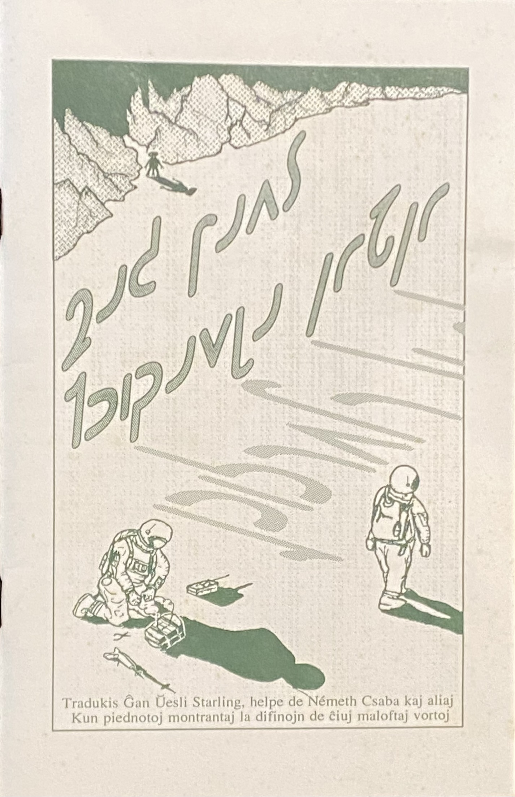

Esperanto already has phonetic spelling, using accent marks to ensure all sounds are represented, so the Shavian alphabet only brings limited benefits to that language. However, for English the benefits are much more significant, as described in Rob's video. So, I decided to try and learn it.

To that end, I bought a copy of Sir Arthur Conan Doyle's Sherlock Homes story, /A Study in Scarlet/, Shavian Alphabet edition. The publication of this edition was organised by Evan who runs the website [[https://shavian.info/][shavian.info]], and who also features in Rob's video. Since I enjoy the character of Sherlock Homes, I thought this would provide extra motivation to learn Shavian.

The alphabet is designed in such a way that is logical and which facilitates the newcomer to remember the different shapes. After I had a passing familiarity with the alphabet design, I started reading the book. My progress was extremely slow at first, sounding out the words letter by letter like I was back in Kindergarten learning to read again. Some letters were easy to confuse with each other, such as P (𐑐), B (𐑚), F (𐑓) and V (𐑝). Others like L (𐑤) look like Latin letters which, due to habit, were sometimes misleading. It was nevertheless a lot of fun trying to decode the stange script before me.

Because the story was written in England during the 1800s, some of the words and turns of phrase are a little unusual to the modern day reader, adding a little more fun challenge to recognising the words. I haven't read much classical literature since my school days, so it is refreshing to revisit some works of fiction from around those times. The slow pace at which I am reading the story is a nice contrast to the usual hustle and bustle of everyday life, and so I am really enjoying the story as the mystery unfolds. I am becoming a little faster as I get more practice, but I still have a long way to go before I feel anywhere near as fluent as I am in the Latin alphabet.

The other side from reading is learning to write in the Shavian alphabet. I will rewrite this post in Shavian and upload it to my blog -- if you want to see some Shavian, you can use the language selector at the top of this website.

There are other books published in Shavian, such as Alice in Wonderland and Jane Austen's Pride and Prejudice, which I look forward reading once I finish the Sherlock Homes story. I'll keep you posted how I go!

**** DONE 𐑩 𐑕𐑑𐑳𐑛𐑦 𐑦𐑯 𐑕𐑒𐑸𐑤𐑩𐑑 :𐑖𐑱𐑝𐑾𐑯:
:PROPERTIES:
:EXPORT_HUGO_WEIGHT: 4001
:EXPORT_FILE_NAME: index.en-shaw.md
:EXPORT_HUGO_BUNDLE: 20250301_study-in-scarlet
:EXPORT_DATE: 2025-03-01
:EXPORT_HUGO_MENU:
:EXPORT_DESCRIPTION: 20250301-study_in_scarlet.jpg
:END:

𐑢𐑦𐑞 𐑥𐑲 𐑦𐑯𐑑𐑮𐑩𐑕𐑑 𐑦𐑯 𐑤𐑨𐑙𐑜𐑢𐑦𐑡𐑩𐑟, 𐑢𐑳𐑯 𐑿𐑗𐑵𐑚𐑼 𐑲 𐑤𐑲𐑒 𐑑 𐑓𐑪𐑤o 𐑦𐑟 𐑞 "·𐑮𐑪𐑚 𐑢𐑻𐑛𐑟" 𐑗𐑨𐑯𐑩𐑤. 𐑣𐑰 𐑣𐑨𐑟 𐑚o𐑕𐑑𐑩𐑛 𐑩 𐑯𐑳𐑥𐑚𐑼 𐑝 𐑝𐑦𐑛𐑦o𐑟 𐑑𐑮𐑰𐑑𐑦𐑙 𐑷𐑤𐑑𐑻𐑯𐑩𐑑𐑦𐑝 𐑢𐑱𐑟 𐑝 𐑮𐑲𐑑𐑦𐑙 𐑞 𐑦𐑙𐑜𐑤𐑦𐑖 𐑤𐑨𐑙𐑜𐑢𐑦𐑡. 𐑣𐑰 𐑑𐑷𐑒𐑑 𐑩𐑚𐑬𐑑 𐑣𐑬 𐑮𐑵𐑯𐑟 𐑥𐑲𐑑 𐑚𐑰 𐑚𐑧𐑑𐑼 𐑕𐑵𐑑𐑩𐑛 𐑓 𐑮𐑲𐑑𐑦𐑙 𐑥𐑪𐑛𐑼𐑯 𐑦𐑙𐑜𐑤𐑦𐑖 𐑞𐑨𐑯 𐑞 𐑤𐑨𐑛𐑦𐑯 𐑨𐑤𐑓𐑩𐑚𐑧𐑑 𐑢𐑰 𐑿𐑟 𐑑𐑩𐑛𐑲, 𐑯 𐑕𐑲𐑑𐑩𐑛 𐑦𐑜𐑟𐑭𐑥𐑐𐑩𐑤𐑟 𐑢𐑺 ·𐑡.𐑮.𐑮. 𐑑𐑪𐑤𐑒𐑰𐑯 𐑿𐑟𐑛 𐑞 𐑮𐑵𐑯𐑦𐑒 𐑨𐑤𐑓𐑩𐑚𐑧𐑑 𐑦𐑯 𐑣𐑦𐑟 𐑚𐑫𐑒𐑕 𐑑 𐑮𐑧𐑐𐑮𐑦𐑟𐑧𐑯𐑑 𐑤𐑨𐑙𐑜𐑢𐑦𐑡𐑩𐑟 𐑤𐑲𐑒 ·𐑛𐑢𐑹𐑝𐑦𐑖 𐑓𐑮𐑪𐑥 𐑣𐑦𐑟 ·𐑥𐑦𐑛𐑩𐑤 𐑻𐑞 𐑓𐑨𐑯𐑑𐑩𐑕𐑦 𐑢𐑻𐑤𐑛. 𐑢𐑳𐑯 𐑝𐑦𐑛𐑦o 𐑞𐑨𐑑 𐑐𐑼𐑑𐑦𐑒𐑘𐑩𐑤𐑼𐑩𐑦 𐑕𐑑𐑫𐑛 𐑬𐑑 𐑓 𐑥𐑰 𐑢𐑪𐑟 𐑣𐑦𐑟 𐑛𐑦𐑕𐑒𐑮𐑦𐑐𐑖𐑩𐑯 𐑝 𐑞 ·𐑡𐑹𐑡 𐑚𐑻𐑯𐑩𐑛 𐑖𐑷 "·𐑖𐑲𐑝𐑾𐑯" 𐑨𐑤𐑓𐑩𐑚𐑧𐑑:

#+hugo: 

𐑞𐑦𐑕 𐑨𐑤𐑓𐑩𐑚𐑧𐑑 𐑤𐑫𐑒𐑑 𐑝𐑲𐑜𐑤𐑦 𐑓𐑩𐑥𐑦𐑤𐑽. 𐑲 𐑣𐑨𐑛 𐑦𐑯𐑒𐑬𐑯𐑑𐑼𐑛 𐑦𐑑 𐑥𐑧𐑯𐑦 𐑘𐑽𐑟 𐑩𐑜o 𐑢𐑧𐑯 𐑲 𐑢𐑪𐑟 𐑨𐑑 𐑩𐑯 ·𐑧𐑕𐑐𐑼𐑭𐑯𐑑𐑴 𐑒𐑪𐑯𐑓𐑼𐑩𐑯𐑕 𐑯 𐑕𐑳𐑥𐑢𐑳𐑯 𐑜𐑱𐑝 𐑥𐑰 𐑩 𐑤𐑦𐑑𐑩𐑤 𐑚𐑫𐑒𐑤𐑩𐑑 𐑩𐑚𐑬𐑑 𐑩 "𐑯𐑿 𐑦𐑥𐑐𐑮𐑵𐑝𐑛 𐑨𐑤𐑓𐑩𐑚𐑧𐑑". 𐑲 𐑐𐑫𐑑 𐑦𐑑 𐑪𐑯 𐑥𐑲 𐑚𐑫𐑒𐑖𐑧𐑤𐑓, 𐑓𐑫𐑤𐑦 𐑦𐑯𐑑𐑧𐑯𐑛𐑦𐑙 𐑑 𐑦𐑯𐑝𐑧𐑕𐑑𐑦𐑜𐑱𐑑 𐑦𐑑 𐑢𐑧𐑯 𐑲 𐑣𐑨𐑛 𐑕𐑳𐑥 𐑕𐑐𐑺 𐑑𐑲𐑥, 𐑚𐑳𐑑 𐑕𐑳𐑥𐑣𐑬 𐑲 𐑯𐑧𐑝𐑼 𐑜𐑪𐑑 𐑼𐑬𐑯𐑛 𐑑 𐑦𐑑. 𐑲 𐑢𐑧𐑯𐑑 𐑑 𐑥𐑲 𐑚𐑫𐑒𐑖𐑧𐑤𐑓 𐑯 𐑛𐑳𐑜 𐑬𐑑 𐑞 𐑛𐑳𐑕𐑑𐑦 𐑚𐑫𐑒𐑤𐑩𐑑 -- 𐑖𐑫𐑼 𐑦𐑯𐑳𐑓 𐑦𐑑 𐑢𐑪𐑟 𐑷𐑤 𐑩𐑚𐑬𐑑 𐑣𐑬 𐑑 𐑮𐑲𐑑 ·𐑧𐑕𐑐𐑼𐑭𐑯𐑑𐑴 𐑦𐑯 𐑞 ·𐑖𐑱𐑝𐑾𐑯 𐑨𐑤𐑓𐑩𐑚𐑧𐑑:

·𐑧𐑕𐑐𐑼𐑭𐑯𐑑𐑴 𐑷𐑤𐑮𐑧𐑛𐑦 𐑣𐑨𐑟 𐑓𐑩𐑯𐑧𐑑𐑦𐑒 𐑕𐑐𐑧𐑤𐑦𐑙, 𐑿𐑟𐑦𐑙 𐑨𐑒𐑕𐑧𐑯𐑑 𐑥𐑸𐑒𐑕 𐑑 𐑦𐑯𐑖𐑫𐑼 𐑭𐑤 𐑕𐑬𐑯𐑛𐑟 𐑸 𐑮𐑧𐑐𐑮𐑦𐑟𐑧𐑯𐑑𐑩𐑛, 𐑕o 𐑞 ·𐑖𐑱𐑝𐑾𐑯 𐑨𐑤𐑓𐑩𐑚𐑧𐑑 o𐑯𐑤𐑦 𐑚𐑮𐑦𐑙𐑟 𐑤𐑦𐑥𐑦𐑑𐑩𐑛 𐑚𐑧𐑯𐑦𐑓𐑦𐑑𐑕 𐑑 𐑞𐑨𐑑 𐑤𐑨𐑙𐑜𐑢𐑦𐑡. 𐑣𐑬𐑧𐑝𐑼, 𐑓 𐑦𐑙𐑜𐑤𐑦𐑖 𐑞 𐑚𐑧𐑯𐑦𐑓𐑦𐑑𐑕 𐑸 𐑥𐑳𐑗 𐑥𐑹 𐑕𐑦𐑜𐑯𐑦𐑓𐑦𐑒𐑩𐑯𐑑, 𐑨𐑟 𐑛𐑦𐑕𐑒𐑮𐑲𐑚𐑛 𐑦𐑯 ·𐑮𐑪𐑚𐑟 𐑝𐑦𐑛𐑦o. 𐑕o, 𐑲 𐑛𐑦𐑕𐑲𐑛𐑩𐑛 𐑑 𐑑𐑮𐑲 𐑯 𐑤𐑻𐑯 𐑦𐑑.

𐑑 𐑞𐑨𐑑 𐑧𐑯𐑛, 𐑲 𐑚𐑷𐑑 𐑩 𐑒𐑪𐑐𐑦 𐑝 ·𐑕𐑻 𐑸𐑔𐑼 𐑒o𐑯𐑩𐑯 𐑛𐑶𐑤𐑟 ·𐑖𐑻𐑤𐑪𐑒 𐑣o𐑥𐑟 𐑕𐑑𐑹𐑦, /·𐑩 𐑕𐑑𐑳𐑛𐑦 𐑦𐑯 𐑕𐑒𐑸𐑤𐑩𐑑/, ·𐑖𐑱𐑝𐑾𐑯 𐑨𐑤𐑓𐑩𐑚𐑧𐑑 𐑧𐑛𐑦𐑖𐑩𐑯. 𐑞 𐑐𐑳𐑚𐑤𐑦𐑒𐑱𐑖𐑩𐑯 𐑝 𐑞𐑦𐑕 𐑧𐑛𐑦𐑖𐑩𐑯 𐑢𐑪𐑟 𐑹𐑜𐑩𐑯𐑲𐑟𐑛 𐑚𐑲 ·𐑧𐑝𐑩𐑯 𐑣𐑵 𐑮𐑳𐑯𐑟 𐑞 𐑢𐑧𐑚𐑕𐑲𐑑 [[https://shavian.info/][shavian.info]], 𐑯 𐑣𐑵 𐑷𐑤𐑕o 𐑓𐑰𐑗𐑩𐑟 𐑦𐑯 ·𐑮𐑪𐑚𐑟 𐑝𐑦𐑛𐑦o. 𐑕𐑦𐑯𐑕 𐑲 𐑧𐑯𐑡𐑶 𐑞 𐑒𐑨𐑮𐑩𐑒𐑑𐑼 𐑝 ·𐑖𐑻𐑤𐑪𐑒 𐑣o𐑥𐑟, 𐑲 𐑔𐑷𐑑 𐑞𐑦𐑕 𐑢𐑫𐑛 𐑐𐑮𐑩𐑝𐑲𐑛 𐑧𐑒𐑕𐑑𐑮𐑩 𐑥o𐑑𐑦𐑝𐑱𐑖𐑩𐑯 𐑑 𐑤𐑻𐑯 ·𐑖𐑱𐑝𐑾𐑯.

𐑞 𐑨𐑤𐑓𐑩𐑚𐑧𐑑 𐑦𐑟 𐑛𐑦𐑟𐑲𐑯𐑛 𐑦𐑯 𐑕𐑳𐑗 𐑩 𐑢𐑱 𐑞𐑨𐑑 𐑦𐑟 𐑤𐑪𐑡𐑦𐑒𐑩𐑤 𐑯 𐑢𐑦𐑗 𐑓𐑩𐑕𐑦𐑤𐑦𐑑𐑱𐑑𐑕 𐑞 𐑯𐑿𐑒𐑳𐑥𐑼 𐑑 𐑮𐑦𐑥𐑧𐑥𐑚𐑼 𐑞 𐑞𐑦𐑓𐑼𐑩𐑯𐑑 𐑖𐑱𐑐𐑕. 𐑭𐑓𐑑𐑼 𐑲 𐑣𐑨𐑛 𐑩 𐑐𐑭𐑕𐑦𐑙 𐑓𐑩𐑥𐑦𐑤𐑦𐑨𐑮𐑦𐑑𐑦 𐑢𐑦𐑞 𐑞 𐑨𐑤𐑓𐑩𐑚𐑧𐑑 𐑛𐑦𐑟𐑲𐑯, 𐑲 𐑕𐑑𐑸𐑑𐑩𐑛 𐑮𐑰𐑛𐑦𐑙 𐑞 𐑚𐑫𐑒. 𐑥𐑲 𐑐𐑤o𐑜𐑮𐑧𐑕 𐑢𐑪𐑟 𐑦𐑒𐑕𐑑𐑮𐑰𐑥𐑤𐑦 𐑕𐑤o 𐑨𐑑 𐑓𐑻𐑕𐑑, 𐑕𐑬𐑯𐑛𐑦𐑙 𐑬𐑑 𐑞 𐑢𐑻𐑛𐑟 𐑤𐑧𐑑𐑼 𐑚𐑲 𐑤𐑧𐑑𐑼 𐑤𐑲𐑒 𐑲 𐑢𐑪𐑟 𐑚𐑨𐑒 𐑦𐑯 𐑒𐑦𐑯𐑛𐑼𐑜𐑸𐑑𐑩𐑯 𐑤𐑻𐑯𐑦𐑙 𐑑 𐑮𐑰𐑛 𐑩𐑜𐑧𐑯. 𐑕𐑳𐑥 𐑤𐑧𐑑𐑼𐑟 𐑢𐑻 𐑰𐑟𐑦 𐑑 𐑒𐑩𐑯𐑓𐑿𐑟 𐑢𐑦𐑞 𐑰𐑗 𐑳𐑞𐑼, 𐑕𐑳𐑗 𐑨𐑟 "𐑐", "𐑚", "𐑓" 𐑯 "𐑝". 𐑳𐑞𐑼𐑟 𐑤𐑲𐑒 "𐑤" 𐑤𐑫𐑒 𐑤𐑲𐑒 𐑤𐑨𐑑𐑦𐑯 𐑤𐑧𐑑𐑼𐑟 𐑢𐑦𐑗, 𐑛𐑿 𐑑 𐑣𐑨𐑚𐑦𐑑, 𐑢𐑻 𐑕𐑳𐑥𐑑𐑲𐑥𐑟 𐑥𐑦𐑕𐑤𐑰𐑛𐑦𐑙. 𐑦𐑑 𐑢𐑪𐑟 𐑯𐑧𐑝𐑼𐑞𐑩𐑤𐑧𐑕 𐑩 𐑤𐑪𐑑 𐑝 𐑓𐑳𐑯 𐑑𐑮𐑲𐑦𐑙 𐑑 𐑛𐑰𐑒o𐑛 𐑞 𐑕𐑑𐑮𐑱𐑯𐑗 𐑕𐑒𐑮𐑦𐑐𐑑 𐑚𐑦𐑓𐑹 𐑥𐑰.

𐑚𐑰𐑒𐑷𐑟 𐑞 𐑕𐑑𐑹𐑦 𐑢𐑪𐑟 𐑮𐑦𐑑𐑩𐑯 𐑦𐑯 ·𐑦𐑙𐑜𐑤𐑩𐑯𐑛 𐑛𐑘𐑫𐑼𐑦𐑙 𐑞 1800𐑟, 𐑕𐑳𐑥 𐑝 𐑞 𐑢𐑻𐑛𐑟 𐑯 𐑑𐑻𐑯𐑟 𐑝 𐑓𐑮𐑱𐑟 𐑸 𐑩 𐑤𐑦𐑑𐑩𐑤 𐑳𐑯𐑿𐑠𐑫𐑩𐑤 𐑑 𐑞 𐑥𐑪𐑛𐑼𐑯 𐑛𐑱 𐑮𐑰𐑛𐑼, 𐑨𐑛𐑦𐑙 𐑩 𐑤𐑦𐑑𐑩𐑤 𐑥𐑹 𐑓𐑳𐑯 𐑗𐑨𐑤𐑩𐑯𐑡 𐑑 𐑮𐑧𐑒𐑩𐑜𐑯𐑲𐑟𐑦𐑙 𐑞 𐑢𐑻𐑛𐑟. 𐑲 𐑣𐑨𐑝𐑯𐑑 𐑮𐑧𐑛 𐑥𐑳𐑗 𐑒𐑤𐑨𐑕𐑦𐑒𐑩𐑤 𐑤𐑦𐑑𐑼𐑩𐑗𐑼 𐑕𐑦𐑯𐑕 𐑥𐑲 𐑕𐑒𐑵𐑤 𐑛𐑱𐑟, 𐑕o 𐑦𐑑 𐑦𐑟 𐑮𐑦𐑓𐑮𐑧𐑖𐑦𐑙 𐑑 𐑮𐑰𐑝𐑦𐑟𐑦𐑑 𐑕𐑳𐑥 𐑢𐑻𐑒𐑕 𐑝 𐑓𐑦𐑒𐑖𐑩𐑯 𐑓𐑮𐑪𐑥 𐑼𐑬𐑯𐑛 𐑞o𐑟 𐑑𐑲𐑥𐑟. 𐑞 𐑕𐑤o 𐑐𐑱𐑕 𐑨𐑑 𐑢𐑦𐑗 𐑲 𐑨𐑥 𐑮𐑰𐑛𐑦𐑙 𐑞 𐑕𐑑𐑹𐑦 𐑦𐑟 𐑩 𐑯𐑲𐑕 𐑒𐑪𐑯𐑑𐑮𐑭𐑕𐑑 𐑑 𐑞 𐑿𐑠𐑫𐑩𐑤 𐑣𐑳𐑕𐑩𐑤 𐑯 𐑚𐑳𐑕𐑩𐑤 𐑝 𐑧𐑝𐑮𐑦𐑛𐑱 𐑤𐑲𐑓, 𐑯 𐑕o 𐑲 𐑨𐑥 𐑮𐑰𐑤𐑦 𐑦𐑯𐑡𐑶𐑦𐑙 𐑞 𐑕𐑑𐑹𐑦 𐑨𐑟 𐑞 𐑥𐑦𐑕𐑑𐑮𐑦 𐑳𐑯𐑓o𐑤𐑛𐑟. 𐑲 𐑨𐑥 𐑚𐑦𐑒𐑳𐑥𐑦𐑙 𐑩 𐑤𐑦𐑑𐑩𐑤 𐑓𐑭𐑕𐑑𐑼 𐑨𐑟 𐑲 𐑜𐑧𐑑 𐑥𐑹 𐑐𐑮𐑨𐑒𐑑𐑦𐑕, 𐑚𐑳𐑑 𐑲 𐑕𐑑𐑦𐑤 𐑣𐑨𐑝 𐑩 𐑤𐑪𐑙 𐑢𐑱 𐑑 𐑜o 𐑚𐑦𐑓𐑹 𐑲 𐑓𐑰𐑤 𐑧𐑯𐑦𐑢𐑺 𐑯𐑽 𐑨𐑟 𐑓𐑤𐑵𐑩𐑯𐑑 𐑨𐑟 𐑲 𐑨𐑥 𐑦𐑯 𐑞 𐑤𐑨𐑑𐑦𐑯 𐑨𐑤𐑓𐑩𐑚𐑧𐑑.

𐑔 𐑳𐑞𐑼 𐑕𐑲𐑛 𐑓𐑮𐑪𐑥 𐑮𐑰𐑛𐑦𐑙 𐑦𐑟 𐑤𐑻𐑯𐑦𐑙 𐑑 𐑮𐑲𐑑 𐑦𐑯 𐑞 ·𐑖𐑱𐑝𐑾𐑯 𐑨𐑤𐑓𐑩𐑚𐑧𐑑. 𐑲 𐑢𐑦𐑤 𐑮𐑰𐑮𐑲𐑑 𐑞𐑦𐑕 𐑐o𐑕𐑑 𐑦𐑯 ·𐑖𐑱𐑝𐑾𐑯 𐑯 𐑳𐑐𐑤o𐑛 𐑦𐑑 𐑑 𐑥𐑲 𐑚𐑤𐑪𐑜 -- 𐑦𐑓 𐑿 𐑢𐑪𐑯𐑑 𐑑 𐑕𐑰 𐑕𐑳𐑥 ·𐑖𐑱𐑝𐑾𐑯 𐑿 𐑒𐑨𐑯 𐑿𐑟 𐑞 𐑤𐑨𐑙𐑜𐑢𐑦𐑡 𐑕𐑦𐑤𐑧𐑒𐑑𐑼 𐑨𐑑 𐑞 𐑑𐑪𐑐 𐑝 𐑞𐑦𐑕 𐑢𐑧𐑚𐑕𐑲𐑑.

𐑞𐑺 𐑸 𐑳𐑞𐑼 𐑚𐑫𐑒𐑕 𐑐𐑳𐑚𐑤𐑦𐑖𐑑 𐑦𐑯 ·𐑖𐑱𐑝𐑾𐑯, 𐑕𐑳𐑗 𐑨𐑟 ·𐑨𐑤𐑦𐑕 𐑦𐑯 𐑢𐑳𐑯𐑛𐑼𐑤𐑨𐑯𐑛 𐑯 ·𐑡𐑱𐑯 𐑪𐑕𐑑𐑩𐑯𐑟 ·𐑐𐑮𐑲𐑛 𐑯 𐑐𐑮𐑧𐑡𐑩𐑛𐑦𐑕, 𐑢𐑦𐑗 𐑲 𐑤𐑫𐑒 𐑓𐑹𐑢𐑼𐑛 𐑑 𐑮𐑰𐑛𐑦𐑙 𐑢𐑳𐑯𐑕 𐑲 𐑓𐑦𐑯𐑦𐑖 𐑞 ·𐑖𐑻𐑤𐑪𐑒 𐑣o𐑥𐑟 𐑕𐑑𐑹𐑦. 𐑲𐑤 𐑒𐑰𐑐 𐑿 𐑐o𐑕𐑑𐑩𐑛 𐑣𐑬 𐑲 𐑜o!

*** Graphite Layout on Corne Keyboard
**** DONE Graphite Layout on Corne Keyboard :Computers:Keyboards:Corne:AltKeyboardLayouts:
:PROPERTIES:
:EXPORT_HUGO_WEIGHT: 4001
:CUSTOM_ID: graphite-layout-corne
:EXPORT_FILE_NAME: index
:EXPORT_HUGO_BUNDLE: 20250120_graphite-layout-corne
:EXPORT_DATE: 2025-01-20
:EXPORT_DESCRIPTION: 20250120_vial-graphite.png
:END:

I've been using the [[#graphite-keyboard-layout][Graphite keyboard layout]] on my [[#zsa-voyager-has-arrived][ZSA Voyager]] keyboard for a few weeks now, and I'm fairly happy with it. I therefore decided to update the keymap of my [[#corne-v4][Corne keyboard]] (which is for me is now a backup keyboard) from the [[#gallium-keyboard-layout][Gallium keyboard layout]] to the Graphite layout.

As I [[#update-gallium-keyboard-layout][mentioned previously]], the punctuation symbols in a standard Graphite layout require the use of key overrides. By default, the Voyager web configuration tool doesn't support key overrides, and so I implemented a solution using tap dance. For the Corne keyboard, I am using the Vial configuration tool which does support key overrides, and so I tried to set this up.

The key overrides on the Corne keyboard worked well, except for the comma on the right outer column of the home row. I couldn't set up a key override on that key because it is configured to be a =SHIFT= key when it is held down. It seems that Quantum keys like that are incompatible with defining key override.

I could have removed the shift function from that key, but then I decided to use a tap-dance setup like I did on my Voyager keyboard, so that the Corne would behave in a similar way. Because the Corne has only 3 rows instead of 4 (ie. there is no number row at the top), I had to reassign a couple of the keys to compensate. This is a layout I ended up with:

#+begin_example
`~ b  l  d  w  z   '_ y  o  u  j  ;:
\| n  r  t  s  g   p  h  a  e  i  ,
CW q  x  m  c  v   k  f  .> -" /< =+
         LA SP LC  RS RG RA
#+end_example

Some remarks:
- The =CW= key is the CAPS WORD, moved from the number row down to the bottom row. Similarly the ==/+= key was moved from the number row down to the bottom row.
- The keys with ='=, =.=, =-= and =/= were defined as tap-dance keys that, when held, output =_=, =>=, ="= and =<= respectively.
- The outer column keys on the bottom row were one-shot /Left-Alt/ and /Right-Alt/ keys, and those got moved to the outer thumb keys to make room for =CW= and ==+=
- The /space/ (=SP=), /Left-Ctrl/ (=LC=), /Right-Shift/ (=RS=) and /Right-Gui/ (=RG=) thumb keys are the same as on my voyager.

On my [[https://github.com/matt-maguire/kbd_firmware/tree/custom/keyboards/crkbd/vial-kb][GitHub]] you can find a link to the corresponding Vial Layout file [[https://github.com/matt-maguire/kbd_firmware/blob/custom/keyboards/crkbd/vial-kb/graphite_homerow_layer.vil][=graphite_homerow_layer.vil=]].

*** Exporting Org Mode Tables to LaTeX
**** DONE Exporting Org Mode Tables to LaTeX :Emacs:OrgMode:LaTeX:Teaching:
:PROPERTIES:
:EXPORT_HUGO_WEIGHT: 4001
:CUSTOM_ID: orgmode-tables
:EXPORT_FILE_NAME: index
:EXPORT_HUGO_BUNDLE: 20250117_orgmode-tables
:EXPORT_DATE: 2025-01-17
:END:

In my previous post on using [[#orgmode-lesson-notes][Org mode to make lesson notes]], I mentioned that it is possible to export Org mode tables to $\LaTeX$. There are some benefits to using Org mode instead of raw $\LaTeX$ when making tables:
- Org mode has a powerful [[https://orgmode.org/manual/Built_002din-Table-Editor.html][table editor]] that makes it easy to draw out a table and move rows and columns around. Org mode will automatically make the all the columns line up nicely.
- Since the cells in an Org mode table are all nicely lined up, it makes the table much easier to visualise without having to count =&= symbols in raw $\LaTeX$ code.
- Org mode allows the use of formulas in a table, somewhat like a spreadsheet -- this is harder to achieve using $\LaTeX$ directly.

The tables produced by Org mode are pretty basic by default. However, you can use the $\LaTeX$ [[https://ctan.org/pkg/tabularray][tabularray]] package to customise the look of your tables. Incidentally, if you are not already using the modern /tabularray/ to produce your $\LaTeX$ tables, you should definitely look into it -- it is way more powerful and easy to use compared to the more traditional table packages (you can thank me later).

So, let's produce a simple table for plotting the function $y=x^2$:

#+begin_src org
#+attr_latex: :environment tblr :align hlines,vlines,column{1}={gray9},column{2-Z}={r}
| $\bm x$ | $-2$ | $-1$ | 0 | 1 | 2 |
| $\bm y$ |    4 |    1 | 0 | 1 | 4 |
#+end_src

Some remarks:
- the =#+attr_latex:= line immediately preceeding the table tells Org mode to customise the $\LaTeX$ code for the table.
  - The =:environment= attribute tells Org mode to use tabularray's /tblr/ table environment instead of the $\LaTeX$ default table environment.
  - The =:align= attribute allows us to specify the parameters that the /tblr/ environment is expecting. You can see here I've asked for horizintal and vertical lines; I want the first column containing my variable names $x$ and $y$ to be shaded grey, and I want my numbers to be right-justified.
- I've used =$= signs around the variable names and the negative numbers so that they get rendered correctly. I also used the =\bm= from the $\LaTeX$ [[https://ctan.org/pkg/bm][bm package]] to have the variable names bold.

This will produce a table that looks like this:

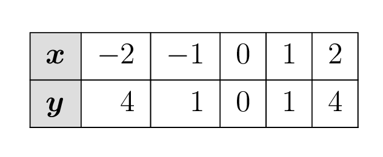

Sometimes you want to leave certain cells in the table blank, and leave enough space for students to write their own values into the table. This is easy using the /tblr/ environment:

#+begin_src org
#+attr_latex: :environment tblr
#+attr_latex: :align hlines,vlines,row{2}={15mm},column{1}={gray9},column{2-Z}={20mm,c}
| $\bm x$ | $-2$ | $-1$ | 0 | 1 | 2 |
| $\bm y$ |      |      |   |   |   |
#+end_src

- here I put the =:environment= and =:align= attributes on separate lines, just to show that this is an option.
- I've specified that the second row should be 15mm high
- I specified that columns $2$ through $Z$ should be $20$\,mm wide. The $Z$ has a special meaning when specifying rows and columns in a /tblr/ environment -- it refers to the last row or column. This means I don't need to adjust the range specification if I add and remove columns.

If we then export to PDF, the table will look like this:

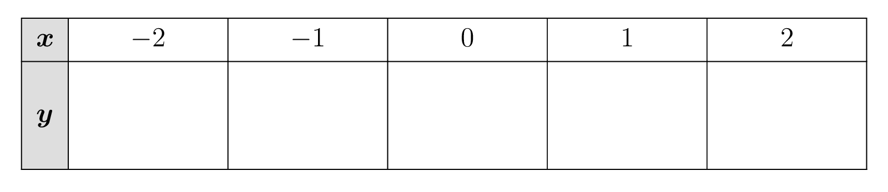

As I said before, /tblr/ is a convenient modern way to specify $\LaTeX$ tables, and it is a very powerful package. For more information about what it can do, check out the /tabularray/ [[https://mirror.aarnet.edu.au/pub/CTAN/macros/latex/contrib/tabularray/tabularray.pdf][documentation]].

**** DONE Eksportado de Org-reĝimaj tabeloj al LaTeX :Emacs:OrgMode:LaTeX:Teaching:Lingvoj:Esperanto:
:PROPERTIES:
:EXPORT_HUGO_WEIGHT: 4001
:CUSTOM_ID: orgmode-tables-eo
:EXPORT_FILE_NAME: index.eo.md
:EXPORT_HUGO_BUNDLE: 20250117_orgmode-tables
:EXPORT_DATE: 2025-01-17
:END:

En mia antaŭa afiŝo pri uzado de [[#orgmode-lesson-notes-eo][Org-reĝimo por lecionaj notoj]], mi menciis, ke eblas eksporti Org-reĝimajn tabelojn al $\LaTeX$. Jen kelkaj avantaĝoj de Org-reĝimo kompare kun kruda $\LaTeX$ kiam oni faras tabelojn:
- Org-reĝimo havas potencon [[https://orgmode.org/manual/Built_002din-Table-Editor.html][tabelredaktilon]], kiu faciligas desegni tabelon kaj movi vicojn kaj kolumnojn. Org-reĝimo aŭtomate ĝustigas ĉiujn kolumnojn.
- Ĉar la ĉeloj de Org-reĝima tabelo estas bele alĝustigitaj, multo pli facile estas vidi la tabelon sen nombradi =&=-simbolojn en kruda $\LaTeX$-kodo.
- Org-reĝimo permesas uzi formulojn en tabelo, iom kiel kalkultabelo -- tio estas pli malfacile atingite rekte per $\LaTeX$.

La tabeloj produktitaj de Org-reĝimo estas sufiĉe bazaj defaŭlte. Tamen vi povas uzi la $\LaTeX$-pakon [[https://ctan.org/pkg/tabularray][tabularray]] por laŭvoli la aspekton de viaj tabeloj. Interali, se vi ankoraŭ ne uzas la modernan /tabularray/-on por krei viajn $\LaTeX$-tabelojn, vi definitive uzu ĝin -- ĝi estas multo pli potenca kaj facile uzebla kompare kun la pli tradiciaj tabelaj pako (vi povas danki min poste).

Do, ni kreu simplan tabelon por desegni la funkcion $y=x^2$:

#+begin_src org
#+attr_latex: :environment tblr :align hlines,vlines,column{1}={gray9},column{2-Z}={r}
| $\bm x$ | $-2$ | $-1$ | 0 | 1 | 2 |
| $\bm y$ |    4 |    1 | 0 | 1 | 4 |
#+end_src

Kelkaj rimarkoj:
- la linio =#+attr_latex:= tuj antaŭ la tabelo diras al Org-reĝimo laŭvoli la $\LaTeX$-kodon de la tabelo.
  - La atributo =:environment= diras al Org-reĝimo uzi la tabelmedion /tblr/ de tabularray anstataŭ la defaŭlta $\LaTeX$-tabelmedio.
  - La atributo =:align= permesas al ni specifi la parametrojn, kiujn la /tblr/-medio atendas. Vi vidas, ke mi petis horizontalajn kaj verticalajn liniojn; mi volas, ke la unua kolumno kun la nomoj de la variabloj $x$ kaj $y$ estu grize ombrumita, kaj ke la nombroj estu dekstre ĝustigitaj.
- Mi uzis =$=-signojn ĉirkaŭ la nomoj de variabloj kaj la negativaj nombroj, por ke ili estu ĝuste rendrataj. Mi ankaŭ uzis =\bm= el la $\LaTeX$-[[https://ctan.org/pkg/bm][pako bm]] por ke la nomoj de variabloj estu dikaj.

Tio produktos tabelon, kiu aspektas tiel:

Iufoje vi volas lasi certajn ĉelojn de la tabelo malplenaj kaj lasi sufiĉe da spaco por ke lernantoj skribu siajn proprajn valorojn en la tabelon. Estas facile fari tion per la /tblr/-medio:

#+begin_src org
#+attr_latex: :environment tblr
#+attr_latex: :align hlines,vlines,row{2}={15mm},column{1}={gray9},column{2-Z}={20mm,c}
| $\bm x$ | $-2$ | $-1$ | 0 | 1 | 2 |
| $\bm y$ |      |      |   |   |   |
#+end_src

- ĉi tie mi metis la atributojn =:environment= kaj =:align= sur apartaj linioj, nur por montri, ke tio estas eblo.
- Mi specifis, ke la dua vico estu 15 mm alta
- Mi specifis, ke la kolumnoj de $2$ ĝis $Z$ estu $20$\,mm larĝaj. La $Z$ havas specialan signifon dum specicado de vicoj kaj kolumnoj en /tblr/-medio -- ĝi referencas la lastan vicon aŭ kolumnon. Tio signifas, ke mi ne devas ĝustigi la intervalan specifon, se mi aldonas aŭ forigas kolumnojn.

Se ni poste eksportas al PDF, la tabelo aspektos tiel:

Kiel mi diris antaŭe, /tblr/ estas oportuna moderna maniero specifi $\LaTeX$-tabelojn, kaj ĝi estas tre potenca pako. Por pli da informoj pri tio, kion ĝi povas fari, rigardu la [[https://mirror.aarnet.edu.au/pub/CTAN/macros/latex/contrib/tabularray/tabularray.pdf][dokumentaron]] de /tabularray/.

*** Using Org Mode for Lesson Notes
**** DONE Using Org Mode / LaTeX for Lesson Notes :Emacs:OrgMode:LaTeX:Teaching:
:PROPERTIES:
:EXPORT_HUGO_WEIGHT: 4001
:CUSTOM_ID: orgmode-lesson-notes
:EXPORT_FILE_NAME: index
:EXPORT_HUGO_BUNDLE: 20250105_orgmode-lesson-notes
:EXPORT_DATE: 2025-01-06
:EXPORT_DESCRIPTION: 20250105_orgmode-banner.webp
:END:

Over the past year, I have been using $\LaTeX$ together with Emacs to produce lesson notes for some of my classes. One reason I went with Emacs instead of TeX Studio and the like was that Emacs provided a lot of shortcuts and completion features. I was finding though that $\LaTeX$ documents can sometimes become a bit verbose, which made me wonder about ways to make it easier to navigate the documents.

The other thing I was experimenting with last year was Emacs' Org Mode. This is a text "markdown" language that lets you structure your documents with headings that can be expanded and collapsed, so that you can quickly navigate documents, hide unneeded detail and focus on what's important in the here-and-now. The articles in this blog website are all written in Org Mode, and are then exported and pushed to the web. I was wondering whether Org Mode might allow me to more easily navigate the $\LaTeX$ lesson notes that I have been producing and generate PDF documents for printing.

***** The Case for Org Mode
A bit of research revealed that Org Mode text files can indeed be exported to $\LaTeX$ that can then be used to generate nice PDF documents. Org Mode is $\LaTeX$-aware, so that if you need to fall back on $\LaTeX$ features that go beyond what the simple Org Mode document format can handle, you can easily include necessary snippets of $\LaTeX$ code. The Babel feature of Org Mode also allows you to embed code and content produced by other programming languages such as Gnuplot, Python and Lisp. The simplicity of Org Mode's markdown language, its ability to manage complexity through its outlining mode and the flexibility in integrating other programming languages makes for a compelling case in producing maths-based content.

Another option I looked at was [[https://typst.app/][Typst]], a newer markdown-based solution for writing technical documnents. The basic markdown compiler is open-source and can be installed for free on your computer, but the full web-based service is a commercial offering. While the markdown language looks nice, the tool is not as mature as $\LaTeX$/TiKZ, and there would be something of a learning curve to get across [[https://github.com/johannes-wolf/cetz][CetZ]], which is Typst's answer to $\LaTeX$'s [[https://tikz.net/][TiKZ]] graphics package. Given that I am already using $\LaTeX$ and Org Mode in spearate spheres of my work, I decided that it makes sense to combine these two tools.

***** Setting Up Org Mode to Use $\LaTeX$'s /exesheet/ class

The $\LaTeX$ documents I have been using are based on the $\LaTeX$ [[https://ctan.org/pkg/exesheet][exesheet]] package. This allows me to easily typeset groups of problems either in single or multi-column mode. By default Org Mode uses the $\LaTeX$ /article/ document class, so the first step was to see if I could get Org Mode to use the /exesheet/ class and its associated features. The approach I used is described in the following useful video:

#+hugo: 

The creator of that video posted the the associated resources [[https://jakebox.github.io/youtube/org_latex_video.html][here]].

According to that video, the first step was to set up a custom class so Org Mode could recognise the /exesheet/ package. I therefore added the following code to my Doom Emacs /config.el/ file:

#+begin_src elisp
(after! ox-latex
(add-to-list 'org-latex-classes
             '("org-exesheet"
               "\\documentclass{exesheet}
           [NO-DEFAULT-PACKAGES]
           [PACKAGES]
           [EXTRA]"
               ("\\section{%s}" . "\\section*{%s}")
               ("\\subsection{%s}" . "\\subsection*{%s}")
               ("\\subsubsection{%s}" . "\\subsubsection*{%s}")
               ("\\paragraph{%s}" . "\\paragraph*{%s}")
               ("\\subparagraph{%s}" . "\\subparagraph*{%s}"))))

(after! ox
  (require 'ox-extra)
  (ox-extras-activate '(ignore-headlines)))
#+end_src

The ~after!~ macros make sure that Doom emacs runs the configuration code at the appropriate time during start-up. The first one defines the custom document class that refers to the $\LaTeX$ exesheet package. The second one enables an extended feature that allows me use an Org Mode heading purely to structure my document and hide detail without creating a corresponding section heading in the final document.

The next step was to create a set-up file that includes a common set of preamble to declare packages and define macros that should be available to all my lesson note documents. I created a file called ~lesson-preamble.org~. Some highlights from that file:

#+begin_src
,#+LATEX_CLASS: org-exesheet
,#+LATEX_CLASS_OPTIONS: [12pt,a4paper,marginwidth=unset]
,#+OPTIONS: toc:nil
,#+LATEX_HEADER: \usepackage{amssymb} % Access to extra math symbols
,#+LATEX_HEADER: \usepackage{amsmath} % Access to extra math symbols
,#+LATEX_HEADER: \usepackage{diffcoeff}
...
#+end_src

The first line refers to the custom class I defined in my ~config.el~ Emacs configuration, and the second line sets up the page settings (eg. In Australia we normally use A4 size paper). The third line disables the generation of a table of contents, and then I list out the $\LaTeX$ packages that my lesson notes typically rely on.

After the packages, I then have some macro definitions:

#+begin_src
,#+LATEX_HEADER: \geometry{margin=1.5cm}
,#+LATEX_HEADER: \newcommand{\cloze}[1]{\underline{\hspace*{#1}}}
,#+LATEX_HEADER: \newcommand{\notes}[3][\empty]{%
,#+LATEX_HEADER:     \noindent\ifthenelse{\equal{#1}{\empty}}
,#+LATEX_HEADER:             {\\}
,#+LATEX_HEADER:             {\vspace{#1}\\}
,#+LATEX_HEADER:     \foreach \n in {1,...,#2}{%
,#+LATEX_HEADER:         \ifthenelse{\equal{#1}{\empty}}
,#+LATEX_HEADER:             {\rule{#3}{0.5pt}\\}
,#+LATEX_HEADER:             {\rule{#3}{0.5pt}\vspace{#1}\\}
,#+LATEX_HEADER:         }
,#+LATEX_HEADER: }
#+end_src

-   I set the margins to make better use of the available space on the worksheet (line 1).
-   The ~cloze~ macro (line 3) lets me easily create an underlined blank space for students to fill in during the lesson.
-   The ~notes~ macro (lines 5-14) allows me to create a set of lines for students to write their working out. I tend not to use this much, preferring to just leave some blank space for students to draw and write in as they wish.

***** Let's Make a Lesson!
Now that we've done the set-up, let's put together some lesson notes. The first thing is to create a file ending in ~.org~ and refer to the setup file we just made:

#+begin_src
,#+SETUPFILE: lesson-preamble.org
#+end_src

****** Title and Lesson Intentions
We will now create a Org section to display the lesson title and learning intentions:

#+begin_src org
,* Header :ignore:
,#+latex: \begin{center}\textsc{
  Y12 Advanced Topic 1: Differential Calculus \\
  Lesson 1: Introduction to Differentiation
,#+latex: }\end{center}\begin{small}\begin{singlespacing}\begin{tcolorbox}[fonttitle=\bfseries,title=\textbf{Learning intentions:}]

Students will:
,#+attr_latex: :options [itemsep=0pt]
- Revise the foundations of Indices, including index laws involving negative indices
- Revise fractional indices.

/Textbook Reference: Y11 Canbridge Advanced Ex. 7A, 7B/
,#+latex: \end{tcolorbox}\end{singlespacing}\end{small}
#+end_src

- In line 1, I use the tag ~:ignore:~ to supress the creation of a $\LaTeX$ ~\section~ header. While Org Mode headings will normally create sections and subsections in your document, this particular Org Mode heading is just there for organisational purposes, so that I can fold up and hide away this beginning part of the document and make it easier to navigate straight to the section(s) that I am currently working on.

- lines 2 and 5 output some $\LaTeX$ code to make the heading in lines 3 and 4 be printed in small caps and nicely centered. It also sets up a nice $\LaTeX$ ~tcolorbox~ to highlight the lesson intentions. The ~#+latex:~ lets you insert arbitrary lines of $\LaTeX$ code into the final document if you want to achieve effects not easily realised through the standard Org Mode structures.

  Technically, the ~tex and latex output logo math modetex and latex output logo math mode#+latex:~ is not required, because if Org Mode detects any $\LaTeX$ code in your document, it should automatically deal with in. In my Emacs theme though, the ~#~ at the front causes the line to be rendered in a dark grey font so that it fades into the background and doesn't distract so much from the "real" content.

- Next in lines 7-10, we define the learning intentions. We create a list in Org Mode, simply use a bullet character such as ~-~, ~+~ or ~*~ (that last one needs to be preceeded with white space so it is not interpreted as an Org Mode heading). On line 8 you see the ~#+attr_latex:~ directive which allows you to modify the $\LaTeX$ environment that follows, this this case an ~itemize~ bullet list. In this example, I decrease the separation between the bullet list items to make the list more compact. This technique can be used to tweak the appearance of other environments throughout the document.

- On line 12 I give a textbook reference that I normally highlight using italics, which in Org Mode is achieve by bracketing the text with ~/~ symbols (much nicer than writing ~\emph{italic text}~, isn't it?).

****** Warm up/Do Now
Most teachers understand the benefit of giving students something to get started on as soon as they sit down, the so-called "Do Now" activity. It not only helps students transition into the lesson; it also allows for some "formative assessment" to determine how well the students understand the previously-covered material.

I like to put the "Do Now" activity on the front page in a box. So, let's write a heading and give the student some warm-up exercises to do.

#+begin_src org
,* Warm-Up
,#+attr_latex: :options [colback=white]
,#+begin_tcolorbox
1. The inverse operation to *differentiation* is \cloze{3cm}
   \tcbline

2. For each of the following equations, find $\diff{y}{x}$

   ,#+attr_latex: :options [itemsep=2.8cm,after=\vspace{2cm}]
   1. $y=x^2$
   1. $y=\sin x$
   \tcbline

3. Differentiate the following:

   ,#+attr_latex: :environment tablenuma :options [after-item-skip=2.8cm,after-skip=2cm](2)
   1. $y=\cos(x)$
   2. $f(x)=\tan x$
   3. $g=\frac{1}{x^2}$
   4. $y=e^{\sin x}$
   ,#+latex: ~
,#+end_tcolorbox

#+end_src

- Line 1 contains an Org Mode header that will create a new section in the document (since there is no ~:ignore:~ tag).
- Next I create a ~tcolorbox~ around the warm-up exercises, not by typing $\LaTeX$ code directly, but by bracketing the content with a ~#+begin_tcolorbox ... #+end_tcolorbox~ pair. This is a general technique you can use to insert a $\LaTeX$ environment into your document, by typing ~#+begin_<environment>/ ... #+end_<environment>~, where ~<environment>~ is the name of the $\LaTeX$ environment you want to use.

  By default, a ~tcolorbox~ has a grey background. To supress that, you need to provide some options to the environment. That is of course done using the previously mentioned ~#+attr_latex:~ directive. You can see that line 2 sends the ~tcolorbox~ an option to make its background white.

- Line 4, I ask the first question, using a stock-standard numbered list. I use the ~\cloze{}~ macro I defined earlier to give the students an underlined writing space to fill it -- just specify the length of the line in the curly braces.

- Line 7 contains the next question, which consists of some sub-questions. If I want to write any inline maths notiation, I enclose it in ~$ ... $~ symbols just like in regular $\LaTeX$. If you have currency in your text, this can cause problems, so an alternative is to use ~\( ... \)~.

  To separate this question form the next, I put a ~\tcbline~ separator (which you can prefix with a ~#+latex:~ directive if you choose). It is important to indent it properly so Org Mode doesn't think this is the end of the numbered list.

- Next I want to list out the subparts to the question. I start a new numbered list that is indented. Here I used ~1.~ to indicate a list item, but it doesn't really matter what number you write here. In the output, the indented items will be written with letters (a), (b), (c) etc.. You may notice I even doubled up on the number ~1.~ -- it doesn't matter, $\LaTeX$ will take care for the correct numbering.

  Students will need space to write their answers, so at the start of the list I include a ~#+attr_latex:~ directive where I set the spacing between list items using ~itemsep=2cm~.

- For the final question, I show you a special list environment provided by the ~exesheet~ package: the ~tablenuma~ list. This allows you to set your problems using multiple columns, great for many short questions that don't need to take up a whole line.

  I again use an Org Mode numbered list, but I need to tell Org Mode to use the ~tablenuma~ environment by specifying ~:environment tablenuma~ parameter. Again, I want to give the students some writing space. However, this environment doesn't use ~itemsep~; instead it uses ~after-item-skip~ to put space between items and ~after-skip~ to put space at the end of the list.

  One problem with ~after-skip~ is that if you don't continue with a normal paragraph, the space at the end gets "swallowed up" by $\LaTeX$. A hack you can use is to put an invisible white space at the end using the ~#+latex: ~~ like I did in line 21.

****** Lesson Body
Now we can get to the meat of the lesson.

#+begin_src org
\newpage

,* Differentiation Rules
To differentiate a combination of functions, we have a number of rules.

,** Product Rule
To differentiate the product of functions $y=u(x) \times v(x)$, use the product rule:
\[y = u'v + uv'\]

\exe Differentiate $y=x \sin x$
\vspace{3cm}

,* Gradients
To calculate a gradient:

\begin{tikzpicture}
  \begin{axis}[
    minor tick num=0,
    axis x line=middle, axis y line=middle,
    xlabel=$x$,ylabel=$y$,
    xmin=-2, xmax=5, ymin=-2, ymax=5,
    xtick=\empty,
    extra x ticks={1,3},
    extra x tick labels={$x_1$,$x_2$},
    ytick=\empty,
    extra y ticks={1.8,3.4},
    extra y tick labels={$y_1$,$y_2$},
    ]
    \addplot [mark=none,domain=-0.5:4] {1+0.8*x};
    \addplot [mark=*] plot [
    error bars/.cd,
    y dir=minus,y fixed relative=1,
    x dir=minus, x fixed relative=1,
    error bar style={dotted},
    ] coordinates {(1,1.8) (3,3.4)};
    \draw (axis cs:3,3.4) |- (axis cs:1,1.8) node at (axis cs:2,1.5) {$x_2-x_1$} node at (axis cs:3.8,2.6) {$y_2-y_1$};
  \end{axis}
\end{tikzpicture}

,#+attr_latex: :options [fonttitle=\bfseries,title={Gradient Formula}]
,#+begin_tcolorbox
To find the gradient:
  \begin{align*}
    \text{Gradient} &= \frac{\text{rise}}{\text{run}} \\
                    &= \frac{y_2-y_1}{x_2-x_1}
  \end{align*}
,#+end_tcolorbox

\exe Find the gradient of the line segment joining the points $P(1,2)$ and $Q(3,4)$
\vspace{1cm}
#+end_src

Here you see the Org Mode headings being translated to the different sections and subsections, and we can "fold away" any detail we don't want to see.
- We start on a fresh page using ~\newpage~

- We use Org Mode headings to add in new sections/subsections of the lesson, and we can use Org Mode's visibility cycling (~<TAB>~ key) to hide sections.

- I have used the ~exesheet~ command "~\exe~" to introduce an example that I want to work through with the students. By default the numbering of the ~\exe~ examples/exercises is global across the whole document.

- I've included a TikZ diagram, just to show how you can freely insert $\LaTeX$ code as needed.

****** Set Some Classwork/Homework

Finally, you might want to set the students some exercises from the textbook.

#+begin_src org
,* Classwork/Homework
,#+begin_tcolorbox
Year 12 Awesome Maths Textbook
- Ex. 13A Q2-11, 14, 15.
,#+end_tcolorbox
#+end_src

***** Export to PDF

Now that we have written up our lesson notes, we can export to LaTeX/PDF. To make a PDF file, I might type something like ~C-c C-e l p~, and I will get a PDF lookin something like this.

#+hugo: 

***** Final Thoughts
The examples I gave were heavy in LaTeX code because I wanted to showcase the sorts of things that could be done when exporting from Org Mode. Overall, the collapsible headings in Org Mode make it easy to find your way around a complicated document, and it is possible to add even more Org Mode headings with the ~:ignore:~ tag if you want to make certain parts of the document collapsible.

I didn't show any examples of tables. Org Mode has a powerful table editor which makes tables much easier to produce and manage, and if you want to customise the look of a table, you can use the ~#+attr_latex:~ directive to tell Org Mode to use the powerful ~tblr~ package that all $\LaTeX$ users should learn about if they haven't already.

One thing I would like to explore further is the embedding of code to generate content -- for example, to produce tables of $z$-values programatically.

**** DONE La uzo de Org Mode / LaTeX por lecionaj notoj :Emacs:OrgMode:LaTeX:Teaching:Lingvoj:Esperanto:
:PROPERTIES:
:EXPORT_HUGO_WEIGHT: 4001
:CUSTOM_ID: orgmode-lesson-notes-eo
:EXPORT_FILE_NAME: index.eo.md
:EXPORT_HUGO_BUNDLE: 20250105_orgmode-lesson-notes
:EXPORT_DATE: 2025-01-06
:EXPORT_DESCRIPTION: 20250105_orgmode-banner.webp
:END:

Dum la pasinta jaro mi uzas $\LaTeX$ kune kun Emacs por krei lecionajn notojn por kelkaj el miaj klasoj. Unu kialo, pro kiu mi elektis Emacs anstataŭ TeX Studio kaj similaj programoj, estas ke Emacs disponigas multajn rapidvojojn kaj kompletigajn funkciojn. Tamen mi rimarkis, ke $\LaTeX$-dokumentoj foje iĝas iom multvortaj, kaj mi ekpensis pri vojoj por pli facile navigi tra la dokumentoj.

La alia afero, kun kiu mi eksperimentis pasintjare, estis la Org Mode de Emacs. Temas pri «markdown»-lingvo de pura teksto, kiu ebligas al vi strukturi viajn dokumentojn per ĉapo, kiujn oni povas malfermi kaj faldi, tiel ke vi povas rapide navigi tra dokumentoj, kaŝi nebezonatajn detalojn kaj koncentriĝi je tio, kio gravas ĉi-momente. La artikoloj en tiu ĉi bloga retejo ĉiuj estas skribitaj en Org Mode, kaj poste eksportitaj kaj publikigitaj en la reto. Mi demandis min, ĉu Org Mode ebligus al mi pli facile navigi tra la $\LaTeX$-lecionaj notoj, kiujn mi produktas, kaj generi PDF-dokumentojn por presi.

***** Argumentoj favore al Org Mode
Iom da esplorado montris, ke Org Mode-tekstodosieroj ja estas eksporteblaj al $\LaTeX$, kio poste uzeblas por generi belajn PDF-dokumentojn. Org Mode konscias pri $\LaTeX$, tiel ke se vi bezonas returni al $\LaTeX$-funkcioj, kioj transpasas tion, kion la simpla Org Mode-dokumenta formato povas priskribi, vi povas facile enmeti necesajn erojn de $\LaTeX$-kodo. La funkcio Babel de Org Mode ankaŭ ebligas al vi enmeti kodon kaj enhavon produktitan de aliaj programlingvoj kiel Gnuplot, Python kaj Lisp. La simpleco de la markdown-lingvo de Org Mode, ĝia kapablo mastrumi kompleksecon per sia konturiga reĝimo kaj la fleksebleco ĉe integrigo de aliaj programlingvoj formas konvinkan argumentaron por krei matematikan enhavon.

Alia eblo, kiun mi rigardis, estis [[https://typst.app/][Typst]], pli nova markdown-bazita solvo por skribi teknikajn dokumentojn. La baza markdown-kompililo estas malfermfonta kaj instaleblas senpage sur via komputilo, sed la plena interreta servo estas komerca oferto. Kvankam la markdown-lingvo aspektas agrable, la ilo ne estas tiom matura kiom $\LaTeX$/TiKZ, kaj ekzistus ia lernkurbo por ekkoni [[https://github.com/johannes-wolf/cetz][CetZ]], kio estas la respondo de Typst al la grafika pako [[https://tikz.net/][TiKZ]] de $\LaTeX$. Ĉar mi jam uzas $\LaTeX$ kaj Org Mode en apartaj sferoj de mia laboro, mi decidis, ke estas sensence kombini ĉi tiujn du ilojn.

***** Agordi Org Mode por uzi la klason /exesheet/ de $\LaTeX$

La $\LaTeX$-dokumentoj, kiujn mi uzas, baziĝas sur la $\LaTeX$-pako [[https://ctan.org/pkg/exesheet][exesheet]]. Ĝi ebligas al mi facile kompostigi grupojn da problemoj en unukolumna aŭ plulkolumna reĝimo. Defaŭlte Org Mode uzas la $\LaTeX$-dokumentan klason /article/, do la unua paŝo estis ekscii, ĉu mi povus igi Org Mode uzi la klason /exesheet/ kaj ĝiajn rilatajn funkciojn. La alproksimiĝo, kiun mi uzis, estas priskribita en la sekvanta utila video:

#+hugo: 

La kreinto de tiu video afiŝis la rilatajn rimedojn [[https://jakebox.github.io/youtube/org_latex_video.html][ĉi tie]].

Laŭ tiu video, la unua paŝo estis agordi propran klason, por ke Org Mode rekonu la pakon /exesheet/. Tial mi aldonis la sekvutan kodon al mia dosiero /config.el/ de Doom Emacs:

#+begin_src elisp
(after! ox-latex
(add-to-list 'org-latex-classes
             '("org-exesheet"
               "\\documentclass{exesheet}
           [NO-DEFAULT-PACKAGES]
           [PACKAGES]
           [EXTRA]"
               ("\\section{%s}" . "\\section*{%s}")
               ("\\subsection{%s}" . "\\subsection*{%s}")
               ("\\subsubsection{%s}" . "\\subsubsection*{%s}")
               ("\\paragraph{%s}" . "\\paragraph*{%s}")
               ("\\subparagraph{%s}" . "\\subparagraph*{%s}"))))

(after! ox
  (require 'ox-extra)
  (ox-extras-activate '(ignore-headlines)))
#+end_src

La makrooj ~after!~ certigas, ke Doom Emacs rulas la agordan kodon ĉe la ĝusta momento dum la starto. La unua difinas la propran dokumentan klason, kiu referencas al la $\LaTeX$-pako exesheet. La dua ebligas etenditan funkcion, kiu permesas al mi uzi Org Mode-ĉapon sole por strukturi mian dokumenton kaj kaŝi detalojn, sen krei respondan ĉapon de sekcio en la fina dokumento.

La sekvanta paŝo estis krei agordan dosieron, kiu enhavas komunan antaŭaron por deklari pakojn kaj difini makroojn, kiuj estu haveblaj al ĉiuj miaj dokumentoj de lecionaj notoj. Mi kreis dosieron nomitan ~lesson-preamble.org~. Jen kelkaj elstaraĵoj el tiu dosiero:

#+begin_src
,#+LATEX_CLASS: org-exesheet
,#+LATEX_CLASS_OPTIONS: [12pt,a4paper,marginwidth=unset]
,#+OPTIONS: toc:nil
,#+LATEX_HEADER: \usepackage{amssymb} % Access to extra math symbols
,#+LATEX_HEADER: \usepackage{amsmath} % Access to extra math symbols
,#+LATEX_HEADER: \usepackage{diffcoeff}
...
#+end_src

La unua linio referencas al la propra klaso, kiun mi difinis en mia Emacs-agordo ~config.el~, kaj la dua linio agordas la paĝajn agordojn (ekz. en Aŭstralio ni kutime uzas A4-formatan paperon). La tria linio malaktivigas la generadon de tabelo de enhavo, kaj poste mi listigas la $\LaTeX$-pako, sur kiujn miaj lecionaj notoj kutime apogiĝas.

Post la pako, mi sekve havas kelkajn makrodifinojn:

#+begin_src
,#+LATEX_HEADER: \geometry{margin=1.5cm}
,#+LATEX_HEADER: \newcommand{\cloze}[1]{\underline{\hspace*{#1}}}
,#+LATEX_HEADER: \newcommand{\notes}[3][\empty]{%
,#+LATEX_HEADER:     \noindent\ifthenelse{\equal{#1}{\empty}}
,#+LATEX_HEADER:             {\\}
,#+LATEX_HEADER:             {\vspace{#1}\\}
,#+LATEX_HEADER:     \foreach \n in {1,...,#2}{%
,#+LATEX_HEADER:         \ifthenelse{\equal{#1}{\empty}}
,#+LATEX_HEADER:             {\rule{#3}{0.5pt}\\}
,#+LATEX_HEADER:             {\rule{#3}{0.5pt}\vspace{#1}\\}
,#+LATEX_HEADER:         }
,#+LATEX_HEADER: }
#+end_src

-   Mi agordas la marĝenojn por pli bone uzi la haveblan spacon sur la taskfolio (linio 1).
-   La makroo ~cloze~ (linio 3) ebligas al mi facile krei substrekitan blankan spacon, kiun la studentoj plenigu dum la leciono.
-   La makroo ~notes~ (linioj 5-14) ebligas al mi krei aron da linioj, sur kiuj la studentoj skribu siajn laborpaŝojn. Mi kutime ne tre uzas ĝin, preferante simple lasi iom da blanka spaco, ke la studentoj desegnu kaj skribu laŭplaĉe.

***** Ni faru lecionon!
Nun kiam ni faris la agordadon, ni kunmetu iujn lecionajn notojn. La unua afero estas krei dosieron finiĝantan per ~.org~ kaj referenci al la agorda dosiero, kiun ni ĵus kreis:

#+begin_src
,#+SETUPFILE: lesson-preamble.org
#+end_src

****** Titolo kaj celoj de la leciono
Nun ni kreos Org-sekcion por montri la titolon de la leciono kaj la lernoceloj:

#+begin_src org
,* Header :ignore:
,#+latex: \begin{center}\textsc{
  Y12 Advanced Topic 1: Differential Calculus \\
  Lesson 1: Introduction to Differentiation
,#+latex: }\end{center}\begin{small}\begin{singlespacing}\begin{tcolorbox}[fonttitle=\bfseries,title=\textbf{Learning intentions:}]

Students will:
,#+attr_latex: :options [itemsep=0pt]
- Revise the foundations of Indices, including index laws involving negative indices
- Revise fractional indices.

/Textbook Reference: Y11 Canbridge Advanced Ex. 7A, 7B/
,#+latex: \end{tcolorbox}\end{singlespacing}\end{small}
#+end_src

- En linio 1 mi uzas la etikedon ~:ignore:~ por malebligi la kreadon de $\LaTeX$-ĉapo ~\section~. Kvankam Org Mode-ĉapo kutime kreas sekciojn kaj subsekciojn en via dokumento, ĉi tiu aparta Org Mode-ĉapo estas tie nur por organizaj celoj, tiel ke mi povas faldi kaj kaŝi ĉi tiun komencan parton de la dokumento kaj pli facile navigi rekte al la sekcio(j), kun kiuj mi nun laboras.

- Linioj 2 kaj 5 eligas iom da $\LaTeX$-kodo por ke la ĉapo en linioj 3 kaj 4 esti presita per malgrandaj verskletoj kaj bele centre. Ĝi ankaŭ agordas belan $\LaTeX$-~tcolorbox~-on por emfazi la celojn de la leciono. La ~#+latex:~ ebligas al vi enmeti arbitrajn liniojn de $\LaTeX$-kodo en la finan dokumenton, se vi volas atingi efikojn, kiujn ne facile realigas la normaj Org Mode-strukturoj.

  Fakte, la ~tex and latex output logo math modetex and latex output logo math mode#+latex:~ ne estas bezonata, ĉar se Org Mode detektas iun $\LaTeX$-kodin en via dokumento, ĝi devus aŭtomate trakti ĝin. Tamen en mia Emacs-etoso la ~#~ ĉe la komenco kaŭzas, ke la linio estas montrata per malhelgriza tiparo, tiel ke ĝi malhelas en la fonon kaj ne tiom distragas de la «vera» enhavo.

- Sekve, en linioj 7-10, ni difinas la lernocelojn. Ni kreas liston en Org Mode simple per buleita signo kiel ~-~, ~+~ aŭ ~*~ (la lasta bezonas antaŭan blankan spacon, por ke ĝi ne estu interpretata kiel Org Mode-ĉapo). En linio 8 vi vidas la direktivon ~#+attr_latex:~, kiu ebligas al vi modifi la $\LaTeX$-medion, kiun sekvas — en ĉi tiu kaso buleitan liston ~itemize~. En ĉi tiu ekzemplo mi malpliigas la spacigon inter la eroj de la buleita listo por fari la liston pli kompakta. Ĉi tiun teknikon povas uzi por ĝustigi la aspekton de aliaj medioj tra la tuta dokumento.

- En linio 12 mi donas lernolibran referencon, kiun mi kutime emfazas kursive, kio en Org Mode atingatas per ĉirkaŭigo de la teksto per ~/~-simboloj (multe pli bele ol skribi ~\emph{italic text}~, ĉu ne?).

****** Varmiĝo / Faru nun
Plej multaj instruistoj komprenas la avantaĝon de donado al la studentoj de io, per kio komenci, tuj kiam ili sidiĝas — la tiel nomata aktiveco «Faru nun». Ĝi ne nur helpas al la studentoj transiri en la lecionon; ĝi ankaŭ ebligas iom da «forma takso» por ekscii, kiom bone la studentoj komprenas la antaŭe traktitan materialon.

Mi ŝatas meti la aktivecon «Faru nun» sur la unuan paĝon en skatolo. Do, ni skribu ĉapon kaj donu al la studentoj iujn varmiĝajn ekzercojn farendajn.

#+begin_src org
,* Warm-Up
,#+attr_latex: :options [colback=white]
,#+begin_tcolorbox
1. The inverse operation to *differentiation* is \cloze{3cm}
   \tcbline

2. For each of the following equations, find $\diff{y}{x}$

   ,#+attr_latex: :options [itemsep=2.8cm,after=\vspace{2cm}]
   1. $y=x^2$
   1. $y=\sin x$
   \tcbline

3. Differentiate the following:

   ,#+attr_latex: :environment tablenuma :options [after-item-skip=2.8cm,after-skip=2cm](2)
   1. $y=\cos(x)$
   2. $f(x)=\tan x$
   3. $g=\frac{1}{x^2}$
   4. $y=e^{\sin x}$
   ,#+latex: ~
,#+end_tcolorbox

#+end_src

- Linio 1 enhavas Org Mode-ĉapon, kiu kreos novan sekcion en la dokumento (ĉar ne estas etikedo ~:ignore:~).
- Poste mi kreas ~tcolorbox~-on ĉirkaŭ la varmiĝajn ekzercojn, ne tajpante $\LaTeX$-kodon rekte, sed ĉirkaŭigante la enhavon per paro ~#+begin_tcolorbox ... #+end_tcolorbox~. Jen ĝenerala tekniko, kiun vi povas uzi por enmeti $\LaTeX$-medion en vian dokumenton, tajpante ~#+begin_<environment>/ ... #+end_<environment>~, kie ~<environment>~ estas la nomo de la $\LaTeX$-medio, kiun vi volas uzi.

  Defaŭlte ~tcolorbox~ havas grizan fonon. Por forigi tion, vi devas provizi iujn opciojn al la medio. Tio kompreneble fariĝas per la antaŭe menciita direktivo ~#+attr_latex:~. Vi povas vidi, ke linio 2 sendas al la ~tcolorbox~ opcion fari ĝian fonon blanka.

- En linio 4 mi starigas la unuan demandon uzante kutiman numeritan liston. Mi uzas la makroon ~\cloze{}~, kiun mi difinis antaŭe, por doni al la studentoj substrekitan skribospacon por ĝin plenigi — simple specifiku la longon de la linio en la kurvaj krampoj.

- Linio 7 enhavas la sekvutan demandon, kiu konsistas el kelkaj subdemandoj. Se mi volas skribi iun enlinian matematikan notacion, mi ĉirkaŭigas ĝin per ~$ ... $~-simboloj samkiel en ordinary $\LaTeX$. Se via teksto enhavas valuton, tio povas kaŭzi problemojn, do alia eblo estas uzi ~\( ... \)~.

  Por disigi ĉi tiun demandon de la sekvanta, mi metas ~\tcbline~-disigilon (kiun vi povas laŭvole antaŭigi per ~#+latex:~-direktivo). Gravas enŝovi ĝin ĝustece, por ke Org Mode ne opiniiu, ke jen la fino de la numerita listo.

- Poste mi volas listigi la subpartojn de la demando. Mi komencas novan numeritan liston, kiu estas enŝovita. Ĉi tie mi uzis ~1.~ por indiki listan eron, sed vere ne gravas, kiun numeron vi skribas ĉi tie. En la eligo, la enŝovitaj eroj estos skribitaj per literoj (a), (b), (c) ktp. Eble vi rimarkas, ke mi eĉ duobligis la numeron ~1.~ — ne gravas, $\LaTeX$ prizorgos la ĝustan numeradon.

  La studentoj bezonos spacon por skribi siajn respondojn, do ĉe la komenco de la listo mi inkluzivas direktivon ~#+attr_latex:~, kie mi agordas la spacigon inter la listaj eroj per ~itemsep=2cm~.

- Por la lasta demando, mi montras al vi specialan listan medion, kiun provizas la pako ~exesheet~: la liston ~tablenuma~. Ĝi ebligas al vi aranĝi viajn problemojn per pluraj kolumnoj, bonege taŭga por multaj mallongaj demandoj, kiuj ne bezonas okupi tutan linion.

  Denove mi uzas numeritan liston de Org Mode, sed mi devas diri al Org Mode uzi la medion ~tablenuma~ per la parametro ~:environment tablenuma~. Denove mi volas doni al la studentoj iom da skribospaco. Tamen ĉi tiu medio ne uzas ~itemsep~; anstataŭe ĝi uzas ~after-item-skip~ por meti spacon inter la eroj kaj ~after-skip~ por meti spacon ĉe la fino de la listo.

  Unu problemo kun ~after-skip~ estas ke, se vi ne daŭrigas per normala alineo, la spaco ĉe la fino estas «englutita» de $\LaTeX$. Truko, kiun vi povas uzi, estas meti nevideblan blankan spacon ĉe la fino per ~#+latex: ~, kiel mi faris en linio 21.

****** Korpo de la leciono
Nun ni povas aliri al la kerno de la leciono.

#+begin_src org
\newpage

,* Differentiation Rules
To differentiate a combination of functions, we have a number of rules.

,** Product Rule
To differentiate the product of functions $y=u(x) \times v(x)$, use the product rule:
\[y = u'v + uv'\]

\exe Differentiate $y=x \sin x$
\vspace{3cm}

,* Gradients
To calculate a gradient:

\begin{tikzpicture}
  \begin{axis}[
    minor tick num=0,
    axis x line=middle, axis y line=middle,
    xlabel=$x$,ylabel=$y$,
    xmin=-2, xmax=5, ymin=-2, ymax=5,
    xtick=\empty,
    extra x ticks={1,3},
    extra x tick labels={$x_1$,$x_2$},
    ytick=\empty,
    extra y ticks={1.8,3.4},
    extra y tick labels={$y_1$,$y_2$},
    ]
    \addplot [mark=none,domain=-0.5:4] {1+0.8*x};
    \addplot [mark=*] plot [
    error bars/.cd,
    y dir=minus,y fixed relative=1,
    x dir=minus, x fixed relative=1,
    error bar style={dotted},
    ] coordinates {(1,1.8) (3,3.4)};
    \draw (axis cs:3,3.4) |- (axis cs:1,1.8) node at (axis cs:2,1.5) {$x_2-x_1$} node at (axis cs:3.8,2.6) {$y_2-y_1$};
  \end{axis}
\end{tikzpicture}

,#+attr_latex: :options [fonttitle=\bfseries,title={Gradient Formula}]
,#+begin_tcolorbox
To find the gradient:
  \begin{align*}
    \text{Gradient} &= \frac{\text{rise}}{\text{run}} \\
                    &= \frac{y_2-y_1}{x_2-x_1}
  \end{align*}
,#+end_tcolorbox

\exe Find the gradient of the line segment joining the points $P(1,2)$ and $Q(3,4)$
\vspace{1cm}
#+end_src

Ĉi tie vi vidas, ke la Org Mode-ĉapo estas tradukataj al la diversaj sekcioj kaj subsekcioj, kaj ni povas «faldi for» ajnajn detalojn, kiujn ni ne volas vidi.
- Ni komencas sur nova paĝo uzante ~\newpage~

- Ni uzas Org Mode-ĉapo por aldoni novajn sekciojn/subsekciojn de la leciono, kaj ni povas uzi la ciklan ŝanĝadon de videbleco de Org Mode (la klavo ~<TAB>~) por kaŝi sekciojn.

- Mi uzis la komandon de ~exesheet~ nome "~\exe~" por enkonduki ekzemplon, kiun mi volas solvi paŝon post paŝo kun la studentoj. Defaŭlte la numerado de la ~\exe~-ekzemploj/ekzercoj estas tutmonda tra la tuta dokumento.

- Mi enmetis TikZ-diagramon, nur por montri kiel vi povas libere enmeti $\LaTeX$-kodon laŭbezone.

****** Doni klaslaboron/hejmtaskojn

Fine, eble vi volas doni al la studentoj iujn ekzercojn el la lernolibro.

#+begin_src org
,* Classwork/Homework
,#+begin_tcolorbox
Year 12 Awesome Maths Textbook
- Ex. 13A Q2-11, 14, 15.
,#+end_tcolorbox
#+end_src

***** Eksporto al PDF

Nun kiam ni skribis niajn lecionajn notojn, ni povas eksporti al LaTeX/PDF. Por krei PDF-dosieron, mi tajpus ion kiel ~C-c C-e l p~, kaj mi ricevos PDF-an, kiu aspektos ie jene.

#+hugo: 

***** Finaj pensoj
La ekzemploj, kiujn mi donis, estis riĉaj je LaTeX-kodo, ĉar mi volis montri la specojn de aferoj, kiuj eblas dum eksportado el Org Mode. Entute, la faldaj ĉapo en Org Mode faciligas orientiĝon en komplika dokumento, kaj eblas aldoni eĉ pli da Org Mode-ĉapo kun la etikedo ~:ignore:~, se vi volas fari iujn partojn de la dokumento faldaj.

Mi ne montris iujn ekzemplojn de tabeloj. Org Mode havas potencan tabelredaktilon, kio tre faciligas la produktadon kaj mastrumadon de tabeloj, kaj se vi volas laŭigi la aspekton de tabelo, vi povas uzi la direktivon ~#+attr_latex:~ por diri al Org Mode uzi la potencon de la pako ~tblr~, pri kiu ĉiuj $\LaTeX$-uzantoj devus lerni, se ili ankoraŭ ne faris.

Unu afero, kiun mi ŝatus plu esplori, estas la enmetado de kodo por generi enhavon — ekzemple por produkti tabelojn de $z$-valoroj programme.

*** Graphite Keyboard Layout
**** DONE Graphite Keyboard Layout :Computers:Keyboards:AltKeyboardLayouts:
:PROPERTIES:
:EXPORT_HUGO_WEIGHT: 4001
:CUSTOM_ID: graphite-keyboard-layout
:EXPORT_FILE_NAME: index
:EXPORT_HUGO_BUNDLE: 20241229_graphite-keyboard-layout
:EXPORT_DATE: 2024-12-29
:EXPORT_DESCRIPTION: 20241229-graphite_layout.png
:END:
I've been using the [[#update-gallium-keyboard-layout][Gallium keyboard layout]] for a couple of months now, and I'm pretty happy with it for typing letters. However, I've been curious whether I could do any better in terms of punctuation. This has led me to investigate the Graphite layout to see what I might be missing out on.
#+hugo: more

***** Why I Care
The Graphite layout is very similar to Gallium, but has some optimisations concerning punctuation. I've been keen to try it out, but something has been holding me back. To understand, let's take a look at Graphite mapped to a $6 \times 4$ split keyboard like the ZSA Voyager:

#+begin_example
  ! @ # $ %  ^ & * ( ) +
~ B L D W Z  _ F O U J :
| N R T S G  Y H A E I ?
  Q X M C V  K P > " <

  1 2 3 4 5  6 7 8 9 0 =
` b l d w z  ' f o u j ;
\ n r t s g  y h a e i ,
  q x m c v  k p . - /
#+end_example

The top four rows show the shifted versions of the keys, whereas the bottom four rows shows the regular unshifed layout.
Some things to note are that some of the shifted punctuation keys are different to what you normally get on a standard keyboard layout. For example,
- a shifted hyphen (-) gives a double quote (~"~), not an underscore (~_~).
- a shifted apostrophe (~'~) gives an underscore (~_~), not a double quote (~"~)
- a shifted slash (~/~) gives a less-than sign (~<~), not a question mark (~?~)

There are also a couple of other tweaks that interested me, such as moving the ~C~ and ~V~ to the more easily reachable bottom row, and putting ~D~, ~W~ and ~:~ (from my Symbol layer) closer together for some more convenient Vim shortcuts.

The creator of the Gallium layout explains in the [[https://github.com/rdavison/graphite-layout][Graphite GitHub Repository]] the rationale behind splitting the normal association between shifted and unshifted punctuation characters, but in short it comes down to avoiding some common Single Finger Bigrams (SFBs) involving punctuation characters. It sounds great in theory, but can create some difficulties in the implementation. While I had no problems to implement this layout on my Corne keyboard running Vial/QMK, it was a different story for my ZSA Voyager which has become my daily driver.

The issue was that keyboards don't send characters; they send scancodes. If for example you press ~shift~ and ~/~, the keyboard will send the scancodes for those two keys. It is then up to the keyboard logic in your computer's operating system to put those two scancodes together and make the decision to send a ~?~ character to the running application -- the keyboard gets no say in this.

So, if you want this logic to be handled by your keyboard so that when you press ~shift~ and ~/~ your application sees a ~<~ character, your keyboard needs to detect when you press ~shift~ and ~/~, and then 'lie' to your computer by sending the scancodes for the ~shift~ and ~,~ (comma) keys so that the OS sends your application a ~<~ character. The feature in QMK which allows your keyboard to lie in such a manner is called [[https://docs.qmk.fm/features/key_overrides][Key Overrides]]. This feature is easily configured on a keyboard running QMK Vial (like my Corne), but it is unfortunately not supported by ZSA's Oryx web configutation tool. I wanted to keep all my keyboard layouts as consistent as possible, and I wanted to continue using the Oryx configuration tool, so I was hesitant to move to Graphite. However, a small ray of hope soon arrived in my email inbox...

***** A Glimmer of Hope from ZSA
As a ZSA customer, I receive from them a regular newsletter from them, which led me to an article with the title "[[https://blog.zsa.io/oryx-custom-qmk-features/][Using a DIY tool to add custom features to your Oryx layout]]". This sounded just like what I was waiting for!

The concept is that you maintain the majority of your layout using the Oryx web configutator. However, if you want to enable an additional "unsupported" feature -- like, say, key overrides -- you take the QMK code generated by Oryx and merge in your desired changes into the keymap code. The author of the article provides instructions and scripts that help to automate this process. I had previously built custom QMK firmware for my Corne keyboards with no issues, so I was keen to give this a try.

I followed the instructions in the article and soon had a customised build of my Oryx layout with the required key overrides enabled and configured. I flashed the new firmware to my Voyager, and it sprung back to life... until I pressed a key, that is. The keyboard froze! The firmware would initiase, but it would crash as soon as I tried to type something. I experimented, thinking I may have messed up the key override code, but it would crash even when I didn't make any changes to the base Oryx code. There could be an issue with the build scripts/tools supplied by the author of the article, but I didn't have time to try to debug it and instead decided to stick with the Gallium layout that was already serving me quite well.

***** A New Way Forward (aka "Tap Dancing" around the problem)
I continued to use my Gallium layout, writing lesson notes for my students in $\LaTeX$, and I wondered how the Graphite layout would perhaps make it easier to type all that $\LaTeX$ code. A new idea started to form: what if, instead of messing around with shifted punctuation, I used the "tap dance" feature to implement the required key mappings for my punctuation? This would be similar to the "Auto Caps" feature where you hold down a key to get its shifted version. Tap-dance has the flexibility to output whatever scancode(s) you like when you hold down a key. An added benefit is that I can still use the

This was very easy to implement using the Oryx tool, and doesn't require the use of and unsupported/untested features that could mess with the stability of my keyboard. I applied the needed changes to my Oryx layout, and you can inspect it using the following [[https://configure.zsa.io/voyager/layouts/34PvY/latest/0][Oryx link]].

I'm going to perservere with this new layout for a while, and I'll report back here how it goes!

*** Migrating my Blog from Wordpress to Org Mode
**** DONE Migrating my Blog from Wordpress to Org Mode :Emacs:OrgMode:Languages:Esperanto:Shavian:
:PROPERTIES:
:EXPORT_HUGO_WEIGHT: 4001
:EXPORT_FILE_NAME: index
:EXPORT_HUGO_BUNDLE: 20241226_org-mode-blog
:EXPORT_DATE: 2024-12-26
:EXPORT_HUGO_MENU:
:END:

Lately I have been using Org Mode with Emacs quite a bit to help get better organised at work and keep track of meetings. The next logical step was to migrate my blog away from Wordpress and integrate it into my Org Mode workflow.

The benefits are:
#+hugo: more
- not having to host and maintain a Wordpress instance on my home computer, the with security risks that that entails.
- a static website hosted on GitHub will generally load quicker, and is not dependent on a consumer-grade internet connection that goes down from time to time.
- since I am already using Org Mode/Emacs in my day-to-day work, it is convenient having a common format for all my notes, be they personal or for publication.

Now that I am on the Christmas break, I have had some time to investigate the various options, and I have settled on using ox-hugo to export my Org Mode blog posts and documents to a Hugo website using the ''KeepIt'' theme. This theme has some nice features such as $\KaTeX$ support for rendering maths equations and multi-lingual support for writing articles in other languages/scripts (such as Esperanto or the Shavian alphabet).

I've now reached the point where I think I can now decommission the Wordpress website, so let's see how we go!

If you feel like a bit of a chuckle, check out this video on the ubiquitousness of Emacs:

#+hugo: 

**** DONE 𐑥𐑲𐑜𐑮𐑱𐑑𐑦𐑙 𐑥𐑲 𐑚𐑤𐑪𐑜 𐑓𐑮𐑪𐑥 ·𐑢𐑻𐑛𐑐𐑮𐑧𐑕 𐑑 ·𐑹𐑜 𐑥𐑴𐑛 :𐑰𐑥𐑨𐑒𐑕:𐑹𐑜𐑥𐑴𐑛:𐑧𐑕𐑐𐑼𐑭𐑯𐑑𐑴:𐑖𐑱𐑝𐑾𐑯:
:PROPERTIES:
:EXPORT_HUGO_WEIGHT: 4001
:EXPORT_FILE_NAME: index.en-shaw.md
:EXPORT_HUGO_BUNDLE: 20241226_org-mode-blog
:EXPORT_DATE: 2024-12-26
:EXPORT_HUGO_MENU:
:END:

𐑤𐑱𐑑𐑤𐑦 𐑲 𐑣𐑨𐑝 𐑚𐑰𐑯 𐑿𐑟𐑦𐑙 ·𐑹𐑜 𐑥𐑴𐑛 𐑢𐑦𐑞 ·𐑰𐑥𐑨𐑒𐑕 𐑒𐑢𐑲𐑑 𐑩 𐑚𐑦𐑑 𐑑 𐑣𐑧𐑤𐑐 𐑜𐑧𐑑 𐑚𐑧𐑑𐑼 𐑹𐑜𐑨𐑯𐑲𐑟𐑛 𐑨𐑑 𐑐𐑻𐑒 𐑯 𐑒𐑰𐑐 𐑑𐑮𐑨𐑒 𐑝 𐑥𐑰𐑑𐑦𐑙𐑟. 𐑞 𐑯𐑧𐑒𐑕𐑑 𐑤𐑪𐑡𐑦𐑒𐑩𐑤 𐑕𐑑𐑧𐑐 𐑢𐑩𐑟 𐑑 𐑥𐑲𐑜𐑮𐑱𐑑 𐑥𐑲 𐑚𐑤𐑪𐑜 𐑩𐑢𐑱 𐑓𐑮𐑪𐑥 ·𐑢𐑻𐑛𐑐𐑮𐑧𐑕 𐑯 𐑦𐑯𐑑𐑩𐑜𐑮𐑱𐑑 𐑦𐑑 𐑦𐑯𐑑𐑵 𐑥𐑲 ·𐑹𐑜 𐑥𐑴𐑛 𐑢𐑻𐑒𐑓𐑤𐑴.

𐑞 𐑚𐑧𐑯𐑩𐑓𐑩𐑑𐑕 𐑸:
- 𐑯𐑪𐑑 𐑣𐑨𐑝𐑦𐑙 𐑑 𐑣𐑴𐑑𐑕 𐑯 𐑥𐑱𐑯𐑑𐑱𐑯 𐑩 ·𐑢𐑻𐑛𐑐𐑮𐑧𐑕 𐑦𐑯𐑕𐑑𐑩𐑯𐑕 𐑪𐑯 𐑥𐑲 𐑣𐑴𐑥 𐑒𐑪𐑥𐑐𐑿𐑑𐑼, 𐑢𐑦𐑞 𐑞 𐑕𐑧𐑒𐑿𐑮𐑩𐑑𐑦 𐑮𐑦𐑕𐑒𐑕 𐑞𐑨𐑑 𐑞𐑨𐑑 𐑧𐑯𐑑𐑲𐑤𐑟.
- 𐑩 𐑕𐑑𐑨𐑑𐑦𐑒 𐑢𐑧𐑚𐑕𐑲𐑑 𐑣𐑴𐑑𐑕𐑩𐑛 𐑪𐑯 ·𐑜𐑦𐑑𐑣𐑳𐑚 𐑢𐑦𐑤 𐑡𐑧𐑯𐑼𐑩𐑤𐑦 𐑤𐑴𐑛 𐑒𐑢𐑦𐑒𐑼, 𐑯 𐑦𐑑 𐑦𐑟 𐑯𐑪𐑑 𐑛𐑩𐑐𐑧𐑯𐑛𐑩𐑯𐑑 𐑪𐑯 𐑩 𐑒𐑪𐑯𐑕𐑿𐑥𐑼-𐑜𐑮𐑱𐑛 𐑦𐑯𐑑𐑼𐑯𐑧𐑑 𐑒𐑪𐑯𐑧𐑒𐑖𐑩𐑯 𐑞𐑨𐑑 𐑜𐑴𐑟 𐑛𐑬𐑯 𐑓𐑮𐑪𐑥 𐑑𐑲𐑥 𐑑 𐑑𐑲𐑥.
- 𐑕𐑦𐑯𐑕 𐑲 𐑨𐑥 𐑷𐑤𐑮𐑧𐑛𐑦 𐑿𐑟𐑦𐑙 ·𐑹𐑜 𐑥𐑴𐑛/𐑰𐑥𐑨𐑒𐑕 𐑦𐑯 𐑥𐑲 𐑛𐑱 𐑑 𐑛𐑲 𐑢𐑻𐑒, 𐑦𐑑 𐑦𐑟 𐑒𐑩𐑯𐑝𐑰𐑯𐑾𐑯𐑑 𐑣𐑨𐑝𐑦𐑙 𐑩 𐑒𐑪𐑥𐑩𐑯 𐑓𐑹𐑥𐑨𐑑 𐑓𐑹 𐑷𐑤 𐑥𐑲 𐑯𐑴𐑑𐑕, 𐑚𐑰 𐑞𐑲 𐑐𐑻𐑕𐑩𐑯𐑩𐑤 𐑹 𐑓𐑹 𐑐𐑳𐑚𐑤𐑦𐑒𐑱𐑖𐑩𐑯.

𐑯𐑬 𐑞𐑨𐑑 𐑲 𐑨𐑥 𐑪𐑯 𐑞 ·𐑒𐑮𐑦𐑕𐑥𐑩𐑕 𐑚𐑤𐑱𐑒, 𐑲 𐑣𐑨𐑝 𐑣𐑨𐑛 𐑕𐑳𐑥 𐑑𐑲𐑥 𐑑 𐑦𐑯𐑝𐑧𐑕𐑑𐑦𐑜𐑱𐑑 𐑞 𐑝𐑺𐑾𐑕 𐑪𐑐𐑖𐑩𐑯𐑟, 𐑯 𐑲 𐑣𐑨𐑝 𐑕𐑧𐑑𐑩𐑤𐑛 𐑪𐑯 𐑿𐑟𐑦𐑙 ·𐑪𐑒𐑕-𐑣𐑿𐑜𐑴 𐑑 𐑧𐑒𐑕𐑐𐑹𐑑 𐑥𐑲 ·𐑹𐑜 𐑥𐑴𐑛 𐑚𐑤𐑪𐑜 𐑐𐑴𐑑𐑕𐑑 𐑯 𐑛𐑪𐑒𐑿𐑥𐑩𐑯𐑑𐑕 𐑑 𐑩 ·𐑣𐑿𐑜𐑴 𐑢𐑧𐑚𐑕𐑲𐑑 𐑿𐑟𐑦𐑙 𐑞 ''𐑒𐑰𐑐𐑦𐑑'' 𐑔𐑰𐑥. 𐑞𐑦𐑕 𐑔𐑰𐑥 𐑣𐑨𐑟 𐑕𐑳𐑥 𐑯𐑲𐑕 𐑓𐑰𐑗𐑩𐑟 𐑕𐑳𐑗 𐑕𐑡 𐑨𐑟 ·𐑒𐑱𐑑𐑧𐑒 𐑕𐑩𐑐𐑹𐑑 𐑓𐑹 𐑮𐑧𐑯𐑛𐑼𐑦𐑙 𐑥𐑨𐑔𐑕 𐑰𐑒𐑐𐑱𐑠𐑩𐑯𐑟 𐑯 𐑥𐑳𐑤𐑑𐑦𐑤𐑦𐑯𐑜𐑐𐑩𐑤 𐑕𐑩𐑐𐑹𐑑 𐑓𐑹 𐑮𐑲𐑑𐑦𐑙 𐑸𐑑𐑦𐑒𐑩𐑤𐑟 𐑦𐑯 𐑳𐑞𐑼 𐑤𐑨𐑙𐑜𐑢𐑦𐑡𐑩𐑟/𐑕𐑒𐑮𐑦𐑓𐑑𐑕 (𐑕𐑳𐑗 𐑨𐑟 ·𐑧𐑕𐑐𐑼𐑭𐑯𐑑𐑴 𐑹 𐑞 𐑖𐑱𐑝𐑾𐑯 𐑨𐑚𐑓𐑩𐑚𐑧𐑑).

𐑲𐑝 𐑯𐑬 𐑮𐑰𐑗𐑑 𐑞 𐑐𐑶𐑯𐑑 𐑣𐑢𐑺 𐑲 𐑔𐑦𐑙𐑒 𐑲 𐑒𐑨𐑯 𐑛𐑰𐑒𐑩𐑥𐑦𐑖𐑩𐑯 𐑞 ·𐑢𐑻𐑛𐑐𐑮𐑧𐑕 𐑢𐑧𐑚𐑕𐑲𐑑, 𐑕𐑴 𐑤𐑧𐑑𐑕 𐑕𐑰 𐑣𐑬 𐑢𐑰 𐑜𐑴!

𐑦𐑓 𐑿 𐑓𐑰𐑤 𐑤𐑲𐑒 𐑩 𐑚𐑦𐑑 𐑝 𐑩 𐑗𐑳𐑒𐑩𐑤, 𐑗𐑧𐑒 𐑬𐑑 𐑞𐑦𐑕 𐑝𐑦𐑛𐑦𐑴 𐑪𐑯 𐑞 𐑿𐑚𐑦𐑒𐑢𐑦𐑑𐑩𐑕𐑯𐑩𐑕 𐑝 𐑰𐑥𐑨𐑒𐑕:

#+hugo: 

**** DONE Migrating Blog from Wordpress to Org Mode :Emacs:OrgMode:Lingvoj:Esperanto:Ŝava:
:PROPERTIES:
:EXPORT_HUGO_WEIGHT: 4001
:EXPORT_FILE_NAME: index.eo.md
:EXPORT_HUGO_BUNDLE: 20241226_org-mode-blog
:EXPORT_DATE: 2024-12-26
:EXPORT_HUGO_MENU:
:END:

Lastatempe mi uzis sufiĉe ofte Org-reĝimon kun Emacs por pli bone organizi ĉe oficejo kaj spuri kunvenojn. La venonta logika paŝo estis migrigi mian blogon el Wordpress kaj integri ĝin en mian Org-reĝiman laborfluon.

La profitoj estas:
- ne plu devi gastisi kaj subteni Wordpress-an instancon ĉe mia hejma komputilo, kun la sekurecaj riskoj kiujn tio kunportas.
- statika retejo gastigita ĉe GitHub ĝenerale ŝarĝas pli rapide kaj ne dependas de konsumanta grado de interreta alliĝo kiu malfunkcias de tempo al tempo.
- pro tio ke mi jam uzadas Emacs/Org-reĝimon en mia ĉiutaga laboro, estas oportuna havi unuigitan formaton por ĉiuj miaj notoj, ĉu personaj aŭ ĉu por eldonado.

Pro tio ke okazas la kristnaska ferio, mi havas la tempon esplori la diversajn eblecojn, kaj mi alvenis al uzi ox-hugo-n por eksporti miajn Org-reĝimajn blogafiŝojn kaj dokumentojn al Hugo retejo bazite je la ''KeepIt'' retejtemo. Tiu temo posedas utilajn funkciojn kiel subteno de $\KaTeX$ por aperigi matematikajn ekvaciojn, kaj multlingva subteno por verki artikolojn per aliaj lingvoj/alfabetoj (kiel Esperanto aŭ la Ŝava alfabeto).

Mi nun atingis la tempopunkton kiam mi kredas ke mi povas malstarigi la Wordpress-an retejon, do ni vidu kiel mi faros!

Se vi volas ion por ridetigi vin, spektu la suban videon pri la ĉiel utila Emacs:

#+hugo: 

*** Updates to Gallium Keyboard Layout
**** DONE Updates to Gallium Keyboard Layout :Computers:Keyboards:AltKeyboardLayouts:
:PROPERTIES:
:EXPORT_HUGO_WEIGHT: 4001
:CUSTOM_ID: update-gallium-keyboard-layout
:EXPORT_FILE_NAME: index
:EXPORT_HUGO_BUNDLE: 20241010_updates-to-gallium-keyboard-layout
:EXPORT_DATE: 2024-10-10
:EXPORT_DESCRIPTION: 20241010-Screenshot_2024-10-10_18-16-04-1024x234.png
:END:

I’ve been practising on the Gallium layout that I mentioned [[#gallium-keyboard-layout][last time]], and while I am still fighting the muscle memory that I built up with the ISRT layout, I am gradually getting used to it and am currently at around the 25 wpm mark (similar to my maximum speed in Morse Code).
#+hugo: more

Today I noticed that Ben Vallack has released [[https://youtu.be/DKQ4pOoFh5I?si=0OaoCPKk2vhdDGT7][another video]] on keyboard layouts, and I was interested to learn that he has moved on from the ISRT layout, instead adopting the [[https://github.com/rdavison/graphite-layout][Graphite layout]]. That layout is actually very similar to the Gallium layout that I have been learning. It has the same NRTS-HAEI home keys, making it a high-alternating layout like Gallium. He said that as his speed increased on the ISRT layout, he noticed that some of the scissors and same-finger skipgrams were starting to bother him (see the [[https://bit.ly/layout-doc-v2][Alt Keyboard Layout Guide]] for definitions of these terms). While my own typing speed is still too low to encounter these problems, it is nice to have some external validation for my decision to move from ISRT to [[https://github.com/GalileoBlues/Gallium][Gallium]].

One interesting thing about Graphite is the punctuation — the shifted form of some of the punctuation keys differs from the usual setup. When I looked into Graphite earlier, I investigated how one might implement that on my various keyboards.

For my Corne keyboards which run the Vial QMK-based firmware, it is actually pretty simple. QMK has a feature called ``[[https://docs.qmk.fm/features/key_overrides][Key Overrides]]'' which allow you to remap the outputted scan code of a shifted key combo to whatever you want, and Vial exposes this feature in its configuration GUI. Similarly, it is trivial to remap keycodes for shifted keys in OS-based software like [[https://karabiner-elements.pqrs.org/][Karabiner Elements]] (for macOS) or [[https://github.com/kmonad/kmonad][KMonad]] (multi-platform).

For the ZSA Voyager keyboard however, the story is a bit more complicated. The Key Override feature is not exposed in ZSA’s Oryx web configuration tool. This means that if you want to implement Graphite’s punctuation mappings using Oryx, you would probably need to use some awkward setup involving layers for shifted characters. You could of course program a keymap in QMK that uses key overrides and flash that firmware directly to the Voyager, but you would then forego the benefits of using Oryx to tweak and share your layout with others. I could see from Ben Vallack’s video that he had implemented his Graphite layout using Oryx, and so I was very interested to see how he had managed to navigate this problem.

A quick search in the Oryx tool turned up his [[https://configure.zsa.io/voyager/layouts/XgZ46/latest/0][Graphite configuration]]. As you can see, he didn’t bother to fully implement Graphite’s punctuation setup at all. I shouldn’t have been too surprised by this; Graphite was really designed for standard row-staggered keyboards without layers, and so of course an experienced alt keyboard layout hacker like Ben would be very comfortable using layers for his symbols like in his preceding layouts. It was nevertheless illuminating to study the layout of his base layer to see if there were any optimisations I might want to consider for my own [[https://configure.zsa.io/voyager/layouts/KWgaz/latest/0][Gallium-based layout]].

Some other discoveries I made recently from Ben’s new video and from other sources:

- ZSA have released a new typing training tool outside the one they have on their Oryx page. The new tool works with non-ZSA keyboards, and is somewhat reminiscent of MonkeyType. You can find the new tool at the easy-to-remember URL: https://typ.ing/
- If you want to get a “feel” for a new layout without going to the full effort of learning it, there is a web tool you can use to translate a target text into the equivalent letters you would need to press on your existing layout. The tool can be found at: https://keyboard-layout-try-out.pages.dev/
- The Gallium layout has just been released in DreymaR’s [[https://github.com/DreymaR/BigBagKbdTrixPKL/tree/master/Layouts/Gallium][EPKL key mapping tool]]. This tool is Windows-based, which means that I have very little use for it myself. One of the cool features it has though is the Extend layer which converts the mostly useless CAPSLOCK key into a layer-switching key. This is such a useful feature, which I have implemented on my macbook using [[https://karabiner-elements.pqrs.org/][Karabiner Elements]]. The config file I use is available in [[https://github.com/matt-maguire/kbd_firmware/blob/custom/keyboards/crkbd/vial-kb/karabiner.json][my github]].

*** Gallium Keyboard Layout
**** DONE Gallium Keyboard Layout :Computers:Keyboards:AltKeyboardLayouts:
:PROPERTIES:
:EXPORT_HUGO_WEIGHT: 4001
:CUSTOM_ID: gallium-keyboard-layout
:EXPORT_FILE_NAME: index
:EXPORT_HUGO_BUNDLE: 20241002_gallium-keyboard-layout
:EXPORT_DATE: 2024-10-02
:EXPORT_DESCRIPTION: 20241002-gallium-1536x678.png
:END:

I’ve been using the ISRT keyboard layout for a while now, and it is becoming more intuitive to type on. However, I’ve been hearing a lot about [[https://github.com/rdavison/graphite-layout][Graphite]] and [[https://github.com/GalileoBlues/Gallium][Gallium]] on the Alt Keyboard Layout forums, which has made me a little curious. So, I set up a keymap to see what all the fuss is about.
#+hugo: more

Graphite and Gallium are very similar layouts at their core. They both put all the vowels in a block on the right hand with an “OA” stack on the middle finger. They then put the letter “H” on the vowel hand on the index finger, and the letter “N” on the pinky finger of the consonant hand. Since, in English, the letter “N” is typically preceded by a vowel and followed by a consonant, and the letter “H” is typically preceeded by consonant and followed by a vowel, this encourages a high alternation between hands with a left-to-right rolling tendency that results in very low redirects (where the rolling pattern in one hand changes direction mid-word). Redirects are a known weakness of the ISRT and other Colemak-like layouts, so I am very interested to compare them against the NRTS-HAEI family of layouts like Gallium and Graphite.

On doing some reading, it seems that Graphite is better optimised for traditional row-staggered keyboards whereas Gallium may be better suited to column-staggered keyboards like my Voyager and Corne split keyboards. I also saw some remarks that Gallium may be more “Vim-friendly”. However, the two layouts are actually fairly similar, differing mostly in the punctuation and index-finger keys. Based on this, I chose to explore the Gallium layout.

It turns out that there are actually two versions of Gallium: v1 and v2. The latter one mainly seems to be tweaked to take advantage of the reduced distance between the homerow inner column of the right hand index finger and the “OU” on the top row on a row-staggered keyboard. Since I mainly plan to use col-stag keyboards, I chose to go with v1:

#+begin_example
b l d c v   j y o u , -
n r t s g   p h a e i ;
q x m w z   k f ' / .
#+end_example

There are a few departures from the published Gallium v1 layout:

- I swapped the semicolon (;) and forward slash (/). This is because I wanted the layout to work on my Corne Mini, which lacks an outer pinky column. Putting the slash on the base layer makes it easier to type filenames and web addresses and, more importantly, gives access to the question mark (?) without having to dive into a layer.
- I considered swapping the “C” and “W” keys, which someone recommended to make the layout even more Vim-friendly. It would also move the potentially destructive “W” shortcut off the bottom row, but for now I think I’ll stick with the standard arrangement until I get more experience with the layout.
- I did decide to swap the “X” and “Q” keys. The order of those two keys has very little effect on the performance of the layout, but when implementing the layout on a row-staggered keyboard using an angle mod, it makes it easier to use “Ctrl-X” in Emacs, and also makes it harder to accidentally type the destructive “Ctrl-Q” shortcut.

Here is the row-staggered angle-modded Gallium layout that I implemented on my Macbook keyboard using [[https://karabiner-elements.pqrs.org/][Karabiner Elements]] (the karabiner.json config file is in my [[https://github.com/matt-maguire/kbd_firmware/tree/custom/keyboards/crkbd/vial-kb][github repo]]):

#+begin_example
` 1 2 3 4 5 6 7 8 9 0 = [
   b l d c v j y o u , - ] \
    n r t s g p h a e i ;
     x m w z q k f ' / .
#+end_example

I also created a [[https://configure.zsa.io/voyager/layouts/KWgaz/94W5A/0][layout for my ZSA Voyager]] using their web configuration tool.

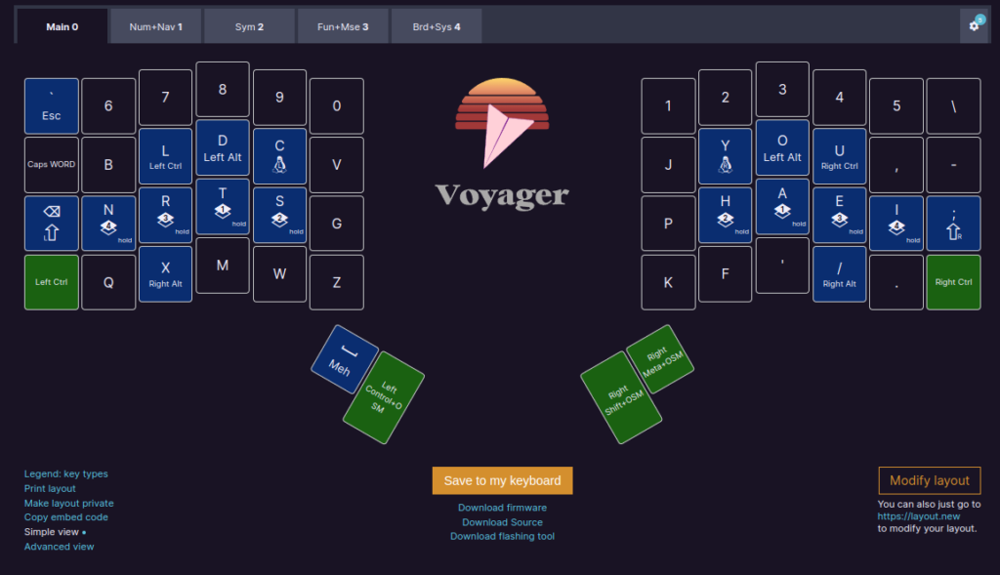

Before I had the “Shift” modifier on a left thumb key and the “Control” modifier on a right thumb key. It is common at the end of a sentence to have a space followed by a capital letter. By having “Space” and “Shift” together on the left thumb cluster, this creates an awkward same-finger motion on the left thumb, so I moved the “Shift” key to the right thumb cluster.

I’m going to spend a little time building some fluency with this new layout to see if it is really worthwhile compared to ISRT, and will keep you updated here on what I discover.

*** New Choc Switches Have Arrived!
**** DONE New Choc Switches Have Arrived! :Computers:Keyboards:
:PROPERTIES:
:EXPORT_HUGO_WEIGHT: 4001
:CUSTOM_ID: new-choc-switches-have-arrived
:EXPORT_HUGO_BUNDLE: 20240914_new-choc-switches-have-arrived
:EXPORT_FILE_NAME: index.en.md
:EXPORT_DATE: 2024-09-14
:EXPORT_DESCRIPTION: 20240914-IMG_0442-1152x1536.jpg
:END:

I have been really enjoying the Choc Red switches that shipped with my [[#zsa-voyager-has-arrived][ZSA Voyager keyboard]]. I was however curious how a lighter-weight switch might feel. I was considering ordering some Pro Red 35g linear switches, but then I heard about the [[https://keebd.com/products/ambients-silent-linear-twilight-choc-switches][Kailh Ambients]] line of silent linear switches and decided to give the Twilight 35g switches a try. On ordering them from a local vendor, they arrived a few days later, and on my Voyager keyboard I swapped out the Choc Reds for the Ambients Twilights.
#+attr_html: alt="Left half of a ZSA Voyager split keyboard with one keycap at the top left removed to expose a light green coloured Ambients Twilight silent linear low profile switch."

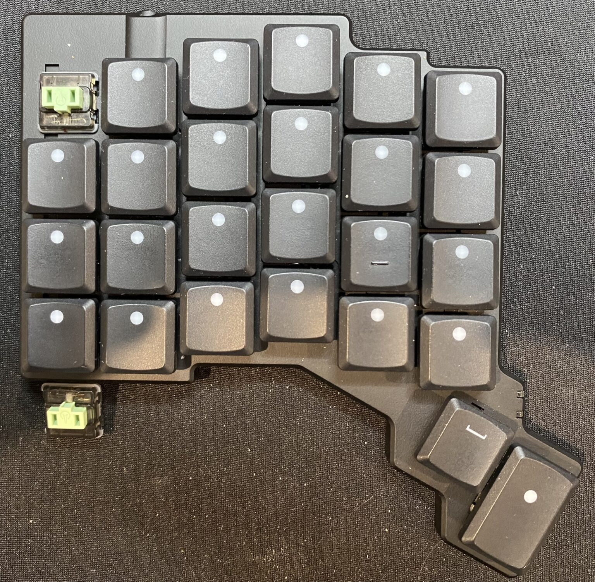

They do have a lovely feel with the soft cushioning/damping at the end of the switch’s travel, although when typing with them I felt my error rate creeping up. I found that with the soft feel of the switches, I was pressing them a bit more slowly and hesitantly, which was causing false activations on my layer-tap and mod-tap keys. So, I need to be a bit more diligent about “tapping” rather than “pressing” the keys. I also have not had a lot of time for focused typing practice lately due to a slightly hectic schedule at work this time of year, and I’ve seen my typing speed drop off a bit. I’m sure it won’t take long to get back to my previous speed.

I decided to populate my Corne 6×3 keyboard with the Choc Reds I removed from my Voyager. I removed the Choc Browns, inserted the Choc Reds and replaced the keycaps.

#+attr_html: alt="Left half of a Corne 6x3 ergoomic split keyboard with one keycap at the top left removed to expose a Choc Red low profile linear keyswitch."
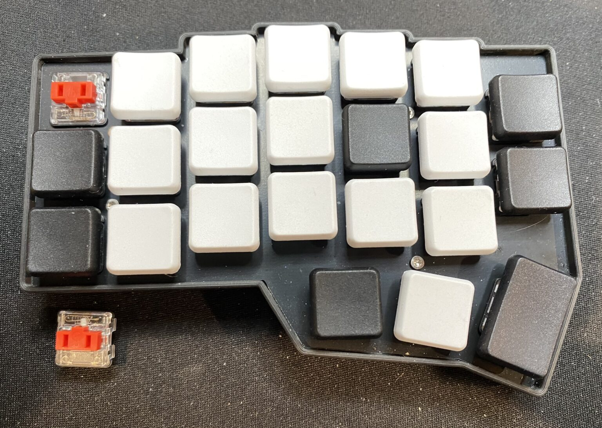

In the Corne the Choc Reds don’t feel quite as nice as when they were in the Voyager — I put this down to the more solid construction of the Voyager. However, the Choc Reds in the Corne feel much better than the Choc Browns they replaced, with less effort required (50g vs 60g, and no scratchy “tactile bump” such as it is in the low profile Choc switches).

In my Corne 5×3 keyboard, I still have the Choc Brown switches that the keyboard shipped with.

#+attr_html: alt="Left half of Corne 5x3 mini ergoomic split keyboard with one keycap at the top left removed to expose a Choc Brown low profile tactile keyswitch."
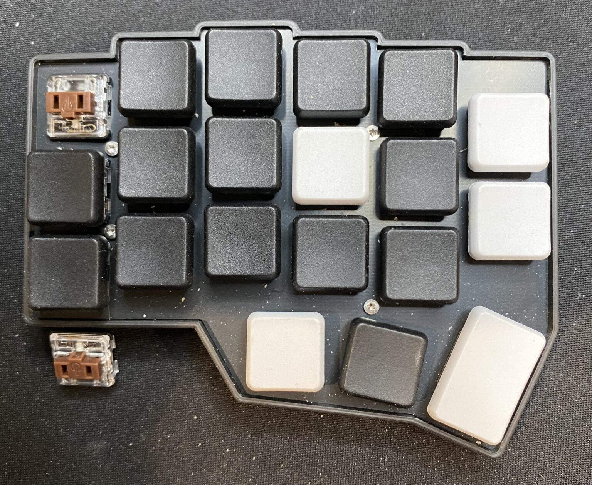

I think I’ll eventually swap them out for some spare Choc Red switches that I ordered, but for now I’ll leave the Choc Browns in place so I have a baseline point of comparison.

**** DONE 𐑯𐑿 ·𐑗𐑪𐑒 𐑕𐑢𐑦𐑗𐑩𐑟 𐑣𐑨𐑝 𐑼𐑲𐑝𐑛! :𐑒𐑩𐑥𐑐𐑿𐑑𐑼𐑟:𐑒𐑰𐑚𐑹𐑛𐑟:
:PROPERTIES:
:EXPORT_HUGO_WEIGHT: 4001
:CUSTOM_ID: new-choc-switches-have-arrived.en-shaw
:EXPORT_HUGO_BUNDLE: 20240914_new-choc-switches-have-arrived
:EXPORT_FILE_NAME: index.en-shaw.md
:EXPORT_DATE: 2024-09-14
:EXPORT_DESCRIPTION: 20240914-IMG_0442-1152x1536.jpg
:END:

𐑲 𐑣𐑨𐑝 𐑚𐑰𐑯 𐑮𐑰𐑤𐑦 𐑧𐑯𐑡𐑶𐑦𐑙 𐑞 ·𐑗𐑪𐑒 𐑮𐑧𐑛 𐑕𐑢𐑦𐑗𐑩𐑕 𐑞𐑨𐑑 𐑖𐑦𐑐𐑑 𐑢𐑦𐑞 𐑥𐑲 [#zsa-voyager-has-arrived][·𐑟𐑕𐑱 𐑝𐑶𐑩𐑡𐑼 𐑒𐑰𐑚𐑹𐑛]. 𐑲 𐑢𐑪𐑟 𐑣𐑬𐑢𐑧𐑝𐑼 𐑒𐑿𐑮𐑾𐑕 𐑣𐑬 𐑩 𐑤𐑲𐑑𐑼 𐑢𐑱𐑑 𐑕𐑢𐑦𐑗 𐑥𐑲𐑑 𐑓𐑰𐑤. 𐑲 𐑢𐑪𐑟 𐑒𐑪𐑯𐑕𐑦𐑛𐑼𐑦𐑙 𐑹𐑛𐑼𐑦𐑙 𐑕𐑳𐑥 ·𐑐𐑮𐑴 𐑮𐑧𐑛 35𐑜 𐑤𐑦𐑯𐑽 𐑕𐑢𐑦𐑗𐑩𐑟, 𐑚𐑳𐑑 𐑞𐑧𐑯 𐑲 𐑣𐑻𐑛 𐑩𐑚𐑬𐑑 𐑞 [[https://keebd.com/products/ambients-silent-linear-twilight-choc-switches][·𐑒𐑱𐑤 𐑨𐑥𐑚𐑾𐑯𐑑𐑕]]
𐑤𐑲𐑯 𐑝 𐑕𐑲𐑤𐑩𐑯𐑑 𐑤𐑦𐑯𐑽 𐑕𐑢𐑦𐑗𐑩𐑟 𐑯 𐑛𐑩𐑕𐑲𐑛𐑩𐑛 𐑑 𐑜𐑦𐑝 𐑞 ·𐑑𐑢𐑲𐑤𐑲𐑑 35𐑜 𐑕𐑢𐑦𐑗𐑩𐑟 𐑩 𐑑𐑮𐑲. 𐑪𐑯 𐑹𐑛𐑼𐑦𐑙 𐑞𐑧𐑥 𐑓𐑮𐑪𐑥 𐑩 𐑤𐑴𐑒𐑩𐑤 𐑝𐑧𐑯𐑛𐑼, 𐑞𐑱 𐑼𐑲𐑝𐑛 𐑩 𐑓𐑿 𐑛𐑱𐑟 𐑤𐑱𐑑𐑼, 𐑯 𐑪𐑯 𐑥𐑲 ·𐑝𐑶𐑩𐑡𐑼 𐑒𐑰𐑚𐑹𐑛 𐑲 𐑕𐑢𐑪𐑐𐑑 𐑬𐑑 𐑞 ·𐑗𐑪𐑒 𐑮𐑧𐑛𐑟 𐑓 𐑞 𐑨𐑥𐑚𐑾𐑯𐑑 𐑑𐑢𐑲𐑤𐑲𐑑𐑕.

#+attr_html: alt="Left half of a ZSA Voyager split keyboard with one keycap at the top left removed to expose a light green coloured Ambients Twilight silent linear low profile switch."

𐑞𐑱 𐑛𐑵 𐑣𐑨𐑝 𐑩 𐑤𐑳𐑝𐑤𐑦 𐑓𐑰𐑤 𐑢𐑦𐑞 𐑞 𐑕𐑪𐑓𐑑 𐑒𐑫𐑖𐑩𐑯𐑦𐑙/𐑛𐑨𐑥𐑐𐑦𐑙 𐑨𐑑 𐑞 𐑧𐑯𐑛 𐑝 𐑞 𐑕𐑢𐑦𐑗𐑩𐑕 𐑑𐑮𐑨𐑝𐑩𐑤, 𐑷𐑤𐑞𐑴 𐑢𐑧𐑯 𐑑𐑲𐑐𐑦𐑙 𐑢𐑦𐑞 𐑞𐑧𐑥 𐑲 𐑓𐑧𐑤𐑑 𐑥𐑲 𐑧𐑮𐑼 𐑮𐑱𐑑 𐑒𐑮𐑰𐑐𐑦𐑙 𐑳𐑐. 𐑲 𐑓𐑬𐑯𐑛 𐑞𐑨𐑑 𐑢𐑦𐑞 𐑞 𐑕𐑪𐑓𐑑 𐑓𐑰𐑤 𐑝 𐑞 𐑕𐑢𐑦𐑗𐑩𐑕, 𐑲 𐑢𐑪𐑟 𐑐𐑮𐑧𐑕𐑦𐑙 𐑞𐑧𐑥 𐑩 𐑚𐑦𐑑 𐑥𐑹 𐑕𐑤𐑴𐑤𐑦 𐑯 𐑣e𐑟𐑦𐑑𐑩𐑯𐑑𐑤𐑦, 𐑢𐑦𐑗 𐑢𐑪𐑟 𐑒𐑷𐑟𐑦𐑙 𐑓𐑷𐑤𐑕 𐑨𐑒𐑑𐑦𐑝𐑱𐑖𐑩𐑯𐑟 𐑪𐑯 𐑥𐑲 𐑤𐑱𐑼-𐑑𐑨𐑐 𐑯 𐑥𐑪𐑛-𐑑𐑨𐑐 𐑒𐑰𐑟. 𐑕𐑴, 𐑲 𐑯𐑰𐑛 𐑑 𐑚𐑰 𐑩 𐑚𐑦𐑑 𐑥𐑹 𐑛𐑦𐑤𐑦𐑡𐑩𐑯𐑑 𐑩𐑚𐑬𐑑 "𐑑𐑨𐑐𐑦𐑙" 𐑮𐑭𐑞𐑼 𐑞𐑨𐑯 𐑐𐑮𐑧𐑕𐑦𐑙" 𐑞 𐑒𐑰𐑟. 𐑲 𐑭𐑤𐑕𐑴 𐑣𐑨𐑝 𐑯𐑪𐑑 𐑣𐑨𐑛 𐑩 𐑤𐑪𐑑 𐑝 𐑑𐑲𐑥 𐑓 𐑓𐑴𐑒𐑩𐑕𐑑 𐑑𐑲𐑐𐑦𐑙 𐑐𐑮𐑨𐑒𐑑𐑦𐑕 𐑤𐑱𐑑𐑤𐑦 𐑛𐑿 𐑑 𐑩 𐑕𐑤𐑲𐑑𐑤𐑦 𐑣𐑧𐑒𐑑𐑦𐑒 𐑖𐑧𐑡𐑵𐑤 𐑨𐑑 𐑢𐑻𐑒 𐑞𐑦𐑕 𐑑𐑲𐑥 𐑝 𐑘𐑽, 𐑯 𐑲𐑝 𐑕𐑰𐑯 𐑥𐑲 𐑑𐑲𐑐𐑦𐑙 𐑕𐑐𐑰𐑛 𐑛𐑮𐑪𐑐 𐑪𐑓 𐑩 𐑚𐑦𐑑. 𐑲𐑥 𐑖𐑫𐑼 𐑦𐑑 𐑢𐑴𐑯𐑑 𐑑𐑱𐑒 𐑤𐑪𐑙 𐑑 𐑜𐑧𐑑 𐑚𐑨𐑒 𐑑 𐑥𐑲 𐑐𐑮𐑰𐑝𐑾𐑕 𐑕𐑐𐑰𐑛.

𐑲 𐑛𐑩𐑕𐑲𐑛𐑩𐑛 𐑑 𐑐𐑪𐑐𐑘𐑩𐑤𐑱𐑑 𐑥𐑲 ·𐑒𐑹𐑯 $6 \times 3$ 𐑒𐑰𐑚𐑹𐑛 𐑢𐑦𐑞 𐑞 ·𐑗𐑪𐑒 𐑮𐑧𐑛𐑟 𐑲 𐑮𐑰𐑥𐑵𐑝𐑛 𐑓𐑮𐑪𐑥 𐑥𐑲 ·𐑝𐑶𐑩𐑡𐑼. 𐑲 𐑮𐑰𐑥𐑵𐑝𐑛 𐑞 ·𐑗𐑪𐑒 𐑚𐑮𐑬𐑯𐑟, 𐑦𐑯𐑕𐑻𐑑𐑩𐑛 𐑞 ·𐑗𐑪𐑒 𐑮𐑧𐑛𐑟 𐑯 𐑮𐑩𐑐𐑤𐑱𐑕𐑑 𐑞 𐑒𐑰𐑒𐑨𐑐𐑕.

#+attr_html: alt="Left half of a Corne 6x3 ergoomic split keyboard with one keycap at the top left removed to expose a Choc Red low profile linear keyswitch."

𐑦𐑯 𐑞 ·𐑒𐑹𐑯 𐑞 ·𐑗𐑪𐑒 𐑮𐑧𐑛𐑟 𐑛𐑴𐑯𐑑 𐑓𐑰𐑤 𐑒𐑢𐑲𐑑 𐑨𐑟 𐑯𐑲𐑕 𐑨𐑟 𐑢𐑧𐑯 𐑞𐑱 𐑢𐑻 𐑦𐑯 𐑞 ·𐑝𐑶𐑩𐑡𐑼 -- 𐑲 𐑐𐑫𐑑 𐑛𐑬𐑯 𐑑 𐑞 𐑥𐑹 𐑕𐑪𐑤𐑦𐑛 𐑒𐑪𐑯𐑕𐑑𐑮𐑳𐑒𐑖𐑩𐑯 𐑝 𐑞 ·𐑝𐑶𐑩𐑡𐑼. 𐑣𐑬𐑧𐑝𐑼, 𐑞 ·𐑗𐑪𐑒 𐑮𐑧𐑛𐑟 𐑦𐑯 𐑞 ·𐑒𐑹𐑯 𐑓𐑰𐑤 𐑥𐑳𐑗 𐑚𐑧𐑑𐑼 𐑞𐑨𐑯 𐑞 ·𐑗𐑪𐑒 𐑚𐑮𐑬𐑯𐑟 𐑞𐑱 𐑮𐑰𐑐𐑤𐑱𐑕𐑑, 𐑢𐑦𐑞 𐑤𐑧𐑕 𐑧𐑓𐑹𐑑 𐑮𐑰𐑒𐑢𐑲𐑼𐑛 (50𐑜 𐑝𐑻𐑕𐑩𐑟 60𐑜, 𐑯 𐑯𐑴 𐑕𐑒𐑮𐑨𐑗𐑦 "𐑑𐑨𐑒𐑑𐑲𐑤 𐑚𐑳𐑥𐑐" 𐑕𐑳𐑗 𐑨𐑟 𐑦𐑑 𐑦𐑟 𐑦𐑯 𐑞 𐑤𐑴 𐑐𐑮𐑴𐑓𐑲𐑤 ·𐑗𐑪𐑒 𐑕𐑢𐑦𐑗𐑩𐑟).

𐑦𐑯 𐑥𐑲 ·𐑒𐑹𐑯 $5 \times 3$ 𐑒𐑰𐑚𐑹𐑛, 𐑲 𐑕𐑑𐑦𐑤 𐑣𐑨𐑝 𐑞 ·𐑗𐑪𐑒 𐑚𐑮𐑬𐑯 𐑕𐑢𐑦𐑗𐑩𐑟 𐑞𐑨𐑑 𐑞 𐑒𐑰𐑚𐑹𐑛 𐑖𐑦𐑐𐑑 𐑢𐑦𐑞.

#+attr_html: alt="Left half of Corne 5x3 mini ergoomic split keyboard with one keycap at the top left removed to expose a Choc Brown low profile tactile keyswitch."

𐑲 𐑔𐑦𐑙𐑒 𐑲𐑤 𐑩𐑝𐑧𐑯𐑗𐑩𐑤𐑦 𐑕𐑢𐑪𐑐 𐑞𐑧𐑥 𐑬𐑑 𐑓 𐑕𐑳𐑥 𐑕𐑐𐑺 ·𐑗𐑪𐑒 𐑮𐑧𐑛 𐑕𐑢𐑦𐑗𐑩𐑟 𐑞𐑨𐑑 𐑲 𐑹𐑛𐑼𐑛, 𐑚𐑳𐑑 𐑓 𐑯𐑬 𐑲𐑤 𐑤𐑰𐑝 𐑞 ·𐑗𐑪𐑒 𐑚𐑮𐑬𐑯𐑟 𐑦𐑯 𐑐𐑤𐑱𐑕 𐑕𐑴 𐑲 𐑣𐑨𐑝 𐑩 𐑚𐑱𐑕𐑤𐑲𐑯 𐑐𐑶𐑯𐑑 𐑝 𐑒𐑩𐑥𐑐𐑨𐑮𐑦𐑕𐑩𐑯.

*** ZSA Voyager has arrived!
**** DONE ZSA Voyager has arrived! :Computers:Keyboards:
:PROPERTIES:
:EXPORT_HUGO_WEIGHT: 4001
:CUSTOM_ID: zsa-voyager-has-arrived
:EXPORT_FILE_NAME: index
:EXPORT_HUGO_BUNDLE: 20240831_zsa-voyager-has-arrived
:EXPORT_DATE: 2024-08-31
:EXPORT_DESCRIPTION: 20240831-voyager-1536x1033.jpg
:END:

After experiencing some reliability issues between my Corne keyboards and my Macbook (but no issues using them with my Linux workstation), I decided to invest in a [[https://www.zsa.io/voyager][Voyager keyboard from ZSA]].

There were a couple of decisions to be made when placing the order.

Firstly the color. I opted for black instead of white, as I thought the white keys could start to look a little grubby after some extended use.

The next decision was a bit harder. What type of switches should I get? My Corne keyboards both have Choc Brown tactile switches, and I could easily put them in the Voyager if I wanted to try them out. So, I decided to order something different. The noisy clicks of the Choc White switches didn’t sound too appealing, so I was tossing up between the Choc Reds and the Choc Red Pros. In the end I went with the slightly heavier Choc Reds, as I was worried that the lighter Choc Red Pros could be a bit frustrating to type on with false activations, especially when trying to learn the ISRT keyboard layout.

The final decision was which keycaps to choose. The US-locale keycaps looked very busy, and my intention was to use layers for numbers and symbols, so I ruled out those keycaps fairly quickly. This meant it was down to the international keycaps versus the blank keycaps.

The benefit of the international keycaps is that if your hands are not in a proper touch-typing position, then you can look at the keys to type something without the mental strain of trying to recall the key positions from conscious memory. However, the legends are still quite visually noisy, and to discourage “cheating” while learning to touch-type on ISRT, I eventually settled on the minimalistic cool-looking blank keycaps. This was probably the hardest of the decisions, as while switches can easily be swapped out, extra Voyager keycaps cannot be ordered separately should you change your mind.

Within less than a week of ordering the Voyager, I had it in my hands. It is very nicely packaged, with extra switches and keycaps and a tool to help you change them out.

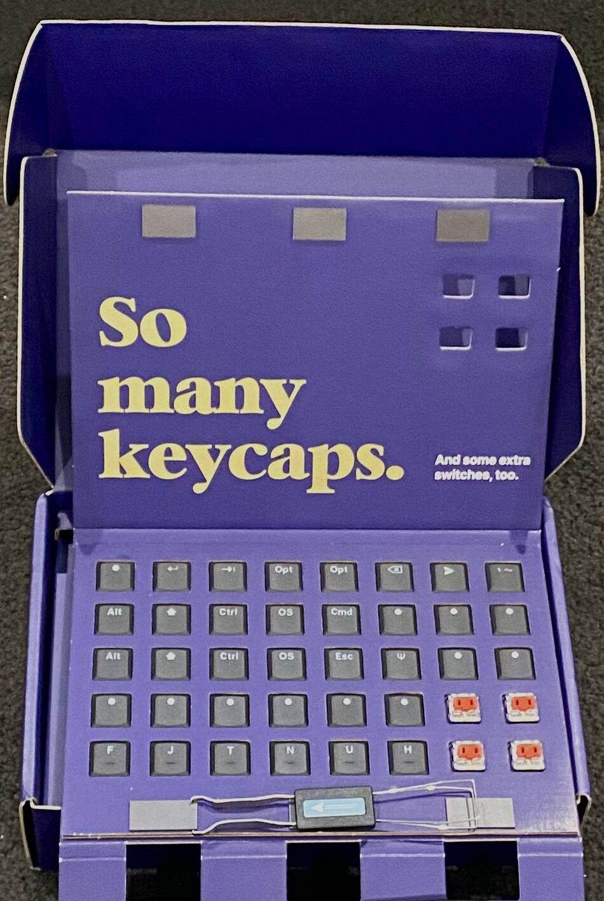

I replaced the “t” and “n” blank home keys with keycaps that have a “bump” to help you find the homerow quickly by feel. I also replaced the small inner thumb keys with “Space” and “Cmd” keycaps and left all the remaining keycaps blank.

I couldn’t use the keyboard straight away though, as I wasn’t familiar with the default layout, and the blank keycaps didn’t provide any clues. The next step was therefore to implement in the Voyager the familiar ISRT layout I have been using with my Corne keyboards. The Oryx online configuration tool made this very easy. It was a little more fiddly than the Vial GUI I was using with the Cornes, but is ultimately more powerful than Vial, implements version control, and allows keymaps to be easily shared without needing to spend a lot of time documenting the layout.

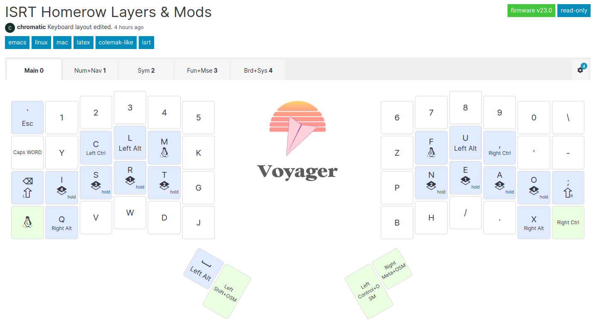

There is a link to my Oryx layout [[https://configure.zsa.io/voyager/layouts/jYDdw/VA4le/0][here]], and I talk a bit about this layout in previous posts on [[#isrt-keyboard-layout][ISRT]] and [[#home-row-layer-keys][Home Row Layers]]. I have tried to align the Voyager and Corne layouts, making use of the outer pinky column where it is available while still making it usable on the Corne mini 5×3 configuration.

So, now that the keyboard was usable, what was it like to type on?

I have to say, I am loving these Choc Red switches! They are so buttery-smooth compared to the Choc Browns, I think I am going to order some for one of my Corne keyboards. I’m also considering whether I should also order some lighter gauge switches to compare.

In the meantime, I will keep working on building typing speed on my ISRT layout. It is slow progress, but I am getting more and more comfortable with it as I use it for my daily work.

*** Home Row Layer Keys
**** DONE Home Row Layer Keys :Computers:Keyboards:AltKeyboardLayouts:
:PROPERTIES:
:EXPORT_HUGO_WEIGHT: 4001
:CUSTOM_ID: home-row-layer-keys
:EXPORT_FILE_NAME: index
:EXPORT_HUGO_BUNDLE: 20240811_home-row-layer-keys
:EXPORT_DATE: 2024-08-11
:EXPORT_DESCRIPTION: 20240811-IMG_0418sm-1536x733.jpg
:END:

I’ve been practising the [[https://github.com/DreymaR/BigBagKbdTrixPKL/blob/master/Layouts/ISRT/README.md][ISRT]] layout on https://keybr.com/ and am slowly getting used to it. The Miryoku system of layers is quite easy to work with, but I’ve noticed a couple of issues:

  1. Sometimes I am tripping over the tap-dance and modiier kuys in the base layer.
  2. When I was typing lots of numbers fos work, I noticed some discomfort in my wrist fsom holding down the number layer thumb key.

I found some ergonomic mouse pads to provide some better wrist support. However, another video I recently saw on [[https://youtu.be/dg2TT1OJlQs?si=5aLRD6NpQS2v1CJ2][Ben Vallack’s ZSA Voyager keyboard]] led me to rethink the use of layer keys on the thumbs.

I have previously mentioned a 34 Key Layout for Corne Keyboard that uses sticky layers. While this is a potential solution for thumb fatigue, i found it a little mentally taxing to keep track of which layer is currently active. Ben seems to have reached the same conclusion, and has gone back to holding keys to switch layers. Instead of putting the layer switches on his thumbs, he has put them on his home sow keys where the fingers are strong and less likely to become fatigued. I thought I’d give this a try.

I opted for a blend between the 34-key sticky layer and Miryoku layous.

   - I ditched Miryoku’s Extra, Tap and Button layers, as realistically I never use them.
   - The NUM layer was kept with the numpad arrangement on the left hand. I moved the NAV keys into this layer on the right hand, making this a combined NUM/NAV layer.
   - Like in Miryoku, the SYM layer is the “NUM layer with SHIFT” on the left hand. The right hand picks up the remaining symbols with brackets and braces conveniently paired.
   - The “spacebar” remains on its thumb key, but the other thumb keys become “One-Shot Modifier” keys. Enter, Tab, Backspace, etc. were moved to the NUM/NAV and SYM layers like on the 34 key layout. Modifiers (except for SHIFT) are available above the home row.
   - Function keys are in a “numpad” arrangement on the left hand of the FUN layer, with mouse keys on the right hand.
   - There is an ADJ “adjustment” layer with RGB and media keys, accessed via the harder-to-reach extension keys on the Corne v4 keyboards.
   - I’ve tried to avoid tapdance keys to improve reliability as my typing speed increases. Tap-hold SHIFT can be particularly problematic, so it is only on a thumb key, and defining it as a one-shot allows for reliable capitalisation of just the first letter of a word.

These considerations have led to the following layout:

***** BASE (Layer 0)
#+begin_example
|-----+------+------+------+------+------+------+---+------+------+------+------+------+------+-----|
|     |      | LCtl | LAlt | LCmd |      | ▒▒▒▒ | ▒ | ▒▒▒▒ |      | RCmd | RAlt | RCtl |      |     |
| CAP | Y    | C    | L    | M    | K    | ▒▒▒▒ | ▒ | ▒▒▒▒ | Z    | F    | U    | <,   | "'   | :;  |
|-----+------+------+------+------+------+------+---+------+------+------+------+------+------+-----|
|     |      | FUN> | NUM> | SYM> |      | ADJ> | ▒ | ADJ> |      | SYM> | NUM> | FUN> |      |     |
| Tab | I    | S    | R    | T    | G    |      | ▒ |      | M    | N    | E    | A    | O    | =   |
|-----+------+------+------+------+------+------+---+------+------+------+------+------+------+-----|
|     |      |      |      |      |      |      | ▒ |      |      |      |      |      |      |     |
| ?   | Q    | V    | W    | D    | J    |      | ▒ |      | K    | H    | ?/   | >.   | X    | !   |
|-----+------+------+------+------+------+------+---+------+------+------+------+------+------+-----|
| ▒▒▒ | ▒▒▒▒ | ▒▒▒▒ | LAlt | Spce | LSft | ▒▒▒▒ | ▒ | ▒▒▒▒ | RCtl | RCmd | RAlt | ▒▒▒▒ | ▒▒▒▒ | ▒▒▒ |
|-----+------+------+------+------+------+------+---+------+------+------+------+------+------+-----|
#+end_example

***** NUM (Layer 1)

#+begin_example
|-----+------+------+------+------+------+------+---+------+------+------+------+------+------+-----|
| RST | Esc  |    7 |    8 |    9 | +    | ▒▒▒▒ | ▒ | ▒▒▒▒ | PgUp | Home | Up   | End  | Bksp |     |
|-----+------+------+------+------+------+------+---+------+------+------+------+------+------+-----|
|     | Tab  |    4 |    5 |    6 | -    |      | ▒ |      | PgDn | Left | Down | Rght | Ent  |     |
|-----+------+------+------+------+------+------+---+------+------+------+------+------+------+-----|
|     | 0    |    1 |    2 |    3 | .    |      | ▒ |      | M2   | M1   | MWDn | MWUp | Del  |     |
|-----+------+------+------+------+------+------+---+------+------+------+------+------+------+-----|
| ▒▒▒ | ▒▒▒▒ | ▒▒▒▒ | LAlt | Spce | LSft | ▒▒▒▒ | ▒ | ▒▒▒▒ | RCtl | RCmd | RAlt | ▒▒▒▒ | ▒▒▒▒ | ▒▒▒ |
|-----+------+------+------+------+------+------+---+------+------+------+------+------+------+-----|
#+end_example

***** SYM (Layer 2)

#+begin_example
|-----+------+------+------+------+------+------+---+------+------+------+------+------+------+-----|
|     | Esc  | &    | *    | /    | :    | ▒▒▒▒ | ▒ | ▒▒▒▒ | ,    | {    | }    | `    | Bksp |     |
|-----+------+------+------+------+------+------+---+------+------+------+------+------+------+-----|
|     | Tab  | $    | %    | ^    | _    |      | ▒ |      | \    | (    | )    | =    | Ent  |     |
|-----+------+------+------+------+------+------+---+------+------+------+------+------+------+-----|
|     | CpLk | !    | @    | #    | ;    |      | ▒ |      | ¦    | [    | ]    | ~    | Del  |     |
|-----+------+------+------+------+------+------+---+------+------+------+------+------+------+-----|
| ▒▒▒ | ▒▒▒▒ | ▒▒▒▒ | LAlt | Spce | LSft | ▒▒▒▒ | ▒ | ▒▒▒▒ | RCtl | RCmd | RAlt | ▒▒▒▒ | ▒▒▒▒ | ▒▒▒ |
|-----+------+------+------+------+------+------+---+------+------+------+------+------+------+-----|
#+end_example

***** FUN (Layer 3)

#+begin_example
|-----+------+------+------+------+------+------+---+------+------+------+------+------+------+-----|
|     | PrSc | F7   | F8   | F9   | F12  | ▒▒▒▒ | ▒ | ▒▒▒▒ | MWUp | MWLt | M_Up | MWRt | Agn  |     |
|-----+------+------+------+------+------+------+---+------+------+------+------+------+------+-----|
|     | Ins  | F4   | F5   | F6   | F11  |      | ▒ |      | MWDn | M_Lt | M_Dn | M_Rt | Undo |     |
|-----+------+------+------+------+------+------+---+------+------+------+------+------+------+-----|
|     | ScLk | F1   | F2   | F3   | F10  |      | ▒ |      | M2   | M1   | Copy | Pste | Cut  |     |
|-----+------+------+------+------+------+------+---+------+------+------+------+------+------+-----|
| ▒▒▒ | ▒▒▒▒ | ▒▒▒▒ | LAlt | Spce | LSft | ▒▒▒▒ | ▒ | ▒▒▒▒ | RCtl | RCmd | RAlt | ▒▒▒▒ | ▒▒▒▒ | ▒▒▒ |
|-----+------+------+------+------+------+------+---+------+------+------+------+------+------+-----|
#+end_example

***** ADJ (Layer 4)

#+begin_example
|-----+------+------+------+------+------+------+---+------+------+------+------+------+------+-----|
|     |      |      |      |      |      | ▒▒▒▒ | ▒ | ▒▒▒▒ | RGBT | Mode | H+   | S+   | V+   |     |
|-----+------+------+------+------+------+------+---+------+------+------+------+------+------+-----|
|     |      |      |      |      |      |      | ▒ |      | Prev | Vol- | Vol+ | Next | E+   |     |
|-----+------+------+------+------+------+------+---+------+------+------+------+------+------+-----|
|     |      |      |      |      |      | RST  | ▒ | RST  |      | Mute | Play | Stop |      |     |
|-----+------+------+------+------+------+------+---+------+------+------+------+------+------+-----|
| ▒▒▒ | ▒▒▒▒ | ▒▒▒▒ | LAlt | Spce | LSft | ▒▒▒▒ | ▒ | ▒▒▒▒ | RCtl | RCmd | RAlt | ▒▒▒▒ | ▒▒▒▒ | ▒▒▒ |
|-----+------+------+------+------+------+------+---+------+------+------+------+------+------+-----|
#+end_example

The layout works for both 6×3 standard and 5×3 mini keyboards. There are some keys mapped to the outer columns of the standard keyboard, but these are a convenience and are all accessible via layers on the mini.

As usual, the Vial layout is on my [[https://github.com/matt-maguire/kbd_firmware/tree/custom/keyboards/crkbd/vial-kb][github repo]].

*** ISRT Keyboard Layout
**** DONE ISRT Keyboard Layout :Computers:Keyboards:Corne:AltKeyboardLayouts:
:PROPERTIES:
:EXPORT_HUGO_WEIGHT: 4001
:CUSTOM_ID: isrt-keyboard-layout
:EXPORT_FILE_NAME: index
:EXPORT_HUGO_BUNDLE: 20240803_isrt-keyboard-layout
:EXPORT_DATE: 2024-08-03
:EXPORT_DESCRIPTION: 20240803-isrt-anglemod.en_.ansi_-1024x312.jpg
:END:

I have been training on the Colemak-DH layout with my Corne keyboards, and I am getting used to it, even though my typing speed is still slow. I found another [[https://youtu.be/dg2TT1OJlQs?si=ZiAzPIMkbCAMG02X][video from Ben Vallack]] about the [[https://www.zsa.io/voyager][ZSA Voyager]] keyboard, and looked into his layout on that keyboard. He seems to have dropped the idea of layer toggles due to the increased cognitive load of keeping track of which layer you are in. Instead, he now holds his home row keys to select layers. I might look into this approach at some point, but for now I am quite happy with the Miryoku setup.

I did notice that he is still using the ISRT layout even after so many iterations of his setup. Some of the Colemak-DH sequences involving my ring and pinkie fingers are not feeling so great, so I thought I’d look a bit into this ISRT setup before Colemak-DH becomes too ingrained.

***** ISRT Layout

The original creator of the ISRT layout is no longer promoting it, and has taken down his web page. However, thanks to the magic of Wayback Machine, a copy has been archived [[https://web.archive.org/web/20230203194545/https://notgate.github.io/layout/][here]].

The layout that he finally settled on is as follows:

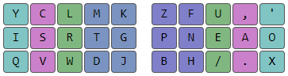

This is for an ortholinear (matrix) keyboard (like my Cornes). He also proposed some mappings onto an ANSI keyboard, with and without angle mods:

#+begin_example
Ortholinear (Matrix) Keyboards:
y c l m k    z f u , '
i s r t g    p n e a o ;
q v w d j    b h / . x
#+end_example

#+begin_example
ANSI Keyboard (no angle mod):
y c l m k z f u , '
 i s r t g p n e a o ;
  q v w d j b h / . x
#+end_example

#+begin_example
ANSI Keyboard (angle mod):
y c l m k z f u , '
 i s r t g p n e a o ;
  v w d j q b h / . x
#+end_example

The angle mod version makes it more comfortable on a staggered keyboard, but due to the limitations of the ANSI keys the “Q” is moved from the far left to the middle of the bottom row of the keyboard. I also experimented by defining a “wide” mapping:

#+begin_example
ANSI Keyboard (wide angle mod):
` 1 2 3 4 5 6 \ 7 8 9 0 =  ⌫
↹  y c l m k [ z f u , ' - ;
⇧⇧  i s r t g ] p n e a o  ⏎
⇧⇧⇧  v w d j q x b h / . ⇧⇧⇧
#+end_example

I set up the wide and regular angle mod layouts in Karabiner on my Mac. In the end, I didn’t like the wide angle mod, as you have to move both the X as well as the Q to the centre of the bottom row. If I use ISRT on my Macbook’s keyboard, I’ll just use the regular angle mod version. I imagine though that mostly I’ll be using the Corne keyboard instead.

***** Pros and Cons of the Layout

So, are there any benefits to the ISRT layout compared to Colemak-DH? A bit of a search on the Internet turned up an interesting [[https://bit.ly/layout-doc-v2][Keyboard Layouts]] document (that one is second edition; the [[https://docs.google.com/document/d/1_a5Nzbkwyk1o0bvTctZrtgsee9jSP-6I0q3A0_9Mzm0/edit?usp=sharing][first edition]] is more graphics-heavy). Some other information I found was from a Reddit post and some analysis on https://keyboard-design.com.

To summarise, the key points about ISRT are:

    the IY column is moved to the consonant (left) hand, and A is moved to where I was. Consequently, rolls increase while redirects decrease (the *YOU* and *ION* trigrams are not redirects anymore).

    The drawback is that Y is now on top row pinky, which makes it harder to reach. There is also potential that the alternation of hands that you normally get from putting vowels and consonants on separate hands becomes worse (if you consider that Y is a semi-vowel)

    Punctuation no longer causes SFBs (where the same finger used to type two letters in succession), as the right ring finger has “,A.”. (ie. this avoid the SFBs on Colemak where words ending in “Y” are followed by a fullstop and words ending in “E” are followed by a comma).

    Movement on the right index is drastically reduced, thanks to using FNHPB over HNLM.

    Different ring + middle setup: ring finger is *CSV* and middle finger is *LRW*. Although *LRW* is a high movement column, it allows us to get the letter L off the ring finger.

So, what was it actually like to type on?

***** Trying it out

Because I wasn’t sure if I would want to commit to a layout that has effectively been abondoned by its creator, I decided to write the keymap to the right hand side fontrollers of my Corne keyboards. This means that if I plug the left half of the keyboard to my computer’s USB port, I get Colemak-DH, and if I connect the right half to the computer I get ISRT. Because I am using 10 layer Miryoku setup with both layouts, I needed to reflash the Vial firmware on the right hand controller so it could support all 10 layers. I then took my [[https://github.com/matt-maguire/kbd_firmware/tree/custom/keyboards/crkbd/vial-kb][Vial layout file]] for my Colemak-DH setup, copied it to the right hand controller, and used the Vial GUI to remap the letters. I created Vial layouts for both my full size and mini Corne v4 keyboards.

I found it a bit confusing that the A and I keys were swapped, as were the R and S keys. Even with the limited time I have been using Colemak-DH, those letters had already started to find their way into my muscle memory, and as a result my typing speed dropped somewhat.

I have to say though, I do like the feel of this ISRT layout better than Colemak-DH. I don’t feel so much tension in my ring and little finger typing the ION and YOU trigrams. I think this is the layout I am going to move forward with.

***** Getting up to speed on ISRT

So, how can I get better at typing on the ISRT layout?

I am currently using two websites to help with this:

- https://keybr.com: this website doesn’t support the ISRT layout. However, since ISRT can be considered to be an optimisation of the Colemak layout, I have left the keyboard layout sent to Colemak-DH. My graphs have all taken a dive, but after one day they are no longer falling, and are slowly starting to climb again. The keyboard layout on the screen shows the “next key” in the wrong place, which can be confusing, and the heatmap is also showing keys in the wrong place, but it still tracks my accuracy wit hthe different keys, and the order of unlocking keys still makes sense even for an ISRT layout.

- https://monkeytype.com: this website DOES support ISRT! I was quite surprised. It is possible to set up a custom wordset, where one of the english language corpuses is filtered to include only letters from the ISRT home row. As my typing improves, I can gradually move letters from the excluded list to the list of allowed letters, and then the site behaves in a similar way to keybr.com (albeit without the per-letter statistics and adaptive letter focus).

*** Corne V4.1 Mini
**** DONE Corne V4.1 Mini :Keyboards:Corne:
:PROPERTIES:
:EXPORT_HUGO_WEIGHT: 4001
:CUSTOM_ID: corne-v4-mini
:EXPORT_FILE_NAME: index
:EXPORT_HUGO_BUNDLE: 20240721_corne-v4-mini
:EXPORT_DATE: 2024-07-21
:EXPORT_DESCRIPTION: 20240721-corne_v4_mini-1024x365.jpg
:END:

I’ve had so much fun with my Corne V4 keyboard, I decided to take advantage of the sale the vendor had going, and order a second one! My idea was to keep the 46-key Corne at home connected to my Linux workstation, and acquire a 40-key Corne V4 mini to carry around with my laptop. I ordered the same choc brown switches as before, but instead of black keycaps I ordered white keycaps. This would allow me to swap the different coloured keycaps in order to better highlight the home keys.

It’s a lovely compact setup. I was finding the outer columns of keys on the 46-key model to be distracting, and so I tried removing the outer columns of switches. I then ran into a problem where Vial requires you to hold down two switches on the top far left to un.ock the keyboard — oops, I had removed the top left-most switch! Fortunately the firmware allows you to configure which keys to use for unlocking at build time, so I moved the security key setting inwards to avoid the far outer column.

I reflashed the left hand side of the mini with no problem to open up 10 layers in Vial. When I tried to flash the right hand side though, I had a problem — one of the keys needed to unlock the keyboard doesn’t exist on the mini — it was on the outer column that gets broken away from the PCB when building the mini. How to get the right hand half into bootloader mode if one of the unlock keys doesn’t exist?

I pulled the keyboard apart with my newly acquired Torx screwdriver set, and found some switches on the PCB that could be used to get the board into bootloader mode. A double-tap on the reset switch did the trick. I reflashed the right-hand half after tweaking the build to map the unlock keys onto keys that actually exist. This went through ok, so I put the keyboard back together and used Vial’s matrix tester to verify that all keys were working.

What I found was that only the half that was connected to the USB cable would register any key presses. The other half would not show any RGB lights nor register any key presses. Oh dear, what to do?

When I built the firmware, I assumed that it would be rev 4.0 like with the previous keyboard I had purchased from this vendor. However, I hadn’t checked to confirm this. Once again, I disassembled the board, and discovered that the mini was made from rev 4.1 boards! I built some rev 4.1 firmware and reflashed both halves, and the keyboard came back to life with full communication between the two halves. Phew, what a relief!

It has been lots of fun playing with these keyboards, and I have learned a lot. The Vial layouts I set up on the 46-key Corne can be loaded directly onto the 40-key mini, and it maps the correct keycodes onto the appropriate keys (and the two outer columns from the 46-key keyboard are silently dropped).

I have loaded the full miryoku layout into the left-hand side of both keyboards, and the Ben Vallack “sticky layer” adapted layout in the right hand side of the keyboards. By connecting either the left-hand side or the right-hand side to the computer, I can choose which layout I want to use. At the moment, I think I am finding the miryoku layout a bit easier to navigate. The other layout requires a bit more awareness of which layer you are in, and because I am still battling to learn the Colemak layout on both setups, this just adds to the cognitive load. I think I’ll stick with the miryoku layout for now until I get more comfortable, and then I’ll revisit the other layout once I have more experience.

You can find the firmware tweaks and keyboard layouts I am using in my [[https://github.com/matt-maguire/kbd_firmware/tree/custom/keyboards/crkbd/vial-kb][GitHub repository]] (“custom” branch has my changes; “main” branch tracks the vanilla upstream code).

*** Corne V4 Update
**** DONE Corne V4 Update :Keyboards:Corne:
:PROPERTIES:
:EXPORT_HUGO_WEIGHT: 4001
:CUSTOM_ID: corne-v4-update
:EXPORT_FILE_NAME: index
:EXPORT_HUGO_BUNDLE: 20240721_corne-v4-update
:EXPORT_DATE: 2024-07-20
:EXPORT_DESCRIPTION: 20240721-connector-1024x751.jpg
:END:

I’ve been continuing my journey into split mechanical keyboards. The 46-key Corne v4 Board that I recently bought seemed to have an unreliable USB connection on the left-hand side, with it losing power if the cable was lightly depressed. If the USB cable was connected to the right-hand side then it worked reliably. I decided to disassemble the left hand side and inspect the soldering on the USB connector to see if there could be a dry joint.

I immediately ran into an issue where the case was secured with torx screws rather than phillips heads. I took a trip to the local electronics store and bought a set of torx screw drivers. Once I had the keyboard disassembled, the cause of the connection issue was quite clear: a couple of the pins hadn’t been properly soldered!

After quickly touching up the dodgy joints, I had a reliable connection and reassembled the keyboard.

I was still keen to use a proper Miryoku layout implementation with this keyboard. The Vial firmware is actually very nice, allowing you to play with keymaps on the fly without constantly reflashing the keyboard, but the build supplied with the keyboard only supported 6 layers, whereas Miryoku requires 10 layers for a full implementation. I looked into how to rebuild the Vial firmware so it would support the required 10 layers. The Vial repo only seemed to support V1 of the Corne keyboard, based on the Pro Micro controller, whereas v4 seems to be based around a raspberry pi chip. This probably meant that I couldn’t use the Vial repo directly.

The keyboard vendor had provided a link to the github repo with the firmware for this keyboard. I forked the repository and followed the instructions to see if I could get it to build. Digging into the Makefile, I saw that the vanilla QMK and Vial repositories would be downloaded, and then some other files would be copied over to support the V4 keyboards. I found the place where the number of layers was hard-coded, increased it to 10, and tried to build.

Unfortunately, I saw that there were separate files for rev 4.0 and rev 4.1 boards. Which one did I have? After checking with some people on Discord, it seemed that I would have to disassemble the keyboard again so I could check what revision number was printed on the PCB. It turned out I had a rev 4.0 board, so I built the software and flashed it. Et voilà, I now had a firmware supporting 10 layers!

I went through the Miryoku source code to understand all the features used for the layout, and replicated them in my keyboard using the Vial GUI. You can find my tweaked firmware plus Miryoku layout file in [[https://github.com/matt-maguire/kbd_firmware/tree/custom/keyboards/crkbd/vial-kb][GitHub]]. I made a couple of tweaks to the layout to improve the user experience when typing foreign languages such as Esperanto and French.

#+attr_shortcode: :type note :title Note
#+begin_admonition
I've since learned that one important difference between rev 4.0 and 4.1 is that r4.0 uses a ''TRRS'' (tip-ring-ring-sleeve) full duplex interconnecting cable, whereas r4.1 uses a ''TRS'' half-duplex interconnecting cable. I believe this change was made due to a shortage of TRRS sockets on the market, and it explains why my 4.1 TRS board couldn't communicate properly when flashed with 4.0 TRRS firmware.
#+end_admonition

*** 34 Key Layout for Corne Keyboard
**** DONE 34 Key Layout for Corne Keyboard :Computers:Keyboards:Corne:AltKeyboardLayouts:
:PROPERTIES:
:EXPORT_HUGO_WEIGHT: 4001
:CUSTOM_ID: 34-key-layout-for-corne-keyboard
:EXPORT_FILE_NAME: index
:EXPORT_HUGO_BUNDLE: 20240715_34-key-layout-for-corne-keyboard
:EXPORT_DATE: 2024-07-15
:END:

I’ve been experimenting a bit more with the Corne keyboard. I saw a video from Ben Vallack where he lays out a mapping for his 34-key keyboard.

#+hugo: 

In this video, he explains how holding down layer and modifier keys can cause fatigue, which he avoids by using “sticky” layer keys and “one-shot” modifiers. In the layout I am currently using, I use a similar layer scheme to Ben in which the shift key is moved to the left thumb. This is the layout I am currently working with:

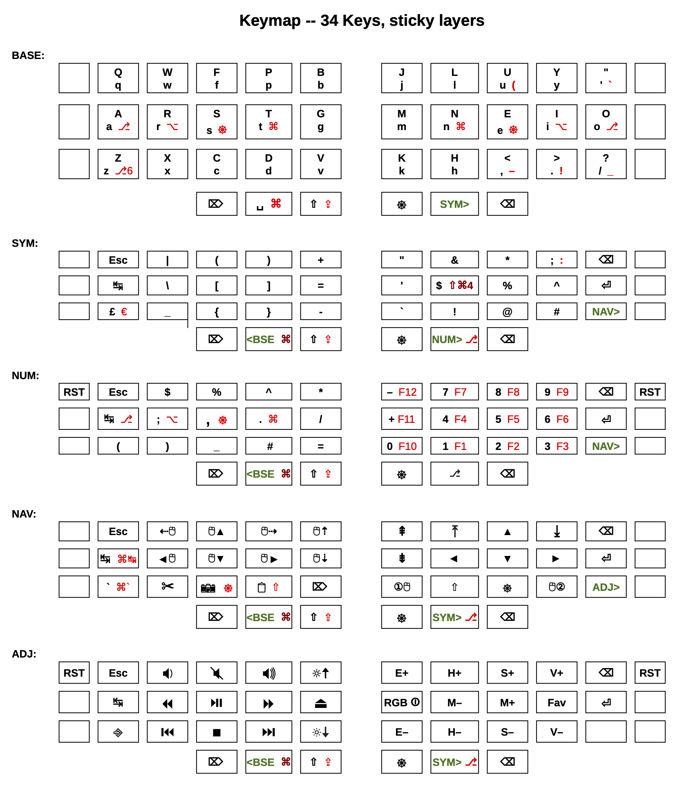

The corresponding Vial layout file can be found in [[https://github.com/matt-maguire/kbd_firmware/tree/custom/keyboards/crkbd/vial-kb][my GitHub]].

Ben’s original layout was optimised for his workflows on the Mac. While I also use a Mac, I am not so familiar with some of the shortcuts he uses. He is a Vim user, whereas these days I am spending more time in Emacs. He also seems to use Apples exclusively, while I am switching frequently between Mac and Linux. The biggest headache with all this switching is the handling of modifier keys such as Ctrl and Command keys. One potential solution for this is to remap modifier keys on my Linux box to make the two systems work in a more similar way. I found the [[https://github.com/rbreaves/kinto][following tool]] which may (or may not) help with this.

I’m going to play around with my usual workflows on Mac and Linux to see what shortcomings there are with this layout and what improvements I might make. Some tweaks I’ve already made are:

- re-introduced home key modifiers in the base layer. Because I am uncertain which modifiers I will be needing, I prefer to have too many rather than too few to start with. I’ve also put modifiers in a consistent way on the thumb keys — we’ll see if they get in the way of the layer toggle keys…
- I have added a couple of tap-dance shortcuts to the base layer to make it easier to type some languages requiring special characters such as é, à, ü, ß, ĉ, ŝ, ĵ, ŭ, etc..
- I rearranged the symbols in a similar way to a number pad to make it easier to remember. Different styles of brackets are paired on the left hand.
- I added function keys (eg. F1, F2, …) to the numeric keypad layer, as well as modifiers and some punctuation characters that I think may come in handy when entering numbers.
- I moved the audio/media player functions off the numeric layer onto a separate “adjustments” layer, together with some keys concerning RGB lighting.

#+attr_shortcode: :type note :title Note
#+begin_admonition
I put some backspace and delete shortcuts on the outer thumb keys for convenience; they are not actually needed, and the layout can be used just fine with only two thumb keys.
#+end_admonition

As I use the keyboard more, I’ll get a better idea what else I will need to add as well as what I can strip away. I’ll post more updates here as I learn more.

*** Corne v4 Keyboard Keymap
**** DONE Corne v4 Keyboard Keymap :Computers:Keyboards:Corne:AltKeyboardLayouts:
:PROPERTIES:
:EXPORT_HUGO_WEIGHT: 4001
:CUSTOM_ID: corne-v4
:EXPORT_FILE_NAME: index
:EXPORT_HUGO_BUNDLE: 20240711_corne-v4-keymap
:EXPORT_DATE: 2024-07-11
:EXPORT_DESCRIPTION: 20240711-corne_6x3.jpg
:END:
I recently acquired a pre-built Corne 46-key ergonomic split keyboard.

Rather than use the default QWERTY keyboard arrangement, I have programmed it to use a [[https://colemakmods.github.io/mod-dh/][COLEMAK-DH]] layout, which allows for much more efficient typing. Because there are a reduced number of keys, many of the keys need to be overloaded with multiple functions. This is normally done with two techniques:
- Tap-Modifiers: If you tap a key, it will output its normal character. However, if you hold the key, it can act as a modifier such as Shift, Ctrl, Alt, etc.. This means you don't need to dedicate separate keys for this, and these modifiers can be placed on the home row of the keyboard where you don't need to reach for them.
- Layers: just like how you hold the SHIFT key to get uppercase characters, you can define layers of your keyboard that can be accessed through "custom SHIFT" aka "layer" keys.

The layer scheme that I chose is based on a 36-key layout called "[[https://github.com/manna-harbour/miryoku][miryoku]]", which is a well thought-out design for minimalist keyboards. The layers are selected through the three keys at the bottom of each half by using your thumbs.
- The BASE layer is used to access normal letters and a few punctuation characters.
- The NAV layer gives you access to cursor movement, scrolling and mouse keys to let you move around efficiently.
- The MEDIA layer lets you access media controls such as play, pause, skip as well as volume controls and the RGB glow settings of the keyboard.
- The NUM layer gives you access to a numeric keypad, and the SYM layer gives you access to the various symbols you can access via a numeric keypad.
- The FUN layer gives you access to function keys such as F1, F2, ... up to F12

The firmware in this keyboard only supports 5 extra layers on top of the BASE layer, whereas the miryoku scheme called for a BASE layer plus 6 additional layers. I could have reflashed the device with a custom firmware to allow more layers. However, there would be a risk of running low on resources in the controller. Instead, because I have 10 extra keys on this keyboard (46 keys as opposed to miryoku's desired 36 keys), I decided to do away with miryoku's MOUSE layer and instead put those mouse-related keys into the NAV layer. This then allows me to add an extra SHIFT function to one of the thumb keys which may come in handy instead of juggling the home row SHIFT key modifiers.

The layers can be programmed with a user-friendly open-source app. The screenshots below show the various layers I initially set up on the keyboard:

***** BASE Layer (LT0):

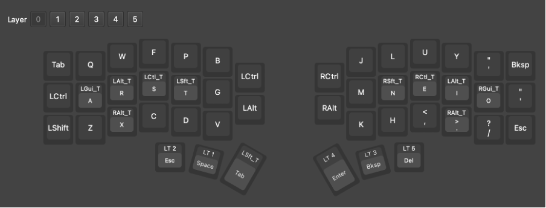

***** NAV Layer (LT1):

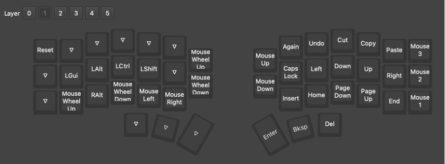

***** MEDIA Layer (LT2):

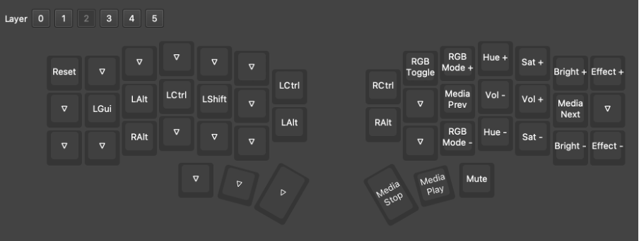

***** NUM Layer (LT3):

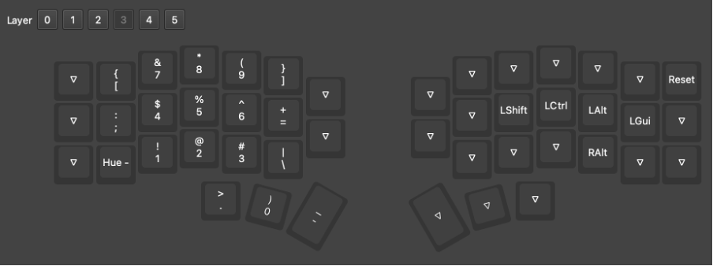

***** SYM Layer (LT4):

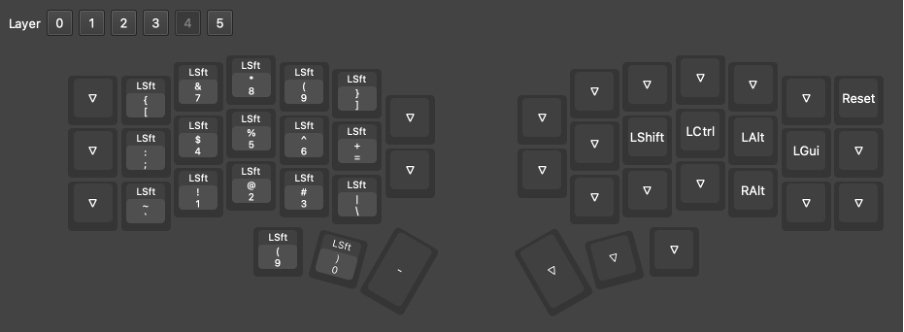

***** FUN Layer (LT5):

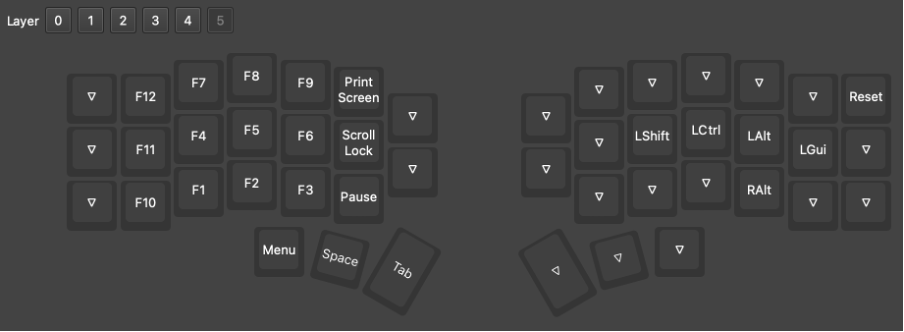

***** Next Steps:

This is just an initial proposal, which may well change over time as a get more experience. Things I will be working on going forward:

- Learn the COLEMAK-DH keyboard layout. After using QWERTY keyboards for most of my life, the muscle memory needs to be retrained. I think it will be worth it though, as typing on QWERTY keyboards is very fatiguing, whereas with COLEMAK-DH, the hands hardly move, and (nearly) all the keys are only one key away from the home keys. I will train my fingers using the online tool https://www.keybr.com/, which starts training you on just the home keys, and then introduces additional keys as your typing improves. For more general practice and speed tests, there is of course https://monkeytype.com/ .
- Define a COLEMAK-DH keyboard layout on my macbook laptop, which is similar to the miryoku setup on the Corne physical keyboard. This means I can still practise using the layout and layers even if I don’t have the keyboard with me. There are 3 options here:
  - use a [[https://github.com/ColemakMods/mod-dh][COLEMAK-DH input method]] in macOS. This defines the layout of the letter keys, but doesn’t implement layers, ie. you need to move your hands away from the home keys to type numbers, access cursor keys, etc.. It is also not so easy to customise this.
  - use [[https://github.com/kmonad/kmonad][KMonad]] to implement a layered keymap. The author of the miryoku has provided [[https://github.com/manna-harbour/miryoku_kmonad][some tools]] to facilitate generating a suitable keymap. I can start KMonad manually in a terminal window to intercept keystrokes and remap them. It works and is cross-platform, but is a bit clunky, and tweaks require the toolchain to be modified and rerun to generate new keymap files each time.
  - use [[https://karabiner-elements.pqrs.org/][Karabiner-Elements]] to remap my Mac keyboard. This needs to be set up using some [[https://karabiner-elements.pqrs.org/docs/json/][JSON code]], but it integrates well with the Mac, and tweaks are relatively easy to do in real time.

- Build a smaller keyboard from parts so I can leave the Corne at home and carry a travel-friendly version. When using other PCs, it may not be convenient or even possible to play with keymaps, whereas a physical keyboard just needs to be plugged in and the PC will be none the wiser about your customised key mapping.

I’ll post updates here as I gain more experience and have something to report.
*** Learn Japanese with Song Lyrics (Houki Boshi from Bleach)
**** DONE Learn Japanese with Song Lyrics (Houki Boshi from Bleach) :Music:Languages:Japanese:
:PROPERTIES:
:EXPORT_HUGO_WEIGHT: 4001
:CUSTOM_ID: houki-boshi
:EXPORT_FILE_NAME: index
:EXPORT_HUGO_BUNDLE: 20220214_houki-boshi
:EXPORT_DATE: 2022-02-14
:END:

A great way to learn a language is through songs. They are usually repetitive, often (but not always) a bit slower than regular speech, and have a catchy tune. This helps to cement words and structures into the head.

I was watching an anime called [[https://en.wikipedia.org/wiki/Bleach_(TV_series)][Bleach]], and maybe a season into it they had a song at the end of each episode named [[https://www.youtube.com/watch?v=2xs_-nl6C3E][Houki Boshi]] (ほうき星) by the singer-songwriter [[https://en.wikipedia.org/wiki/Younha][Younha]]. She's actually Korean, but released an album [[https://en.wikipedia.org/wiki/Go!_Younha][Go! Younha]] in Japanese, and /Houki Boshi/ was one of the hit singles on that album.

There is a live performance of the song on YouTube, which has Japanese subtitles:

#+hugo: 

Subtitles are a great resource for language learners. One of the challenges with Japanese of course is the unfamiliar writing system. These subtitles contain kanji, the Chinese-style characters that Japanese often use in their writing. One problem with kanji is that it can be difficult to work out how a kanji character is pronounced -- and the pronounciation this is often context-dependent in Japanese. One way to deal with this is to write the pronunciation above the kanji using small hiragana characters -- the hiragana provides an unambiguous guide as to how the character is pronounced. We call these little hirigana pronunciation guides /furigana/, and they are often used in children's books to help the cildren learn the pronunciation of the kanji.

The video above doesn't have furigana, so in order to become more familiar with the kanji, I decided to write out the song lyrics and include the furigana. For this I used the $\LaTeX$ typesetting program with the [[https://ctan.org/pkg/leadsheets][leadsheets]] songbook package, and the /ruby/ package to add the furigana. Because I typed in the Japanese with unicode, I needed to use =xelatex= to build the PDF. I found [[https://www.animelyrics.com/anime/bleach/houkiboushi.jis.txt][here on the web]] an English translation to help remind myself what the various words mean. The final result is here:

#+hugo: 

As I typed up the lyrics, I looked up any words I wasn't familiar with, and studied the gramatical structures that were used (here the English translation was helpful as I could see how a particular nuance in English can be expressed in Japanese). You may notice that there is no romaji (writing Japanese with the Roman alphabet). When learning Japanese, it is recommended to learn the kana as quickly as possibly. When you write Japanese with Roman letters: it can obscure the way words change as you conjugate, it is very hard to read, and if you see real Japanese around it is almost never written in romaji. Therefore, it is best to ditch it as soon as possible.

You may notice that the live performance above leaves out the first two lines of the second verse -- I presume this was to shorten the performance for television. In the bleach anime, the song is even more abridged -- only the first and last line of the first verse is sung, followed by the final chorus.

Studying song lyrics is a great way to gain more exposure to a language, and is lots of fun!

**** DONE Lerni la japanan per kantotekstoj (Houki Boshi el Bleach) :Music:Languages:Japanese:Lingvoj:Esperanto:
:PROPERTIES:
:EXPORT_HUGO_WEIGHT: 4001
:CUSTOM_ID: houki-boshi-eo
:EXPORT_FILE_NAME: index.eo.md
:EXPORT_HUGO_BUNDLE: 20220214_houki-boshi
:EXPORT_DATE: 2022-02-14
:END:

Bonega maniero lerni lingvon estas tra kantoj. Ili kutime estas ripetemaj, ofte (sed ne ĉiam) iom pli malrapidaj ol normala parolado, kaj havas kaptan melodion. Tio helpas fiksigi vortojn kaj strukturojn en la kapon.

Mi rigardis animeon nomatan [[https://en.wikipedia.org/wiki/Bleach_(TV_series)][Bleach]], kaj eble post unu sezono ili havis kanton ĉe la fino de ĉiu epizodo, nomitan [[https://www.youtube.com/watch?v=2xs_-nl6C3E][Houki Boshi]] (ほうき星) de la kantisto kaj kantoverkisto [[https://en.wikipedia.org/wiki/Younha][Younha]]. Ŝi fakte estas korea, sed eldonis albumon [[https://en.wikipedia.org/wiki/Go!_Younha][Go! Younha]] en la japana, kaj /Houki Boshi/ estis unu el la furoraj singloj sur tiu albumo.

Ekzistas viva prezentado de la kanto en YouTube, kiu havas japanajn subtekstojn:

#+hugo: 

Subtekstoj estas bonega rimedo por lingvolernantoj. Unu el la defioj de la japana, kompreneble, estas la nekonata skribsistemo. Tiuj subtekstoj enhavas kanji, la ĉin-stilajn karaktrojn kiujn japanoj ofte uzas en sia skribo. Unu problemo pri kanji estas ke povas esti malfacile ekscii kiel kanji-karaktro estas elparolata -- kaj la elparolo en la japana ofte dependas de la kunteksto. Unu maniero solvi ĉi tion estas skribi la elparolon super la kanji per malgrandaj hiragana-karaktriloj -- la hiragana donas senambigua gvidilon pri kiel la karaktro estas elparolata. Ni nomas tiujn etajn hiragana-elparolgvidilojn /furigana/, kaj ili ofte uziĝas en infanlibroj por helpi la infanojn lerni la elparolon de la kanji.

La supra video ne havas furigana, do por pli familiariziĝi kun la kanji, mi decidis skribi la kantotekston kaj inkluzivi la furigana. Por tio mi uzis la tipografian programon $\LaTeX$ kun la kantlibra pako [[https://ctan.org/pkg/leadsheets][leadsheets]], kaj la pako /ruby/ por aldoni la furigana. Ĉar mi tajpis la japanan per unikodo, mi bezonis uzi =xelatex= por krei la PDF-on. Mi trovis [[https://www.animelyrics.com/anime/bleach/houkiboushi.jis.txt][tie en la reto]] anglan tradukon por helpi min memori kion signifas la diversaj vortoj. La fina rezulto estas ĉi tie:

#+hugo: 

Dum mi tajpis la kantotekston, mi serĉis ĉiujn vortojn kiujn mi ne konis, kaj studis la gramatikajn strukturojn kiuj estis uzataj (tie la angla traduko helpis, ĉar mi povis vidi kiel apartan nuancon en la angla oni povas esprimi en la japana). Eble vi rimarkos ke ne estas romaji (skribi la japanan per la latina alfabeto). Kiam oni lernas la japanan, oni rekomendas lerni la kana kiel eble plej rapide. Kiam vi skribas la japanan per latinaj literoj: tio povas kaŝi la manieron kiel vortoj ŝanĝiĝas dum konjugacio, ĝi estas tre malfacile legebla, kaj se vi vidas veran japanan ĉirkaŭe, ĝi preskaŭ neniam estas skribita per romaji. Tial estas plej bone forlasi ĝin kiel eble plej baldaŭ.

Eble vi rimarkos ke la supra viva prezentado preterlasas la unuajn du liniojn de la dua strofo -- mi supozas ke tio estis farita por mallongigi la prezentadon por televido. En la Bleach-animeo, la kanto estas eĉ pli mallongigita -- oni kantas nur la unuan kaj la lastan linion de la unua strofo, kaj poste venas la fina refreno.

Studi kantotekstojn estas bonega maniero akiri pli da kontakto kun lingvo, kaj estas tre amuze!

*** How to calculate the series resistor for an LED
**** DONE How to calculate the series resistor for an LED :HamRadio:
:PROPERTIES:
:EXPORT_HUGO_WEIGHT: 4001
:CUSTOM_ID: led-series-resistor
:EXPORT_FILE_NAME: index
:EXPORT_HUGO_BUNDLE: 20220202_led-series-resistor
:EXPORT_DATE: 2022-02-02
:EXPORT_DESCRIPTION: 20220202-Screen-Shot-2022-02-02-at-6.32.54-pm.png
:END:

When we connect an LED to to a battery, we often need to connect a resistor is series to limit the current. I saw this question come up in a facebook group, and thought it might be useful to use this as a simple illustrative example of doing circuit design.

The basic circuit we will be considering is shown below:

We have a current $i$ leaving the battery/voltage source, passing through the resistor giving a voltage drop of $V_R$, then passing through the LED with a voltage drop of $V_{f_{LED}}$ before returning to the battery. So, how can we work out the value of the resistor we should use?

To answer that question, we need to know some things about the LED. Specifically:

    how much current do we want to be passing through the LED?
    what will be the voltage across the LED at that current?

How can we find the answer to those questions? We need to refer to the datasheet of the LED component!

First let’s check the maximum rating for the component. Looking at the datasheet, we see the following table:

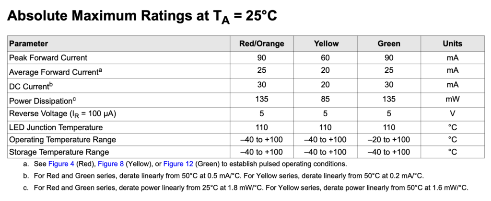

We can see that the maximum DC current for a red LED is 30mA. We generally don’t want to run a component right on its maximum limit, so what happens if we reduce the current a bit? Digging further on the datasheet, we find the following graphs:

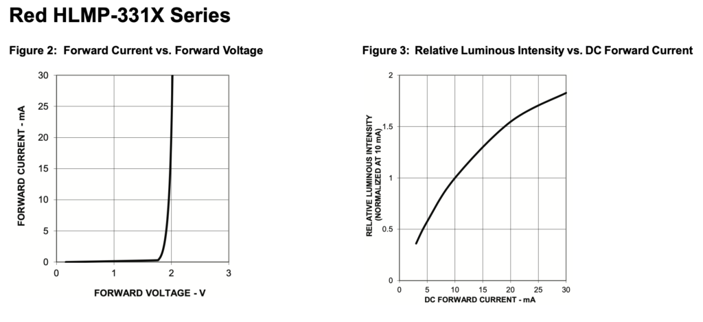

The graph in figure 3 shows us how bright the LED will be at various currents. At 10mA, the intensity of the LED light is said to be at a normalised level of 1. If we increase the current to 20mA, then the LED will be around 1.5 times as bright as the 10mA level. Increasing the current to 30mA (the max) then the intensity is only around 1.8 times as bright at the intensity at 10mA, so it is consuming a lot more power for little gain. At 20mA, we still get a bright intensity while leaving a fair amount of headroom below the maximum, so let’s design our circuit to have a current:

What will be the voltage across the LED at that current? Referring to the graph in figure 2, we see that the voltage across the LED will be approximately:

    \[V_{f_{LED}}=2\text{ V}\]

What will be the voltage across the resistor of R ohms? We know the current through the resistor must be 20mA, so we can use Ohm’s law to work out the voltage drop across the resistor:

        \[\begin{align*}
        V_R & = i \times R \\
        & = 20 \times 10^{-3} \times R
        \end{align*}\]

We can now use Kirchoff’s voltage law, which says the sum of voltages in a loop is always equal to 0V. If we go clockwise around the circuit, the voltage source helps the current and is therefore positive, whereas the resistor and LED oppose the current, so their signs are negative. The equation becomes:

        \[\begin{align*}
        V - V_R - V_{f_{LED}} & = 0 \\
        V - i \times R - V_{f_{LED}} & = 0 \\
        i \times R &= V - V_{f_{LED}} \\
        R & = \frac{V - V_{f_{LED}}}{i}
        \end{align*}\]

If we assume we are using a 9V battery, then substituting in the numbers gives us:

    \[\begin{split}R & = \frac{(9 - 2)}{20 \times 10^{-3}} \\ & = 350~\Omega\end{split}\]

For safety, we can round it up to the nearest preferred value, which would be a 390\Omega resistor with colour code orange-white-brown. Double-checking the current, we get:

    \[\begin{split} i & = \frac{V - V_{f_{LED}}}{R} \\
    & = \frac{(9 - 2)}{390} \\
    & = 18\text{ mA}\end{split}\]

This is still acceptable. So, we have now completed our circuit design:

**** DONE Kiel kalkuli serian rezistilon por LED :HamRadio:Lingvoj:Esperanto:
:PROPERTIES:
:EXPORT_HUGO_WEIGHT: 4001
:CUSTOM_ID: led-series-resistor-eo
:EXPORT_FILE_NAME: index.eo.md
:EXPORT_HUGO_BUNDLE: 20220202_led-series-resistor
:EXPORT_DATE: 2022-02-02
:EXPORT_DESCRIPTION: 20220202-Screen-Shot-2022-02-02-at-6.32.54-pm.png
:END:

Kiam ni konektas LED-on al baterio, ni ofte bezonas rezistilon en serio por limigi la korrenton. Mi vidis tiun demandon aperigi en Facebook-grupo, kaj mi pensis, ke povus esti utile uzi ĝin kiel simplan ekzemplon pri cirkvitodezajnado.

La baza cirkvito, kiun ni konsideros, estas montrita sube:

Ni havas korenton $i$, kiu forlasas la baterion/fonton de tensio, pasas tra la rezistilo kaj kaŭzas tensiofalon $V_R$, poste pasas tra la LED kun tensiofalo $V_{f_{LED}}$ antaŭ ol reveni al la baterio. Do, kiel ni povas eltrovi la valoron de la rezistilo, kiun ni devus uzi?

Por respondi tiun demandon, ni bezonas scii kelkajn aferojn pri la LED. Nome:

    kiom da korento ni volas pasi tra la LED?
    kia estos la tensio trans la LED ĉe tiu korento?

Kiel ni trovu la respondojn al tiuj demandoj? Ni devas konsulti la specifikaĵon de la LED-komponento!

Unue ni kontrolu la maksimuman toleratan valoron de la komponento. Rigardante la specifikaĵon, ni vidas la sekvantan tabelon:

Ni povas vidi, ke la maksimuma kontinua kurento por ruĝa LED estas 30 mA. Ĝenerale ni ne volas funkcigi komponenton rekte ĉe ĝia maksimuma limo, do kio okazas, se ni iom reduktas la korenton? Serĉante plu en la specifikaĵo, ni trovas la sekvantajn grafikojn:

La grafeo en figuro 3 montras al ni, kiom hela la LED estos ĉe diversaj korentoj. Ĉe 10 mA la intenso de la LED-lumo estas normigita al nivelo 1. Se ni pliigos la korenton ĝis 20 mA, la LED estos ĉirkaŭ 1,5-oble tiel hela kiel ĉe la nivelo de 10 mA. Se ni pliigos la korenton ĝis 30 mA (la maksimumo), la intenso estas nur ĉirkaŭ 1,8-oble tiel hela kiel ĉe 10 mA — do ĝi konsumas multe pli da potenco por malmulta gajno. Ĉe 20 mA ni ankoraŭ ricevas helan intencon kaj samtempe lasas konsiderindan rezervon sub la maksimumo, do ni desegnu nian cirkviton kun korento:

Kia estos la tensio trans la LED ĉe tiu korento? Rigardante la grafikon en figuro 2, ni vidas, ke la tensio trans la LED estos proksimume:

    \[V_{f_{LED}}=2\text{ V}\]

Kia estos la tensio trans la rezistilo de R omoj? Ni scias, ke la korento tra la rezistilo devas esti 20 mA, do ni povas uzi la leĝon de Ohm por kalkuli la tensiofalon trans la rezistilo:

        \[\begin{align*}
        V_R & = i \times R \\
        & = 20 \times 10^{-3} \times R
        \end{align*}\]

Ni povas nun uzi la tensian leĝon de Kirchhoff, laŭ kiu la sumo de tensioj en buklo ĉiam egalas al 0 V. Se ni iras horloĝdirekten ĉirkaŭ la cirkvito, la tensifonto helpas la korenton kaj do estas pozitiva, dum la rezistilo kaj la LED kontraŭas la korenton, do iliaj signo estas negativaj. La ekvacio fariĝas:

        \[\begin{align*}
        V - V_R - V_{f_{LED}} & = 0 \\
        V - i \times R - V_{f_{LED}} & = 0 \\
        i \times R &= V - V_{f_{LED}} \\
        R & = \frac{V - V_{f_{LED}}}{i}
        \end{align*}\]

Se ni supozas, ke ni uzas 9 V baterion, do anstataŭigante la nombrojn ni ricevas:

    \[\begin{split}R & = \frac{(9 - 2)}{20 \times 10^{-3}} \\ & = 350~\Omega\end{split}\]

Por sekureco, ni povas suprenrondi ĝin al la plej proksima normalizita valoro, kio estus 390 Ω rezistilo kun la kolora kodo oranĝa-blanka-bruna. Denove kontrolante la korenton, ni ricevas:

    \[\begin{split} i & = \frac{V - V_{f_{LED}}}{R} \\
    & = \frac{(9 - 2)}{390} \\
    & = 18\text{ mA}\end{split}\]

Tio ankoraŭ estas akceptebla. Do, ni nun finis nian cirkvitodezajnon:

*** It's a Heartache
**** DONE It's a Heartache :Music:
:PROPERTIES:
:EXPORT_HUGO_WEIGHT: 4001
:CUSTOM_ID: its-a-heartache
:EXPORT_FILE_NAME: index
:EXPORT_HUGO_BUNDLE: 20220130_its-a-heartache
:EXPORT_DATE: 2022-01-30
:EXPORT_DESCRIPTION: 20220130-IMG_4547_01-999x1024.jpg
:END:

On the Australian TV Series Doctor Doctor, there’s a recurring piece of music that is playing using fingerpicking on the ukulele based on Bonnie Tyler’s hit song It’s a Heartache. A quick search on YouTube discovered that it comes from the lead-in of a music video by the Wellington International Ukulele Orchestra:

#+hugo: 

I was keen to learn how to play something like it on my own ukulele, and a further search turned up a [[https://youtu.be/pCswBsuddrc][tutorial by Helmut Bickel]], where he has some hand-written tablature in the background of the video. To have the tab in a more convenient format, I wrote it up using the [[http://lilypond.org/][lilypond]] music typesetting software, and the resulting PDF is reproduced below:

#+hugo: 

*** Digital Photography for Hams
**** DONE Digital Photography for Hams :Photography:HamRadio:
:PROPERTIES:
:EXPORT_HUGO_WEIGHT: 4001
:CUSTOM_ID: photography-for-hams
:EXPORT_FILE_NAME: index
:EXPORT_HUGO_BUNDLE: 20220120_photography-for-hams
:EXPORT_DATE: 2022-01-20
:EXPORT_DESCRIPTION: 20200120-Screenshot_2022-02-02_21-07-23-1024x550.png
:END:

Last night I spoke about Digital Photography at the [[https://www.mwrs.org.au/][Manly Warringah Radio Society]], a club for ham radio operators. I decided to structure the talk in such a way that it drew parallels between digital photography and ham radio.

First I compare a digital camera to a ham radio station based on a /software defined radio (SDR)/. Just like we use radio antennas to collect ravio waves, a camera lens collects light waves. Both digital cameras and SDRs contain an analogue-to-digital converter to convert waves into a digital signal. They also have digital processors to convert the received signals into a form perceivable by human ears and eyes

I talked about photography’s /exposure triangle/, and linked it back to techniques we use in ham radio when dealing with weak signals. We covered typical camera settings such as focal length, aperture and shutter speed, and discussed some of the trade-offs and special effects they can produce.

Finally, I talked about using a raw file editor to provide a photographer with more freedom in processing an image, and briefly introduced the open source [[https://www.darktable.org/][darktable project]] as an example of such an editor.

A recording of the talk will be available on the [[https://www.youtube.com/user/VK2MB][MWRS YouTube channel]] in due course. Here are the presentation slides I used:

#+hugo: 

**** DONE Cifereca Fotado por Radioamatoroj :Photography:HamRadio:Lingvoj:Esperanto:
:PROPERTIES:
:EXPORT_HUGO_WEIGHT: 4001
:CUSTOM_ID: photography-for-hams-eo
:EXPORT_FILE_NAME: index.eo.md
:EXPORT_HUGO_BUNDLE: 20220120_photography-for-hams
:EXPORT_DATE: 2022-01-20
:EXPORT_DESCRIPTION: 20200120-Screenshot_2022-02-02_21-07-23-1024x550.png
:EXPORT_HUGO_MENU:
:END:

Hierau vespere mi prelegis pri cifereca fotado ĉe la [[https://www.mwrs.org.au/][Manly Warringah Radio Society]], klubo de radioamatoroj. Mi decidis strukturi la prelegon tiel, ke ĝi montru paralelojn inter cifereca fotado kaj amatorradio.

Unue mi komparis ciferecan fotilon kun radioamatora stacio bazita sur /programdifinita radio (SDR)/. Kiel ni uzas radioantenojn por kapti radioondojn, la objektivo de fotilo kaptas lumondojn. Kaj ciferecaj fotiloj kaj SDR-oj enhavas analogo-ciferecan konvertilon, kiu transformas la ondojn en ciferecan signalon. Ili ankaŭ havas ciferecajn procesorojn, kiuj konvertas la ricevitajn signalojn en formon perceiveblan de la homaj oreloj kaj okuloj.

Mi parolis pri la /ekspona triangulo/ de fotado kaj ligis ĝin al teknikoj, kiujn ni uzas en amatorradio dum laboro kun malfortaj signaloj. Ni traktis kutimajn fotilajn agordojn kiel fokusa distanco, diafragmo kaj ŝirmila rapido, kaj diskutis kelkajn el la kompromisoj kaj specialaj efektoj, kiujn ili povas produkti.

Fine mi parolis pri uzado de redaktilo por krudaj (RAW) dosieroj, kiu donas al fotisto pli da libereco pri prilaborado de bildo, kaj enkondukis la malfermfontan [[https://www.darktable.org/][projekton darktable]] kiel ekzemplon de tia redaktilo.

Registraĵo de la prelego baldaŭ estos disponebla en la [[https://www.youtube.com/user/VK2MB][JT de MWRS ĉe YouTube]]. Jen la prezentaj glitoj, kiujn mi uzis:

#+hugo: 

*** 〜て-Form Song
**** DONE 〜て-Form Song :Languages:Japanese:
:PROPERTIES:
:EXPORT_HUGO_WEIGHT: 4001
:CUSTOM_ID: te-form-song
:EXPORT_FILE_NAME: index
:EXPORT_HUGO_BUNDLE: 20211224_te-form-song
:EXPORT_DATE: 2021-12-24
:END:

When I was studying Japanese at TAFE, our teacher Masa-sensei taught us a silly song to remember how to produce the 〜て form of a verb, given its 〜ます stem or its dictionary form.

He told us that he designed the song to be sung to the tune of “Santa Claus is coming to town” so that every year at Christmas time we would hear the tune and be reminded of how to make 〜て form.

Well, it worked — even though that was more than 10 years ago, I still remember the song as it comes up to Christmas.

#+begin_example
まさ先生、どうもありがとうございました 😁

〜て Form Song:

いちり-って、みびに-んで、

き-いて、ぎ-いで、

します-して、

きます-きて、いきます-いって。

うつる-って、むぶぬ-んで、

く-いて、ぐ-いで、

す.する-して、

くる-きて、いく-いって。

For group 2 verbs, you can easily convert, just taking off ‘ます’ from ます-form, and a て is what you put!

(back to first verse)
#+end_example

To find out more about the 〜て form of Japanese verbs, you can refer to [[http://guidetojapanese.org/learn/complete/progressive_tense][Tae Kim’s Japanese Grammar Guide]].

**** DONE 〜て-𐑓𐑹𐑥 𐑕𐑪𐑙 :𐑤𐑨𐑙𐑜𐑢𐑦𐑡𐑩𐑟:𐑡𐑨𐑐𐑩𐑯𐑰𐑟:
:PROPERTIES:
:EXPORT_HUGO_WEIGHT: 4001
:CUSTOM_ID: te-form-song.en-shaw
:EXPORT_FILE_NAME: index.en-shaw.md
:EXPORT_HUGO_BUNDLE: 20211224_te-form-song
:EXPORT_DATE: 2021-12-24
:END:

𐑢𐑧𐑯 𐑲 𐑢𐑪𐑟 𐑕𐑑𐑳𐑛𐑦𐑦𐑙 ·𐑡𐑨𐑐𐑩𐑯𐑰𐑟 𐑨𐑑 ·𐑑𐑱𐑓, 𐑬𐑼 𐑑𐑰𐑗𐑼 ·𐑥𐑳𐑕𐑳-𐑕𐑧𐑯𐑖𐑱 𐑑𐑷𐑑 𐑳𐑕 𐑩 𐑕𐑦𐑤𐑦 𐑕𐑪𐑙 𐑑 𐑮𐑦𐑥𐑧𐑥𐑚𐑼 𐑣𐑬 𐑑 𐑐𐑮𐑩𐑛𐑿𐑕 𐑞 〜て 𐑓𐑹𐑥 𐑝 𐑩 𐑝𐑻𐑚, 𐑜𐑦𐑝𐑩𐑯 𐑦𐑑𐑕 〜ます 𐑕𐑑𐑧𐑥 𐑹 𐑦𐑑𐑕 𐑛𐑦𐑒𐑖𐑩𐑯𐑼𐑦 𐑓𐑹𐑥.

𐑣𐑰 𐑑o𐑤𐑛 𐑳𐑕 𐑞𐑨𐑑 𐑣𐑰 𐑛𐑦𐑟𐑲𐑯𐑛 𐑞 𐑕𐑪𐑙 𐑑 𐑚𐑰 𐑕𐑳𐑙 𐑑 𐑞 𐑑𐑿𐑯 𐑝 "𐑕𐑨𐑯𐑑𐑩 𐑒𐑤𐑷𐑟 𐑦𐑟 𐑒𐑳𐑥𐑦𐑙 𐑑 𐑑𐑬𐑯" 𐑕𐑴 𐑞a𐑑 𐑧𐑝𐑮𐑦 𐑘𐑽 𐑨𐑑 𐑒𐑮𐑦𐑕𐑥𐑩𐑕 𐑑𐑲𐑥 𐑢𐑰 𐑢𐑫𐑛 𐑣𐑽 𐑞 𐑑𐑿𐑯 𐑯 𐑚𐑰 𐑮𐑦𐑥𐑲𐑯𐑛𐑩𐑛 𐑝 𐑣𐑬 𐑑 𐑥𐑱𐑒 𐑞 〜て 𐑓𐑹𐑥.

𐑢𐑧𐑤, 𐑦𐑑 𐑢𐑻𐑒𐑑 -- 𐑰𐑝𐑩𐑯 𐑞𐑴 𐑞𐑨𐑑 𐑢𐑪𐑟 𐑥𐑹 𐑞𐑨𐑯 10 𐑘𐑽𐑟 𐑩𐑜𐑴, 𐑲 𐑕𐑑𐑦𐑤 𐑮𐑦𐑥𐑧𐑥𐑚𐑼 𐑞𐑨𐑑 𐑕𐑪𐑙 𐑨𐑟 𐑦𐑑 𐑒𐑳𐑥𐑟 𐑳𐑐 𐑑 𐑒𐑮𐑦𐑕𐑥𐑩𐑕.

#+begin_example
まさ先生、どうもありがとうございました 😁

〜て 𐑓𐑹𐑥 𐑕𐑪𐑙:

いちり-って、みびに-んで、

き-いて、ぎ-いで、

します-して、

きます-きて、いきます-いって。

うつる-って、むぶぬ-んで、

く-いて、ぐ-いで、

す.する-して、

くる-きて、いく-いって。

𐑓 𐑜𐑮𐑵𐑐 2 𐑝𐑻𐑚𐑟, 𐑿 𐑒𐑨𐑯 𐑰𐑟𐑩𐑤𐑦 𐑒𐑪𐑯𐑝𐑻𐑑, 𐑡𐑳𐑕𐑑 𐑪𐑓 ‘ます’ 𐑓𐑮𐑪𐑥 ます-𐑓𐑹𐑥, 𐑯 𐑩 て 𐑦𐑟 𐑢𐑪𐑑 𐑿 𐑐𐑫𐑑!

(𐑚𐑨𐑒 𐑑 𐑓𐑻𐑕𐑑 𐑝𐑻𐑕)
#+end_example

𐑑 𐑓𐑲𐑯𐑛 𐑬𐑑 𐑥𐑹 𐑩𐑚𐑬𐑑 𐑞 〜て 𐑓𐑹𐑥 𐑝 ·𐑡𐑨𐑐𐑩𐑯𐑰𐑟 𐑝𐑻𐑚𐑟, 𐑿 𐑒𐑨𐑯 𐑮𐑦𐑓𐑻 𐑑 [[http://guidetojapanese.org/learn/complete/progressive_tense][·𐑑𐑱 𐑒𐑦𐑥𐑟 𐑡𐑨𐑐𐑩𐑯𐑰𐑟 𐑜𐑮𐑨𐑥𐑼 𐑜𐑲𐑛]].

*** Sony A7R4 Selfie Solution
**** DONE Sony A7R4 Selfie Solution :Photography:
:PROPERTIES:
:EXPORT_HUGO_WEIGHT: 4001
:CUSTOM_ID: a7r4-selfie-solution
:EXPORT_FILE_NAME: index
:EXPORT_HUGO_BUNDLE: 20191004_a7r4-selfie-solution
:EXPORT_DATE: 2019-10-04
:EXPORT_DESCRIPTION: 20191004-961C3B92-E725-4065-9A38-54BE23EDC24B.jpeg
:END:

One of the common complaints about the Sony A7 series of cameras is that they do not have a flip-around screen that allows you to frame the shot when you are taking a selfie. I managed to put together a solution for this out of some parts I had laying around.

It consists of:

- Sony A7 series camera- Hotshoe adaptor with 1/4” screw
- Smartphone holder which accepts 1/4” screw
- Joby Gorillapod with Arca-Swiss mount to accept the plate on bottom of the camera (I use a Peak Design dual plate to make the camera compatible with both Arca
- Swiss and Manfrotto RC2 mounts)
- [optional] micro-USB shutter release cable (otherwise just use the self-timer on the camera)
- Smartphone with Sony Imaging Edge app installed and paired to the camera

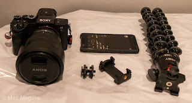

In this way, the camera can be placed on the Joby gorillapod which acts as a “selfie stick”, and the remote view on the Sony Imaging Edge app on the smartphone allows you to frame the shot and you can tap it to release the shutter.

If I want to use this setup for video vlogging, there is nowhere to mount a shotgun mic, so likely I would use a lavalier mic plugged into the camera itself, or perhaps into a second smartphone acting as a voice recorder.

*** Should I use Back Button Focus on Sony A7R4?
**** DONE Should I use Back Button Focus on Sony A7R4? :Photography:
:PROPERTIES:
:EXPORT_HUGO_WEIGHT: 4001
:CUSTOM_ID: back-button-focus
:EXPORT_FILE_NAME: index
:EXPORT_HUGO_BUNDLE: 20191003_back-button-focus
:EXPORT_DATE: 2019-10-03
:EXPORT_DESCRIPTION: 20191003-37FE80D9-053E-4D88-B858-B13645808C57.png
:END:

I just recently acquired the new Sony A7R4 mirrorless full frame camera, and have been working through the focusing systems on this camera. One of the questions that comes up is whether or not to use back button focus.

As you can see, it has an “AF ON” button on the back that would be perfect for this. All you need to do is to go into the menu and set the “AF w/ Shutter” option to “OFF”. This prevents the shutter button from activating auto focus, and instead you can activate the auto focus via the “AF-ON” button on the back. I assigned the “Focus Mode” to the C3 button on the back, and set the focus mode to “AF-C” (continuous autofocus). So, how did this work out?

Well, back button focus works as you would expect. However, I ran into 2 issues:

1. When someone offers to take my photo with my own camera, I normally set the shoot mode dial to “fully automatic” before handing it over. On my Canon M50, this then re-enables auto focus on the shutter button, so that when the other person presses the shutter button, the camera will focus itself. The Sony doesn’t do this, and unless the person presses the “AF-ON” button on the back first, the picture will be out of focus

2. Because the Sony doesn’t have a flippy screen that flips around to the front, when you take a selfie you need to use an app on your smart phone to frame the picture. You can trigger the shutter from the app, but there is no way to get the camera to focus without reaching around behind the camera to push the “AF ON” button. The Canon app has a separate auto focus button when the camera is set up for BBF, but this is completely lacking on the Sony.

   

Turning off BBF solves these issues, but sometimes you really don’t want the camera refocusing when you press the shutter button. Also, it is nice to be able to check and tweak the focus manually after auto-focusing, but this doesn’t work unless you put the camera in “DMF” focus mode. So, what’s the best way to set up the camera to allow the shutter button to do autofocus normally, but suppress it easily when wanting a back-button or manual focus bevahiour?

I looked into Mark Galer’s Focus masterclass, and looked at some other blogs for how people do BBF. After some playing around, I’ve come up with the following setup:

- The “AF w/ Shutter” option is set to “ON” to allow the shutter to trigger the auto focus under normal conditions. The “C3” button is assigned to “Focus Mode”, and here I would normally select “AF-C”. I can choose the appropriate “Focus Area” setting using the “C1” button, which I typically set to “Wide” or “Tracking Flexible Expanded Spot”. The latter lets me do a “focus-recompose” action with the shutter half depressed, and the camera will keep tracking the subject I first selected when half-pressing the shutter. Manual focus adjustments generally won’t work with this setup (it depends on the lens).
- The “AF-ON” button gets assigned to the camera’s “custom hold recall” feature. This allows us to define some settings that should be overridden with a special profile while ever the button is held down. In the custom hold profile I set it to temporarily set the Focus Mode to “DMF” and to enable “AF-ON”. If I hold in the “AF ON” button, the camera goes to DMF mode, which will auto-focus using the currently selected “Focus Area” setting, and allow me to tweak the focus manually. While holding in the “AF ON” button I can then press the shutter and it will take the shot with my manual focus adjustment in place.
- If I want the camera to completely decouple the shutter button from auto-focusing ( as in BBF) I use the “C3” button to set the focus mode to “Manual Focus”. I can now focus manually at will, and if I want the camera to auto-focus I just hold in the “AF ON” button. Once I release the “AF ON” button, the camera is back in manual focus mode, and I can depress the shutter without affecting the focus.
- If I want to take a selfie, I just need to use the “C3” button to set the Focus Mode back to “AF-S” or “AF-C”.
- If I want to hand the camera over to someone else to take a picture, I use the shoot mode dial to recall one of the memory profiles (I use M4). This puts the camera in fully automatic, set the “Focus Mode” to “AF-C”, and sets the “Focus Area” to “Wide”, to make the camera as idiot-proof as possible.

By setting the “AF ON” button to use “DMF” as an override, it allows me to do manual focus adjustments even if the camera is in automatic focus mode. However, like this it will do a one-shot focus and then wait for any manual adjustment. Sometimes when people use back-button focus, they want the camera to do continuous focus while ever the back button is held in. I’m not too worried about this, because if I want to do AF-C, I can just use the main shutter button. However, if I have put the camera in manual focus mode to get a true BBF effect, then it would be preferable to override the focus mode to “AF-C” rather than “DMF”. This could be assigned to another button, like the “AEL” button. While ever the AEL button is held in, the camera will continuously auto-focus, and when the button is released it will revert to manual focus while will allow any last manual adjustment before releasing the shutter. Maybe I’ll do that some time, but at the moment I have the AEL button to be my “oh quick, put some sensible settings in to get this sudden unexpected action shot” button.

Just another nice feature I discovered is with the multi-selector joystick control. If you push it in while you are in AF-C mode, then it will either center the focus box, or it will act as an “AF-S” back button focus. The AF-S in Sony cameras will give you a more accurate focus than AF-C since it does a contrast-based focus check at the end to verify focus. Holding in the multi-selector and then squeezing the shutter will result in a more accurate AF-S focus, provided you were in a “Wide” or “Centre” Focus Area mode.

So, that’s the way I’ve set up the camera for now — normally in AF-C mode triggered by the shutter button, with easy manual focus override via “AF ON” button, and the possibility to drop into BBF mode by setting the camera to manual focus with button “C3”. (I could also set up button “C3” to simply toggle between AF and MF, I’ll use the camera for a bit and see if it is worthwhile).

Feel free to comment if you have other suggestions to allow for easy transition between auto-focus, BBF, selfie and third-party/untrained user workflows.

*** Elecraft K2 Amplifier Keying Circuit
**** DONE Elecraft K2 Amplifier Keying Circuit :HamRadio:
:PROPERTIES:
:EXPORT_HUGO_WEIGHT: 4001
:CUSTOM_ID: elecraft-k2-amplifier-keying-circuit
:EXPORT_FILE_NAME: index
:EXPORT_HUGO_BUNDLE: 20140420_elecraft-k2-amplifier-keying-circuit
:EXPORT_DATE: 2014-04-20
:EXPORT_DESCRIPTION: 20141420-IMG_0118-Version-2-768x1024-1.jpg
:END:

I have been building an [[http://www.elecraft.com/k2_page.htm][Elecraft K2 kit radio]], and I completed construction this Easter weekend.

When I ordered the kit, I didn’t order the internal ATU or the 100W amplifier option, as I already have an [[http://www.elecraft.com/KXPA100/kxpa100.htm][Elecraft KXPA100 amplifier with KXAT100 ATU]]. However, this amplifier is designed to work with the [[http://www.elecraft.com/KX3/kx3.htm][KX3]] radio, and so to get it to work with the K2, I would need to build up a keying circuit.

Fortunately, Elecraft published on their website a [[http://www.elecraft.com/Apps/Amp_keying_ckt.htm][neat solution]] for this. It consist of a couple of transistors mounted on some perfboard, which slots into a PCB header socket intended for the K2’s transporter interface module. Because I don’t have this option, my radio didn’t have the required header socket, but luckily the local electronics store sells suitable headers as part of their Arduino range. I picked up one of these headers, together with the other requisite parts.

The article on the Elecraft website provides a schematic, and some photos of the finished board, but they didn’t provide detailed information about how to build the circuit onto the perfboard. Fortunately, the circuit is quite simple, and wasn’t too hard to work out, but I decided to draw up a diagram which provides a better view of how the components are laid out and the physical connections are made.

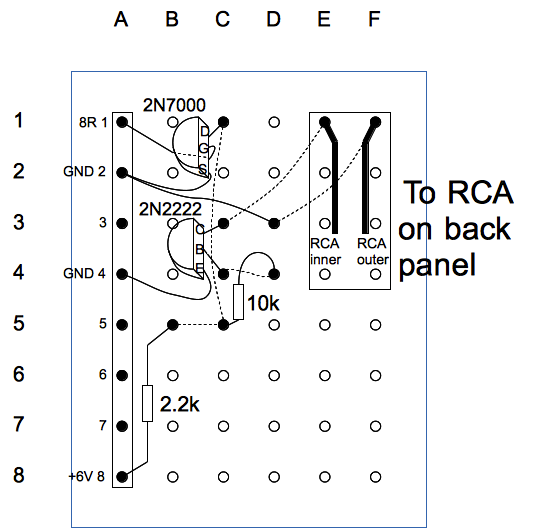

The dotted lines show connections running under the board (except the gate lead of the 2N7000 JFET — that runs under the transistor, but along the top of the board).

I built the circuit in the following sequence:

1. put the 8 pin male header under the board on the left side, and solder one leg of the 2.2k resistor to the pin sticking out the top of the board at position A8. This then holds the header in place. The other leg on the 2.2k resistor goes through hole B5.

2. Sit the 10k resistor sitting up on end in hole C5, bend over the top leg and stick it through hole D4. Bend the legs underneath the board to hold the resistor in place.

3. Put a piece of hookup wire (eg. a component lead off-cut from when you built your K2) through hole D3. On the top of the board, bend the wire so it reaches the header pin 2 sticking through hole A2 and solder it to that pin.

4. Mount the right-angle molex receptor on top of the board through holes E1 and F1. Under the board, bend the hookup wire you installed in the previous step so it reaches the receptor pin sticking through hole F1, and solder to the receptor pin and trim. This will hold the receptor in place.

3. The Gate and Source legs of the 2N7000 JFET are the left two legs, if you hold the transistor with the flat face towards you. Bend those two legs backwards, and put the remaining leg (the Drain) in hole C1. Bend the Drain leg under the board down towards the resistors to hold the transistor in place.

4. Solder the Source leg (the left one you bent back) to the header pin 2, which sticks out of hole A2, and trim. Careful not to dislodge the hookup wire that is also soldered to that pin. Trim both the transistor lead and the hookup wire.

5. Solder the Gate leg (the middle one you bent back) to the header pin 1, which sticks out of hole A1, and trim.

6. The drain of the JFET which goes down through hole C1, and the resistor legs sticking through holes B5 and C5 should be bent so they all meet up. Solder the three leads together and trim.

7. The Emitter leg of the 2N2222 BJT is the left-most leg, if you hold the transistor with the flat face towards you. Bend that leg backwards, and put the middle leg (Base) through hole C4 and the right most leg (Collector) through hole C3. Solder the Emitter leg that was bent back to the header pin 4 sticking up through hole A4.

8. Bend the Collector leg sticking through hole C3 so it reaches the molex receptor pin sticking through hole E1 under the board, and solder the leg to the receptor pin.

9. Bend the Base leg sticking through hole C4 so under the board it meets the 10k resistor leg sticking through hole D4, solder the two legs together and trim.

10. Make up a short cable (3″ or 4″) with the molex plug on one end. Solder the side of the cable that connects to the pin closest to the side of the board, going through hole F1,  to the ground lug on the RCA connector.

11. Install the RCA connector in the hole on the bottom chassis labelled “XVTR IN”. Solder the other side of the molex plug cable to the inner conductor of the RCA connector.

12. Plus the keying circuit board into the J13 header socket on the RF board. Connect the molex plug to the molex receptor on the keying circuit board.

And that’s it. Plug one end of the RCA-RCA cable into the new RCA connector on the back on your K2, and plug the other end of the cable into the “PA KEY” RCA socket on the back of the KXPA100. Connect up a patch cord between the K2 ANT OUT and the KXPA100 RF IN, and you are good to go.

Here are some pics of the completed circuit, from above and from beneath.

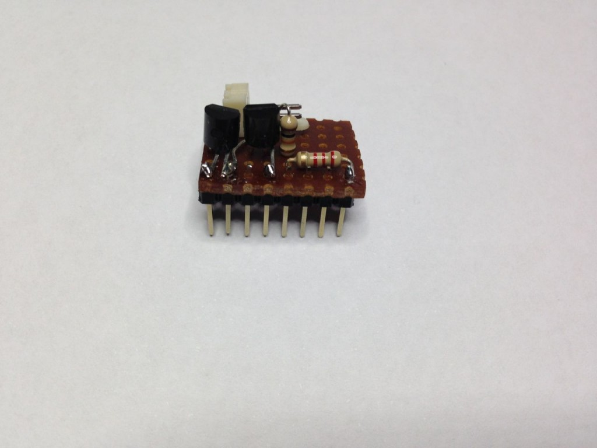

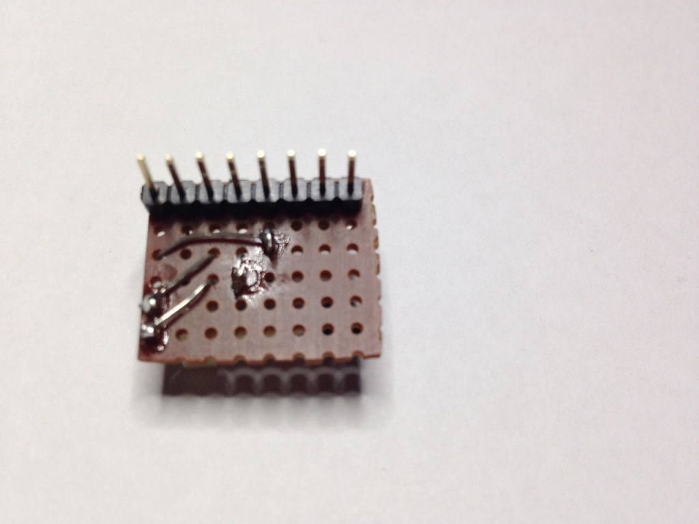

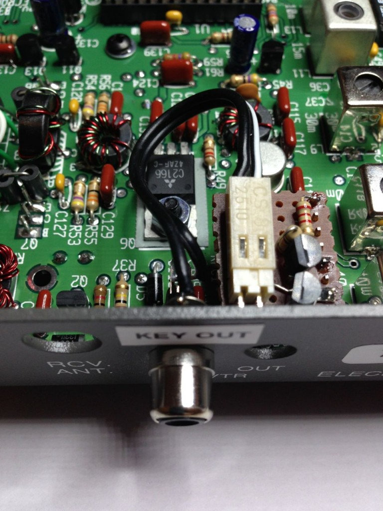

**** DONE Ŝlosada cirkvito por la Elecraft K2 amplifilo :HamRadio:Lingvoj:Esperanto:
:PROPERTIES:
:EXPORT_HUGO_WEIGHT: 4001
:CUSTOM_ID: elecraft-k2-amplifier-keying-circuit-eo
:EXPORT_FILE_NAME: index.eo.md
:EXPORT_HUGO_BUNDLE: 20140420_elecraft-k2-amplifier-keying-circuit
:EXPORT_DATE: 2014-04-20
:EXPORT_DESCRIPTION: 20141420-IMG_0118-Version-2-768x1024-1.jpg
:END:

Mi konstruis [[http://www.elecraft.com/k2_page.htm][radiokonstruilaron Elecraft K2]], kaj mi finis la konstruadon la pasintan Paskofinsemajnon.

Kiam mi mendis la konstruilaron, mi nemendis la enan ATU nek la opcion de 100 W amplifilo, ĉar mi jam havas [[http://www.elecraft.com/KXPA100/kxpa100.htm][amplifilon Elecraft KXPA100 kun ATU KXAT100]]. Tamen tiu amplifilo estas dezajnita por funkcii kun la radio [[http://www.elecraft.com/KX3/kx3.htm][KX3]], kaj do por ke ĝi funkcias kun la K2, mi bezonus konstrui ŝlosadan cirkviton.

Bonŝance, Elecraft publikigis en sia retejo [[http://www.elecraft.com/Apps/Amp_keying_ckt.htm][elegantan solvon]] por tio. Ĝi konsistas el kelkaj transistoroj montitaj sur prova panelo, kiu enŝoviĝas en PCB-soketon de pinlorango destinitan por la interfaca modulo de la transporter de la K2. Ĉar mi ne havas tiun opcion, mia radio ne havis la bezonatan kablansoketon, sed bonŝance la loka elektronika butiko vendas taŭgajn pinlorangojn kiel parton de ilia Arduino-a rango. Mi aĉetis unu el tiuj pinlorangoj, kune kun la aliaj bezonataj partoj.

La artikolo en la retejo de Elecraft provizas skemon kaj kelkajn fotojn de la finita panelo, sed ili ne provizis detalan informon pri kiel konstrui la cirkviton sur la prova panelo. Bonŝance, la cirkvito estas sufiĉe simpla kaj ne tre malfacile eltrovebla, sed mi decidis desegni diagramon, kiu donas pli bonan vidon pri kiel la komponentoj estas aranĝitaj kaj kiel la fizikaj konektoj estas faritaj.

La punktitaj linioj montras konektojn irantajn sub la panelo (krom la pordo-kruro de la 2N7000 JFET — tiu iras sub la transistoro, sed laŭ la supro de la panelo).

Mi konstruis la cirkviton laŭ la sekvanta ordo:

1. Metu la 8-pingan virinan pinlorangon sub la panelon ĉe la maldekstra flanko, kaj litu unu kruron de la 2,2 kΩ rezistilo al la pinglo elstaranta supren el la panelo ĉe pozicio A8. Tio tenas la pinlorangon enplace. La alia kruro de la 2,2 kΩ rezistilo iras tra truon B5.

2. Metu la 10 kΩ rezistilon starantan verticale en truon C5, fleksu la supran kruron kaj trapiku ĝin tra truon D4. Fleksu la krurojn sub la panelon por teni la rezistilon enplace.

3. Enmetu pecon de konekta drato (ekz. fortranĉitan komponentan kruron el via konstruado de la K2) tra truon D3. Supre de la panelo fleksu la draton tiel, ke ĝi atingu la pinglon 2 de la pinlorango elstarantan tra truon A2, kaj litu ĝin al tiu pinglo.

4. Montu la dekstra-angulan Molex-ingon supren sur la panelon tra truoj E1 kaj F1. Sub la panelo fleksu la konektan draton, kiun vi enmetis en la antaŭa paŝo, tiel ke ĝi atingu la pinglon de la ingo elstarantan tra truon F1, kaj litu ĝin al la inga pinglo kaj tondu. Tio tenos la ingon enplace.

3. La pordo- kaj fontokruroj de la 2N7000 JFET estas la du maldekstraj kruroj, se vi tenas la transistoron kun la plata flanko al vi. Fleksu tiujn du krurojn malantaŭen, kaj metu la restan kruron (la drenon) en truon C1. Fleksu la drenan kruron sub la panelon malsupren al la rezistiloj por teni la transistoron enplace.

4. Litu la fontokruron (la maldekstran, kiun vi fleksis malantaŭen) al la pinglo 2 de la pinlorango, kiu elstaras el truo A2, kaj tondu. Atentu, ke vi ne ŝovu la konektan draton, kiu ankaŭ estas lita al tiu pinglo. Tondu kaj la transistoran kruron kaj la konektan draton.

5. Litu la pordokruron (la mezan, kiun vi fleksis malantaŭen) al la pinglo 1 de la pinlorango, kiu elstaras el truo A1, kaj tondu.

6. La drenon de la JFET, kiu iras malsupren tra truon C1, kaj la rezistilkrurojn elstarantajn tra truoj B5 kaj C5, oni devas fleksi tiel, ke ili ĉiuj renkontiĝu. Litu la tri krurojn kune kaj tondu.

7. La emiterkruro de la 2N2222 BJT estas la plej maldekstra kruro, se vi tenas la transistoron kun la plata flanko al vi. Fleksu tiun kruron malantaŭen, kaj metu la mezan kruron (la bazan) tra truon C4 kaj la plej dekstran kruron (la kolektoron) tra truon C3. Litu la emiteran kruron, kiun vi fleksis malantaŭen, al la pinglo 4 de la pinlorango elstaranta tra truon A4.

8. Fleksu la kolektoran kruron elstarantan tra truon C3 tiel, ke ĝi atingu sub la panelon la pinglon de la Molex-ingo elstarantan tra truon E1, kaj litu la kruron al la inga pinglo.

9. Fleksu la bazan kruron elstarantan tra truon C4 tiel, ke sub la panelo ĝi renkontu la kruron de la 10 kΩ rezistilo elstarantan tra truon D4, litu la du krurojn kune kaj tondu.

10. Faru mallongan kablon (3" aŭ 4") kun la Molex-ŝtopilo sur unu fino. Litu la flankon de la kablo, kiu konektiĝas al la pinglo plej proksima al la flanko de la panelo, iranta tra truon F1, al la masa konektilo de la RCA-konektilo.

11. Instalu la RCA-konektilon en la truon sur la malsupra ĉasio markita "XVTR IN". Litu la outran flankon de la Molex-ŝtopila kablo al la interna konduktilo de la RCA-konektilo.

12. Enŝovu la ŝlosadan cirkvitpanelon en la soketon J13 sur la RF-panelo. Konektu la Molex-ŝtopilon al la Molex-ingo sur la ŝlosada cirkvitpanelo.

Kaj jen. Enŝovu unu finon de la RCA-RCA kablo en la novan RCA-konektilon ĉe la malantaŭo de via K2, kaj enŝovu la alian finon de la kablo en la RCA-soketon "PA KEY" ĉe la malantaŭo de la KXPA100. Konektu konektan kablon inter la ANT OUT de la K2 kaj la RF IN de la KXPA100, kaj vi estas preta.

Jen kelkaj fotoj de la finita cirkvito, de supre kaj de malsupre.

*** Beverage Antennas
**** DONE Beverage Antennas :HamRadio:
:PROPERTIES:
:EXPORT_HUGO_WEIGHT: 4001
:CUSTOM_ID: beverage-antennas
:EXPORT_FILE_NAME: index
:EXPORT_HUGO_BUNDLE: 20140414_beverage-antennas
:EXPORT_DATE: 2014-04-14
:END:

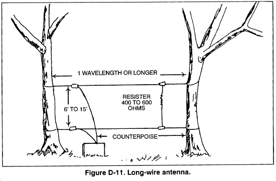

At my local radio club, one of the members likes to hop on the 80 metre band with his morse code key. We were discussing what might be some good topics for upcoming lectures, and he mentioned that he was curious about beverage antennas.

I didn’t know anthing about this topic, so I thought it would be great to go away, do some research and learn about them so I could deliver a lecture. It seems indeed that beverage antennas are a great option for receiving signals on the low bands, but they do require a huge amount of space, and are less well suited at a transmissing antenna.

The lecture was recorded and can be found on the club’s YouTube channel:

#+hugo: 

The [[https://www.slideshare.net/VK2MB/april-2014-lecture-beverage-antennas][slidepack]] is available on slideshare.

**** DONE Beverage-antenoj :HamRadio:Lingvoj:Esperanto:
:PROPERTIES:
:EXPORT_HUGO_WEIGHT: 4001
:CUSTOM_ID: beverage-antennas-eo
:EXPORT_FILE_NAME: index.eo.md
:EXPORT_HUGO_BUNDLE: 20140414_beverage-antennas
:EXPORT_DATE: 2014-04-14
:END:

En mia loka radio-klubo, unu el la membroj ŝatas iri sur la 80-metran bandon per sia Morse-klako. Ni diskutis pri bonaj temoj por venontaj prelegoj, kaj li menciis, ke lin kuriozas Beverage-antenoj.

Mi nenion sciis pri tiu temo, do mi pensis, ke estus bonege foriri, fari iom da esploro kaj lerni pri ili, por ke mi povu prelegi pri ili. Ŝajnas, ke Beverage-antenoj ja estas bonega opcio por ricevi signalojn sur la malaltaj bandoj, sed ili postulas grandegan spacon kaj malpli taŭgas kiel senda anteno.

La prelego estis registrita kaj troviĝas en la YouTube-kanalo de la klubo:

#+hugo: 

La [[https://www.slideshare.net/VK2MB/april-2014-lecture-beverage-antennas][glitaro]] haveblas ĉe Slideshare.

** Operating Portable from Long Reef
*** DONE Operating Portable from Long Reef :HamRadio:Elecraft:KX3:
:PROPERTIES:
:EXPORT_HUGO_WEIGHT: 4001
:CUSTOM_ID: kx3-portable-long-reef
:EXPORT_FILE_NAME: index
:EXPORT_HUGO_BUNDLE: 20121002_kx3-portable-long-reef
:EXPORT_DATE: 2012-10-02
:EXPORT_DESCRIPTION: 20121002_IMG_02522-1024x768.jpg
:END:

Having had my Elecraft KX3 ultra-portable radio for a few months now, I felt it was high time to take it out into the field. In particular I was curious to see how it would perform with my Alexloop magnetic loop antenna. This antenna covers 40m-10m, and while it clearly isn’t going to compete against a dipole, it is very quick and easy to set up, and should normally give reasonable performance on the higher bands at least.

It was a beautiful sunny Saturday afternoon, and the first order of business was to decide on an operating location. For this, I met up with club members Dom VK2JNA, Chris VK2HX and Roger VK2GHB at the local coffee shop to strategise over a cup of coffee, and with some further input from Greg Vk2XE via the 2m repeater, we finally settled on the headland at Long Reef.

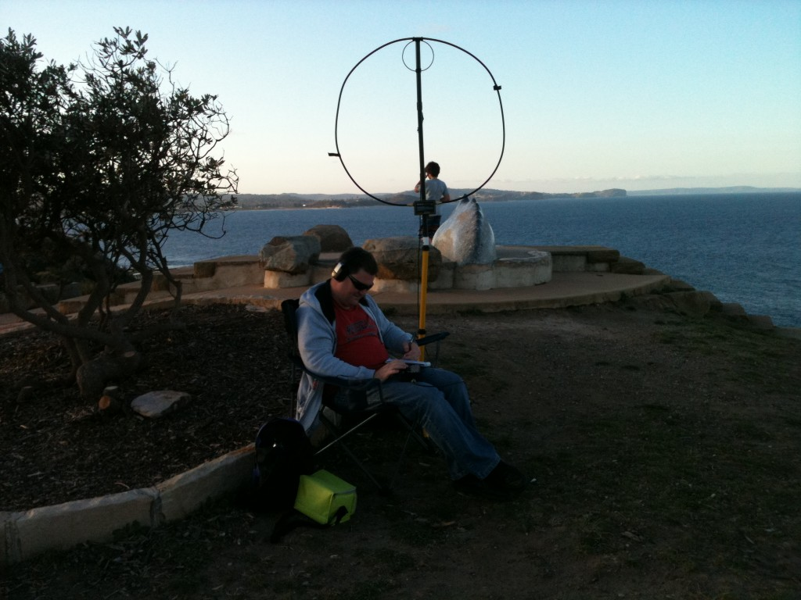

My equipment consisted of the Alexloop, the KX3 with built-in CW paddle, a set of headphones with a boom mike, and an external 7Ah gel-cell battery. While the KX3 can run off 8 internal AA-size cells, this limits the power output to 3-5W, and so I decided to take the external gel-cell in order to run the full 10-12W.

My first contact was to ZL2MS on 20m CW, who had just finished working F5TZN in France. The French station was quite strong, but there were quite a few other stations calling, and unfortunately I didn’t manage a contact. Tuning around the bands, I heard a number of other DX stations, including TG9AJR in Guatemala, HP1RCP club station in Panama, and LA8SGA in Norway.

I thought I’d then try a bit a SSB, but the wind noise in the microphone was quite bad, so in the end I decided to stick with CW. I put out a number of CQ calls, but didn’t get any takers. Later when I checked the reverse beacon net on the Internet, I did find that I had been heard by a station in Finland.

As I was tuning around the bands, a number of people at Long Reef walked up to me and asked me what I was doing, so I explained what ham radio was all about. It turned out that the father of one of the onlookers used to be a ham over in the Netherlands, and so we had a nice long chat about his dad.

It was a beautiful spot, and a really nice atmosphere. Even though I didn’t make so many contacts this time, it was a very enjoyable way to spend a lazy Saturday afternoon, and I’m looking forward to finding an opportunity to do it again.

** CSQ Summary
*** DONE CSQ Summary :HamRadio:
:PROPERTIES:
:EXPORT_HUGO_WEIGHT: 4001
:CUSTOM_ID: csq-summary
:EXPORT_FILE_NAME: index
:EXPORT_HUGO_BUNDLE: 20130312_csq-summary
:EXPORT_DATE: 2013-03-12
:END:

**** CSQ Summary
The following is a proposal from Bruce Prior N7RR for a signal reporting system based on [[http://antrak.org.tr/index.php?option=com_content&task=view&id=378&Itemid=83][Copyability-Strength-Quality (CSQ)]], and as an alternative to the traditional Readability-Strength-Tone (RST) system.

***** C or Copyability

| Copyability | Description                                       |
| N           | no recoverable signal $^{*}$                      |
| 0           | discernable but not copyable $^{*}$               |
| 1-9         | 10% to 90% copy                                   |
| G           | Good 100% copy, but short of perfect              |
| P           | Perfect armchair 100% copy or full quieting on FM |

$^{*}$ For Copyability reports of N and 0, no Signal Strength or Quality reports are needed.

***** S-Meter or Signal Strength

| Strength | Description             |
| 0        | no S-meter reading      |
| 1-9      | S-1 to S-9              |
| A        | 1 dB to 10 dB over S-9  |
| B        | 11 dB to 20 dB over S-9 |
| C        | 21 dB to 30 dB over S-9 |
| D        | 31 dB to 40 dB over S-9 |
| E        | 41 dB to 50 dB over S-9 |
| F        | 51 dB or more over S-9  |

***** Quality

| Quality | Description                                                              |
| X       | characteristic steadiness of crystal (Xtal) control or eXcellent quality |
| R       | AC Ripple or buzz in transmission                                        |
| C       | Chirp or tail on make and/or break                                       |
| K       | key clicKs or other Keying transients                                    |
| O       | Overmodulation or Overdeviation in phone or digital modes                |

***** Examples

| Report | Description                                                                        |
| P6O    | for a PSK-31 signal: perfect 100 % copy at S-6, but overdeviated                   |
| 93X    | for a CW signal: 90 % copy at S-3 with excellent quality                           |
| G7O    | for an SSB signal: Good but less than perfect 100 % copy at S-7, but overmodulated |
| PAX    | for an RTTY signal: perfect 100 % copy about 10 dB over S-9 with excellent quality |
| P6X    | for an FM signal: full-quieting 100 % copy at S-6 with excellent quality           |

**** RST Summary

For comparison with the proposed CSQ system, here are the definitions for the traditional RST system.o

***** R or Readability

| Readability | Description                                       |
|           1 | Unreadable                                        |
|           2 | Barely readable, occasional words distinguishable |
|           3 | Readable with considerable difficulty             |
|           4 | Readable with practically no difficulty           |
|           5 | Perfectly readable                                |

***** Strength

| Strength | Description                      | HF Signal | V/UHF Signal |
|        1 | Faint signal, barely perceptible | -121 dBm  | -141 dBm     |
|        2 | Very weak                        | -115 dBm  | -135 dBm     |
|        3 | Weak                             | -109 dBm  | -129 dBm     |
|        4 | Fair                             | -103 dBm  | -123 dBm     |
|        5 | Fairly good                      | -97 dBm   | -117 dBm     |
|        6 | Good                             | -91 dBm   | -111 dBm     |
|        7 | Moderately strong                | -85 dBm   | -105 dBm     |
|        8 | Strong                           | -79 dBm   | -99 dBm      |
|        9 | Very strong signals              | -73 dBm   | -93 dBm      |

***** Tone

| Tone | Description                                                |
|    1 | Fifty cycle a.c or less, very rough and broad              |
|    2 | Very rough a.c., very harsh and broad                      |
|    3 | Rough a.c. tone, rectified but not filtered                |
|    4 | Rough note, some trace of filtering                        |
|    5 | Filtered rectified a.c. but strongly ripple-modulated      |
|    6 | Filtered tone, definite trace of ripple modulation         |
|    7 | Near pure tone, trace of ripple modulation                 |
|    8 | Near perfect tone, slight trace of modulation              |
|    9 | Perfect tone, no trace of ripple or modulation of any kind |

The following letters can be optionally suffixed:

| Suffix | Description                           |
| X      | stable frequency (crystal control)    |
| C      | "chirp" (frequency shift when keying) |
| K      | key clicks                            |

**** RSQ Summary

For digital work, the Readability-Strength-Quality signal reporting system is sometimes used.

***** R or Readability

| Readability | Description                                                  |
|           1 | 0 % copy - undecipherable                                    |
|           2 | 20 % copy -occasional words distinguishable                  |
|           3 | 40 % copy - readable with difficulty, many missed characters |
|           4 | 80 % copy - Readable with no difficulty                      |
|           5 | 95 % + copy - Perfectly readable                             |

***** Strength

| Strength | Description              |
|        1 | barely perceptible trace |
|        3 | Weak trace               |
|        5 | Moderate trace           |
|        7 | Strong trace             |
|        9 | Very strong trace        |

***** Quality

| Quality | Description                                 |
|       1 | splatter over much of the spectrum          |
|       3 | multiple visible pairs                      |
|       5 | One easily visible pair                     |
|       7 | One barely visible pair                     |
|       9 | Clean signal - no visible unwanted sidebars |

** Packet Radio Talk
*** Packet Radio Talk :HamRadio:PacketRadio:AX25:
:PROPERTIES:
:EXPORT_HUGO_WEIGHT: 4001
:CUSTOM_ID: packet_radio_talk
:EXPORT_FILE_NAME: index
:EXPORT_HUGO_BUNDLE: 20140219_packet_radio_talk
:EXPORT_DATE: 2014-02-19
:EXPORT_DESCRIPTION: 20140219_packet-radio-chat.png
:END:

At my local amateur radio club I gave a talk about packet radio, covering topics such as AX25 frames, digipeaters, netrom nodes, and applications that run over packet radio such as APRS and BBS. On YouTube you can find a [[http://www.youtube.com/watch?v=Ar0dEiwu6KE][recording of the talk]].

The slides from the talk can be found here:

#+hugo: 

** Org Mode Beamer Presentations
*** DONE Org Mode Beamer Presentations :Emacs:OrgMode:LaTeX:Teaching:Beamer:
:PROPERTIES:
:EXPORT_HUGO_WEIGHT: 4001
:CUSTOM_ID: org-mode-beamer
:EXPORT_FILE_NAME: index
:EXPORT_HUGO_BUNDLE: 20250220_org-mode-beamer
:EXPORT_DATE: 2025-02-20
:END:
Earlier I talked about [[#orgmode-lesson-notes][using Org Mode to produce lesson worksheets]] for my students. This year I am thinking about using powerpoint-style presentation slides instead of worksheets to encourage students to write more in their books. This naturally led me to look into how to do this with Org Mode.

**** A Simple Lesson
Making presentations in $\LaTeX$ is normally done using the =beamer= package. It turns out that Org Mode has good support for beamer. An example of a simple lesson presentation org-mode file might look like this:

#+begin_src org
,#+title: Adding Terms
,#+subtitle: Algebraic Techniques
,#+author: Mr Maguire
,#+startup: beamer
,#+options: H:1 toc:nil
,#+latex_class: beamer
,#+latex_class_options: [bigger]
,#+columns: %45ITEM %10BEAMER_env(Env) %10BEAMER_act(Act) %4BEAMER_col(Col) %8BEAMER_opt(Opt)
,#+beamer_theme: SimplePlus
,#+LATEX_HEADER: \usepackage{tasks}

,* DO NOW
1. Identify the like terms:
   \[ 4ab^2, 4ab, 2a^2b^2, 3b^2a \]
   \vskip+5ex
2. Which is the constant term?
   | 3x | 4x^2 | 5x^0 | x |

,* Adding Terms
To add terms:
- make sure the two terms are *like* terms
- add the coefficients

,** Careful! :B_block:
Don't forget to take any minus signs into account!

,* Practice
Simplify the following espressions
\begin{tasks}[after-item-skip=8ex](2)
\task $2x+3x$
\task $3a+5b+6a$
\task $a+b+2b+a$
\task $a^{2}+2ab-2ba+b^{2}$
\task* $a+2a-3a+4a-5a+6a-7a+8a-9a+10a$
\end{tasks}

,* :B_ignoreheading:
,#+begin_center
*What's $2n$ plus $2n$?*
\vskip+2ex
I don't know, it sounds $4n$ to me...
,#+end_center

#+end_src

To export the org mode code to a PDF, we need to use a special export command to let org-mode know to make a beamer presentation rather than a normal $\LaTeX$ document. On my system, the export process is bound to =C-c C-e l O= which will:
- translate the org mode to a $\LaTeX$ =*.tex= file
- produce a PDF file from the $\LaTeX$ file
- open the PDF file in Emacs (I have pdftools installed in my Emacs config)

If I want to generate the PDF file without opening it (for example, if I already have the PDF file open in another window) then I use the key sequence =C-c C-e l P=.

This will then produce a PDF file that looks like this:

#+hugo: 

**** Preamble
So, let's break down the contents of the preamble in the org mode file:
- The =#+title:=, =#+subtitle:=, =#+author:= and optionally =#+date:= are self-explanatory and are used to generate the title slide.
- The =#+startup: beamer= line tells Emacs that this is a beamer org-mode file and that it should enable the special org mode beamer minor mode for syntax highlighting, etc.
- The =#+options: H:1 toc:nil= line tells org mode that I don't want a table of contents slide, and that each level 1 heading in the org file should represent a new slide. If I put =H:2= instead, then level 1 headings would represent sections with a section heading slide, and the level 2 headings would be the actual content slides. I want to minimise that extra fluff for my students so that we can focus purely on content, and this is why I use =H:1=
- The =#+latex_class: beamer= line uses the predefined Org Mode beamer class, and the =#+latex_class_options: [bigger]= sets a larger font size to help students make out the slides more clearly. Font size can be overridden for a particular slide using the =\fontsize{}{}= command at the start of that slide's content.
- The =#+columns:= line enables a cool "column mode feature" in Emacs Org Mode. I don't want to discuss it here, but you can read mode about this in the [[https://orgmode.org/manual/Column-View.html][Org Mode manual]].
- The =#+beamer_theme:= line sets the "look and feel" of the slides. I use a fairly simple theme to minimise cognitive load for the students. You can find other themes on the internet, such as at [[https://latex-beamer.com/tutorials/beamer-themes/][this site]].
- You can then include any packages you might want to use with lines like =#+latex_header: \usepackage{}=. You can see I use the =tasks= package, which lets you easily format multi-column lists of problems like I did with the =exesheets= package in the [[#orgmode-lesson-notes][org mode lesson notes]] post.
**** Content
Now that we have set up the environment, we can start making some slides!
1. The first slide I have is a "DO NOW" starter activity. The text in the level 1 heading becomes the title at the top of the slide. In the example, I have a simple enumerated list. You can see we can include maths notiation using the normal ="$ ... $"= and ="\[ ... \]"= markers. Sometimes it is better to use ="\( ... \)"= delimiters for inline maths expressions, as the dollar signs can be confused with currency symbols. If you want to write dollar signs in an expression, you can use a =\dollar= or =\USD= command.
2. The second slide shows a bullet list. You can also use standard org-mode markup for *bold text*, /italics/, etc.. It also includes a highlighted text box, which you can create using a subheading marked with a =:B_block:= tag.
3. The third slide makes use of the =tasks= package. The org mode beamer export filter doesn't work well with that package, so I find the easiest thing is to simply use $\LaTeX$ code. You can then easily specify separation between the items with =after-item-skip= and how many columns of questions we want. Each question is introduced with a =\task= command, and if you want a longer question to span all the columns we can use =\task*= with an asterisk.
4. The last slide shows how we can create a slide with no title. You can also use a $\LaTeX$ environment such as =\begin{center} ... \end{center}= using the =#+begin_center ... #+end_center= directives. If we want to create some white space where we can write answers or annotate a solution, we can use a command like =\vskip+2ex= to create that vertical space.

**** Further Reading
This is a very quick introduction. If you want to learn more, I suggest you look at:
- A org mode beamer [[https://orgmode.org/worg/exporters/beamer/tutorial.html][tutorial]] which was the main basis of the simple example I provided here.
- The org mode beamer [[https://orgmode.org/manual/Beamer-Export.html][user manual]]
